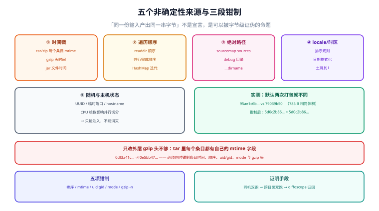

# 可复现构建：把「同一份输入」变成字节级可证

**可复现构建（reproducible build）** 的定义很短：**给定同一份源码、同一套工具链、同一份构建指令，任何人都能构建出逐字节相同的产物**。它的价值不在「省时间」，而在「让缓存可被验证」——没有它，缓存里那份产物是对是错永远只能靠祈祷。

本页先给「非确定性」的五个来源，然后用本机实测说明**一个 20 文件的目录，两次 `tar czf` 的字节就不一样**，以及钳制之后为什么能一致、以及只钳制一半为什么还是不一致。最后给出 Java / Node / Go / 容器四套生态的配方。



本页判据族 `BCP-A` ~ `BCP-H`，共 8 条，定义在最后一节。

## 一、五个非确定性来源

| # | 来源 | 具体表现 | 钳制手段 |
| --- | --- | --- | --- |
| 1 | **时间戳** | `tar`/`zip` 里每个条目的 mtime、`gzip` 头里的时间、`jar` 里的文件时间 | `SOURCE_DATE_EPOCH`、`tar --mtime`、`gzip -n`、`isPreserveFileTimestamps = false` |
| 2 | **遍历顺序** | 目录 `readdir` 顺序、并行任务的完成顺序、`HashMap` 迭代顺序 | 排序后写入；用有序容器；固定并行度 |
| 3 | **绝对路径** | sourcemap 的 `sources`、debug 信息里的编译目录、脚本里的 `__dirname` | 相对化、`-trimpath`、`<root>` 占位 |
| 4 | **locale / 时区** | 按 locale 排序、日期格式化、大小写转换（土耳其语 `i`） | 固定 `LC_ALL=C`、`TZ=UTC` |
| 5 | **随机与主机状态** | UUID、临时端口、`hostname`、CPU 核数（影响并行切分）、内存（影响优化决策） | 注入种子；把「核数」等写进显式参数 |

五类里只有第 2、3、4 类是**可以完全消灭**的；第 1 类靠「钳制到一个固定时刻」；第 5 类只能「注入」，即把随机源变成参数。

## 二、实测：默认打包为什么每次都不同

实验：把 20 个 `.js` 文件（内容相同、mtime 各差 1 小时）打成一个 `tar.gz`，连做两次，比对 sha256。

| 打包方式 | 第一次 | 第二次 | 结果 |
| --- | --- | --- | --- |
| 默认 `tar czf`（`tarfile.open("w:gz")`） | `95ae1c6b41f0` | `79039b50c3da` | **不同** |
| 排序 + 固定 mtime/uid/gid + `gzip mtime=0` | `5d0c2b86bae0` | `5d0c2b86bae0` | **相同** |
| **只**把外层 gzip 的 mtime 置 0（内层 `w:gz` 仍带真实 mtime） | `0df3a41c165d` | `f0e5bb475380` | **仍然不同** |

两个包大小完全一样（785 字节），差异**只来自头部的时间字段**——这就是「不可复现」最典型的形态：**内容一样、体积一样、哈希不同**。

第三行是这一页最值得记住的：**只改外层 gzip 头是不够的**，因为 `tar` 格式里**每个条目都有自己的 mtime 字段**，`w:gz` 这种「tar 内部再 gzip」的写法会把真实 mtime 写进每个 tar header。要一致，必须**同时**处理：

1. tar 里每个条目的 `mtime`（钳到一个固定值）；
2. tar 里条目的**顺序**（排序）；
3. 条目的 `uid` / `gid` / `uname` / `gname`（置 0 / 空）；
4. 条目的 `mode`（统一 0644，否则会带上运行环境的 umask）；
5. 外层 `gzip` 头的 mtime（`gzip -n` 或 `mtime=0`）。

Python 版的完整写法（本机实测通过）：

```python
import gzip, io, os, tarfile

def pack_reproducible(src, out, epoch=1700000000):
    raw = io.BytesIO()
    with tarfile.open(fileobj=raw, mode="w", format=tarfile.PAX_FORMAT) as tf:
        for name in sorted(os.listdir(src)):          # 1) 排序
            p = os.path.join(src, name)
            ti = tf.gettarinfo(p, arcname="dist/" + name)
            ti.mtime = epoch                          # 2) 固定时间
            ti.uid = ti.gid = 0                       # 3) 所有权
            ti.uname = ti.gname = ""
            ti.mode = 0o644                           # 4) 权限
            with open(p, "rb") as fh:
                tf.addfile(ti, fh)
    buf = io.BytesIO()
    with gzip.GzipFile(fileobj=buf, mode="wb", mtime=0, compresslevel=6) as gz:  # 5) 外层头
        gz.write(raw.getvalue())
    with open(out, "wb") as f:
        f.write(buf.getvalue())
```

对应的命令行版本（GNU tar + gzip）：

```shell
# SOURCE_DATE_EPOCH 由 CI 注入（例如取提交时间），不要用"现在"
export SOURCE_DATE_EPOCH=$(git log -1 --format=%ct)
tar --sort=name \
    --mtime="@${SOURCE_DATE_EPOCH}" \
    --owner=0 --group=0 --numeric-owner \
    --pax-option=exthdr.name=%d/PaxHeaders/%f,delete=atime,delete=ctime \
    -cf - dist | gzip -n -9 > dist.tar.gz
```

`--clamp-mtime` 是另一种选择：它只在文件 mtime **晚于**给定值时钳制，早于的保留。适合「源码文件的 mtime 有语义」（例如想保留提交时间）的场景；但如果目标是「任何机器上都一致」，用 `--mtime` 全量覆盖更稳——因为 `--clamp-mtime` 保留了「早于基准」的那些值，而那些值本身可能因 checkout 方式不同而不同（`git clone` 会给所有文件同一个当前时间，`git archive` 给提交时间）。

## 三、`SOURCE_DATE_EPOCH`：一个约定，不是魔法

规范很短：一个 Unix 时间戳（秒），构建工具在需要「当前时间」时改用它。它之所以有效，是因为**主流工具链都实现了它**：

| 工具/生态 | 支持情况 | 怎么用 |
| --- | --- | --- |
| **GNU tar / gzip** | 不自动读该变量 | 显式 `--mtime` / `-n`（见上） |
| **Java `jar`（Gradle）** | Gradle 提供开关 | `isPreserveFileTimestamps = false`、`isReproducibleFileOrder = true` |
| **Python `wheel` / `setuptools`** | 新版本会读 | 直接 `export SOURCE_DATE_EPOCH` |
| **Go** | 不直接读，但有等价开关 | `-trimpath`、`-buildvcs=false`、固定 `-ldflags` |
| **Docker BuildKit** | 需显式传 | `--build-arg SOURCE_DATE_EPOCH=...` 或 `--rewrite-timestamp` |
| **Debian / RPM 打包链** | 广泛支持 | 直接导出该变量 |

::: danger 三个「设了 SOURCE_DATE_EPOCH 但产物还是不同」的原因
1. **工具没读它**：`tar` / `gzip` 就不会自动读，必须显式传参。设了变量以为万事大吉，是最常见的误解。
2. **并行导致顺序不同**：多线程压缩、并行打包，输出顺序取决于完成顺序。解法是固定并行度或改用「先收集、后排序、再写」。
3. **压缩器版本不同**：`zlib` 的小版本可能改变压缩输出（同一输入、不同压缩流）。跨机器复现要求**压缩器版本也一致**——这也是为什么「可复现」的定义里包含「同一套工具链」。
:::

## 四、四套生态的具体改法

### Java / Gradle

```kotlin [build.gradle.kts]
tasks.withType<Jar>().configureEach {
    isPreserveFileTimestamps = false   // 不写文件时间
    isReproducibleFileOrder = true     // 条目排序
}
```

`jar` 的不可复现主要来自「文件时间 + 条目顺序」这两项，上面两行基本能解决 90% 的问题。剩下的常见来源：`MANIFEST.MF` 里的 `Build-Jdk`、`Created-By`（有些插件会写当前 JDK 版本，跨机器就不同）。

### Node / 前端

| 来源 | 改法 |
| --- | --- |
| 模块 ID 顺序 | 打包器开 `deterministic` / `moduleIds: 'deterministic'`（不同工具名不同） |
| sourcemap 里的绝对路径 | `devtoolModuleFilenameTemplate` 用相对路径；或构建在固定路径下进行 |
| 产物里的 `new Date()` | 用 `SOURCE_DATE_EPOCH` 或提交号替代 |
| 哈希文件名不稳定 | 检查哈希输入是否含时间/路径 |

### Go

```shell
go build -trimpath -buildvcs=false -ldflags="-s -w -buildid=" -o app ./cmd/app
```

- `-trimpath`：去掉源码绝对路径（否则二进制里带着 `/home/xxx/repo`）；
- `-buildid=`：清掉构建 ID（否则每次不同）；
- `-buildvcs=false`：不嵌入 VCS 状态（嵌入了也能复现，但要求 `.git` 状态一致，CI 上常常不一致）。

### 容器镜像

| 手段 | 作用 |
| --- | --- |
| `SOURCE_DATE_EPOCH` 构建参数 | 让镜像里的文件时间固定 |
| BuildKit `--rewrite-timestamp` | 重写层内所有时间戳 |
| 固定基础镜像 digest（`@sha256:`） | 基础层不变，层键才稳定 |
| `COPY` 顺序与 `.dockerignore` | 减少无关文件进入层，减少层键漂移 |

::: warning 一个真实的坑：pin 了 digest 但没 pin 架构
`FROM node:22@sha256:...` 只固定了「那一层的内容」，但多架构镜像的 manifest list 会按平台选不同 digest。跨平台复现必须**同时固定平台**（`--platform=linux/amd64`），否则 CI（amd64）与本地（arm64）拿到的不是同一个基础层。
:::

## 五、怎么证明：三种粒度的验证

| 粒度 | 做法 | 能证明什么 | 成本 |
| --- | --- | --- | --- |
| **同机双跑** | 清缓存，连跑两次，`sha256sum` 比对 | 与时间/随机/顺序无关 | 2× 构建 |
| **跨目录双跑** | 两个不同路径各构建一次 | 与绝对路径无关 | 2× 构建 |
| **跨机器/容器** | 两个干净容器，`diffoscope` 出差异报告 | 与工具链、locale、文件系统无关 | 高，适合 nightly |

`diffoscope` 的价值在于**把「字节不同」翻译成「哪一层、哪个字段不同」**：它能递归解开 tar/zip/jar/wheel/镜像层，指出「`dist/app.js` 内容相同，但 `dist/app.js` 的 mtime 不同」。没有它，你只能看到两个哈希不一样，然后开始猜。

```shell
# 最小验证：同机双跑
pnpm build && find dist -type f -print0 | sort -z | xargs -0 sha256sum > /tmp/r1.txt
pnpm build && find dist -type f -print0 | sort -z | xargs -0 sha256sum > /tmp/r2.txt
diff /tmp/r1.txt /tmp/r2.txt && echo "字节一致"

# 结构差异归因（需安装 diffoscope）
diffoscope --text /tmp/report.txt dist-a.tar.gz dist-b.tar.gz
head -60 /tmp/report.txt
```

**期望结果**：第一条 `diff` 为空。非空时，先看差异文件的**类型**——若是 `.map` / `.js` 且差异在路径上，是第 3 类来源；若是二进制且差异在头几个字节，是时间戳。

## 六、本页判据

| 编号 | 判据 | 不满足时改哪里 |
| --- | --- | --- |
| `BCP-A` | 五个非确定性来源逐条对过，每类的「本仓库是否存在」有书面结论 | 按第一节表逐条试 |
| `BCP-B` | 打包/压缩链路显式钳制了时间与顺序（不只设了环境变量） | 见第二节的五项清单 |
| `BCP-C` | `SOURCE_DATE_EPOCH` 由提交时间注入，不是「当前时间」 | 见第三节 |
| `BCP-D` | 产物里不含构建目录的绝对路径（`grep` 验证） | 见第四节各生态配方 |
| `BCP-E` | locale / 时区在构建环境里被固定（`LC_ALL=C`、`TZ=UTC`） | CI 环境变量 |
| `BCP-F` | 有「同机双跑字节一致」的记录（V1） | 见第五节 |
| `BCP-G` | 有「跨目录双跑一致」的记录（V2）或明确的例外清单 | 见第五节 |
| `BCP-H` | 差异归因工具（`diffoscope` 或等价物）在需要时可用 | 见第五节 |

## 七、验证方式

```shell
# 1) 打包可复现（本页第二节实验，可直接跑）
python lab_cache.py 2>&1 | sed -n '/== 3/,/== 4/p'

# 2) 产物不含绝对路径
grep -rl "$(pwd)" dist 2>/dev/null | head
#    期望：无输出。有输出说明 sourcemap / debug 信息里带了构建目录

# 3) 同机双跑
pnpm build > /dev/null && sha256sum dist/**/* 2>/dev/null | sort > /tmp/h1
pnpm build > /dev/null && sha256sum dist/**/* 2>/dev/null | sort > /tmp/h2
diff /tmp/h1 /tmp/h2 && echo "字节一致"

# 4) 跨目录双跑（验证路径无关）
git clone . /tmp/relocated && (cd /tmp/relocated && pnpm i --frozen-lockfile && pnpm build > /dev/null)
diff <(cd dist && find . -type f | sort | xargs sha256sum) \
     <(cd /tmp/relocated/dist && find . -type f | sort | xargs sha256sum)
```

**期望结果**：第 2 步无输出、第 3/4 步 `diff` 为空。第 4 步在本机常常会失败——它失败得越早，说明「跨机器共享缓存」这条路走得越不踏实。

## 与相邻专题的分工

- 缓存键（为什么不可复现会伪装成「命中率 0」）：[指纹](../CacheKey/index.md)
- 假命中的识别与止血：[正确性](../Correctness/index.md)
- 镜像层与平台差异：[生态对照](../Platforms/index.md)
- 产物签名与溯源（可复现是它的前提）：[依赖与安全治理](../../DependencyGovernance/index.md)

## 参考资料

- reproducible-builds.org：*SOURCE_DATE_EPOCH* 规范、*diffoscope*、*Build Variations* 分类
- Debian Wiki：*ReproducibleBuilds*（`tar --sort=name --mtime` 的出处配方）
- Gradle 官方：*Reproducible Builds*（`isPreserveFileTimestamps` / `isReproducibleFileOrder`）
- Go 官方：`-trimpath`、`-buildvcs`、`-ldflags`
- Docker 官方：BuildKit `--rewrite-timestamp` 与多平台 manifest
