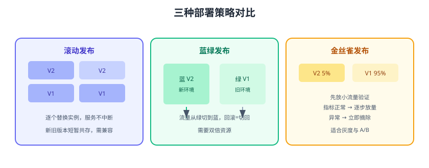
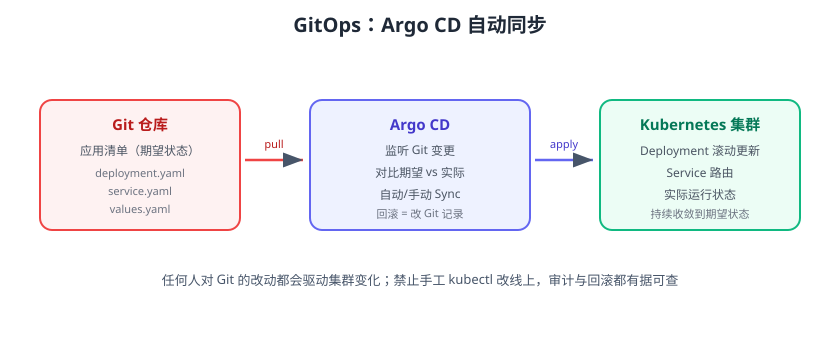

# 自动部署与回滚

部署是把制品安全地送到目标环境的过程。自动部署的核心不是“跑一条脚本”，而是**可验证、可回滚、可观测**。本页覆盖滚动/蓝绿/金丝雀三种发布策略、健康检查与自动回滚、GitOps（Argo CD）部署，以及回滚的完整预案。



## 部署流程总览

```text
制品（不可变 Tag）
  → 部署到 staging → 冒烟测试 → 通过
  → 部署到 prod（策略选择）→ 健康检查
  → 指标观察窗口（10~30 分钟）→ 宣布上线
  → 异常 → 自动/手动回滚
```

## 三种部署策略

| 策略 | 原理 | 停机 | 回滚速度 | 适用 |
| --- | --- | --- | --- | --- |
| 滚动 | 逐个替换实例 | 无 | 慢（逐台回滚） | 大多数应用，默认选择 |
| 蓝绿 | 新环境整体切换 | 无 | 极快（切回旧环境） | 核心应用、数据库兼容要求高 |
| 金丝雀 | 小流量试新版本 | 无 | 快（摘流量） | 高风险变更、灰度、A/B |

### 滚动发布（K8s 默认）

```yaml [deployment.yaml]
spec:
  replicas: 3
  strategy:
    type: RollingUpdate
    rollingUpdate:
      maxUnavailable: 1        # 最多 1 个实例不可用
      maxSurge: 1              # 最多多起 1 个新实例
  template:
    spec:
      containers:
        - name: app
          image: registry.example.com/shop/order-service:1.2.0-45-a1b2c3d
```

```shell
kubectl rollout status deployment/order-service
kubectl rollout history deployment/order-service
kubectl rollout undo deployment/order-service   # 一键回滚
```

### 蓝绿发布

```text
绿（V1，当前）→ 部署蓝（V2）→ 验证 → 切 Service 指向蓝
回滚：把 Service 指回绿
```

```shell
# 切流量（Service selector 从 green 改 blue）
kubectl patch service order-service -p \
  '{"spec":{"selector":{"version":"blue"}}}'

# 回滚
kubectl patch service order-service -p \
  '{"spec":{"selector":{"version":"green"}}}'
```

### 金丝雀发布

```shell
# 创建金丝雀 Deployment（副本 1，版本 V2）
kubectl create deployment order-canary --image=...:V2 --replicas=1

# 用 Service + 权重（或 Nginx/Argo Rollouts）按 5%:95% 分流
```

金丝雀观察指标正常后逐步放大流量，异常立即摘除 V2。

## 健康检查与自动回滚

### 就绪探针

```yaml
spec:
  template:
    spec:
      containers:
        - name: app
          readinessProbe:
            httpGet:
              path: /actuator/health
              port: 8080
            initialDelaySeconds: 5
            periodSeconds: 10
          livenessProbe:
            httpGet:
              path: /actuator/health
              port: 8080
            initialDelaySeconds: 30
            periodSeconds: 15
```

### 流水线健康检查

```shell
# 部署后轮询健康接口，失败即回滚
for i in $(seq 1 30); do
  if curl -sf http://localhost:8080/actuator/health | grep -q '"UP"'; then
    echo "健康检查通过"
    exit 0
  fi
  sleep 5
done
echo "健康检查失败，触发回滚"
exit 1
```

## GitOps：Argo CD

GitOps 把 **Git 仓库当作部署的唯一事实来源**：应用清单（Deployment/Service）提交到 Git，Argo CD 监听变更并自动把集群收敛到期望状态。回滚 = 改回 Git 里的旧版本。本节是快速上手；从安装、Project 边界、仓库设计、密钥到回滚演练的**完整专题**见 [GitOps：声明式持续交付](../../../Ops/ContainerOrchestration/GitOps/index.md)。



### 安装与接入

```shell
kubectl create namespace argocd
kubectl apply -n argocd -f https://raw.githubusercontent.com/argoproj/argo-cd/v3.5.0/manifests/install.yaml
kubectl -n argocd get secret argocd-initial-admin-secret \
  -o jsonpath="{.data.password}" | base64 -d
```

### 创建 Application

```yaml [app.yaml]
apiVersion: argoproj.io/v1alpha1
kind: Application
metadata:
  name: order-service
  namespace: argocd
spec:
  destination:
    server: https://kubernetes.default.svc
    namespace: shop
  project: default
  source:
    repoURL: https://git.example.com/shop/order-service-config.git
    path: overlays/prod
    targetRevision: main
  syncPolicy:
    automated:
      prune: true
      selfHeal: true
```

```shell
kubectl apply -f app.yaml
argocd app sync order-service
argocd app get order-service
```

发布流程变为：

```text
改 Git 镜像 Tag → MR 合并 → Argo CD 检测到差异 → 自动/手动同步 → 集群更新
```

## 回滚预案

::: danger 回滚前三问
1. **数据兼容吗**：新版本改了表结构/缓存格式，回滚到旧代码可能读不了新数据；先评估是否需要“向前兼容”设计。
2. **回滚后健康吗**：旧版本能正常启动并连上当前数据库吗？
3. **回滚谁执行**：谁有权限、多久内完成、要不要审批？
:::

### 「不可回滚点」：先判回不回得去，再判该不该回

上面前两问合起来决定一件事——**这次变更是否已经越过不可回滚点**。判定方法只有一条问题：

> **这次发布之后，把应用切回上一个版本，数据库还能不能正常服务上一个版本？**

| 变更类型 | 可回滚性 | 说明 |
| --- | --- | --- |
| 加列 / 加表 / 加索引 | ✅ 可回滚 | 旧代码忽略新列照常工作 |
| 加非空约束（带默认值） | ⚠️ 谨慎 | 旧版本能跑，但新版本写入的行可能不满足旧代码的假设 |
| 改列类型 / 重命名列 | ❌ 视为不可回滚 | 新代码写的数据旧代码读不懂，回滚后出现「读不出来的行」 |
| 删列 / 删表 / 清数据 | ❌ **不可回滚** | 数据已经没了；只能靠备份，且会丢恢复点后的写入 |

越过不可回滚点时，正确做法有两条：**把删改拆到下一次发布**（本次只做「加」），或者**把预案从「回滚」改写为「前滚」**——一旦出错只能用更快的修复顶上去，没有退路。**准备了一份在关键时刻无效的回滚预案，比没有预案更危险。**

### 回滚之后还欠两件事

回滚不是终点，这两步最常被省掉：

| 动作 | 为什么必要 |
| --- | --- |
| **回滚后重新跑冒烟** | 回滚换的是镜像，但**缓存、连接池、会话、迁移历史表都没变**——回滚后的系统是一个新老混合的中间状态，必须重新验证。「回滚完就好了」是错觉 |
| **补 revert 并重走发布流程** | 回滚把**线上**退回了旧版本，但**仓库里的代码还是新版本**。不补 revert，下一次发布会把同一个问题原样带回来，而且因为「上次回滚过」，它看起来像偶发 |

| 场景 | 回滚动作 |
| --- | --- |
| K8s 滚动发布 | `kubectl rollout undo deployment/xxx` |
| 蓝绿 | Service 切回旧环境 |
| 金丝雀 | 摘掉金丝雀流量/删除 Canary |
| Argo CD | Git 回退旧 Tag 并 sync |
| 数据库变更 | 迁移脚本反向执行（downgrade）或备份恢复 |
| 前端 | CDN 回滚到上一版 dist/或旧静态资源 |

::: info 与本库项目章节的分工
本页讲**通用策略**（三种发布方式、健康检查、GitOps、回滚手段的对照），与具体项目无关。

一个真实项目的**发布动作编排**（发布窗口怎么选、迁移与应用的先后、观察窗口看哪四项、什么条件下必须回滚）见[上线发布与结项验收 · 发布方案与回滚预案](../../../../project/Complete/BlogPlatform/ReleaseAcceptance/index.md)：那里把「发布做完了」和「回滚到位了」都拆成了可证伪的编号判据（`GL1~GL6` / `Rb1~Rb8`）。**本页给手段，那一章给判据与执行顺序。**
:::

## 数据库发布与回滚

数据库变更无法“像应用一样回滚”，常用策略：

1. **向前兼容**：先加列/加表（可空），应用双版本都兼容，再改代码，最后清理旧字段。
2. **扩展-迁移-收缩（Expand-Migrate-Contract）**。
3. **版本化迁移**：Flyway/Liquibase 管理脚本，支持 undo（谨慎使用）。
4. **备份先行**：大表变更前备份，异常时恢复。

## 易错点与最佳实践

::: danger 常见错误
1. **跳过 staging**：改完直接上 prod，问题到用户端才发现。
2. **健康检查探针太宽松**：探针永远通过，部署失败无感知；探针要真实反映服务可用性。
3. **回滚等于重发旧代码但数据已变**：忽略数据库兼容，回滚后照样出问题。
4. **手工 kubectl/ssh 改线上**：绕过流水线，集群状态与 Git 不一致，回滚无从下手。
5. **并发部署无锁**：两个版本同时滚，互相覆盖；加互斥。
6. **无观察窗口**：部署完没看指标就宣布成功，异常 20 分钟后才发现。
:::

::: tip 最佳实践
1. 生产部署用不可变镜像 Tag + 健康检查 + 自动回滚三件套。
2. 部署完成后观察错误率、RT、CPU 10~30 分钟再确认。
3. 能 GitOps 就 GitOps：禁止手工改集群，审计与回滚都有据可查。
4. 每季度做一次回滚演练，把“回滚手册”写成可执行脚本。
5. 发布窗口避开高峰，核心系统保留 24 小时观察期。
:::

## 验证方式

1. 用 K8s 做一次滚动发布，观察新旧实例平滑切换，`rollout status` 显示成功。
2. 手动把探针路径改成不存在的接口，确认部署卡住并触发自动回滚。
3. 用 Argo CD 改 Git 里的镜像 Tag，观察集群自动同步到新版本；再回退 Tag 验证回滚。
4. 演练蓝绿：切流量、验证、切回，全程记录时间与操作。

## 相关专题

- [完整项目交付 · 一键部署与上线验收](../../../Others/ProjectDelivery/Delivery/index.md)：本页给部署与回滚的**工具与命令**，该页给**判据**——三套环境矩阵、部署六步的不可调换顺序、灰度与回滚必须凑齐的三个前置条件，以及六类 18 项上线验收清单
- [后端通用模板 · 镜像推送与发布策略](../../../../project/Base/BackendTemplate/Release/index.md)：本页讲「怎么发布与回滚」，该页讲**发布产物本身怎么保证可追溯**——标签按「会不会变」分四层、部署命令只引用不可变标签、`cosign` 签名与验签、registry 标签不可变策略，以及「回滚是换回旧身份而不是重新构建」的完整论证

## 函数与 Serverless 的回滚差异

前面讲的回滚单位都是**镜像 tag 或上一版部署**（`kubectl rollout undo`、切回上一个 Tag）。函数（Lambda / 阿里云函数计算 / 云函数等）没有「实例」这个概念，回滚单位变成**版本与别名（Version & Alias）**，或**流量权重**。理解这个差异，才能在 Serverless 场景里把「一条命令回滚」真正落地。

| 维度 | 容器 / 虚机 | 函数（Serverless） |
| --- | --- | --- |
| 回滚粒度 | 镜像 tag / 上一版 Deployment | 版本（Version）+ 别名（Alias）指向，或流量权重 |
| 回滚耗时 | 秒级到分钟级（等 Pod 就绪） | 秒级（只改一条别名指针，几乎无等待） |
| 能否按比例灰度 | 需要网关 / Service Mesh / Argo Rollouts 配合 | 原生支持：别名权重（如 5%/95%）即可 |
| 状态迁移注意 | 新老实例并存，需向前兼容 | 版本间共享同一个后端存储，**数据兼容要求与容器一致** |
| 常见失败原因 | 探针太宽、拉镜像慢、资源不足 | 别名没绑定版本、版本未发布、并发/内存配额不足导致冷启动超时 |

```shell [把别名指向上一版本，并按权重灰度]
# 函数每次发布新版本会生成一个不可变版本号（如 42）
# 查看现有版本与别名
aws lambda list-versions-by-function --function-name order-processor
aws lambda list-aliases --function-name order-processor

# 灰度：让 prod 别名 5% 流量打到新版本 43，95% 留在旧版本 42
aws lambda update-alias \
  --function-name order-processor \
  --name prod \
  --function-version 43 \
  --routing-config '{"AdditionalVersionWeights":{"42":0.95}}'

# 观察窗口内指标异常 → 直接把别名整体切回旧版本（回滚就是改一条指针）
aws lambda update-alias \
  --function-name order-processor \
  --name prod \
  --function-version 42 \
  --routing-config '{}'
```

::: danger 函数回滚的三个专属陷阱
1. **函数是有状态的写入方时，回滚代码不等于回滚数据**：函数常直接写数据库 / 对象存储 / 消息队列，把代码切回旧版本，已经写进去的新格式数据仍然在那里。回滚前先确认新版本有没有改变写入的数据结构，必要时把数据回滚计划与代码回滚分开准备。
2. **冷启动会让灰度期的延迟指标失真**：新版本首次调用要冷启动，灰度期 p95 会被少数冷启动样本拉高，容易误判为「新版本更慢」而急着急回滚。观察延迟时把冷启动样本单独看，或先预热再判断。
3. **别名与版本必须成对管理，否则无从回滚**：只发布版本、不绑定别名，或直接让别名指向 `$LATEST`，回滚时就没有稳定的旧指向可切。约定「生产只通过别名调用，别名只指向已发布的不可变版本」。
:::

容器侧的回滚判据、观察窗口与「回滚谁拍板」见 [完整项目交付 · 一键部署与上线验收](../../../Others/ProjectDelivery/Delivery/index.md)；函数工程从代码到上线的完整链路见 [云原生与服务托管 · 实战](../../../Ops/CloudNative/Practice/index.md)。

## 与「部署与交付」专题的分工（第 149 天补充）

**本页回答什么**：通用层面的**策略与机制**——三种部署策略怎么取舍、健康检查怎么触发自动回滚、回滚预案该写哪几项、数据库发布与回滚的两条路。
**本页不回答什么**：某一个具体项目**这一次上线**的回退预算、演练读数与禁切清单。前者是「这一类怎么做」，后者是「这一个怎么做」，归项目侧的 [发布手册](/project/Complete/TeamBoard/ReleaseRunbook/index.md) 与 [上线验收](/project/Complete/TeamBoard/LaunchAcceptance/index.md)。

**为什么要把这条分工写死**：本页第五节「回滚预案」给的是一张**清单模板**（谁批、多久内、回哪一版、怎么验证）。模板最大的风险是**被当成已完成的动作**——清单齐了、每一格都填了，于是「回滚已经准备好了」。而回退**能力**只能靠演练读数证明：多长窗口内能切回、切回后判据拿几条、哪些变更**不允许**在窗口内切（禁切清单）。第 149 天项目侧正是按这个口径把「回退预算 + 演练读数 + 禁切清单」三件写进发布手册的，本页与它互不替代。

**一句话记法**：本页给的是**方法论**（能迁移、不含具体版本号与具体端口），项目侧给的是**这一次的证据**（含具体版本号、具体端口与具体读数）。一页里既写方法论又写这次的读数，两个读者的需求会互相打架——改口径的人要动方法段，查这次上线的人要动证据段。

## 与「观测驱动开发」专题的分工（第 158 天补充）

本页讲**回滚动作本身**（版本回退、迁移可逆性、数据兼容、回滚脚本）；第 158 天的 [灰度度量](/docs/Tools/ObservabilityDriven/GrayMetrics/index.md) 讲**什么时候该回滚**——即触发回滚的数值条件。一个是「怎么做」，一个是「凭什么做」。

| 边界问题 | 归本页 | 归该专题 |
| --- | --- | --- |
| 回滚分几步、每步多久 | 四步回滚序列、30 分钟预算、镜像与迁移的顺序 | 不涉及 |
| 迁移不可逆时怎么回 | `migrations_reversible: false` 的标注与删列三段式 | 不涉及 |
| 什么数值出现时自动回滚 | 回滚脚本的触发入口 | 四条条件：错误率 2 倍、P99 1.5 倍、关键失败数 > 0、分流偏差 > 5%，且都带样本量下限 |
| 回滚之后能不能自动重放 | 回滚脚本可以被谁调用 | 纪律：**回滚自动、恢复人工**，禁止自动重试放量 |

本页特有的一个坑：**回滚成功 ≠ 恢复正常**。开关关掉后，缓存里仍是新格式、连接池里仍有新连接、已写入的新结构数据不会自己回退。所以回滚清单里必须包含「缓存清哪些前缀、连接池是否要重启、新格式数据谁来读」三行——缺这三行的回滚脚本，跑完只是「不再产生新问题」，不是「问题消失」。

## 与「契约演进与兼容」专题的分工

本页讲**发布与回滚的机制**：蓝绿/金丝雀、回滚触发条件、数据库变更与回滚的冲突。

[契约演进与兼容](../../../Backend/ContractEvolution/index.md) 讲**回滚的前提**——只有当新数据能被老代码读时，回滚才成立。

| 问题 | 本页 | 契约演进专题 |
| --- | --- | --- |
| 怎么在 1 分钟内回滚 | 本页（流量切换、镜像回退） | [服务端承载多版本](../../../Backend/ContractEvolution/ServerVersions/index.md)：S2（旧服务端兼容）不成立时，回滚即二次事故 |
| 数据库变更能不能回滚 | 本页给「不可逆变更」清单 | [库表演进](../../../Backend/ContractEvolution/SchemaEvolution/index.md)：把不可逆点精确到「老列停写」这一步 |
| 灰度比例怎么定 | 本页给流量比例与门禁指标 | [实战](../../../Backend/ContractEvolution/Practice/index.md)：按租户取模，且先验证桶分布 |

::: danger 回滚预案里最容易被漏掉的一句
「回滚到哪个版本」必须具体到**读哪一列、读哪个 schema**。只写「回滚镜像」是不够的——如果新版本已经把 `amount` 停写，回滚后的老代码读到的是过期值，页面会显示旧金额而不报错。
:::

## 与「部署前置」章节集的分工（第 169 天补充）

本页讲**发布策略**（蓝绿、金丝雀、滚动）与回滚的**操作步骤**；[回滚矩阵](/project/Complete/TeamBoard/RollbackMatrix/index.md) 讲的是「回滚之后旧代码还能不能写」这件更底层的事。分工：

| 问题 | 归本页 | 归「部署前置」章节集 |
| --- | --- | --- |
| 蓝绿 / 金丝雀怎么切流量、回滚命令是什么 | ✅ 策略与操作 | —— |
| 回滚后旧代码写新结构会不会 500 | —— | ✅ `RBD-B` / `RBD-C` |
| 回滚的触发条件（错误率、延迟） | ✅ | —— |
| 迁移标签 `R0~R3` 与「含 `R3` 就没有回滚选项」 | —— | ✅ `RBD-A` / `RBD-H` |

::: danger 本页特有的一条坑：在**没跑迁移**的库上演练回滚
回滚演练最常见的假绿是：拿一个还没执行本次迁移的库，把镜像换回上一版，一切正常——因为结构没变，旧代码当然能写。真实情况是「库已经加了列、删了默认值」，旧代码的 `INSERT` 会直接 `null value in column … violates not-null constraint`（本机实测），**每一条写入都 500**。演练必须在**已迁移**的库上做，并且包含「旧版写路径」这一步（能起来 ≠ 能写入）。
:::

## 参考资料

- Kubernetes Deployment 策略：https://kubernetes.io/zh-cn/docs/concepts/workloads/controllers/deployment/
- Kubernetes 滚动更新与回滚：https://kubernetes.io/zh-cn/docs/tasks/run-application/rolling-update-replication-controller/
- Argo CD 文档：https://argo-cd.readthedocs.io/
- Argo Rollouts（渐进式发布）：https://argoproj.github.io/rollouts/
- 蓝绿/金丝雀发布模式：https://martinfowler.com/bliki/BlueGreenDeployment.html
- 传统虚机/裸机场景的批量部署与灰度：[Ansible 自动化运维 · 实战](../../../Ops/Ansible/Practice/index.md)
- 流水线里最危险的一步是基础设施变更：用 [Terraform · 常见问题与最佳实践](../../../Ops/Terraform/FAQ/index.md) 的「已审批 plan 文件 + apply 该文件」流程，禁止 CI 直接 `apply -auto-approve`
- 部署前的安全门禁（依赖/镜像扫描、镜像签名与验签）：[安全加固 · 扫描工具链](../../../Ops/SecurityHardening/ScanningToolchain/index.md)
- AWS Lambda 版本与别名（版本不可变、别名可带权重）：https://docs.aws.amazon.com/lambda/latest/dg/configuration-aliases.html

## 与网关深入专题的分工（第 133 天补充）

本页讲的是**发布与回滚的流程**（怎么发、怎么退、什么条件下退）；[网关深入 · 流量治理](../../../Backend/GatewayDeep/TrafficManagement/index.md) 讲的是**网关侧的灰度能力怎么配**（按权重、按 Header、按用户分桶）。**流程在这边，切削手段在那边。**

| 环节 | 本页（发布流程） | 网关深入（切削手段） |
| --- | --- | --- |
| 什么时候开始灰度 | 发布单与审批链，判据是「变更影响面」 | —— |
| 怎么把流量切出去 | 由发布流程决定「切多少」 | `backendRefs[].weight` / 插件按 Header 或 Cookie 分桶 |
| 怎么看灰度是否成功 | 本页定义闸门指标与观察窗口 | 网关侧提供**路由命中率**与**上游延迟**两个观测点 |
| 怎么退 | 回滚到上一个镜像 / 版本 | **改权重**即可退（秒级），不必重新发布 |

**三条必须对齐的地方**：

1. **灰度能力决定回滚时间。** 如果灰度只做在应用侧（新版本先发一批 Pod），回滚至少要等一次重启；如果灰度做在网关侧（同一版本只切权重），回滚只是改一个数字。**「能不能一分钟回退」几乎完全取决于网关侧有没有灰度能力**——这是本页与该专题最需要一起看的一条。
2. **网关配置本身也要走发布流程。** 路由与插件配置是「能被一次误操作搞挂全部流量」的变更，必须纳入版本控制、评审与灰发，而不是在控制台上手点。
3. **回滚要同时回滚两侧。** 应用回滚了、网关权重还切在新版本上，会得到「代码是旧的、流量还在灰度上」的组合态。标准动作里必须含一句「确认网关权重已回到 100/0」。
