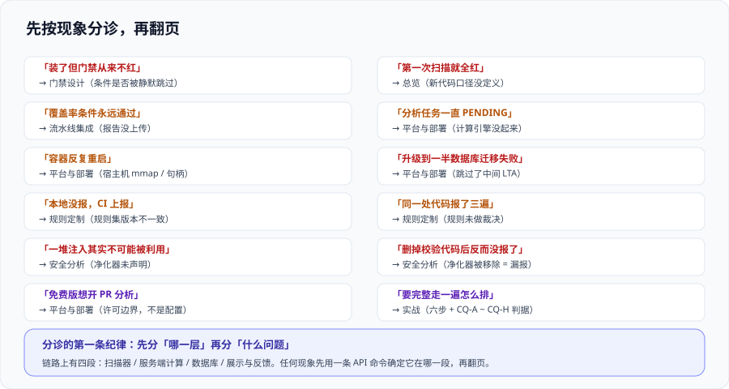

# 常见问题与最佳实践

这一页是前面九页的**急诊室**：现象 → 最可能的原因 → 去哪一页看。前两节按“现象”组织，第三节是上线自查清单，第四节是可以直接抄的纪律，第五节是术语对照。

## 一、现象分诊表

先按现象定位原因。**这一列“先查什么”是按排查成本从低到高排的**，不要跳步：

| 现象 | 最可能的原因 | 先查什么 | 详见 |
| --- | --- | --- | --- |
| 装了平台但门禁从来不红 | 门禁没绑定到项目，或条件被静默跳过（度量缺失） | `api/qualitygates/project_status` 看每条条件的 `actualValue` 是否为 `null` | [质量门禁设计](../QualityGate/index.md) |
| 第一次扫描门禁就全红 | 新代码口径没定义，全量被当成新代码 | `api/new_code_periods/list` 是否返回空 | [总览](../Overview/index.md) 边界二 |
| 覆盖率条件永远“通过”，但项目其实没测试 | 覆盖率报告没上传，条件被跳过 | `api/measures/component` 的 `coverage` 是否为空 | [流水线与 PR 集成](../PipelineIntegration/index.md) |
| 分析任务一直是 PENDING | 计算引擎（CE）没起来或卡住 | 容器日志 + `api/ce/activity` | [SonarQube 平台与部署](../SonarQube/index.md) |
| 服务端容器反复重启 | 宿主机 `vm.max_map_count` / 文件句柄未设置 | `sysctl vm.max_map_count`，容器日志里的内存报错 | [SonarQube 平台与部署](../SonarQube/index.md) |
| 升级时数据库迁移失败 | 跳过了中间 LTA | 对照官方升级路径，确认是否需先升到上一个 LTA | [SonarQube 平台与部署](../SonarQube/index.md) 第五节 |
| 下一次 `docker pull` 之后实例挂了 | 用了浮动 tag，数据库被迁移 | `grep -rn image .` 看镜像 tag 是否带具体版本 | [SonarQube 平台与部署](../SonarQube/index.md) |
| 本地跑没报，CI 上报 | 规则集本地与服务端不一致（版本或 profile 不同） | 本地插件版本与服务端版本对比 | [规则定制与质量配置](../RuleCustomization/index.md) |
| 同一处代码报了三遍 | 多条规则覆盖同一形状，未做裁决 | 对比命中的规则 key | [规则定制与质量配置](../RuleCustomization/index.md) 第六节 |
| 一堆“注入”其实不可能被利用 | 污点分析缺少净化器声明 | 看问题是否带污点路径（`flows`） | [安全分析与污点追踪](../SecurityAnalysis/index.md) |
| 删掉校验代码之后反而“没报了” | 净化器被移除 → 真实漏报 | 核对 `sanitize`/`validate` 类函数的近期改动 | [安全分析与污点追踪](../SecurityAnalysis/index.md) |
| 免费版想开 PR 分析 | 许可边界，不是配置问题 | 对照发行版能力表 | [SonarQube 平台与部署](../SonarQube/index.md) 第三节 |

## 二、高频十二问

**1. 门禁绿了是不是说明代码没问题？**
不是。门禁判的是**新代码**，绿只表示“这一周没有让情况更糟”。存量问题仍然在库里、仍然进趋势图，只是不参与“能不能合并”。

**2. 存量那几千条问题到底要不要清？**
不要专门排期清。**被改动的代码会自动进入新代码范围**，改到哪儿清到哪儿。立项清债的做法在有业务压力的团队里几乎总是半途而废。

**3. 为什么建议继承内置规则集，而不是复制一份来改？**
继承能让上游的规则更新**自动流进来**，而你的差异只有自己改的那几条、一眼看得清。复制一份的代价是长期分叉：上游加了新规则你收不到，而你的副本会越来越像“另一套产品”。

**4. 覆盖率 80% 是硬标准吗？**
不是。它是官方 `Sonar way` 门禁的**默认值**。合理的做法是按项目类型定值：先量出当前新代码覆盖率的**分布**，取一个略高于中位数的位置，再写下爬升路径与检查点。

**5. 能不能用“整体评级”当门禁条件？**
可以，但要分清场景。**合并门禁（PR）适合用增量条件**（新代码问题数、新代码覆盖率）；**发布门禁适合用整体条件**（整体安全评级、覆盖要求）。混用的典型后果是“评审人看到一条与本次改动无关的失败原因”。

**6. 免费版真的不能做 PR 门禁吗？**
不能做**原生的** PR 分析与装饰。可行的替代是：在主干流水线里跑分析并阻断**后续发布步骤**——代价是问题在合并之后才发现。另一种是把能在本地跑的部分尽量前移（IDE + 提交钩子）。**不要**手动传 `sonar.pullrequest.*` 参数到免费版上，那会让结果挂错分支，比不做更糟。

**7. 分析太慢怎么办？**
先分清慢在哪：是**扫描阶段**慢（源码多、语言多）还是**服务端计算**慢（规则多、跨文件分析重）。扫描阶段慢的正解是缩小分析范围与做增量；服务端慢的正解是调整跨文件分析规则的使用范围，或提高 CE 的资源。**加计算引擎副本在社区版行不通**（CE 是单实例）。

**8. 规则太多，怎么判断该关哪些？**
用第一节 [规则定制与质量配置](../RuleCustomization/index.md) 第四节那张表：**连续两个季度零命中的关掉**、**长期被标记误报的关掉或调参**、**与其他规则重复的只留一条**。三条判据都不需要讨论“这条规则好不好”，只需要看数据。

**9. 自定义规则值得投入吗？**
先看有没有更低成本的路：**外部工具 + SARIF 导入**能做到“复用已有检测能力、平台侧零插件维护”。只有“必须做、且有语言原生 API 支持、还得长期维护”时才写插件。XPath 模板规则是成本最低的自研方式。

**10. 安全热点（Hotspot）和漏洞有什么区别？**
热点是“**需要有人看一眼并给出结论**”，不等于已确认的漏洞；所以它的门禁条件是“评审率 = 100%”而不是“数量 = 0”。另外注意 **2026.5 起官方已把 Security Hotspots 弃用为 Security Issues**，自定义门禁里依赖热点评审率的条件需要复核。

**11. 误报怎么办？总不能一直堆着。**
误报无法消灭（原因见 [静态分析与检测器](../StaticAnalysis/index.md) 第四节），只能给它**固定的处理通道**：单条标记 / 文件排除 / 调参 / 关规则四种，各有适用判断。关键纪律是**月度量**——每月看一次“标记为误报/不会修复”的数量，与台账对齐；没有留痕的误报处理等于规则治理失去了输入。

**12. 平台装了半年，怎么判断它有没有价值？**
看**新代码的问题密度**，而不是问题总数。总数会因为规则集扩张而上涨，密度不会。另外看一个反向指标：**“门禁失败率”**——如果长期接近 0，说明规则集太松或者门禁根本没接上。

## 三、上线自查清单（二十项）

**部署与版本**

- [ ] 服务端版本已显式钉住（镜像 tag 带具体版本，不是浮动发行版名）
- [ ] 数据库版本达标（2026.5 LTA 起最低 PostgreSQL 15）
- [ ] 服务端运行时 JDK 基线已对齐（Java 17 已不再支持，Java 25 可作为运行时）
- [ ] 宿主机 `vm.max_map_count` 与文件句柄数已设置并写入持久化配置
- [ ] 数据库可**独立于实例**备份，且做过一次恢复演练
- [ ] 升级路径已写明（逐个 LTA 停），且有非生产实例演练记录

**口径与门禁**

- [ ] 每个项目的**新代码口径**都显式定义过（不是靠实例默认）
- [ ] 多语言仓库的多个项目口径**一致**
- [ ] 门禁条件**全部作用于新代码**（不是整体代码）
- [ ] 每条门禁条件都有**写下来的定值依据**（不是抄来的默认值）
- [ ] 没有把绝对量写成条件（如“代码行数 > 1000”）
- [ ] 阶段性的宽松阈值都写明了**回看日期**

**规则**

- [ ] 每种语言一条 profile，指标明确（没有一份 profile 覆盖所有语言）
- [ ] 自定义 profile 的**差异条数**是可知的（不是“改了一堆说不清”）
- [ ] 自定义规则为零，或每一处都有成本核算（优先考虑 SARIF 导入）
- [ ] 关闭的规则都**记录了原因**

**流水线**

- [ ] 步骤顺序为「构建测试 → 断言报告存在 → 扫描」
- [ ] 覆盖率报告路径与实际产物名**一致**
- [ ] 扫描器版本钉住，且与服务端版本兼容
- [ ] `fetch-depth: 0`（全量 git 历史）
- [ ] 门禁结论能到达**评审界面**（PR 评论或 Job Summary），而不是只留在 CI 日志里

## 四、十二条最佳实践

1. **先定新代码口径，再定阈值。** 顺序反了就要重算一遍。
2. **规则先冻结两周再调整。** 没有真实命中数据时做的调整都是猜。
3. **门禁条件全部作用在增量上。** 唯一例外是发布门禁里的整体安全条件。
4. **每加一条规则都要能回答“谁在什么时候会看到它”。** 答不出来就别开。
5. **覆盖率的先决条件是“报告真的传上去了”。** 加一步断言，成本一分钟。
6. **误报要有月度量与台账。** 没有留痕的处理不构成治理。
7. **扫描器与平台版本都钉住。** 浮动版本会在你最不希望的时候带来变化。
8. **报告模式先跑一周，再开阻断。** 拿真实失败率做决策，不靠估计。
9. **不专门排期清存量债。** 让“改动即进入新代码范围”自然发生。
10. **结论必须走到人眼前。** 只在 CI 日志里的门禁，收益直接减半。
11. **区分“卡住合并”与“卡住发布”。** 前者要硬，后者要可解释。
12. **任何“临时放宽”都要写回看日期。** 缺了它，临时就是永久。

## 五、术语表

| 术语 | 英文 | 含义 |
| --- | --- | --- |
| 质量配置 | Quality Profile | 一组规则的集合，**按语言**组织，绑定到项目 |
| 质量门禁 | Quality Gate | 一组阈值条件，决定“能不能过” |
| 新代码 | New Code | 门禁作用的那一段代码，由「新代码口径」定义 |
| 新代码口径 | New Code Definition | 判“哪一段算新”的规则：上一个版本 / 指定天数 / 参照分支 / 指定分析 |
| 边写边清 | Clean as You Code（CaYC） | 只判新代码、让存量随改动自然收敛的方法论 |
| 多质量规则模式 | MQR Mode | 现行默认模式：问题统一为 Issue，按三个软件质量分别评级 |
| 软件质量 | Software Quality | Security / Reliability / Maintainability |
| 整洁代码属性 | Clean Code Attribute | Consistent / Intentional / Adaptable / Responsible 四项 |
| 问题 | Issue | 平台记录的一条缺陷（统一分类后的说法） |
| 安全热点 | Security Hotspot | “需要人工评审的可疑点”，**2026.5 起被 Security Issues 取代** |
| 污点分析 | Taint Analysis | 追踪外部可控数据从源到汇的路径，用于发现注入类缺陷 |
| 净化器 | Sanitizer | 能消除污点的函数；**未声明时会带来大量误报** |
| LTA | Long-Term Active | 每年一个的长期支持版本（原先叫 LTS），提供 12 个月漏洞与阻断级补丁 |
| 社区构建版 | Community Build | 免费开源发行版，**仅主分支分析、无 PR 装饰**，走每月发布列车 |
| 计算引擎 | Compute Engine（CE） | 消费分析报告、算门禁结论的组件，**社区版为单实例** |
| 装饰 | Decoration | 把门禁结论与问题摘要写回 PR 界面的能力，**需商业版** |
| 增量分析 | Incremental Analysis | 只分析改动部分的策略，是分析时长的主要杠杆 |
| 分析范围 | Analysis Scope | 哪些文件参与分析；`exclusions` 写错会漏掉真源码 |

## 参考资料

- Sonar 官方文档 · Quality gates（条件、Sonar way 与 AI Code 门禁的完整定义）：https://docs.sonarsource.com/sonarqube-server/latest/instance-administration/analysis-functions/quality-gates/
- Sonar 官方文档 · Clean as You Code 与 New code（口径定义与配置）：https://docs.sonarsource.com/sonarqube-server/latest/user-guide/clean-as-you-code/
- Sonar 官方文档 · Analysis parameters（排查“条件被跳过”时最常需要核对的参数清单）：https://docs.sonarsource.com/sonarqube-server/latest/analyzing-source-code/analysis-parameters/
- Sonar 官方发布说明 · SonarQube Server 2026.5 LTA（Security Hotspots → Security Issues、PostgreSQL 15+、Java 25 运行时）：https://community.sonarsource.com/t/sonarqube-server-2026-5-lta/189075
- Sonar 官方博客 · 各发行版对比（免费版与商业版的能力边界，含单并发分析限制）：https://www.sonarsource.com/blog/sonarqube-compare-editions
- Sonar 官方规则库 · Rules Explorer（按语言检索规则、查参数与示例）：https://rules.sonarsource.com/
- 本站 [代码质量平台](../index.md) · 专题地图与事实速览：`docs/Tools/CodeQuality/`
- 本站 [依赖与安全治理](../../DependencyGovernance/index.md) · 依赖侧（SCA）的问题分诊：`docs/Tools/DependencyGovernance/FAQ/`
