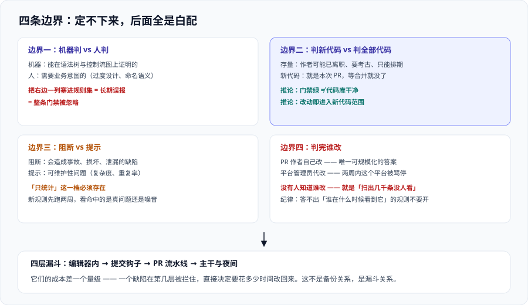

# 总览：代码质量的四条边界

代码质量工具最大的问题不是「扫不出问题」，而是**扫出来的东西没人认领**。一个跑了半年、报告里躺着三千条问题的实例，和一个没装的实例，对交付速度的影响几乎一样——都拦不住任何一次提交。所以本页先不给工具清单，先把**四条边界**划出来；这四条边界定不下来，后面所有的配置都是在给一个没人看的报告调参数。



## 一、先分清三个词

「代码质量」这个词在团队里往往同时指三件事，混着说就会得出错误结论：

| 说法 | 实际在说什么 | 判据来源 | 典型工具形态 |
| --- | --- | --- | --- |
| 代码规范 | **格式与命名**（缩进、分号、import 顺序） | 完全确定，无歧义 | Prettier、EditorConfig、ESLint 的格式化规则 |
| 静态分析 | **不运行代码**就能判出的缺陷 | 语法、控制流、数据流 | 本专题的主线 |
| 质量平台 | 让前两者**可度量、可比较、可阻断**的那一层 | 服务端聚合 + 门禁 | SonarQube 这类平台 |

三者的关系是**包含**而不是并列：格式规则是静态分析里最便宜的一个子集，静态分析是质量平台判据来源的一部分。

::: tip 一句话理解
**格式类问题永远不要在评审里讨论，缺陷类问题永远不该只靠人眼看。** 前者的正确答案是「让工具自动改」，后者的问题是人会漏、人会累、人会因为赶进度而放行。质量平台存在的唯一理由就是**把后者的判断从人身上挪到一条可执行的判据上**。
:::

分工落在工具上大致是这样：

| 层次 | 什么时候跑 | 失败时谁先看到 | 目的是 |
| --- | --- | --- | --- |
| 编辑器内 | 敲代码时 | 写代码的人，**两秒内** | 让别人根本不用看到这个问题 |
| 提交钩子 | `git commit` 时 | 写代码的人 | 拦住格式与明显错漏 |
| 流水线 | PR / 合并前 | PR 作者 + 评审人 | **让不合格的变更进不了主干** |
| 平台周期性 | 每晚 / 每周 | 负责人 | 看趋势：技术债是在还还是在涨 |

**这四层不是备份关系，是漏斗关系。** 同一类问题在第几层被拦住，决定了它的修复成本——编辑器内是零成本，进主干之后是「跨模块改动 + 回归验证」。

## 二、四条边界

### 边界一：什么该机器判，什么必须人判

这是最重要的一条。机器的能力上限是「**能在语法树与控制流图上证明的东西**」，一旦需要知道业务意图，它就只剩猜：

| 机器判得住（规则化） | 机器判不住（必须人判） |
| --- | --- |
| `==` 比较对象、未关闭的资源、空指针解引用 | 「这个类为什么存在」「有没有过度设计」 |
| 循环里的字符串拼接、正则回溯风险 | 「这个命名在业务语义上是否准确」 |
| 硬编码凭据、已知的不安全加密算法 | 「这里的容错是不是掩盖了真实故障」 |
| 圈复杂度 / 认知复杂度超阈值 | 「复杂度是不是因为需求本身就复杂」 |
| 复制粘贴出的重复块 | 「这两段看起来一样，但是不是必须独立演进」 |

**右边那一列写进规则集，后果一定是被长期标记「误报」，然后整条门禁一起被忽略。** 这是本专题反复出现的一个模式：**一条会误报的门禁，很快就会变成一条被跳过的门禁**。

### 边界二：判新代码，还是判全部代码

这是第二重要的一条，也是**几乎每个团队第一次落地都会踩的坑**。

对一个有十万行历史代码的仓库打开全量规则，第一天就会得到几千条问题。接下来只有两种结局：

1. **清债**：排期三个月专门修，修到一半需求插进来，进度冻结，最后不了了之。
2. **关掉门禁**：因为「一直红着，没法拦」，门禁形同虚设。

两种结局都不是团队不努力，而是**把「历史存量」和「今天新写的」当成了同一件事**——但它们的责任人、可修复性、时间窗完全不同：

| | 存量代码 | 新代码 |
| --- | --- | --- |
| 谁写的 | 可能已经离职 | 就是 PR 的作者 |
| 上下文 | 需要考古 | 作者脑子里有 |
| 时间窗 | 只能排期 | 就是本次 PR，**等它合并就没了** |
| 拒绝的成本 | 高（改不改都要回归） | 低（现在就改，还没人依赖） |

Sonar 的官方做法叫 **Clean as You Code（CaYC，边写边清）**：门禁只对**新代码**生效。它的推论有两个，都反直觉但很重要：

- **存量问题不清零也不影响门禁变绿。** 门禁绿不表示代码库干净，只表示**这一周没有让情况更糟**。
- **存量代码一旦被改动，改动的部分就进入新代码范围。** 所以「碰过的代码要达标」是自然发生的，不需要专门排期。

::: warning 一条要写进团队共识的说明
**门禁绿 ≠ 代码库干净。** 它只表示这一周没有让情况更糟。不把这句话说在前面，后面一定会反复出现同一个争论：「门禁都是绿的那怎么还有这么多问题？」
:::

### 边界三：什么级别阻断，什么级别只提示

门禁一旦只分「过 / 不过」两种状态，就必然在「太严，大家绕过去」和「太松，等于没有」之间反复横跳。实用做法是按**后果**分三档：

| 档位 | 判据形态 | 失败了会怎样 | 适合什么 |
| --- | --- | --- | --- |
| 阻断 | 进流水线，失败即 `exit 1` | 无法合并 | 会造成安全事故、线上故障、数据损坏的缺陷 |
| 提示 | 只发评论 / 标记，不阻断 | 合并，但留痕 | 可维护性问题：复杂度、重复率、命名 |
| 只统计 | 只进趋势图 | 什么都不发生 | 覆盖面还不明确的新规则、刚上线的自定义规则 |

**「只统计」这一档必须存在。** 新规则一上线就阻断，等于拿整个团队的交付速度去赌这条规则的准确率——而准确率只能靠真实数据看。仓库里常见的一个现实做法是：**新规则先在「只统计」跑两周，看命中的是真问题还是噪音，再决定升不升档**。

### 边界四：判完谁改

这一条最容易被忽略，因为它不是技术问题：

- 门禁红了，**PR 作者自己改**——这是唯一可规模化的答案；
- 门禁红了，**平台管理员去改**——两周内这个平台就会被骂停；
- 门禁红了，**谁都不知道该谁改**——这就是「扫出三千条没人看」的成因。

有一条配套纪律：**任何一条规则，都必须能指出「谁在什么情况下会看到它」**。答不出来的规则不要开。

## 三、质量模型：三个质量 + 四个属性

现行 SonarQube 默认使用 **MQR Mode**（Multi-Quality Rule，多质量规则模式）。它把过去混在一起的分类拆成两层：

**第一层：这条问题影响哪个「软件质量」**（Software Quality，三个）：

| 软件质量 | 问的问题 | 典型缺陷 |
| --- | --- | --- |
| Security | 能不能被利用 | 注入、弱加密、硬编码凭据 |
| Reliability | 会不会出故障 | 空指针、资源泄漏、逻辑错误导致崩溃 |
| Maintainability | 好不好改 | 认知复杂度、重复块、命名与注释缺失 |

**第二层：影响有多大**（严重度），五档：**Blocker / High / Medium / Low / Info**。

评级是把某一质量下最严重的那条问题换算成分数，再映射到 **A~E**。这套模型带来一个很实用的推论：

::: tip 一句话理解
**「有多少个问题」不是判据，「最严重的那个有多严重」才是。** 一个有 500 条 Low 问题的模块，评级可以是 A；一个有 1 条 Blocker 的模块，评级一定是差的。所以门禁用**评级**比用**问题数**更稳——问题数会随规则集扩张而暴涨，评级不会。
:::

还有一层描述「**为什么它是个问题**」，叫 Clean Code Attribute（整洁代码属性），四项：

| 属性 | 含义 | 对应的话术 |
| --- | --- | --- |
| Consistent | 一致 | 「和别处写法不一样」 |
| Intentional | 意图明确 | 「看不出这行想干什么」 |
| Adaptable | 可适应 | 「加一个需求就要改五处」 |
| Responsible | 可信赖 | 「这个写法在边界情况下不可靠」 |

**属性不参与门禁判定**，它的用途是**把机器语言翻译成团队能接受的说法**。当一条规则被质疑时，说清它属于哪一类，比贴一段规则描述有效得多。

## 四、什么时候不需要做到这个程度

这一节比前面所有内容都实用——**很多团队上平台的收益是负的**：

| 情况 | 判断 | 更该做的事 |
| --- | --- | --- |
| 仓库只有一个人维护、总量几千行 | 不装服务端 | 编辑器插件足够；装服务端要维护数据库与升级路径 |
| 原型 / Demo 阶段，代码预期会被丢掉 | 不装 | 装了也只是给自己加一道「反正会红」的门 |
| 团队没人会用扫描结果，也没有改的时间 | **先不装阻断型门禁** | 可以装「只统计」档，先把数据攒起来，让数据说服管理层排期 |
| 缺陷主要来自需求理解错、并发时序、外部依赖 | **不能只看本专题** | 静态分析对这三类的覆盖率极低，见 [静态分析与检测器](../StaticAnalysis/index.md) |
| 有硬性合规要求（如要出 OWASP Top 10 报告） | 要装 | 注意 Community Build **不含**合规报告，需看商业版 |

一句话判据：**如果你回答不出「门禁红了之后谁会去改」，那就先别挂阻断。**

## 五、最小起步三步

真要从零开始，顺序只有三步，且**顺序不可换**：

1. **定新代码口径**：新代码从哪里算起——是「上一个版本标签之后」还是「最近 30 天」？这个定义决定了后面所有阈值的作用范围。做法见 [质量门禁设计](../QualityGate/index.md)。
2. **选一套规则集并冻结两周**：先用默认推荐集（Sonar way）跑，**两周内不加不减规则**，攒出真实命中数据。
3. **挂一档门禁**：先只挂条件里最确定的几条（新代码无新问题 + 覆盖率下限），把「只统计」留给其余条件。

三步之后才谈「要不要自建规则」「要不要多套门禁」。**反过来做——先自建规则再定口径——几乎一定会返工。**

## 六、验证方式

本节内容全部是判断标准，无法自动验证，但**它的产物可以**：做完第二节到第五节，你应该能在自己的仓库里执行下面三条命令并得到确定答案（示例以 SonarQube 默认端口与常见项目键为例）：

```shell
# 1. 门禁是不是真的作用在「新代码」上：看条件里的指标是否带 new_ 前缀语义
curl -s -u "$SONAR_TOKEN:" "$SONAR_HOST_URL/api/qualitygates/show?name=Sonar%20way" | jq '.conditions[] | {metric, op, error}'

# 期望：四条条件里，覆盖率与重复率的指标都指向「新代码」口径（新代码覆盖率 / 新代码重复行），
#       而不是整体覆盖率（coverage）与整体重复率（duplicated_lines_density）。
#       若看到 coverage 而没有 new 语义，说明门禁作用在整体代码上 —— 这正是第四节说的那种「第一天就红」的配法。
```

```shell
# 2. 新代码口径是不是被显式定义过：读实例级与项目级的设置
curl -s -u "$SONAR_TOKEN:" "$SONAR_HOST_URL/api/new_code_periods/list?project=my-project" | jq '.newCodePeriods[]?'
curl -s -u "$SONAR_TOKEN:" "$SONAR_HOST_URL/api/settings/values?keys=sonar.dbcleaner.daysBeforeDeletingClosedIssues" | jq '.settings[]?'

# 期望：能读到一个明确的 newCodePeriods 条目（类型为 PREVIOUS_VERSION / NUMBER_OF_DAYS / SPECIFIC_ANALYSIS 之一）。
#       若返回空数组，说明项目在用「全局默认」，此时必须去实例级设置里确认默认值是什么 —— 空不等于安全，
#       它只是把口径藏到了另一个地方（这一步的意义是「不让口径藏在默认值里」）。
```

```shell
# 3. 规则集规模与自定义幅度：确认「冻结两周」这件事有据可查
curl -s -u "$SONAR_TOKEN:" "$SONAR_HOST_URL/api/qualityprofiles/search?project=my-project" | jq '.profiles[] | {name, language, isDefault, isBuiltIn}'

# 期望：语言有几种就有几条 profile，且你改动过的那些 isBuiltIn 为 false；
#       数量本身就是答案 —— 如果一次改动里出现了十几个自定义 profile，说明第二步的「冻结」没有执行。
```

三条命令都不需要流水线，只需要一个能访问的实例与一个 token。**它们的共同点是：验证的不是「工具装没装」，而是第三节那四条边界有没有真的落地。**

## 与「代码搜索与索引工程」的分工

| 需求 | 归谁 | 关键差别 |
| --- | --- | --- |
| 「代码里有没有这种写法」（模式已知） | 本页（静态分析 / 规则集） | AST 级匹配，能区分注释与字符串 |
| 「这个符号/这段文本在哪」（模式临时给） | [代码搜索与索引工程](../../CodeSearch/index.md) | 子串匹配，要毫秒级响应 |
| 「这个规则在历史上有没有违反过」 | 本页 + [CI 流水线](../../CICD/PipelineDesign/index.md) | 门禁语义 |

**这一页特有的一个坑**：拿 `grep` 当规则引擎用，会**同时产生误报与漏报**——`grep -n "eval("` 会命中注释里的示例与文档字符串（误报），而 `eval (` 这样带空格的写法又搜不到（漏报）。规则必须落在 AST 上，这也是静态分析与文本搜索最本质的分界：**前者知道自己在看代码的哪一部分，后者只知道字节**。

## 参考资料

- Sonar 官方文档 · Clean as You Code（新代码口径的官方定义与动机）：https://docs.sonarsource.com/sonarqube-server/latest/user-guide/clean-as-you-code/
- Sonar 官方文档 · Changing instance modes（MQR Mode 与 Standard Experience 的对照，含三个软件质量与 A~E 评级）：https://docs.sonarsource.com/sonarqube-server/latest/instance-administration/system-functions/changing-instance-modes/
- Sonar 官方文档 · Clean Code attributes（Consistent / Intentional / Adaptable / Responsible 四项属性的官方说明）：https://docs.sonarsource.com/sonarqube-server/latest/user-guide/clean-code-attributes/
- Sonar 官方文档 · Quality gates（Sonar way 的四条条件与「条件必须用差分值」这条纪律）：https://docs.sonarsource.com/sonarqube-server/latest/instance-administration/analysis-functions/quality-gates/
- Sonar 官方文档 · Introduction to SonarQube Server（七个分析阶段，解释「规则为什么不是一句正则」）：https://docs.sonarsource.com/sonarqube-server/latest/architecture/architecture-introduction/
- 本站 [代码质量平台](../index.md) · 相邻专题分工总表：`docs/Tools/CodeQuality/`
