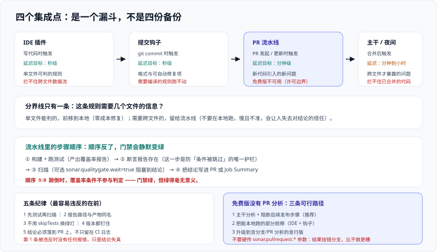

# 流水线与 PR 集成

前面几页定的是“判什么、按什么判”，这一页解决“**在哪一步判、判完结果给谁看**”。

集成做得好不好，几乎完全体现在一个数字上：**从提交代码到看见门禁结论，要等多久？** 这个时间超过几分钟，开发者就会切去做别的事，回来时上下文已经丢了；超过一刻钟，就会开始出现“本地先跑一遍再说”的绕过行为——而本地跑出来的结论和服务端**永远不完全一样**。



## 一、四个集成点，各管一段

| 集成点 | 触发时机 | 反馈延迟目标 | 能拦住什么 | 拦不住什么 |
| --- | --- | --- | --- | --- |
| IDE 插件（本地） | 写代码时 | **秒级** | 单文件可判的规则 | 跨文件数据流、整体评级 |
| 提交钩子 | `git commit` | 秒级 | 格式、可自动修复的问题 | 需要编译或全量分析的规则 |
| PR 流水线 | 发起 / 更新 PR | **分钟级** | 新代码引入的新问题、覆盖率下降 | 整体代码的历史存量 |
| 主干（合并后 / 夜间） | 合并后 | 分钟到小时 | 只有跨文件才暴露的问题、整库趋势 | 已经合并进去的东西 |

**这四层是漏斗，不是备份。** 一个缺陷在第几层被拦住，直接决定它的修复成本：本地是零成本，PR 是“改一下再推一次”，合并之后就是“新开一个 PR 回头修”。

::: tip 一句话理解
**不要把本地能秒级发现的东西，留给 PR 流水线去发现。** 反过来说，**也不要在本地跑跨文件分析**——它慢、结果还不准，会让人失去对结论的信任。分界线就是“这条规则需要几个文件的信息”。
:::

## 二、扫描器怎么选

SonarQube 提供多种分析入口，选择依据是**项目怎么构建**，而不是“哪个更流行”：

| 入口 | 形态 | 适合 | 关键区别 |
| --- | --- | --- | --- |
| Scanner CLI | 独立可执行 / 容器镜像 | 语言杂、没有统一构建工具、想统一调用方式 | **不负责编译**，源码必须先构建好（尤其是编译型语言） |
| 构建工具插件 | `mvn sonar:sonar`、`gradle sonar` | Java / JVM 项目 | 能复用构建产物与类路径，**分析精度更高** |
| .NET 专用 | `dotnet sonarscanner begin/end` | .NET / C# | 必须**包住**整个 `build`，begin 与 end 之间不能漏 |
| npm 包 | `sonar-scanner` | 前端 / Node 项目 | 与 CI 的 Node 版本绑定，注意扫描器版本要求 |
| 官方容器镜像 | Docker | 想固定扫描器版本、CI 里少装东西 | 挂载源码与报告目录即可；**镜像 tag 同样要钉版本** |

**一条容易被忽略的取舍**：Scanner CLI 不做编译，因此**编译型语言必须把“构建 + 分析”放在同一台机器、同一个工作目录里跑**。把构建产物跨 stage 传递时路径变了，分析器可能定位不到类文件，结果是**精度下降但不会报错**——报告照出，只是部分规则静默失效。

## 三、增量分析：成本与体验的分水岭

全量分析一次十万行代码，与只分析改动的部分，耗时差一个数量级。触发增量的手段有三类：

| 手段 | 参数 / 前提 | 效果 | 限制 |
| --- | --- | --- | --- |
| 分支分析 | `sonar.branch.name` | 每个分支独立算“新代码”，互不干扰 | **Community Build 不可用**（只分析主分支） |
| PR 分析 | `sonar.pullrequest.key` / `.branch` / `.base` | 以目标分支为基线，**只判 PR 引入的差异** | 同上，需商业版 |
| 分析范围收缩 | `sonar.inclusions` / `sonar.exclusions` | 减少被分析的文件 | **是过滤不是增量**，写错会漏掉真源码 |

::: danger 关于“免费版没有 PR 分析”该怎么接门禁
Community Build 只分析主分支、也没有 PR 装饰。这不是“配置一下就能开”的功能，是**许可边界**。可行的三条路，各有代价：

1. **合并后判（推荐给免费版）**：主干流水线里跑分析 + 等门禁，**失败则阻断后续发布步骤**。代价是问题在合并之后才发现，修复要新开 PR。
2. **本地 + 提交钩子前移**：把能在本地跑的部分尽量前移，PR 阶段只做“跑得动的检查”。代价是覆盖不全，但比“什么都不查”好得多。
3. **买 Developer 起**：拿到分支/PR 分析与 PR 装饰。判断依据见 [SonarQube 平台与部署](../SonarQube/index.md) 的发行版对照表。

**不要把 1 说成 2。** 有人在免费版上手动传 `sonar.pullrequest.*` 参数，分析照跑、**结果却挂在主分支上**——看起来“接上了”，实际上 PR 与主干的结论混在一起，是比不做更坏的状态。
:::

## 四、CI 集成的五条纪律

这五条是在流水线里接质量平台时最容易违反、后果又最隐蔽的：

1. **先跑测试，再传报告，最后扫描。** 顺序反了，扫描时覆盖率报告还不存在 → 门禁的覆盖率条件**被静默跳过** → 门禁绿得没有意义（见 [质量门禁设计](../QualityGate/index.md) 第一节）。

2. **报告路径必须与实际产物同名。** 覆盖率报告路径参数（如 `sonar.coverage.jacoco.xmlReportPaths`、`sonar.javascript.lcov.reportPaths`、`sonar.python.coverage.reportPaths`）写的路径，与测试步骤真正生成的文件名必须一致。**这两处分别由两个人维护时，就一定会有一次不一致。**

   ```yaml
   # 反例：测试脚本输出 build/reports/jacoco/test/jacocoTestReport.xml
   #       而属性文件写 sonar.coverage.jacoco.xmlReportPaths=**/jacoco.xml
   # 后果：条件被跳过（不报错），门禁结论不可信
   ```

3. **不要把“跳过测试”当成让门禁变绿的手段。** `-DskipTests` 之后覆盖率报告是旧的或空的，扫描会用**上一轮的报告**——如果 CI 环境是复用工作目录的，这个报告可能是别人的。

4. **扫描器与平台版本要互相兼容，且都要钉版本。** 扫描器用浮动版本，会在某次上游更新后突然不支持某个参数；平台用浮动 tag，会在某次 pull 之后把数据库迁移掉（见 [SonarQube 平台与部署](../SonarQube/index.md) 第五节）。

5. **失败信息必须落到 PR 上，而不是只留在 CI 日志里。** 只留日志的结果是“CI 红了，但没人点进去看是哪几条”。

## 五、一个完整的 GitHub Actions 例子

下面这份配置刻意把顺序、版本钉定、门禁等待三件事都写全了。**它是“教科书顺序”，可以整体照着改**：

```yaml [.github/workflows/quality.yml]
name: quality

on:
  push:
    branches: [main]
  pull_request:
    branches: [main]

jobs:
  build-and-analyze:
    runs-on: ubuntu-latest
    steps:
      # 1) 全量历史：责任信息与「新代码」判定都依赖 git 历史
      - uses: actions/checkout@v4
        with:
          fetch-depth: 0

      - uses: actions/setup-java@v4
        with:
          distribution: temurin
          java-version: "25"      # 与服务端运行时基线保持一致

      # 2) 缓存扫描器与依赖：不改结论，只省时间
      - uses: actions/cache@v4
        with:
          path: ~/.sonar/cache
          key: sonar-${{ runner.os }}-${{ hashFiles('**/pom.xml') }}

      # 3) 先构建 + 跑测试（产出覆盖率报告）
      - name: Build & test
        run: mvn -B verify

      # 4) 确认报告真的存在 —— 这一步是防「条件被静默跳过」的唯一护栏
      - name: Assert coverage report exists
        run: |
          test -s target/site/jacoco/jacoco.xml || {
            echo "coverage report missing -> quality gate would silently skip the coverage condition"
            exit 1
          }

      # 5) 扫描 + 等门禁结果（wait=true 时，门禁 ERROR 会让这一步失败）
      #    扫描器版本显式钉住，不用 latest
      - name: SonarQube scan
        env:
          SONAR_TOKEN: ${{ secrets.SONAR_TOKEN }}
          SONAR_HOST_URL: ${{ vars.SONAR_HOST_URL }}
        run: |
          mvn -B org.sonarsource.scanner.maven:sonar-maven-plugin:5.2.0.4988:sonar \
            -Dsonar.qualitygate.wait=true \
            -Dsonar.qualitygate.timeout=300 \
            -Dsonar.coverage.jacoco.xmlReportPaths=target/site/jacoco/jacoco.xml

      # 6) 把结论摘要贴到 Job Summary 上：让「点进去看」变成「不用点」
      - name: Publish gate summary
        if: always()
        run: |
          curl -s -u "$SONAR_TOKEN:" \
            "$SONAR_HOST_URL/api/qualitygates/project_status?projectKey=$SONAR_PROJECT_KEY" \
            | jq -r '.projectStatus.conditions[] | "\(.metricKey)\t\(.status)\t\(.actualValue // "n/a") / \(.errorThreshold)"' \
            >> "$GITHUB_STEP_SUMMARY"
        env:
          SONAR_TOKEN: ${{ secrets.SONAR_TOKEN }}
          SONAR_HOST_URL: ${{ vars.SONAR_HOST_URL }}
          SONAR_PROJECT_KEY: my-project
```

::: warning 这份配置里两处刻意的选择
1. **第 4 步“断言报告存在”是多余的步骤吗？** 不是。它拦住的正是那种“门禁绿了但覆盖率条件根本没参与判定”的情况。**一个会静默跳过的判据，比一个不存在的判据更危险**——因为前者让人以为已经查过了。
2. **`sonar.qualitygate.wait=true` 会让这一步阻塞到门禁出结果。** 超时（`qualitygate.timeout`，单位秒）要设得比正常分析耗时留出余量；设得过小会出现“门禁还在算，流水线已经超时失败”，看起来像门禁失败。
:::

## 六、PR 装饰：让结论自己走到人眼前

“结果没人看”是平台失效的头号原因。三个成本递增的手段：

| 手段 | 做法 | 效果 | 成本 |
| --- | --- | --- | --- |
| Job Summary / 构建产物 | 把门禁条件明细写进流水线摘要 | 点一下就能看到，不用进平台 | 极低，**任何版本都能做** |
| PR 评论（自定义） | 用 API 读出门禁结果，贴成一条评论 | 结论出现在评审界面里 | 低，需一个脚本与 token |
| **原生 PR 装饰** | 平台直接写 PR 状态与评论 | 与评审流程无缝；含“被合并后会消失的问题”提示 | **需要分支/PR 分析能力（商业版）** |

前两种在 Community Build 上就能做，**性价比极高**：

```shell
# 把门禁结论贴成 PR 评论（GitHub，片段）
gh pr comment "$PR_NUMBER" --body "$(curl -s -u "$SONAR_TOKEN:" \
  "$SONAR_HOST_URL/api/qualitygates/project_status?projectKey=my-project" \
  | jq -r '"质量门禁：" + .projectStatus.status + "\n" +
           ([.projectStatus.conditions[] | "- \(.metricKey): \(.actualValue // "n/a") (阈值 \(.errorThreshold), \(.status))"] | join("\n"))')"

# 期望：PR 上出现一条含「质量门禁：OK/ERROR」与逐条条件的评论。
#       注意：免费版下这个结论归属主分支，因此它只是「主干当前状态」，不是「本 PR 引入的差异」——
#       不要把它标注成「本 PR 的门禁结果」，那会误导评审人。
```

## 七、验证方式

集成正确性可以完整验证。下面四条命令覆盖“顺序对不对、结论可不可信、结果到没到人眼前”：

```shell
# 1. 覆盖率报告确实被服务端收到了（不是本地存在就行）
curl -s -u "$SONAR_TOKEN:" \
  "$SONAR_HOST_URL/api/measures/component?component=my-project&metricKeys=coverage,new_coverage,lines_to_cover" \
  | jq '.component.measures[] | {metric, value}'
# 期望：coverage 与 new_coverage 都有值（不是空数组、不是 0 而 lines_to_cover 很大）。
#       若 lines_to_cover 有值而 coverage 为空，说明报告没传上去 —— 门禁的覆盖率条件会被静默跳过。

# 2. 扫描器与服务端版本是否兼容、参数有没有被忽略
curl -s -u "$SONAR_TOKEN:" "$SONAR_HOST_URL/api/server/version"
# 期望：与你钉住的平台版本一致。
#       再对照扫描器日志里的 "SonarScanner ... " 行：两者跨越的版本越多，被忽略的参数越多，
#       而「被忽略的参数」在日志里通常只是 WARN，不会让分析失败。

# 3. 门禁等待是否真的生效：读最近一次分析任务的耗时与状态
curl -s -u "$SONAR_TOKEN:" "$SONAR_HOST_URL/api/ce/activity?ps=5&type=REPORT" \
  | jq '.tasks[] | {status, executionTimeMs, submittedAt}'
# 期望：status=SUCCESS，executionTimeMs 小于 qualitygate.timeout × 1000。
#       若 executionTimeMs 接近超时值，说明该调大 timeout，否则会出现「门禁还在算、流水线已失败」。

# 4. 结论有没有到达评审者眼前：核对 PR 上是否真的出现了结果
gh pr view "$PR_NUMBER" --json comments --jq '.comments[].body' | grep -c "质量门禁"
# 期望：>= 1。为 0 时说明装饰步骤没跑或权限不足 ——
#       这时门禁即使生效，也只有主动点进 CI 日志的人才知道，等于把门禁的收益打了对折。
```

## 参考资料

- Sonar 官方文档 · CI 集成总览（GitHub / GitLab / Bitbucket / Azure DevOps 的接入方式对比）：https://docs.sonarsource.com/sonarqube-server/latest/analyzing-source-code/ci-integration/overview/
- Sonar 官方文档 · Analyzing with Maven（`mvn sonar:sonar`、覆盖率报告路径参数）：https://docs.sonarsource.com/sonarqube-server/latest/analyzing-source-code/scanners/maven/
- Sonar 官方文档 · SonarScanner CLI（不负责编译的前置条件与常见失败）：https://docs.sonarsource.com/sonarqube-server/latest/analyzing-source-code/scanners/sonarscanner/
- Sonar 官方文档 · Pull request analysis（`sonar.pullrequest.*` 参数与所需发行版）：https://docs.sonarsource.com/sonarqube-server/latest/analyzing-source-code/pull-request-analysis/
- Sonar 官方文档 · Quality gate status in the pipeline（`sonar.qualitygate.wait` 的行为与超时）：https://docs.sonarsource.com/sonarqube-server/latest/analyzing-source-code/ci-integration/quality-gate-status/
- Sonar 官方指南 · Integrating quality gates into your CI/CD pipeline（含 GitHub Actions 完整示例）：https://www.sonarsource.com/resources/library/integrating-quality-gates-ci-cd-pipeline/
- 本站 [CI/CD](../../CICD/index.md) · 流水线阶段划分与制品管理：`docs/Tools/CICD/`
- 本站 [质量门禁设计](../QualityGate/index.md) · 门禁条件与阈值：`docs/Tools/CodeQuality/QualityGate/`
- 本站 [依赖与安全治理](../../DependencyGovernance/index.md) · 依赖侧扫描在流水线中的位置：`docs/Tools/DependencyGovernance/`
