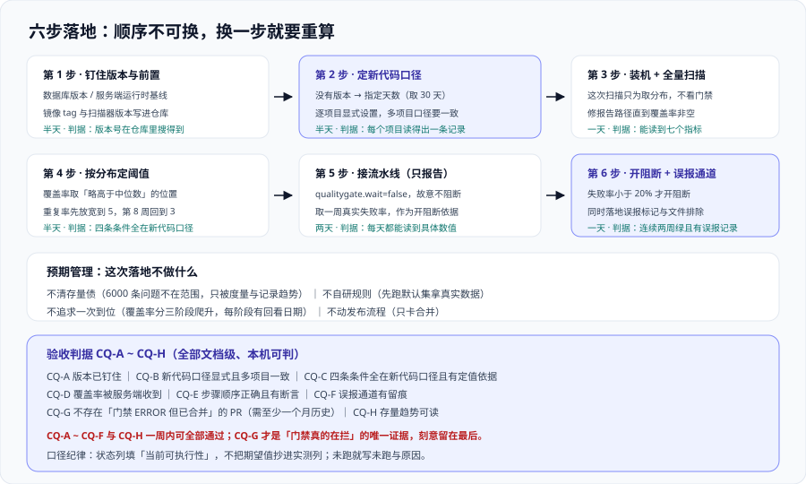

# 实战：给一个仓库立起质量门禁

前面八页分别讲了组件、规则、门禁、集成与安全。这一页把它们串成一条**六步落地路径**，每一步都给出可执行的命令与通过判据。

目标系统设定为一个真实得让人不舒服的场景：**一个已经跑了三年的多语言仓库**——后端 Java（Maven，25 万行），前端 TypeScript（pnpm，8 万行），另有若干 YAML 与 Dockerfile；三个人在维护；现在**没有任何质量门禁**，只有各仓库本地各写一份的 Lint 配置。



## 零、先把预期说清楚

这次落地的目标**不是**“让代码库变干净”，而是**“让情况不再变糟，并且让存量清理变成顺手的事”**。三个可衡量的目标：

| 目标 | 判据 | 达成时间 |
| --- | --- | --- |
| 新代码不再引入新问题 | 新代码问题数 = 0 | 第 2 周 |
| 新代码有测试 | 新代码覆盖率达标（先 50%，两个季度后 80%） | 第 3 周 |
| 规则集不再各写一份 | 本地与流水线用同一份规则来源 | 第 1 周 |

**明确不做的四件事**（写在这里，避免中途扩大范围）：

1. **不清存量债。** 三年积累的六千条问题不在本次范围。它们仍然被度量、被记录趋势，只是不参与“能不能合并”。
2. **不自研规则。** 第 1 周内不动自定义规则，先用默认集拿到真实数据（见 [规则定制与质量配置](../RuleCustomization/index.md) 第五节）。
3. **不追求一次到位。** 覆盖率分三阶段爬升，每个阶段有明确日期与检查点。
4. **不动发布流程。** 本次只卡“合并”，发布门禁留到第二阶段（见 [质量门禁设计](../QualityGate/index.md) 第七节）。

## 第一步：钉住版本与前置（半天）

升级与部署的坑几乎全部来自“没钉版本”。先做完这三件事再进下一步：

```shell
# 1.1 确认数据库版本达标（2026.5 LTA 起最低 PostgreSQL 15）
docker compose exec -T db psql -U sonar -d sonar -tAc "show server_version;"
# 期望：15 以上。

# 1.2 确认服务端 JDK 基线（2026.1 起 Java 17 已不再支持，Java 25 可作为运行时）
curl -s "$SONAR_HOST_URL/api/system/status" | jq '{status, version}'
# 期望：status=UP，version 与你钉住的 LTA 版本一致。

# 1.3 把服务端与扫描器版本写进仓库的一处文档（而不是散在 CI 与本地）
grep -rn "sonar" .github/workflows/ | head
# 期望：能看到显式的版本号（镜像 tag、扫描器插件版本）。
#       出现 latest / 浮动发行版名 = 未钉版本，先改掉。
```

**通过判据**：三条命令都拿到确定值，且**版本号在仓库里能搜到**（不是只在某人脑子里）。

## 第二步：定新代码口径（半天）

这一步是本页最关键的一步。这个仓库**没有版本标签体系**（三年里发的是滚动更新），所以：

| 候选口径 | 判断 |
| --- | --- |
| 上一个版本 | **不可用**：没有版本基线 |
| 参照分支（PR 级） | **看许可**：Community Build 不可用；这里先按免费版设计 |
| 指定天数（NUMBER_OF_DAYS） | **选它**，取 30 天 |

为什么取 30 天而不是 7 天：这三人团队一个迭代约两周，7 天会切成半个迭代，导致“上一半的工作量还没达标就滚出新范围”；30 天覆盖两个迭代，是一个能产生压力又不至于压死人的窗口。

```shell
# 显式设定项目级口径（不要依赖实例默认）
curl -s -u "$SONAR_TOKEN:" -X POST "$SONAR_HOST_URL/api/new_code_periods/set" \
  -d "project=backend-core" -d "type=NUMBER_OF_DAYS" -d "value=30"

# 回读确认
curl -s -u "$SONAR_TOKEN:" "$SONAR_HOST_URL/api/new_code_periods/list?project=backend-core" \
  | jq '.newCodePeriods[] | {type, value}'
# 期望：{"type":"NUMBER_OF_DAYS","value":"30"}。

# 多语言仓库要逐个项目设：前端与后端是两个项目，口径应一致（不一致则"同一周两个项目的判定范围不同"）
for p in backend-core frontend-web; do
  curl -s -u "$SONAR_TOKEN:" "$SONAR_HOST_URL/api/new_code_periods/list?project=$p" \
    | jq -c --arg p "$p" '{project: $p, periods: [.newCodePeriods[]? | {type, value}]}'
done
```

**通过判据**：每个项目都能读出一条明确记录；**两个项目的口径一致**。

## 第三步：装机 + 建项目 + 首次全量扫描（一天）

先跑一次**全量**扫描。这次扫描的目的**不是**看门禁——是**拿到真实分布数据**，作为后面定阈值的输入。

```properties [sonar-project.properties]
# ---- 项目标识（projectKey 写错会在平台上新建一个项目，而不是更新现有的）----
sonar.projectKey=backend-core
sonar.projectName=backend-core
sonar.projectVersion=0.0.0-local

# ---- 源码范围：显式写清楚哪些是源码、哪些是测试 ----
sonar.sources=src/main/java
sonar.tests=src/test/java

# ---- 排除：生成代码与构建产物（排除粒度写错会把真源码一起排掉，改完必须核对文件数）----
sonar.exclusions=**/target/**,**/generated-sources/**,**/*.min.js
sonar.coverage.exclusions=**/config/**,**/*Application.java

# ---- 覆盖率报告：路径必须与测试步骤真正生成的文件一致 ----
sonar.coverage.jacoco.xmlReportPaths=target/site/jacoco/jacoco.xml

# ---- 编码：避免中文注释在该平台侧变成乱码 ----
sonar.sourceEncoding=UTF-8
```

```shell
# 首次全量扫描（不加门禁等待，这次只看数据）
mvn -B verify
mvn -B org.sonarsource.scanner.maven:sonar-maven-plugin:5.2.0.4988:sonar \
  -Dsonar.qualitygate.wait=false

# 读回分布：这是第三步唯一的产出
curl -s -u "$SONAR_TOKEN:" \
  "$SONAR_HOST_URL/api/measures/component?component=backend-core&metricKeys=coverage,duplicated_lines_density,ncloc,complexity,violations,reliability_rating,security_rating,sqale_rating" \
  | jq '.component.measures[] | {metric, value}'
# 期望：能读到全部指标。
#       若 coverage 为空而 ncloc 有值 => 覆盖率报告没上传，先修报告路径再往下走。
#       violations 会是一个很大的四位数 —— 这是正常的，它不参与门禁（第一步的目标就是不清存量）。
```

**通过判据**：能读到七个指标的值，且**覆盖率不是空的**。覆盖率空的话，后面的覆盖率条件会静默跳过（见 [质量门禁设计](../QualityGate/index.md) 第一节），这一步必须先绿。

## 第四步：按分布定阈值，挂上第一档门禁（半天）

拿第三步的数据定值。假设读出来的**近 30 天新代码覆盖率**分布是：中位数 41%，上四分位 62%，最高 88%。那么：

| 阶段 | 覆盖率阈值 | 依据 | 什么时候调 |
| --- | --- | --- | --- |
| 第 1 阶段 | **50%** | 略高于中位数 41%：努力可达，且能筛掉“完全没测试的提交” | 上线后第 4 周回看 |
| 第 2 阶段 | **65%** | 接近上四分位 62% | 第 8 周，取决于达标率 |
| 第 3 阶段 | **80%** | 官方默认值 | 第 2 季度末 |

门禁条件（**全部作用在新代码上**）：

| 条件 | 比较符 | 阈值 | 为什么 |
| --- | --- | --- | --- |
| 新代码问题数 | `>` | 0 | 最硬的一条，不可协商 |
| 新代码覆盖率 | `<` | 50（第 1 阶段） | 分阶段爬升，见上表 |
| 新代码重复率 | `>` | 5 | 先放宽到 5（默认 3 太紧，存量已有重复模式），第 8 周回到 3 |
| 安全热点评审率 | `<` | 100 | 热点不是“必须改”，是“必须看过” |

```shell
# 复制内置门禁再改（内置 Sonar way 是只读的，不能直接在它上面改）
curl -s -u "$SONAR_TOKEN:" -X POST "$SONAR_HOST_URL/api/qualitygates/copy" \
  -d "name=our-gate-v1" -d "sourceName=Sonar%20way"

# 绑定到项目
curl -s -u "$SONAR_TOKEN:" -X POST "$SONAR_HOST_URL/api/qualitygates/select" \
  -d "projectKey=backend-core" -d "gateName=our-gate-v1"

# 回读：确认四条条件都作用在新代码口径上
curl -s -u "$SONAR_TOKEN:" "$SONAR_HOST_URL/api/qualitygates/show?name=our-gate-v1" \
  | jq '[.conditions[] | {metric, op, error}]'
# 期望：四条条件；指标名指向新代码（新代码覆盖率 / 新代码重复率等），
#       出现不带 new 语义的整体指标即为配错 —— 那会让第一天全红。
```

**通过判据**：门禁条件四条、全部新代码口径、阈值有写下来的定值依据（**依据本身就是交付物**）。

## 第五步：接流水线，先只报告不阻断（两天）

这一周**故意不阻断**。目的是拿到“如果阻断，一周期会红几次”的真实数据——这个数字比任何人的估计都准。

```yaml [.github/workflows/quality.yml]
name: quality
on:
  push: { branches: [main] }

jobs:
  analyze:
    runs-on: ubuntu-latest
    steps:
      - uses: actions/checkout@v4
        with:
          fetch-depth: 0            # 全量历史：新代码判定与责任信息都依赖它
      - uses: actions/setup-java@v4
        with: { distribution: temurin, java-version: "25" }
      - name: Build & test
        run: mvn -B verify
      - name: Assert coverage report exists
        run: test -s target/site/jacoco/jacoco.xml || { echo "coverage report missing"; exit 1; }
      - name: Scan (报告模式：不阻断)
        env:
          SONAR_TOKEN: ${{ secrets.SONAR_TOKEN }}
          SONAR_HOST_URL: ${{ vars.SONAR_HOST_URL }}
        run: |
          mvn -B org.sonarsource.scanner.maven:sonar-maven-plugin:5.2.0.4988:sonar \
            -Dsonar.qualitygate.wait=false    # 第 1 周：只取结论，不影响流水线
      - name: Gate summary
        if: always()
        env:
          SONAR_TOKEN: ${{ secrets.SONAR_TOKEN }}
          SONAR_HOST_URL: ${{ vars.SONAR_HOST_URL }}
        run: |
          curl -s -u "$SONAR_TOKEN:" \
            "$SONAR_HOST_URL/api/qualitygates/project_status?projectKey=backend-core" \
            | jq -r '.projectStatus.status, ([.projectStatus.conditions[] | "\(.metricKey) \(.status) \(.actualValue // "n/a")"] | .[])' \
            >> "$GITHUB_STEP_SUMMARY"
```

**通过判据**：连续五个工作日的主干构建里，**能读到每一天的门禁状态与逐条实际值**（不是“绿的”，是具体数值）。若某天的条件 `actualValue` 是 `null`，先修数据来源，不要进第六步。

## 第六步：开阻断 + 定误报通道（一天）

拿到第五步的真实数据后决定开不开阻断。判断标准：

| 第五步的观察 | 决策 |
| --- | --- |
| 门禁失败率 < 20%，且失败原因集中在“忘了写测试” | **开阻断**，`sonar.qualitygate.wait=true` |
| 门禁失败率 > 50%，且大量是同一批规则 | **别开**：先把这批规则下调档位或加入 profile 例外，回到第三步重新取数 |
| 条件 `actualValue` 经常为 `null` | **别开**：数据链路没修好，开了也只是红得莫名其妙 |

同时把误报通道落地（否则阻断会立刻变成抱怨）：

```shell
# 误报通道 1：单条问题标记（人在平台上点，或用 API）
curl -s -u "$SONAR_TOKEN:" -X POST "$SONAR_HOST_URL/api/issues/do_transition" \
  -d "issue=<ISSUE_KEY>" -d "transition=falsepositive"
# 期望：该问题从"新代码问题数"里移出。注意它仍留在库里，用于规则质量统计。

# 误报通道 2：文件级排除（生成代码、测试夹具），必须在扫描器侧与服务端保持一致
grep -n "sonar.exclusions" sonar-project.properties
# 期望：能看到排除项，并且改完之后核对过「被分析的文件数」变化 ——
#       排除粒度写错会把真源码一起排掉，这是最隐蔽的一类配置事故。
```

**通过判据**：**连续两周**主干门禁绿，且期间至少处理过一次误报（有记录）。没有误报记录的“两周全绿”，多半是因为规则集太松。

## 七、验收判据 `CQ-A ~ CQ-H`

八条判据全部为**文档级 + 本机可判**（命令见各条），不依赖特定工具：

| 判据 | 内容 | 验证方式 | 本机可判 |
| --- | --- | --- | --- |
| `CQ-A` | 版本已钉住：服务端与扫描器版本在仓库文档里能搜到，且不是浮动 tag | `grep -rn "sonar" .github/workflows/` 命中的都是显式版本 | ✅ |
| `CQ-B` | 新代码口径已显式定义，且多项目一致 | `api/new_code_periods/list` 每个项目返回一条记录，`type`/`value` 相同 | ✅ |
| `CQ-C` | 门禁条件全部作用于新代码，且每条有定值依据 | `api/qualitygates/show` + 定值依据表 | ✅ |
| `CQ-D` | 覆盖率报告确实被服务端收到（不是本地有就行） | `api/measures/component` 的 `coverage` 非空 | ✅ |
| `CQ-E` | 报告顺序正确：测试 → 断言报告存在 → 扫描 | 流水线文件里步骤顺序与断言步骤存在 | ✅ |
| `CQ-F` | 误报通道存在且有留痕 | `api/issues/search?resolutions=FALSE-POSITIVE,WONTFIX` 的数量与台账一致 | ✅ |
| `CQ-G` | 无绕过记录：不存在“门禁 ERROR 但已合并”的 PR | 门禁结论与合并记录对照 | ⏳ 需历史数据（满一个月后可判） |
| `CQ-H` | 存量趋势可读：整体问题数有趋势数据（不清债但要看得到） | `api/measures/search_history` 返回历史序列 | ✅ |

**验收结论的口径**：`CQ-A~CQ-F` 与 `CQ-H` 在落地后一周内即可全部通过；`CQ-G` 需要至少一个月的主干记录——**这是“门禁真的在拦”的唯一证据**，也是本页刻意留到最后的一条。

## 八、常见返工点

| 返工点 | 出现在第几步 | 代价 |
| --- | --- | --- |
| 先配规则再定新代码口径 | 顺序颠倒 | 阈值全部要重算，白配一遍 |
| `projectKey` 写错导致新建项目 | 第三步 | 历史趋势断掉，要人工迁移 |
| 覆盖率报告路径与产物名不一致 | 第三步 / 第五步 | 条件静默跳过，**结论不可信但看不出** |
| 一次开十几种语言的 profile | 第四步 | 零命中规则大量堆积，后续治理成本翻倍 |
| 开阻断时没准备误报通道 | 第六步 | 一周内团队要求关掉门禁 |

## 参考资料

- Sonar 官方文档 · Clean as You Code（本次落地的核心方法论）：https://docs.sonarsource.com/sonarqube-server/latest/user-guide/clean-as-you-code/
- Sonar 官方文档 · Defining new code（四种口径的配置入口与 API）：https://docs.sonarsource.com/sonarqube-server/latest/project-administration/defining-new-code/
- Sonar 官方文档 · Quality gates（条件三要素、差分值要求、条件增删与绑定 API）：https://docs.sonarsource.com/sonarqube-server/latest/instance-administration/analysis-functions/quality-gates/
- Sonar 官方指南 · Integrating quality gates into your CI/CD pipeline（含从建项目到验证门禁的完整步骤）：https://www.sonarsource.com/resources/library/integrating-quality-gates-ci-cd-pipeline/
- Sonar 官方文档 · Analysis parameters（`sonar.exclusions`、覆盖率报告路径、`sonar.qualitygate.wait` 等参数的权威定义）：https://docs.sonarsource.com/sonarqube-server/latest/analyzing-source-code/analysis-parameters/
- 本站 [质量门禁设计](../QualityGate/index.md) · 阈值与口径的判据：`docs/Tools/CodeQuality/QualityGate/`
- 本站 [流水线与 PR 集成](../PipelineIntegration/index.md) · CI 集成的五条纪律：`docs/Tools/CodeQuality/PipelineIntegration/`
- 本站 [CI/CD · 自动化测试与质量门禁](../../CICD/Testing/index.md) · 测试与覆盖率在生产侧的组织方式：`docs/Tools/CICD/Testing/`
- 本站 [完整项目交付](../../../Others/ProjectDelivery/index.md) · 上线验收的标准动作清单：`docs/Others/ProjectDelivery/`
