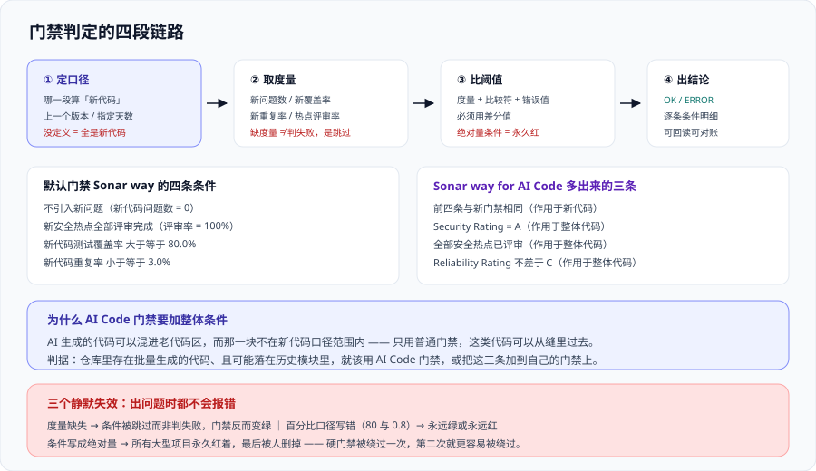

# 质量门禁设计

质量门禁（Quality Gate）回答**一个非常具体的问题**：这个项目**现在**能不能发。

它和规则集的分工是：规则集决定“能发现什么”，门禁决定“发现到什么程度算不合格”。所以门禁的设计难点不在工具配置，而在**两个必须先定下来的东西**——判哪一段代码（新代码口径），以及阈值凭什么定成这个数。



## 一、门禁到底在判什么

一条门禁条件由三样东西组成（官方定义就是这三项）：**度量（measure）+ 比较符 + 错误值**。

| 要素 | 例子 | 注意 |
| --- | --- | --- |
| 度量 | 新代码覆盖率、新代码重复行占比、新代码问题数 | 度量必须**存在**，否则条件会被跳过而不是判失败（见下） |
| 比较符 | `>`、`<`、`>=`、`<=`、`=`、`!=` | **方向容易写反**；「覆盖率 ≥ 80」与「覆盖率 < 80 判失败」是同一件事的两种写法 |
| 错误值 | 80、3、0 | 必须与度量的单位一致（百分比是 80 还是 0.8） |

::: danger 三条最容易出错的判据写法
1. **条件写成了绝对量。** 官方文档明确要求门禁条件必须使用**差分值**——「代码行数大于 1000」这种条件没有意义（它只会让所有大型项目永久红着）。用**增量**而不是**总量**。
2. **度量缺失时条件被跳过。** 覆盖率条件只有在覆盖率报告被上传后才参与判定。某一轮 CI 因为步骤顺序问题没上传报告，**门禁可能反而变绿**。这是“门禁通过但不能信”的头号成因，护栏是：在流水线里**先确认报告存在，再触发门禁等待**。
3. **百分比口径写错。** 覆盖率 80% 在指标里常常是 `80.0` 而不是 `0.8`。写错一个数量级的表现是：门禁要么永远绿、要么永远红，而两种情况下都**不会报配置错误**。
:::

## 二、新代码口径：整套体系的地基

这是本页最重要的一节。**新代码口径（New Code Definition）定义了“门禁到底在判哪一段代码”**，它定错了，后面所有阈值都是错的。

### 四种口径及各自适合什么

| 口径类型 | 判据 | 适合 | 坑 |
| --- | --- | --- | --- |
| **上一个版本**（Previous version） | 上一次版本基线之后的全部提交 | 有明确版本节奏的产品 | 版本发布间隔长时，“新代码”会积累成一个很大的集合 |
| **指定天数**（Number of days） | 最近 N 天内的提交 | 持续交付、没有版本概念的团队 | N 取值决定门槛的实际严苛程度；取 30 天意味着“一个月的工作量要全部达标” |
| **参照分支**（Reference branch） | 与指定分支的差异 | 特性分支开发、要 PR 级反馈 | 依赖分支分析能力，**Community Build 不可用** |
| **指定分析基线**（Specific analysis） | 从某一次分析之后开始算 | 一次性迁移、试点 | 需要人工在恰当时机“打卡”，忘了打就一直是全量 |

### 怎么选：三个问题定一个

1. **有没有版本？** 有明确发布版本 → 「上一个版本」；没有 → 「指定天数」。
2. **要不要 PR 级反馈？** 要 → 必须用「参照分支」，也就意味着**需要分支分析能力**（见 [SonarQube 平台与部署](../SonarQube/index.md) 的发行版对照）。
3. **团队规模与提交频率？** 高频提交 + 长周期发布 → 用「指定天数」而不是「上一个版本」，否则新代码集合会大到无法一次达标。

::: tip 一句话理解
**新代码口径的作用是“把存量问题合法地排除在门禁之外”，而不是“掩盖存量问题”。** 这两者的区别在于**存量问题仍然被度量、被展示、被记录趋势**——只是不参与“能不能合并”这个判断。如果一套配置同时让存量问题既不入库也不展示，那是配置错误，不是策略选择。
:::

### 口径必须显式定义

不显式定义时，项目会继承实例级默认。**“继承默认”在文档上是安全的，在组织上是危险的**——因为没有人知道默认是什么。做法：

```shell
# 每个项目都应能读出自己的新代码口径（而不是"靠默认"）
curl -s -u "$SONAR_TOKEN:" "$SONAR_HOST_URL/api/new_code_periods/list?project=my-project" \
  | jq '.newCodePeriods[]? | {type, value, projectKey}'

# 期望：返回一条明确记录（type 为 PREVIOUS_VERSION / NUMBER_OF_DAYS / SPECIFIC_ANALYSIS / REFERENCE_BRANCH）。
#       返回空数组时，说明用的是实例级默认 —— 此时必须去实例设置里把默认值读出来并写进项目文档，
#       「不知道口径是什么」本身就等同于「门禁在判一段没定义过的代码」。
```

## 三、默认门禁：Sonar way 的四条条件

`Sonar way` 是平台内置、默认启用、**只读**的门禁。它的四条条件全部作用于**新代码**：

| 条件 | 判据 | 为什么是这条 |
| --- | --- | --- |
| 不引入新问题 | 新代码问题数 = 0 | 最硬的一条。它把“新写的代码至少不能比现在差”变成不可协商 |
| 新安全热点全部评审完成 | 评审比例 = 100% | 热点不是“已确认的漏洞”，**它要求的是“有人看过并给出结论“**，而不是”修好” |
| 新代码测试覆盖率 ≥ **80.0%** | 覆盖率百分比 | 断言“新写的代码有测试” |
| 新代码重复率 ≤ **3.0%** | 重复行占比 | 断言“没有明显复制粘贴” |

另外还有一条**专为 AI 生成代码**准备的默认门禁 `Sonar way for AI Code`，共七条：前四条与上面相同（作用于新代码），后三条作用于**整体代码**——**Security Rating = A、全部安全热点已评审、Reliability Rating ≤ C**。

::: info 两者不能互相替代
`Sonar way` 判的是“这次变更有没有让情况变糟”；`Sonar way for AI Code` 多出来的是“**整体代码里不能藏着高危安全项**”。原因是 AI 生成的代码可以混进**老代码区**，而那块区域不在新代码口径范围内——**只用普通门禁，这类代码可以从缝里过去**。

适用判断：仓库里如果存在由 AI 助手批量生成的代码，且这些代码可能落在历史模块里，就该用 AI Code 门禁，或把它的三条整体条件**加到自己的门禁上**。
:::

## 四、阈值凭什么定成这个数

「80% 覆盖率」和「3% 重复率」是**默认值**，不是真理。改它有两个正当理由，也有一个不正当理由：

| 想改的理由 | 是否正当 | 正确做法 |
| --- | --- | --- |
| 我们是数据管道项目，主体是配置与 SQL，单测覆盖率天然上不去 | **正当** | 按项目类型分门禁，把覆盖率条件换成别的条件（如“新代码必须有集成测试”用别的方式度量），并在门禁说明里写下理由 |
| 我们刚起步，80% 一次达到不了 | **正当，但要注意方向** | 改成**分阶段爬升**：先 50%，两个季度后到 65%，再到 80%。**写下每个阶段的日期**，否则“分阶段”会永久停在第一阶段 |
| 门禁总是红，影响交付 | **不正当** | 这多半是第二章的新代码口径没定义好，或者条件写成了绝对量。**先查口径，再谈阈值** |

**阈值定值的通用方法**（三步）：

1. **量当前分布**：把最近一个季度的新代码覆盖率实际值读出来，形成分布而不是一个平均数。
2. **取“努力可达”的位置**：选一个当前水平略高、但不至于让所有 PR 都红的点。经验上是**当前中位数之上一点**，而不是理想值。
3. **写下爬升路径与检查点**：什么时候从 A 调到 B，由谁决定。

```shell
# 读出新代码覆盖率的历史序列，用来定阈值（而不是凭感觉）
curl -s -u "$SONAR_TOKEN:" \
  "$SONAR_HOST_URL/api/measures/search_history?component=my-project&metrics=new_coverage&ps=30" \
  | jq '[.measures[0].history[] | {date, value}]'

# 期望：30 个数据点的时间序列。
#       若返回空，说明 new_coverage 这个指标从未被计算过 —— 大概率是覆盖率报告没上传，
#       此时讨论阈值是没有意义的（条件会被静默跳过，见第一节第 2 条）。
```

## 五、多套门禁：可以分，但不能互相矛盾

按项目类型分设门禁是正常需求（前端库与数据管道不该用同一套阈值）。但有三条边界：

| 允许 | 不允许 |
| --- | --- |
| 按**项目类型**分（库、服务、前端、数据管道） | 按**团队**分（同一个团队的两个仓库用两套标准，却说不清为什么） |
| 某类项目**多一条**更严的条件 | 某类项目**少一条**安全条件（安全不可协商） |
| 分阶段爬升的不同阶段用不同门禁 | 为了“先过上的”而临时换门禁，换完忘记换回来 |

**判据很简单**：**任意两条门禁的差异，都必须能用“项目类型的客观差异”解释。** 解释不了的差异会立刻演变成组织问题——“为什么他们那组能过我们过不了”。

一条配套机制：**门禁变更要有记录**。至少记三样：改了哪条条件、为什么改、什么时候回看。缺第三样时，“临时放宽”就会变成“永久放宽”。

## 六、Clean as You Code 的三个推论

官方把“只判新代码”这套方法叫 **Clean as You Code（边写边清）**。它的推论比方法本身更重要：

**推论一：门禁绿 ≠ 代码库干净。** 它只表示“这一周没有让情况更糟”。这句话要写进团队共识，否则一定会出现“门禁都是绿的那怎么还有三千个问题”的争论。

**推论二：存量代码被修改的部分会自动进入新代码范围。** 这是 CaYC 最优雅的地方——**它不需要专门排期清债**。你只要碰了那段代码，改动部分就要达标。于是“技术债”的偿还方式是“顺手”，而不是“立项”。

**推论三：门禁的价值随时间累积，而不是即时。** 第一天上线门禁，指标不会好看；一年后才看得出差别。所以**判断门禁有效的指标不是“问题总数降了吗”，而是“新代码的问题密度降了吗”**。

对应的四个反模式：

| 反模式 | 表现 | 后果 |
| --- | --- | --- |
| 门禁只警告不阻断 | 报告里红着，流水线照样绿 | 半年后没人看报告 |
| 阻断但给所有人豁免权限 | 谁都点得动“跳过门禁” | 门禁变成流程表演 |
| 门禁条件全挂在新代码上，但新代码口径是“全量“ | 第一次扫描全红 | 直接导致”关掉门禁”（见 [总览](../Overview/index.md) 边界二） |
| 覆盖率条件没有报告来源 | 条件被静默跳过 | **门禁绿得毫无意义**，且没人发现 |

## 七、“卡住合并”与“卡住发布”是两件事

这两件事经常被混为一谈，但它们的失败代价不同：

| | 卡住合并（PR 门禁） | 卡住发布（发布门禁） |
| --- | --- | --- |
| 判什么 | 这次变更有没有引入新问题 | 这个版本整体是否达标 |
| 常用条件 | 新代码无新问题、新代码覆盖率 | 整体评级、整体安全条件、合规条件 |
| 失败代价 | 低：作者改一下，几分钟到几小时 | 高：已经要走发版流程，回退成本大 |
| 适合的档位 | **阻断** | 视合规要求；非合规场景下更适合“提示 + 负责人决策” |

实践建议：**PR 门禁要硬（阻断），发布门禁要可解释（谁在什么时候看、依据是什么）**。把发布门禁也做成硬阻断，最可能的结果是发布流程被拖长之后，有人拿到管理员权限把条件删掉——**硬门禁一旦被绕过一次，第二次就更容易被绕过。**

## 八、验证方式

门禁的正确性**可以客观验证**，这是它与“规则集好不好”最大的区别。下面四条命令覆盖了最关键的四个问题：

```shell
# 1. 门禁条件的作用范围：确认全部作用在「新代码」而不是整体代码
curl -s -u "$SONAR_TOKEN:" "$SONAR_HOST_URL/api/qualitygates/show?name=Sonar%20way" \
  | jq '.conditions[] | {metric, op, error}'
# 期望：四条条件，且指标指向新代码口径（新代码覆盖率 / 新代码重复率 / 新问题数 / 新热点评审率）。
#       若出现不带 new 语义的整体指标（如 coverage、duplicated_lines_density），说明门禁在判存量代码 ——
#       这正是「第一天就全红」的配法。

# 2. 实际门禁结论：读最近一次分析的门禁状态与逐条条件明细
curl -s -u "$SONAR_TOKEN:" "$SONAR_HOST_URL/api/qualitygates/project_status?projectKey=my-project" \
  | jq '{status: .projectStatus.status, conditions: [.projectStatus.conditions[] | {metricKey, status, actualValue, errorThreshold}]}'
# 期望：status 为 OK 或 ERROR，且每条 condition 都有 actualValue（不是 null）。
#       出现 actualValue 为 null 的条件 = 该度量这轮没有数据 = 条件被静默跳过（第一节第 2 条那类坑）。

# 3. 新代码口径：确认它是被显式定义过的
curl -s -u "$SONAR_TOKEN:" "$SONAR_HOST_URL/api/new_code_periods/list?project=my-project" \
  | jq '.newCodePeriods[]?'
# 期望：一条明确记录。空数组 = 用的是实例默认，必须去实例设置读出来并写进文档。

# 4. 门禁有没有被绕过：把「检查失败」与「实际合并」两件事对上
git log --merges --since="30 days ago" --pretty="%h %s" | head -20
# 期望：把每个 PR 合并记录与它当时的门禁结论对照。
#       若存在「门禁 ERROR 但已合并」的 PR，说明阻断链条上有豁免 —— 这是最该关心的一条，
#       因为它意味着其余所有判据都可以被同样地绕过。
```

## 参考资料

- Sonar 官方文档 · Quality gates（三条要素、差分值要求、Sonar way 与 Sonar way for AI Code 的完整条件）：https://docs.sonarsource.com/sonarqube-server/latest/instance-administration/analysis-functions/quality-gates/
- Sonar 官方文档 · Clean as You Code（新代码方法论的官方表述与动机）：https://docs.sonarsource.com/sonarqube-server/latest/user-guide/clean-as-you-code/
- Sonar 官方文档 · New code definition（四种口径的定义与配置入口）：https://docs.sonarsource.com/sonarqube-server/latest/project-administration/defining-new-code/
- Sonar 官方指南 · Integrating quality gates into your CI/CD pipeline（PR 与发布场景下的门禁接入与验证步骤）：https://www.sonarsource.com/resources/library/integrating-quality-gates-ci-cd-pipeline/
- Sonar 官方文档 · Web API · qualitygates 与 project_status（本页验证命令所用的接口）：https://docs.sonarsource.com/sonarqube-server/latest/web-api/
- 本站 [总览：代码质量的四条边界](../Overview/index.md) · 判新代码还是判全部代码：`docs/Tools/CodeQuality/Overview/`
- 本站 [流水线与 PR 集成](../PipelineIntegration/index.md) · 门禁如何接进流水线：`docs/Tools/CodeQuality/PipelineIntegration/`
