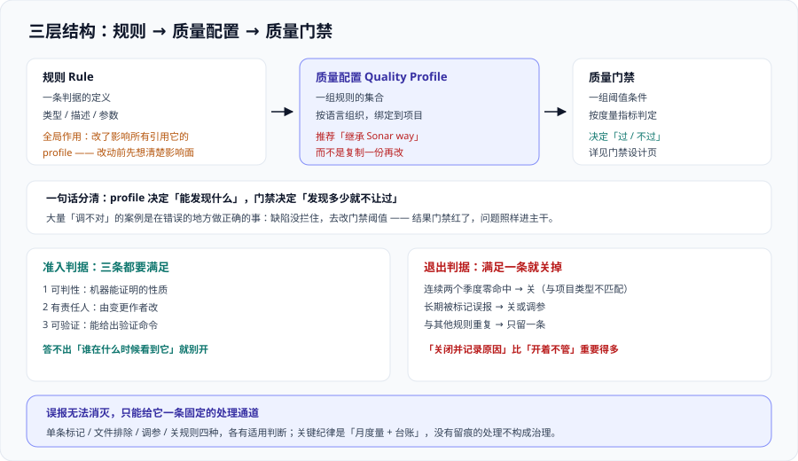

# 规则定制与质量配置

规则集是平台的**判据来源**。装完之后真正决定这套体系好不好用的，不是平台本身，而是**规则集里有哪些规则、它们开了多重、以及误报有没有出路**。

这一页讲三件事：怎么组织规则（质量配置 profile）、怎么调规则的严格程度（参数与严重度）、以及**误报怎么处理**。最后一件最不“技术”，但它是平台能不能活过三个月的分水岭。



## 一、三个概念的关系

先分清三个词，它们在 UI 上挨着，但职责完全不同：

| 概念 | 是什么 | 作用范围 | 改了会怎样 |
| --- | --- | --- | --- |
| 规则（Rule） | 一条判据的定义，含类型、描述、参数 | 全局（平台内置或插件提供） | 影响所有引用它的 profile |
| 质量配置（Quality Profile） | **一组规则的集合**，按**语言**维度组织 | 绑定到项目 | 决定这个项目实际会跑哪些规则 |
| 质量门禁（Quality Gate） | **一组阈值条件**，作用于度量指标 | 绑定到项目 | 决定“过 / 不过”，见 [质量门禁设计](../QualityGate/index.md) |

三者的关系是一句话：**profile 决定“能发现什么”，门禁决定“发现多少就不让过”。**

::: tip 一句话理解
大量“调不对”的案例其实是在错误的地方做正确的事——**想拦住的缺陷没拦住，去改门禁阈值；结果门禁变红了，问题还是进主干。** 正确顺序永远是：先确认规则在 profile 里开着（能发现），再谈门禁（发现多少算不合格）。
:::

## 二、profile 的组织方式

### 按语言，不按团队

profile 是**语言维度**的，一个项目有几种语言就会用到几个 profile。这带来两条实践结论：

- **不要试图用一份 profile 覆盖所有语言。** SQL 规则对 Java 项目无意义；前端规则集里塞 JDBC 规则只会制造零命中。
- **多语言仓库（Java + JS + YAML）会有三个 profile，改动是三处。** 这是“改规则”这件事看起来繁琐的根本原因，不是操作失误。

### 继承，而不是复制

推荐做法是**继承**内置的 `Sonar way`，只表达差异：

| 方式 | 优点 | 缺点 | 什么时候用 |
| --- | --- | --- | --- |
| 直接用内置 `Sonar way` | 零维护 | 不能定制；内置 profile 是**只读**的 | 起飞阶段、试点项目 |
| **继承** `Sonar way` 作为父 profile | 父级新增规则会**自动继承**；差异只有你自己改的那几条，一眼看得清 | 上游调整可能带来意外变化，需要偶尔回看 | **推荐默认** |
| 复制一份再改 | 完全可控，不受上游影响 | **上游的规则更新你收不到**；几份副本长期分叉 | 有强合规要求、必须冻结规则集时 |

一份 profile 的“健康度”可以直接从差异条数看出来：**差异条数超过 20 条的 profile，说明已经从“微调”变成“另起一套”**，这时要回去问：为什么默认集会这么不合适？通常答案是项目类型特殊（如生成代码为主、或数据科学与业务代码混在一个仓库），那么这个特殊性应该写进配置说明，而不是靠人记住。

### 一条纪律：默认 profile 只指一个

每个语言可以有多个 profile，但**只能有一个默认**。默认 profile 会作用于“没有显式绑定 profile”的项目。常见问题：试点时新建了一个 profile 并设为默认，**存量项目不受影响（它们已显式绑定），新项目全部继承新 profile**——于是“为什么老项目报的规则和新项目不一样”。

## 三、参数与严重度：怎么调

不同规则的**可调维度**不同，实际只有四类：

| 可调项 | 例子 | 调整时要想什么 |
| --- | --- | --- |
| 数值阈值 | 认知复杂度上限、方法行数上限、重复块最小行数 | 阈值是**分布问题**：先看当前项目的实际分布，再取一个“能达成但需要努力”的位置 |
| 布尔开关 | 是否要求公共 API 有 Javadoc、是否强制 `final` 参数 | 开关影响面大，先开在“只统计”档验证命中量 |
| 严重度 / 影响等级 | 把某条规则从 Medium 提到 High | **只影响评级与门禁，不影响是否报告**；提级前先确认这条规则命中的一定是真问题 |
| 生效范围 | 排除某些文件、只对某些目录生效 | 排除粒度最容易写错，改完要核对被排除的文件数 |

::: danger 关于阈值类参数的三条纪律
1. **先量分布，再定阈值。** 拿一句“复杂度不能超过 15”直接上线，如果当前代码的中位数已经是 18，这不是门禁而是灾难。做法是先在“只统计”档跑一周，把实际分布读出来。
2. **区分“绝对阈值”与“增量阈值”。** 复杂度上限通常只对**新代码**有意义；对存量代码套绝对阈值等于要求一次性重写。
3. **阈值一旦调整，要重算历史结论。** 门禁条件依赖度量指标，度量随阈值变——**改完阈值后旧的门禁结论不再可比**，这一点要在变更单里写清楚，否则会出现“上周能过这周过不了，代码没动”的困惑。
:::

## 四、规则的准入与退出

规则不是“越多越好”。每加一条都要能回答两个问题：**它拦住了什么？谁会在什么时候看到它？** 答不上来的先别开。

### 准入判据（三条都要满足）

1. **可判性**：这条规则判的是机器能证明的性质（对应 [静态分析与检测器](../StaticAnalysis/index.md) 的六层模型）。
2. **有责任人**：命中之后由**变更的作者**修改，而不是由平台管理员代改。
3. **可验证**：能给出“修好之后应用什么命令确认它不再报”，而不是只能靠人眼看。

### 退出判据（满足任一条就该关掉）

| 现象 | 判据 | 处置 |
| --- | --- | --- |
| 长期零命中 | 连续两个季度命中数为 0 | 关闭并记录原因（规则与项目类型不匹配） |
| 长期被标记误报 | 该规则命中中“标记为不会修复/误报”的比例过高 | 关闭或调参；把结论回写到规则说明里 |
| 与其他规则重复 | 同一处缺陷被两条规则报告 | 只留一条，另一条关闭并写明“由 X 覆盖” |
| 与语言版本冲突 | 规则要求的老写法在现代语言里已不适用 | 关闭；同时记下“升级语言基线后需要重评” |

**“关闭并记录原因”比“开着不管”重要得多。** 原因是：下一个人看到规则关着时，需要知道这是有意为之还是历史遗留。规则说明与项目配置说明是唯一能承载这个信息的地方。

## 五、自定义规则：先算成本

自定义规则是很多团队的“第一反应”，但它有三条成本必须先算：

| 实现方式 | 支持范围 | 一次性成本 | 长期成本 | 建议 |
| --- | --- | --- | --- | --- |
| XPath 模板规则 | 主要面向 Java 这类提供 AST 模板的语言 | 低：写一段 XPath | 中：语言语法升级要跟着改 | **首选**，适合团队自己的约定（如“禁止直接 `new Thread()`”） |
| 平台插件（自研分析器） | 取决于语言 API | 高：要搭一套插件工程与打包链路 | 高：要跟平台大版本同步升级、要自己维护发布 | 只在“必须做且没有替代”时上 |
| 外部工具 + SARIF 导入 | 任意语言 | 中：把外部工具输出转成 SARIF | 低：工具升级时改转换脚本 | **外部已有专业工具的推荐走这条**，见下 |

::: warning 一条比“自研规则”划算得多的路：SARIF 导入
SonarQube 支持**把第三方工具的 SARIF 报告合并进分析结果**。这意味着：如果某个语言或某类缺陷已经有成熟的外部工具（专门的检测器、公司自研的检查脚本），不必把它重写成 Sonar 插件——把它输出成 SARIF 再导入即可。

这条路的三个好处：**平台侧零插件维护成本**、**工具可以独立升级**、**结果统一进同一套门禁与历史趋势**。代价是结果在平台上的“展示细节”不如原生规则丰富（规则说明由你的转换脚本提供）。
:::

## 六、规则冲突怎么裁决

同一个缺陷被多条规则覆盖是常态，不是缺陷。裁决原则按优先级：

1. **优先留“能给出路径”的那条。** 污点分析类的规则能指出数据流路径，模式匹配类的只能指一行——前者对修复者的价值高一个量级。
2. **优先留“与门禁档位匹配”的那条。** 如果要它阻断，必须选误报率最低的那条。
3. **优先留“语言原生”的那条。** 跨语言重复实现的同名规则，行为差异往往比想象的大（同一 `key` 在不同语言下参数与判定范围可能不同）。

裁决结果必须**写成一句话**放进配置说明，例如：「`java:S2077`（SQL 注入）与自定义 XPath 规则重复，保留前者，后者关闭——因为前者能给出从参数到执行的完整路径。」

## 七、误报：必须有出路

误报是这套体系里唯一“无法消灭”的东西（原因见 [静态分析与检测器](../StaticAnalysis/index.md) 第四节）。**能做的不是降低误报率，而是给它一条固定的处理通道。**

| 处置方式 | 作用范围 | 适用判断 | 代价 |
| --- | --- | --- | --- |
| 标记“不会修复”（含理由） | 单个问题 | 确认是误报，且规则在别处有效 | 问题仍会出现在列表里，但不再计入新代码判定 |
| 标记“误报” | 单个问题 | 分析器判断错误 | 平台会用它做统计，**可能影响规则质量改进方向** |
| 在**分析范围**里排除文件 | 文件 / 目录 | 生成代码、测试夹具、示例代码 | **必须核对排除后的文件数**，写错会把真源码排掉 |
| 调整规则参数 | 整个 profile | 阈值不合适 | 影响所有项目，需要回看历史结论 |
| 关闭规则 | 整个 profile | 规则与项目类型不匹配 | 需要写清原因，见第四节 |

一条非常实用的落地纪律：**误报处理要有“月度量”**。

```shell
# 用 API 读出「被标记为误报 / 不会修复」的数量趋势，作为规则治理的输入
curl -s -u "$SONAR_TOKEN:" \
  "$SONAR_HOST_URL/api/issues/search?componentKeys=my-project&resolutions=FALSE-POSITIVE,WONTFIX&ps=1" \
  | jq '.paging.total'

# 期望：这个数应与你上个月手工登记的「误报处理台账」条数一致。
#       若它持续增长而台账没动，说明误报在处理时没有留痕 ——
#       这时规则治理失去了输入，第四节那张「退出判据」表就永远用不上。
```

## 八、验证方式

配置类改动无法“跑测试验证”，但**它的效果可以用 API 客观量出来**。下面三条命令构成一次配置复核：

```shell
# 1. 差异条数：确认 profile 是「微调」还是「另起一套」
curl -s -u "$SONAR_TOKEN:" "$SONAR_HOST_URL/api/qualityprofiles/search?project=my-project" \
  | jq '.profiles[] | {name, language, isDefault, isBuiltIn}'
# 期望：每种语言一条，且自定义的那些 isBuiltIn=false。
#       数量异常（一次出现十几条自定义 profile）说明第二步的「冻结」没执行。

# 2. 规则集规模与开闭状态：确认没有「长期零命中却还开着」的规则
curl -s -u "$SONAR_TOKEN:" \
  "$SONAR_HOST_URL/api/rules/search?qprofile=<PROFILE_KEY>&activation=true&ps=1" \
  | jq '{total: .paging.total}'
# 期望：拿到一个确定的启用规则条数，作为「冻结基线」。
#       下一次复核时对比这个数：只增不减且没有关闭记录，说明退出判据没被执行。

# 3. 误报通道是否活着：这决定了规则治理有没有输入
curl -s -u "$SONAR_TOKEN:" \
  "$SONAR_HOST_URL/api/measures/component?component=my-project&metricKeys=violations,open_issues" \
  | jq '.component.measures[] | {metric, value}'
# 期望：open_issues 与 violations 都在。
#       若 open_issues 长期不降而 violations 在涨，说明「发现问题」在做，「处理问题」没做 ——
#       此时应先降门禁档位或缩规则集，而不是继续加规则。
```

## 参考资料

- Sonar 官方文档 · Quality profiles（profile 的组织、继承与默认绑定）：https://docs.sonarsource.com/sonarqube-server/latest/instance-administration/analysis-functions/quality-profiles/introduction/
- Sonar 官方文档 · Rules（规则类型、参数、可调影响等级与 MQR 模式下的口径）：https://docs.sonarsource.com/sonarqube-server/latest/user-guide/rules/
- Sonar 官方规则库 · Sonar Rules Explorer（按语言检索规则、查看参数与示例代码）：https://rules.sonarsource.com/
- Sonar 官方文档 · Adding coding rules（自定义规则与插件方式，含 XPath 模板规则）：https://docs.sonarsource.com/sonarqube-server/latest/extension-guide/adding-coding-rules/
- Sonar 官方文档 · SARIF reports（把第三方工具结果合并进分析）：https://docs.sonarsource.com/sonarqube-server/latest/analyzing-source-code/importing-external-issues/importing-issues-from-sarif-reports/
- Sonar 官方文档 · Analysis parameters（`sonar.exclusions`、`sonar.issue.ignore.multicriteria` 等配置项）：https://docs.sonarsource.com/sonarqube-server/latest/analyzing-source-code/analysis-parameters/
- 本站 [静态分析与检测器](../StaticAnalysis/index.md) · 规则为什么会有误报：`docs/Tools/CodeQuality/StaticAnalysis/`
- 本站 [质量门禁设计](../QualityGate/index.md) · 门禁阈值怎么定：`docs/Tools/CodeQuality/QualityGate/`
