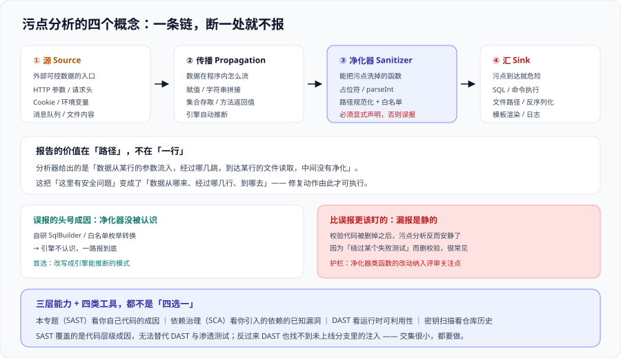

# 安全分析与污点追踪

代码质量平台里的“安全分析”其实是**三种能力叠在一起**，它们的误报率、修复方式、责任人都完全不同。把它们混着讲，就会出现“安全扫描报了一堆，没人知道该改什么”的局面。

这一页把这三层拆开，然后重点讲中间那层——**污点分析（taint analysis）**：它是最贵、误报最多、也最容易配置错的一层。



## 一、三层能力，先分清

| 层次 | 判据 | 典型发现 | 误报率 | 修复动作 | 可用发行版 |
| --- | --- | --- | --- | --- | --- |
| 密钥检测（Secrets） | 高置信度的**字符串模式**匹配（凭据格式、私钥头、云厂商 key 前缀） | 硬编码密码、提交进仓库的 token | 低 | **立刻轮换凭据**，再从历史里清掉 | Community Build 有基础版；商业版覆盖 400+ 模式 |
| 安全热点 / 安全问题（Hotspots / Security Issues） | 规则 + 人工评审 | 弱加密算法、不安全的随机数、关闭了证书校验 | 中 | **先看再判**：热点是“要看一眼”，不是“必须改” | 免费版有安全热点评审 |
| SAST / 污点分析 | **全程序数据依赖** | 注入类缺陷（SQL / 命令 / 路径穿越 / 反序列化） | **高** | 按报告路径改数据流或加净化 | **Developer 起** |

::: tip 一句话理解
**“发现了一个安全问题”和“发现了一段可疑代码”是两件事。** 第一层和第三层报的是“问题”，第二层（热点）报的是“**需要有人来做判断的地方**“——所以热点的门禁条件是”评审比例 = 100%“，而不是”数量 = 0”（见 [质量门禁设计](../QualityGate/index.md) 第三节）。
:::

## 二、污点分析的四个概念

污点分析的全部逻辑可以归结为一条路径：**污点源 → 传播 → （有没有净化器） → 汇**。环上任何一处不成立，就不报。

| 概念 | 定义 | 典型成员 | 配置在哪 |
| --- | --- | --- | --- |
| 源（Source） | 外部可控数据的入口 | HTTP 参数、请求头、Cookie、环境变量、文件内容、消息队列消息 | 引擎内置 + 可扩展 |
| 传播（Propagation） | 数据在程序内怎么流 | 赋值、字符串拼接、集合存取、方法返回值、序列化 | 引擎自动推断 |
| 净化器（Sanitizer） | **能把污点洗掉的函数** | `PreparedStatement` 的占位符、`Integer.parseInt`、路径规范化 + 白名单校验、HTML 转义 | **需要显式声明**，见第四节 |
| 汇（Sink） | 污点到达就危险的操作 | SQL 执行、命令执行、文件路径、反序列化、模板渲染、日志 | 引擎内置 + 可扩展 |

## 三、一次完整的污点路径

看一个例子，它同时是最常见的两个缺陷：SQL 注入与路径穿越。

```java [src/main/java/demo/FileController.java]
@RestController
public class FileController {

    private final JdbcTemplate jdbc;
    private final Path baseDir = Path.of("/srv/reports");

    @GetMapping("/report")
    public String report(@RequestParam String id, @RequestParam String name) {
        // (1) 源：id 与 name 都来自请求参数 => 都是污点
        String sql = "SELECT body FROM reports WHERE id = " + id;   // (2) 传播：拼接 => sql 被污染
        String body = jdbc.queryForObject(sql, String.class);        // (3) 汇：SQL 执行 => 报 SQL 注入

        Path p = baseDir.resolve(name);                              // (4) 传播：resolve => p 被污染
        return Files.readString(p);                                  // (5) 汇：文件读取 => 报路径穿越
    }
}
```

分析器给出的报告形如「**污点从第 1 行的参数流入第 5 行的文件读取，中间没有净化**」，并逐跳列出经过的赋值。**这个“路径”才是报告的核心价值**——它把“这里有安全问题”变成“数据是从哪来、经过哪几行、到哪去”。

对照修复方式，正好能看清两类处置的差别：

| 缺陷 | 修法 | 为什么这样修能让它不报 |
| --- | --- | --- |
| SQL 注入 | 改成参数化查询（占位符 + 参数数组） | **占位符被引擎识别为净化器**：参数不再作为 SQL 文本的一部分参与拼接 |
| 路径穿越 | `normalize()` 之后校验结果仍在 `baseDir` 之下 | 校验函数需要显式声明为净化器，或写成引擎能推断的模式（见下） |

```java [修复后的写法]
// SQL：把"拼接"改成"占位符"，这是一次数据流形态的改变，不是一次转义
String sql = "SELECT body FROM reports WHERE id = ?";
String body = jdbc.queryForObject(sql, String.class, id);

// 路径：先规范化，再断言仍然落在基目录之下
Path p = baseDir.resolve(name).normalize();
if (!p.startsWith(baseDir)) {
    throw new IllegalArgumentException("path escapes base dir");
}
return Files.readString(p);
```

::: danger 路径校验里三个看起来对、其实不对的写法
1. **只做字符串前缀检查**：`name.startsWith("/")` 挡不住 `../`，也挡不住绝对路径与符号链接。
2. **只 `normalize()` 不校验**：规范化只是把 `a/../b` 变成 `b`，它不判断结果有没有跑出基目录。
3. **先读文件再校验**：把校验放在读取之后，等于漏洞已经发生，只是你在事后发现了。
:::

## 四、净化器：这层配置决定误报率

污点分析的所有误报几乎都来自同一个地方：**引擎不知道你的某个函数其实是净化的**。于是它只能保守地假设“数据还是脏的”，一路报到底。

| 情况 | 引擎的行为 | 结果 |
| --- | --- | --- |
| 用了框架自带的参数化 API | 内置识别 | 不报，正确 |
| 用了公司自研的 `SqlBuilder` 安全封装 | **不认识** | 报，**误报** |
| 用了白名单枚举转换 `Status.of(code)` | 通常不认识，除非实现形式可推断 | 报，**误报** |
| 报告里明确“已校验”但取消校验 | 认识（因为校验代码被删了） | 不报 —— **真实的漏报，最危险** |

处置方式按成本从低到高：

1. **改写成引擎能推断的模式**（首选）。例如把“自己拼 SQL 再转义”改成“用参数化 API”，既治误报也治真问题。
2. **显式声明净化器**（需要引擎支持，通常在商业版的安全引擎可定制能力里）。声明时要写清“它为什么安全”，而不是只写“它安全”。
3. **在分析范围里排除该类文件**（最后手段）。代价是**这一整块代码从此不再被安全分析覆盖**——这个代价必须在配置说明里写出来，而不是默默排掉。

::: warning 一条比误报更该关注的指标
**误报是吵，漏报是静。** 上面第四行那种情况——校验代码被删掉之后污点分析**反而安静了**——在实践中很常见，因为删除校验往往是为了“绕过某个测试失败”。

可观测的护栏是：**把“净化器相关的函数被改动”纳入评审关注点**。一个 `sanitize`、`validate`、`escape` 命名的函数被改动时，评审人应该多看一眼：改完之后数据还是净化的吗？
:::

## 五、与相邻能力的边界

安全这件事在流水线上有四个常被混淆的工具，分工必须写死：

| 能力 | 看什么 | 什么时候跑 | 能发现 | 发现不了 |
| --- | --- | --- | --- | --- |
| 本专题（SAST / 代码安全） | **你自己的代码**里的成因 | 提交 / PR | 注入、弱加密、硬编码凭据 | 第三方库的已知漏洞、运行时配置错误 |
| [依赖与安全治理](../../DependencyGovernance/index.md)（SCA） | **你引入的依赖**的已知漏洞 | 提交 / 定时 | CVE、许可证、来源可信 | 你自己的代码写错了 |
| DAST（动态扫描） | **运行中的服务**的响应行为 | 部署后 / 定时 | 配置类问题、真实可利用性 | 代码成因、未上线的分支 |
| 密钥扫描（独立工具） | **仓库历史与提交内容** | 提交 / 全历史 | 已泄漏的凭据 | 代码逻辑缺陷 |

::: tip 一句话理解
**它们不是“四选一”，而是“四层”。** 官方资料里有一句很好用的定位：SAST 覆盖的是**代码层级的成因**，它**无法替代** DAST 与渗透测试对“运行时可利用性”的验证。反过来说，DAST 也永远找不到一个还没上线的分支里的注入——**两者的交集很小，所以都要做**。
:::

## 六、2026.5 的一处破坏性变更

**Security Hotspots 被弃用，改为 Security Issues。**

| 项 | 旧口径 | 新口径（2026.5 起） |
| --- | --- | --- |
| 术语 | 安全热点（Security Hotspot） | 安全 Issue |
| 语义 | “需要人工评审的可疑点” | 直接作为安全问题管理 |
| 门禁条件 | 「安全热点评审率 = 100%」 | 条件口径随之调整 |
| 存量影响 | —— | **自定义门禁里依赖“热点评审率”的条件需要复核**；API 字段与仪表盘维度都会变 |

实践建议：**升级到 2026.5 LTA 之前，先把自定义门禁里所有涉及“热点”的条件列出来**，逐个确认升级后是否仍有效。这件事的成本很低，但漏掉的后果是“门禁看起来还在，其实那条条件已经不判定任何东西了”——正是 [质量门禁设计](../QualityGate/index.md) 第一节第 2 条那类静默失效。

## 七、验证方式

安全分析的结论无法靠“看报告”验证，但**它的配置与覆盖范围可以客观核对**：

```shell
# 1. 确认安全类规则确实在 profile 里启用了（否则"没报"什么都不说明）
curl -s -u "$SONAR_TOKEN:" \
  "$SONAR_HOST_URL/api/rules/search?qprofile=<PROFILE_KEY>&activation=true&types=VULNERABILITY&ps=1" \
  | jq '{total: .paging.total}'
# 期望：拿到一个明确的安全规则条数。
#       为 0 说明这个语言的 profile 里一条安全规则都没开 —— 此时「安全扫描通过」是没有意义的结论。

# 2. 核对最近一次分析里的安全问题明细与路径
curl -s -u "$SONAR_TOKEN:" \
  "$SONAR_HOST_URL/api/issues/search?componentKeys=my-project&types=VULNERABILITY&ps=10&additionalFields=flows" \
  | jq '.issues[] | {rule: .rule, message, component, line, flows: (.flows | length)}'
# 期望：每条问题都能读到 flows（污点路径的跳数）。
#       flows 为空而类型是漏洞的条目，通常是模式匹配类规则命中的 ——
#       这类必须人工确认，不要直接按「漏洞」处置（它的误报率明显更高，见第一节）。

# 3. 核对「净化器相关函数」最近有没有被改动 —— 漏报的主要来源
git log --since="30 days ago" --oneline -- '*Sanitiz*' '*Validat*' '*Escap*' '*SqlBuilder*'
# 期望：若有输出，逐个确认改动之后数据是否仍被净化。
#       这一条的重点不是命令本身，而是「把它变成一次例行的复核」——
#       漏报在平台上不可见，只能靠这类外部线索发现。
```

## 参考资料

- Sonar 官方规则库 · Security 类规则（按语言与 CWE 检索安全规则，含污点路径说明）：https://rules.sonarsource.com/
- Sonar 官方发布说明 · SonarQube Server 2026.5 LTA（Security Hotspots 弃用为 Security Issues、SCA reachability、密钥掩码）：https://community.sonarsource.com/t/sonarqube-server-2026-5-lta/189075
- Sonar 官方博客 · 各发行版对比（污点分析与增强密钥检测属于 Developer 及以上的能力边界）：https://www.sonarsource.com/blog/sonarqube-compare-editions
- OWASP · Top 10（2021，注入类缺陷在其中的位置；对照 SAST 覆盖率）：https://owasp.org/Top10/
- OWASP · Source Code Analysis Tools（静态安全分析工具的定位与局限，含误报率讨论）：https://owasp.org/www-community/Source_Code_Analysis_Tools
- NIST · SP 800-218 Secure Software Development Framework（SSDF，SAST 在安全开发实践中的对应项）：https://csrc.nist.gov/pubs/sp/800/218/final
- CWE · Top 25 最危险软件弱点（安全规则背后的弱点分类，用于判断规则覆盖了哪一类）：https://cwe.mitre.org/top25/
- 本站 [依赖与安全治理](../../DependencyGovernance/index.md) · SCA 与依赖侧漏洞优先级：`docs/Tools/DependencyGovernance/`
- 本站 [安全加固 · 扫描工具链../../../Ops/SecurityHardening/ScanningToolchain/index.md) · SAST / DAST / SCA 在流水线里的挂载位置：`docs/Ops/SecurityHardening/ScanningToolchain/`
