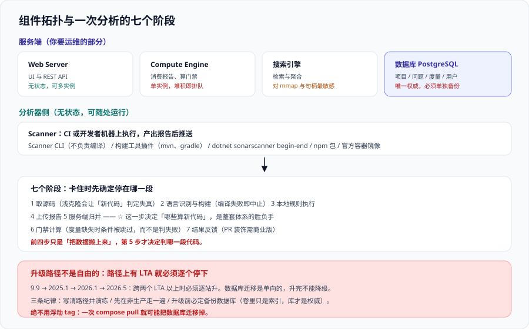

# SonarQube 平台与部署

SonarQube 是一个**服务端 + 分析器**构成的静态分析平台：分析器在 CI 或开发者机器上跑，把结果推给服务端；服务端负责存储、聚合、算出门禁结论，再把结论反馈回 IDE 与 PR。

这一页讲**装起来、升上去、备份出来**这三件运维层面的事。规则怎么定制见 [规则定制与质量配置](../RuleCustomization/index.md)，门禁怎么定阈值见 [质量门禁设计](../QualityGate/index.md)——**部署做错的话，后面两页的配置都会失去意义**（最常见的是版本钉不住，升级直接把数据库迁移掉）。



## 一、组件拓扑：五个部分

| 组件 | 职责 | 关键性质 | 挂了会怎样 |
| --- | --- | --- | --- |
| Web Server | 提供 UI 与 REST API | 无状态，可多实例 | 页面与 API 不可用，**分析仍可继续排队** |
| Compute Engine（CE） | **消费分析报告**、算质量门禁、写库 | **单实例**（社区版只有一个 worker） | 分析任务堆积，门禁永远处于“等待中” |
| 搜索引擎（Elasticsearch） | 问题的全文检索与聚合 | 对内存与文件句柄最敏感 | 服务起不来或反复重启 |
| 数据库（PostgreSQL） | 唯一权威存储：项目、问题、度量、用户 | **必须外部部署并单独备份** | 数据丢失不可恢复 |
| Scanner（分析器） | 在目标仓库侧执行，产出报告 | **无状态、可随处运行** | 分析失败，不影响服务端 |

::: danger 三处最容易踩的坑
1. **把 CE 当成可以水平扩容的组件。** 社区版 CE 是单实例；「加机器就能更快」在这里不成立。分析慢的正确解法是**做增量分析**（见 [流水线与 PR 集成](../PipelineIntegration/index.md)），不是加副本。
2. **数据库与实例同生共死。** Compose 里把 PostgreSQL 和服务端写在同一个编排文件里，很容易顺手 `down -v` 把数据卷删掉。**数据库要能独立于实例存活、独立备份**。
3. **对搜索引擎的宿主机参数不设。** 它要求宿主机的 `vm.max_map_count` 与文件句柄数达到下限，没设的表现是**容器起来后反复重启**，而日志里只有内存或 mmap 报错。
:::

## 二、一次分析的七个阶段

理解这个流程，才能在“分析卡住”时知道该看哪儿：

| 阶段 | 在哪发生 | 产物 | 常见失败点 |
| --- | --- | --- | --- |
| 1. 拉取源码与配置 | Scanner | 本地工作副本 | 浅克隆导致责任信息缺失（见下） |
| 2. 语言识别与构建 | Scanner | 语法树、编译产物 | 编译失败 → 分析直接中止 |
| 3. 本地规则执行 | Scanner | 未上传的中间报告 | 规则集版本与服务端不一致 |
| 4. 上传报告 | Scanner → Web | 任务 ID | 网络 / 代理 / token 权限 |
| 5. 服务端归并 | CE | 与上一版对比后的**新代码**判定 | **新代码口径没定义 → 全量当成新代码** |
| 6. 门禁计算 | CE | 门禁状态与条件明细 | 指标缺失（如覆盖率报告没传） |
| 7. 结果反馈 | CE → PR / IDE | 装饰评论、IDE 本地标记 | 分支分析在免费版不可用 |

::: tip 一句话理解
**第 5 步是整套体系的胜负手。** 前四步只是“把数据搬上来”，第 5 步决定“哪些算新的”。口径没定义时，服务端会把**大量历史代码**也卷进新代码范围，于是第一次扫描门禁就红——这正是 [总览](../Overview/index.md) 边界二描述的那个场景。
:::

关于第 1 阶段有一个非常具体的坑，值得单独写出来：

```shell
# 责任信息（谁写的这行、那次提交的 hash）来自 git 历史。
# 浅克隆会让分析器看不到足够的历史，结果是「新代码」判定失真、或者 issues 的 blame 为空。
git fetch --unshallow || git fetch --depth=2147483647
```

CI 默认的 `actions/checkout` 深度是 1。**没有全量历史，服务端无法把问题挂到正确的提交上**，门禁的“新代码”结论就不可信。

## 三、发行版、许可与能力边界

选型不是“选功能多少”，而是**先回答“要不要分支与 PR 分析”**——这一条几乎决定了预算：

| 发行版 | 许可 | 分支 / PR 分析 | 语言覆盖 | 安全能力 | 组合（Portfolio）| 建议使用场景 |
| --- | --- | --- | --- | --- | --- | --- |
| Community Build | 二进制 **LGPLv3** + 打包的分析器 **SSALv1**（自 2024-11-29） | **仅主分支，无 PR 分析 / 无 PR 装饰** | 20+ 语言与框架 | 基础密钥检测、安全热点评审 | 无 | 个人、原型、小团队、开源项目 |
| Developer | 商业 | **支持特性/维护分支与 PR 分析、PR 装饰** | + C/C++、Swift、Dart、ABAP、YAML/JSON、Ansible、Shell 等 | SAST（污点分析）、400+ 密钥模式 / 340+ 规则 | 无 | 100K+ 行代码、要 PR 反馈的团队 |
| Enterprise | 商业 | 同上，**DevOps 平台集成不限数量** | 再加 Apex、COBOL、Gosu、JCL、PL/I、RPG、VB6 | 安全引擎可定制、私有密钥规则、合规报告（PCI DSS / OWASP / CWE Top 25 / STIG 等） | **有** | 多团队、要合规与审计报告的组织 |
| Data Center | 商业 | 同上 | 同上 | 同上 | 有 | 高可用、组件冗余、K8s 自动扩缩 |

两条容易被忽略的事实：

- **Community Build 同时只能处理一个分析**（官方文档明确列出这条性能限制）。团队规模上去之后，“排队”会先于“功能不够”成为瓶颈。
- **Community Build 实际上包含自定义质量配置与自定义门禁**（以及 SAML 单点登录）。也就是说：**免费版缺的核心是“协作反馈链路”，不是“规则能力“**。这条判断能省掉很多”要不要为规则付费”的纠结。

::: info 许可上的双重结构（2026-10 口径）
Sonar 官方的许可说明记录了一次变更：Community Build 与 SonarQube for IDE **原本整体为 GNU LGPLv3**；**自 2024-11-29 起，二进制仍以 LGPLv3 发布，但打包进去的分析器（analyzers）改用 SSALv1（Sonar Source-Available License v1.0）**；不含分析器的那部分源码仍为 LGPLv3。

实践含义：**公司内部自用不受影响**；**二次分发、或用它提供与 SonarQube 实质相同的服务**时，受 SSALv1 的“非竞争用途”条款约束。法务口径以官方许可页当时文本为准，本页不构成法律意见。
:::

## 四、部署：最小可跑的 Compose

下面这份编排是“能起来并完成一次分析”的最小集合。它刻意做了三件事：**数据库独立持久化、搜索引擎的宿主机参数显式设置、版本 tag 显式钉住**。

```yaml [compose.yaml]
services:
  db:
    image: postgres:17
    environment:
      POSTGRES_USER: sonar
      POSTGRES_PASSWORD: "${POSTGRES_PASSWORD:?must be set}"
      POSTGRES_DB: sonar
    volumes:
      - sonar-db-data:/var/lib/postgresql/data
    healthcheck:
      test: ["CMD-SHELL", "pg_isready -U sonar -d sonar"]
      interval: 10s
      timeout: 5s
      retries: 10
    restart: unless-stopped

  sonarqube:
    # 钉住明确版本：浮动 tag 会在下一次 pull 时把数据库迁移掉
    # 商业版形如 sonarqube:2026-lta-developer；免费版为 sonarqube:community（跟随最新月度 Build）
    # 实际可用 tag 以官方镜像页为准，这里只固定「不要用 latest / 不要用浮动发行版名」这条纪律
    image: sonarqube:community
    depends_on:
      db:
        condition: service_healthy
    environment:
      SONAR_JDBC_URL: "jdbc:postgresql://db:5432/sonar"
      SONAR_JDBC_USERNAME: sonar
      SONAR_JDBC_PASSWORD: "${POSTGRES_PASSWORD:?must be set}"
      # 交给容器的堆上限：小机器上不设会被 Elasticsearch 的内存要求顶死
      SONAR_WEB_JAVAOPTS: "-Xmx1g"
      SONAR_CE_JAVAOPTS: "-Xmx1g"
      SONAR_SEARCH_JAVAOPTS: "-Xms1g -Xmx1g"
    ports:
      - "127.0.0.1:9000:9000"
    volumes:
      - sonar-data:/opt/sonarqube/data
      - sonar-extensions:/opt/sonarqube/extensions
      - sonar-logs:/opt/sonarqube/logs
    ulimits:
      nofile:
        soft: 131072
        hard: 131072
    restart: unless-stopped

volumes:
  sonar-db-data:
  sonar-data:
  sonar-extensions:
  sonar-logs:
```

宿主机侧还有一条必须在**启动前**完成的设置，否则容器会反复重启：

```shell
# Elasticsearch 对 mmap 数量的要求；不设的表现是容器起来又退出，日志里是内存相关报错
sudo sysctl -w vm.max_map_count=524288
sudo sysctl -w fs.file-max=131072
# 永久生效
printf 'vm.max_map_count=524288\nfs.file-max=131072\n' | sudo tee /etc/sysctl.d/99-sonarqube.conf

# 另外三条容器侧的硬性前提（SonarQube 镜像刻意不以 root 运行）：
#   1. 不要用 --user root 覆盖镜像默认用户
#   2. 挂载目录的属主必须是镜像内的运行用户（否则日志目录写不进去）
#   3. 数据卷不要用 NFS 等不支持文件锁的存储
docker compose up -d
docker compose logs -f sonarqube   # 看到 "SonarQube is operational" 才算起来
```

::: warning 关于 2026.5 及以后的两个前置
- **数据库最低 PostgreSQL 15**。低于此版本的升级会被拒绝，必须先升库。官方还移除了 Helm chart 里的 PostgreSQL 依赖，**依赖内置数据库的生产环境必须先迁到外部数据库**。
- **服务端需要完整 JDK，且 Java 25 可作为运行时、Java 17 已不再支持**；JS/TS 扫描器**不再支持 Node.js 20**。升级前把这三项一次性对齐，比在维护窗口里逐个发现要便宜得多。
:::

## 五、升级：路径不是自由的

这是本页最该记住的一节。SonarQube 的升级**必须逐个 LTA 停下**：

| 你的当前版本 | 目标版本 | 必须经过 | 说明 |
| --- | --- | --- | --- |
| `2026.1` LTA | `2026.5` LTA | 直达 | 上一个 LTA 到当前 LTA |
| `2026.2`（LTA 之后的中间版） | `2026.5` LTA | 直达 | 路径上**没有夹着别的 LTA**，可以直接升；判据是「从你到目标之间还有没有未升的 LTA」，不是「跨了几个版本号」 |
| `2025.1`（已不活跃 LTA） | `2026.5` LTA | **`2025.1` → `2026.1` → `2026.5`** | 跨两个 LTA，**必须停一次** |
| `9.9` | `2026.5` LTA | `9.9` → `2025.1` → `2026.1` → `2026.5` | 老实例最常见的一条路，跨三次 |

三条配套纪律：

1. **写清升级路径并演练一次。** 官方文档的说法是“路径上只要存在 LTA，就必须先升到每个中间 LTA 再升目标版本”。把路径写进变更单，就不会在维护窗口里现算。
2. **非生产实例先升一次。** 数据库迁移是**单向**的，升级后**不能降级**。先在生产之外把全过程走一遍并记下耗时。
3. **升级前必定备份数据库。** 见下一节。

```shell
# 备份（数据库是唯一权威存储；data 卷只是缓存与索引，可重建）
docker compose exec -T db pg_dump -U sonar -d sonar -Fc > sonar-$(date +%Y%m%d-%H%M).dump

# 恢复演练（务必在临时容器里做，不要在生产实例上验证恢复）
docker run --rm -i --network sonar_default -e PGPASSWORD="$POSTGRES_PASSWORD" postgres:17 \
  pg_restore -h db -U sonar -d sonar-restore-check --clean --if-exists < sonar-20261014-0930.dump

# 期望：pg_restore 无 error 退出；随后用 API 核对项目数与问题数是否与备份前一致
curl -s -u "$SONAR_TOKEN:" "$SONAR_HOST_URL/api/components/search?qualifiers=TRK&ps=1" | jq '.paging.total'
```

::: danger 升级类事故的三个成因
1. **用浮动 tag。** `sonarqube:developer` 一类的 tag 会随上游更新而指到新版本，下一次 `docker compose pull` 就可能把数据库迁移掉。
2. **跳过中间 LTA。** 报错通常出现在数据库迁移阶段，而此时**回滚已经没有意义**（迁移是单向的）。
3. **只备份了数据卷没备份数据库。** 数据库才是权威，卷里是索引；恢复卷但库是旧的，等于把两个不配套的东西拼在一起。
:::

## 六、验证方式

装完之后，下面四条命令构成一次完整自检。它们全部只依赖 HTTP API 与容器运行时：

```shell
# 1. 服务状态：必须看到 UP，且版本与你钉住的一致
curl -s "$SONAR_HOST_URL/api/system/status" | jq '{status, version}'
# 期望：{"status":"UP","version":"<你钉住的版本号>"}
# 若 status 是 STARTING 且长时间不变，去容器日志看 Elasticsearch 相关报错（先查 vm.max_map_count）。

# 2. 计算引擎是否在消费：看待处理任务数是否回落
curl -s -u "$SONAR_TOKEN:" "$SONAR_HOST_URL/api/ce/activity?ps=5" | jq '.tasks[] | {status, type, submittedAt}'
# 期望：第一次分析之后能看到 status 为 SUCCESS 的记录。
#       若长期是 PENDING，说明 CE 没起来或 worker 卡住 —— 此时门禁会一直"等待中"，从 UI 上看不出原因。

# 3. 数据库前置版本是否达标（2026.5 起最低 PostgreSQL 15）
docker compose exec -T db psql -U sonar -d sonar -tAc "show server_version;"
# 期望：15 以上。低于 15 时服务端会拒绝启动或升级。

# 4. 许可与能力边界自查：确认自己用的是哪一档，别按商业版文档去配免费实例
curl -s -u "$SONAR_TOKEN:" "$SONAR_HOST_URL/api/navigation/global" | jq '{edition: .edition, version: .version}'
# 期望：edition 显示 community / developer / enterprise / datacenter。
#       community 下如果尝试启用分支分析，API 会返回权限或功能不可用 —— 这不是配置问题，是许可边界。
```

## 参考资料

- Sonar 官方下载页（当前 LTA、Community Build 版本号与各发行版能力对照）：https://www.sonarsource.com/products/sonarqube/downloads/
- Sonar 官方发布说明 · SonarQube Server 2026.5 LTA（PostgreSQL 15+、Java 25 运行时、Java 17 与 Node.js 20 支持变化、Helm chart 变更）：https://community.sonarsource.com/t/sonarqube-server-2026-5-lta/189075
- Sonar 官方发布说明 · SonarQube Server 2026 Release 1 LTA（服务端 JDK 要求、Kubernetes 版本、ZIP 安装弃用）：https://community.sonarsource.com/t/sonarqube-server-2026-release-1-lta/177042/1
- Sonar 官方文档 · Docker 安装与宿主机前提（`vm.max_map_count`、文件句柄、非 root 运行）：https://docs.sonarsource.com/sonarqube-server/latest/setup-and-upgrade/install-the-server/installing-sonarqube-from-docker/
- Sonar 官方文档 · Determine your update path（逐 LTA 升级路径的官方判据）：https://docs.sonarsource.com/sonarqube-server/latest/setup-and-upgrade/update-your-instance/determine-your-update-path/
- Sonar 官方博客 · SonarQube 各发行版对比（Community Build 的分支/PR 限制、单并发分析、语言覆盖差异）：https://www.sonarsource.com/blog/sonarqube-compare-editions
- Sonar 官方许可说明（LGPLv3 与 SSALv1 的双重许可口径）：https://www.sonarsource.com/legal/terms-and-conditions/
- 本站 [规则定制与质量配置](../RuleCustomization/index.md) · 装好之后的规则治理：`docs/Tools/CodeQuality/RuleCustomization/`
- 本站 [CI/CD](../../CICD/index.md) · 流水线侧如何调用扫描器：`docs/Tools/CICD/`
