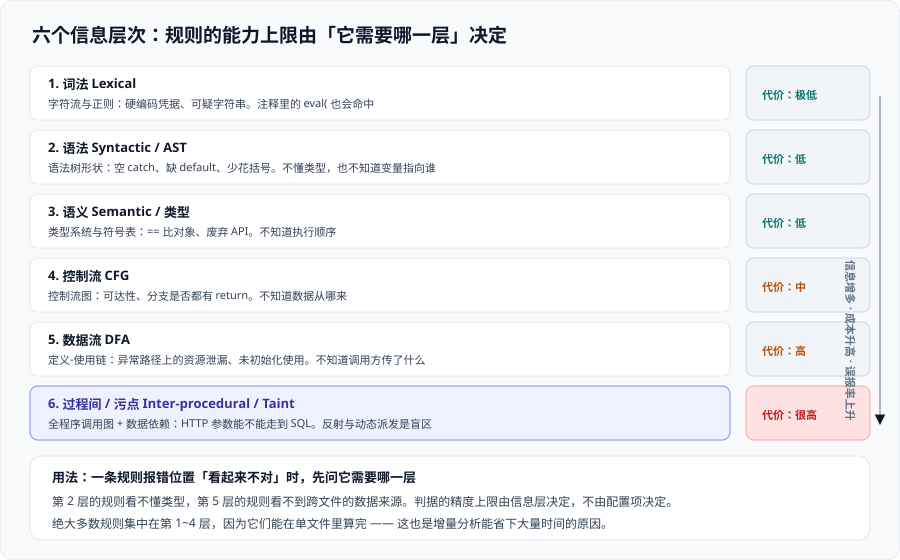

# 静态分析与检测器

静态分析（Static Analysis）指**在不运行代码的前提下**，通过分析源码来发现缺陷。它是所有代码质量规则的技术底座：判断一条规则「能不能写」，本质上是问「它需要哪一层信息」。

这一页的作用不是教你写分析器，而是让你在**看到一条规则不报、或者报错了**的时候，能立刻定位到原因出在哪一层。



## 一、六个层次：从字符到跨过程

静态分析不是一种技术，而是一条**逐层加深的流水线**。每一层能拿到的信息都比上一层多，成本也高一个量级：

| 层次 | 输入 | 能回答的问题 | 拿不到的东西 |
| --- | --- | --- | --- |
| 1. 词法（Lexical） | 字符流 | 「这行里出现了 `eval(` 吗」「有硬编码的可疑字符串吗」 | 完全不理解结构，注释里的 `eval(` 也会命中 |
| 2. 语法（Syntactic / AST） | 抽象语法树 | 「有没有空的 `catch` 块」「`if` 后面少了花括号吗」 | 不知道类型、不知道变量实际指向谁 |
| 3. 语义（Semantic / 类型） | AST + 类型信息 + 符号表 | 「`==` 两边是对象还是值」「这里用了个已废弃的 API」 | 不知道执行顺序 |
| 4. 控制流（CFG） | 控制流图 | 「这段代码可达吗」「每个分支都有 `return` 吗」 | 不知道数据从哪来 |
| 5. 数据流（DFA） | CFG + 变量的定义-使用链 | 「这个资源在异常路径上泄漏了吗」「这个变量没初始化就用了」 | 不知道调用方传了什么进来 |
| 6. 过程间 / 污点（Inter-procedural / Taint） | 全程序的调用图 + 数据依赖 | 「HTTP 参数能不能一路走到 SQL 语句」 | 反射、动态派发、配置驱动的路径 |

**层次越高，越贵。** 这也是为什么同一套规则集里，绝大多数规则集中在第 1~4 层——它们可以在**单文件**里算完，增量分析时只需要重算改动的文件。

::: tip 一句话理解
一条规则报错位置「看起来不对」时，第一个该问的问题是：**它需要哪一层的信息？** 第 2 层的规则看不懂类型，第 5 层的规则看不懂跨文件的数据来源。**判据的精度上限由信息层决定，不由配置项决定。**
:::

## 二、七类检测器的能力与代价

把上面六层组合起来，实际产品里的检测器可以归成七类。**这张表是本页最该记住的东西**：

| 检测器 | 依据 | 典型规则 | 误报形态 | 判定代价 |
| --- | --- | --- | --- | --- |
| 模式匹配 | 词法 + 正则 | 硬编码密码、`MD5` 用于口令、注释里的 TODO | 「示例代码」「测试用的假密钥」也命中 | 极低 |
| 语法模式 | AST 形状 | 空 `catch`、`switch` 缺 `default`、多余的分号 | 「这里确实不需要 `default`」 | 低 |
| 类型与签名 | 类型系统 | `equals` 与 `==` 混用、`null` 传给非空参数 | 泛型擦除后的场景判不准 | 低 |
| 度量阈值 | 计数 | 认知复杂度 > 15、方法行数 > 100、参数 > 7 | 「这就是一个查表函数」——复杂度高但与缺陷无因果 | 极低 |
| 重复检测 | 归一化后的 token 序列 | 复制粘贴的重复块 | 生成的代码、结构相似但语义无关的代码 | 中 |
| 数据流 | 定义-使用链 | 资源泄漏、未初始化、永远为真的比较 | 早期 `return`、自定义的关闭路径识别不到 | 高 |
| 污点分析 | 全程序数据依赖 + 净化器规则 | 注入类缺陷（SQL / 命令 / 路径穿越） | **误报与漏报都多**，靠净化器规则收敛 | 很高 |

前五类的判据是**可判定的局部性质**，第 6、7 类需要**推断程序行为**——这是它们的误报率明显更高的根本原因，不是实现质量问题。

## 三、同一个缺陷，四类检测器各自会怎么说

拿一个真实的小缺陷看差别：**用户输入拼接进 SQL**。

```java
@GetMapping("/orders")
public List<Order> search(@RequestParam String keyword) {
    String sql = "SELECT * FROM orders WHERE note LIKE '%" + keyword + "%'";
    return jdbcTemplate.query(sql, orderRowMapper);
}
```

四类检测器看到的完全是不同的东西：

| 检测器 | 它实际“看”到的 | 会不会报 |
| --- | --- | --- |
| 模式匹配 | 这一行有字符串 `SELECT` 加号拼接 | 会报，但**报的是“拼接 SQL 字符串”这个形状**，换一种拼法就不报了 |
| AST 形状 | `+` 表达式里一个常量一个变量 | **不报**——拼接本身是合法语法 |
| 数据流 | `keyword` 从参数传到 `sql` 变量 | 会报“数据从参数流向敏感 API” |
| 污点分析 | `keyword` 是污点源（`@RequestParam`）→ 未经过净化器 → 流入 SQL 执行 | 会报，且能给出**完整路径**；若中间出现过 `validate(keyword)` 且它被声明为净化器，则**不报** |

**这一段解释了一个常见困惑**：为什么同一个漏洞，A 项目报、B 项目不报？因为 B 项目在早期加过一个自定义校验方法，并把它**注册成了净化器**——污点分析认为数据已经被清洗过。

::: danger 三处最容易误判的地方
1. **把“没报”当成“没有”。** 静态分析的漏报是**结构性**的：反射调用、`invoke` 动态派发、配置驱动的分支（如从 YAML 读到的列名），分析器一律只能保守假设。没报只说明“在它能看到的路径上没找到”。
2. **把“报了”当成“必须改”。** 第 1 类检测器的命中里，测试夹具、示例代码、故意写坏的负向用例占了很大比例。正确做法是在**分析范围**里排除，而不是关掉规则（关掉规则会连生产代码一起放走）。
3. **改了净化器规则却不复扫。** 净化器一放开，全库的污点结论都会变。这类改动必须**全量重扫一次**，不能只跑增量——增量只算改动文件，它的结论建立在“其他文件没变”的假设上。
:::

## 四、误报与漏报的结构性来源

| 现象 | 根因 | 正确处置 |
| --- | --- | --- |
| 报了一个“其实不可能发生”的缺陷 | 缺少调用方上下文（过程内分析） | 补一个 `assert` 或空判断让分析器看到约束，而不是关规则 |
| 一段好好的代码被判为泄漏 | 自定义的释放路径分析器不认识 | 用注解 / 配置声明它是释放方法，让分析器认识 |
| 大量重复代码块被报 | 生成代码没被排除 | 在 `sonar.exclusions` / 分析范围里排除生成目录 |
| 规则长期零命中 | 规则与语言特性不匹配（如给纯前端仓库开 JDBC 规则） | 按语言维护 profile，**不要用一份 profile 覆盖所有语言** |
| 同一处缺陷报了三遍 | 三条规则覆盖同一个形状 | 在 profile 里只留一条，其余关掉并记录原因 |

一张判断用的对照表：

| 你能证明结论吗 | 分析器能不能证明 | 结果 | 你该做什么 |
| --- | --- | --- | --- |
| 能 | 能 | 报，且是真问题 | 改代码 |
| 能 | 不能 | **漏报** | 不要指望工具；用测试或评审补 |
| 不能 | 能 | 报，但可能是误报 | 补上下文让分析器收敛，或标记为“不会修复”并写原因 |
| 不能 | 不能 | 都不报 | 属于**设计层**的问题，见 [总览](../Overview/index.md) 边界一 |

## 五、为什么“过程间分析”贵一个量级

把分析从单文件推到跨文件，代价来自三处，理解它们能帮你判断**该不该开这条规则**：

1. **状态爆炸。** 单文件分析的输入是“这一棵树”；跨文件分析的输入是“所有可能的调用组合”。真实项目里这个组合数会很快超出算力预算，所以分析器必须**做近似**——近似就是误报与漏报的来源。
2. **编译期 vs 分析期。** 跨文件分析需要先建**调用图**，而调用图在有多态、反射、回调的语言里无法精确构造。Java 的分析器要借助字节码，Python 这类动态语言只能靠启发式。
3. **增量失效。** 单文件分析可以只重算改动的文件；跨文件分析一旦有文件改动，**它的邻居结论都可能变**，所以增量范围要往外扩。这直接影响流水线耗时，是实践中“为什么开了污点分析之后 PR 检查从 2 分钟变成 8 分钟”的原因。

实践中对应的三条工程决定：

| 决定 | 常见做法 | 代价 |
| --- | --- | --- |
| 污点分析放哪跑 | 放**主干 / 夜间**，PR 只跑增量 | PR 反馈快，但缺陷发现滞后一次合并 |
| 要不要全量重扫 | 只在**净化器规则 / 分析范围变更**时全量 | 平时省时间，变更时慢一次 |
| 生成代码怎么处理 | 直接 `exclusions` 排除，不进分析范围 | 排除粒度写错会把真源码一起排掉，**排除后要核对文件数** |

## 六、能力边界总表

放在一起看，哪一类缺陷“静态分析基本抓不到”：

| 缺陷类别 | 静态分析覆盖率 | 说明 |
| --- | --- | --- |
| 编码规范、命名、格式 | 极高 | 本来就是可判定性质 |
| 空指针 / 资源泄漏（局部） | 高 | 数据流能覆盖大部分 |
| 注入类（有明确源的） | 中 | 取决于净化器规则质量 |
| 并发与时序（死锁、竞态） | **低** | 需要线程交错模型，工业静态分析基本不做 |
| 业务逻辑算错 | **极低** | 需要需求语义 |
| 需求理解偏差 | 无 | 任何静态分析都覆盖不到 |
| 性能退化（N+1 查询等） | 低 | 需要运行时数据 |

**这张表的用法**：当团队抱怨“上了平台还是出事故”时，先查事故属于哪一行。落在下面四行的事故，**不是工具的失职**——它们该由测试、压测、混沌演练、评审分别承担，参见 [总览](../Overview/index.md) 第四节。

## 七、验证方式

静态分析本身的结论无法“跑命令验证”，但**它的三层能力差异可以在自己的仓库上实测出来**，这是判断某条规则属于哪一类的最快方法：

```shell
# 第 1 步：取一条你怀疑是"模式匹配"的规则，看它的类型与所需信息
curl -s -u "$SONAR_TOKEN:" "$SONAR_HOST_URL/api/rules/show?key=java:S2077" \
  | jq '{key: .rule.key, type: .rule.type, severity: .rule.severity, cleanCode: .rule.cleanCodeAttribute}'

# 期望：能看到 type 与 cleanCodeAttribute 两个字段。
#       如果一条规则同时出现在多个语言 profile 里但 key 语言前缀不同（java:S2077 / python:S2077），
#       说明它是"同一个形状在各语言里各写了一遍"——这类规则的行为差异通常比想象的大。
```

```shell
# 第 2 步：确认"分析范围"排除了什么 —— 这是第 4 节里"排除粒度写错"的兜底检查
curl -s -u "$SONAR_TOKEN:" "$SONAR_HOST_URL/api/settings/values?component=my-project&keys=sonar.exclusions,sonar.test.exclusions" \
  | jq '.settings[] | {key, value}'

# 期望：能读到你写的排除规则。若返回空，说明排除写在扫描器命令行而不是服务端，
#       此时要回读 CI 配置 —— 两处都写且不一致时，以扫描器侧为准（服务端设置可能被覆盖）。
```

```shell
# 第 3 步：核对"改成净化器规则后有没有全量重扫"
curl -s -u "$SONAR_TOKEN:" "$SONAR_HOST_URL/api/measures/component?component=my-project&metricKeys=last_analysis_date,analysis_count" \
  | jq '.component.measures[] | {metric, value}'

# 期望：last_analysis_date 应晚于你改配置的时间。
#       如果它早于改动时间，说明那一轮结论仍然是旧净化器算出来的 —— 此时"没报"不可采信，
#       处理方式：触发一次不带增量的全量分析，再比对问题数变化。
```

这三条命令测的都是**配置与结论的可追溯性**，不是工具的准确率——准确率只能靠自己在真实数据上看，见 [规则定制与质量配置](../RuleCustomization/index.md) 的复核流程。

## 参考资料

- Sonar 官方文档 · SonarQube Server architecture（分析器内部的符号表、数据流与语义分析阶段）：https://docs.sonarsource.com/sonarqube-server/latest/architecture/architecture-introduction/
- Sonar 官方文档 · Rule types and severities（规则类型、严重度与 MQR 模式下的分类口径）：https://docs.sonarsource.com/sonarqube-server/latest/user-guide/rules/
- Sonar 官方规则库 · Sonar Rules Explorer（按语言与缺陷类型检索全部规则，含每条规则的技术依据）：https://rules.sonarsource.com/
- OWASP · Source Code Analysis Tools（静态分析工具的定位与局限，含误报率讨论）：https://owasp.org/www-community/Source_Code_Analysis_Tools
- NIST · SP 800-218 Secure Software Development Framework（SSDF，静态分析在 SSDF 实践中的对应位置）：https://csrc.nist.gov/pubs/sp/800/218/final
- 本站 [安全分析与污点追踪](../SecurityAnalysis/index.md) · 污点分析在 Sonar 上的落地与误报治理：`docs/Tools/CodeQuality/SecurityAnalysis/`
- 本站 [依赖与安全治理](../../DependencyGovernance/index.md) · 依赖侧扫描与本专题的边界：`docs/Tools/DependencyGovernance/`
