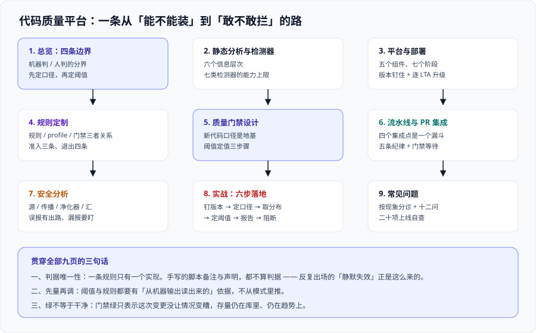

# 代码质量平台

代码质量平台回答的是**一个几乎没人愿意正面回答的问题**：这段代码到底「够不够好」，谁来判、按什么判、判完谁必须停下来改。

它和测试的分工很容易搞混：**测试验证「行为对不对」，质量平台检查「代码本身好不好」**。测试通过了，代码照样可能有一百个重复块、三层嵌套的 `if`、一个硬编码的数据库密码——它们不会让任何一条测试变红，但会在半年后变成「这个模块没人敢改」。

本专题讲的是 Sonar 这一套平台（SonarQube Server / Community Build / Cloud 与 IDE 端）**装起来之后的事**：规则从哪来、新代码口径怎么定、门禁阈值凭什么定成 80%、门禁红了到底该谁改。它不重复讲 CI 流水线怎么搭（那是 [CI/CD](../CICD/index.md) 的职责），也不讲依赖包自身的漏洞（那是 [依赖与安全治理](../DependencyGovernance/index.md) 的职责）。

::: tip 一句话理解
代码质量平台的价值不在「发现了多少个问题」，而在**「把质量这件事从一次性的评审意见，变成一条可以自动执行的判据」**。所以本专题每一页最后都会落到同一个问题上：**这条规则被绕过的时候，会有什么东西变红？** 答不上来的规则，装上去也只是产报告。
:::

## 与相邻专题的分工

「质量门禁」「静态分析」「SAST」「测试覆盖率」四个词经常混着用，边界必须写死：

| 专题 | 讲什么 | 与本专题的关系 |
| --- | --- | --- |
| 本专题 | **平台视角**：规则体系、新代码口径、门禁设计、增量分析、结果治理 | —— |
| [CI/CD](../CICD/index.md) | 流水线怎么搭、阶段怎么切、制品怎么管 | 那边是**管子**，本专题是**管子上挂的那道闸**；门禁命令写在流水线里，但**判据与阈值不在那边定** |
| [CI/CD · 自动化测试与质量门禁](../CICD/Testing/index.md) | 测试金字塔、单测/集成/E2E 在流水线里怎么排、覆盖率怎么统计 | 那边回答「**测试跑什么**」，本专题回答「**测试报告之外，代码本身按什么标准收**」；覆盖率是两者唯一的交点——那边产出报告，本专题决定**它进不进闸门、门槛多高** |
| [依赖与安全治理](../DependencyGovernance/index.md) | SBOM、CVE 优先级、许可证合规、供应链来源 | 那边管**你引入的 90%**，本专题管**你自己写的那 10%**；两者在「一次扫描输出两份报告」处相遇，但**修复动作完全不同**（那边是升级版本，本专题是改代码） |
| [安全加固 · 扫描工具链](../../Ops/SecurityHardening/ScanningToolchain/index.md) | SAST / DAST / SCA / 密钥扫描在流水线里的**位置与分工** | 那边回答「**什么时候挂哪一种扫描**」，本专题把其中的 **SAST 展开到原理层**：污点怎么传播、为什么会有漏报，见 [安全分析与污点追踪](./SecurityAnalysis/index.md) |
| [测试工具](../TestingTools/index.md) | JMeter、Selenium、接口自动化的**执行工具** | 那是**运行时**的工具，本专题是**不运行代码**的工具；一页也不重叠 |
| [IDE 配置](../IDE/index.md) | 编辑器配置、插件、快捷键 | 本专题只讲 IDE 侧的**规则同步**（Connected Mode）这一件事，编辑器怎么配归那边 |
| [前端测试](../../Frontend/Testing/index.md) | Vitest / Jest / Playwright 的用法 | 前端侧的测试工具链；前端项目的质量平台接入是**同一个平台的多语言问题**，本专题讲跨语言的那部分约束 |
| [前端工程化](../../Frontend/Others/FrontendEngineering/index.md) | 规范、构建优化、工程结构 | 那边的「代码规范」是**人工约定 + Lint 规则**，本专题是**平台化、可度量、可阻断**的那一层；Lint 跑在本地，门禁跑在服务端 |
| [设计模式](../../Backend/DesignPatterns/index.md) | 反模式与过度设计的**人工判断** | 那边讲「为什么这叫坏味道」，本专题讲「**机器能判到哪一层**」——两者重叠的部分正是本专题最该讲清的地方：机器只判可判的 |
| [完整项目交付](../../Others/ProjectDelivery/index.md) | 上线验收的标准动作清单 | 本专题的 [实战](./Practice/index.md) 是它在「有质量门禁」时的特例：验收清单多一条「**门禁是绿的，且绿得有意义**」 |

## 专题地图

| 页面 | 内容 | 适合谁读 |
| --- | --- | --- |
| [总览：代码质量的四条边界](./Overview/index.md) | 什么该机器判、什么必须人判、判完谁改、什么时候先别上平台 | 所有人，先读 |
| [静态分析与检测器](./StaticAnalysis/index.md) | 从词法到数据流、七类检测器的能力与漏报来源 | 想搞清「为什么这规则有时不准」的人 |
| [SonarQube 平台与部署](./SonarQube/index.md) | 组件拓扑、版本与发行版差异、Docker/Helm 部署、升级路径 | 要装机与升级的人，**重点读** |
| [规则定制与质量配置](./RuleCustomization/index.md) | Quality Profile、参数取舍、自定义规则、规则冲突的裁决 | 平台管理员 |
| [质量门禁设计](./QualityGate/index.md) | 新代码口径、阈值定值依据、Clean as You Code、多套门禁的边界 | 负责人，**重点读** |
| [流水线与 PR 集成](./PipelineIntegration/index.md) | 增量分析、扫描器选型、门禁等待、PR 装饰、失败可视化 | 要接流水线的人 |
| [安全分析与污点追踪](./SecurityAnalysis/index.md) | 污点源、传播、净化器、误报治理，与 SCA / DAST 的边界 | 安全与后端开发 |
| [实战：给一个仓库立起质量门禁](./Practice/index.md) | 六步落地与 `CQ-A ~ CQ-H` 验收判据，含可执行命令 | 想看完整过程的人 |
| [常见问题与最佳实践](./FAQ/index.md) | 分诊表、高频十二问、上线自查清单、术语表 | 所有人 |

## 事实与规格速览（2026-10 口径）

下表来自 **Sonar 官方发布页与官方文档**（2026-10 联网核对）。版本号在 Sonar 这一侧**换过一次规则**，先记住这一点再看表：

| 项 | 当前事实（2026-10） | 对判断的影响 |
| --- | --- | --- |
| 版本号规则 | 10.8 之前是 `MAJOR.MINOR.PATCH`（如 `9.9`）；**现在是「年份 + 发布序号 + 补丁」**，如 `2026.5.2` | 老的镜像 tag `sonarqube:9.9-community`、`sonarqube:10-lts` **都已不是有效名字**；按老名字拉镜像会拉到很旧的版本或直接失败 |
| 发布节奏 | SonarQube Server **每两个月一个版本**，**每年一个 LTA**（Long-Term Active，原先叫 LTS）；Community Build 走**独立的每月列车**，**没有 LTA 概念** | 「用最新版」在 Server 上意味着**一年六次数据库迁移**；停在 LTA 上是低维护路线 |
| 当前 LTA | **2026.5 LTA**（2026-09，补丁已到 `2026.5.2`）；上一个 LTA 是 **2026.1 LTA**（2026-01）；**2025.1 LTA 已不活跃** | LTA 提供 **12 个月**的漏洞与阻断级补丁，整体活跃期**自发布起最多 18 个月** |
| 当前 Community Build | `26.9.0.129388`（2026-09） | 免费版的版本号与 Server 完全不同轨，**两者不可按数字比新旧** |
| 升级路径 | **升级路径不是自由的**：路径上只要出现过 LTA，就必须**逐个 LTA 停下再走**——老于 2026.1 的实例**必须先升到 2026.1，再升 2026.5** | 现场最容易翻车的点：维护窗口里才发现要跳两级，而数据库迁移已经开始 |
| 2026.5 LTA 的运行前置 | **PostgreSQL 15+ 为必需**；服务端需要 **完整 JDK**（Java 25 可作为运行时，**Java 17 已不再支持**）；JS/TS 扫描器**不再支持 Node.js 20**；Helm chart 移除内置 ingress-nginx 与 PostgreSQL 依赖 | 「先升 Java 还是先升库」不是选择题，是**升级前置清单** |
| 发行版与许可 | Community Build 为免费开源；商业线为 **Developer / Enterprise / Data Center**。许可上：**二进制仍为 LGPLv3，但自 2024-11-29 起打包进去的分析器改为 SSALv1**（Sonar Source-Available License） | 内网自用不受影响；**二次分发或做成竞品服务要按 SSALv1 看**，法务口径以官方许可页为准 |
| Community Build 的能力边界 | 只有**主分支**分析，**没有分支 / PR 分析与 PR 装饰**；无组合（Portfolio）、无安全合规报告、无审计日志、无 SCIM、无 AI CodeFix；**同时只能处理一个分析** | 这与「多人协作要不要买」是同一个问题，见 [SonarQube 平台与部署](./SonarQube/index.md) 的选型表 |
| 默认质量门禁 | **Sonar way**：内置、默认启用、只读。四条条件全部作用于**新代码**——无新问题 / 新安全热点全部评审完成 / 新代码覆盖率 ≥ **80.0%** / 新代码重复率 ≤ **3.0%** | 「80 / 3」不是拍脑袋，是**默认值**；改它要有依据，见 [质量门禁设计](./QualityGate/index.md) |
| 2026.1 起的补充默认门禁 | **Sonar way for AI Code**（7 条条件，含整体代码的 Security Rating = A、Reliability Rating ≤ C） | 专治「AI 生成的代码混进老代码区」，它与普通门禁**不是一回事** |
| 分析模式 | 现行默认是 **MQR Mode**（多质量规则模式），问题统一为 Issue，按 **Security / Reliability / Maintainability** 三个软件质量分别评级（A~E）；严重度为 Blocker / High / Medium / Low / Info。旧口径为 Standard Experience（Bug / Vulnerability / Code Smell） | **切模式会改变门禁条件所用的指标**，已在生产用自定义门禁的实例必须先测再切 |
| 2026.5 的破坏性变更 | **Security Hotspots 被弃用，改为 Security Issues**；ZIP 安装方式已弃用（未来移除） | 存量文档与脚本里凡出现「热点（Hotspot）」的表述与 API 字段，都要按此对照 |
| 规则规模与语言 | 官方口径为 **7000+ 条语言相关规则**；Community Build 覆盖 20+ 语言与框架，C/C++、Swift、ABAP、COBOL、Apex 等**只在商业版** | 「买的不是界面，是语言覆盖与分支分析」这句话在选型时基本成立 |

::: info 版本组织说明
本专题**不另开版本目录**。原因和 CDN 那类主题不同：SonarQube 的版本边界**确实是破坏性的**（`9.9` → `10.x` → `2026.x` 换过版本号规则、换过分析模式、弃用过 API），但**旧版本不构成需要长期并存维护的第二条内容线**——升上去之后旧版本实例不会长期留着，官方也只对 LTA 提供 12 个月补丁。因此这里的做法是：**正文一律面向当前 LTA，历史差异在页内用 `::: info` 说清并标注适用版本**。

需要按「官方名 + 大版本号」建目录的主题是**框架与语言**类，仓库里的范例可以直接对照 [Spring5](../../Backend/Java/Frame/Spring/Spring5/index.md) / [Spring6](../../Backend/Java/Frame/Spring/Spring6/index.md) 与 Spring Boot [v2](../../Backend/Java/Frame/SpringBoot/v2/index.md) / [v3](../../Backend/Java/Frame/SpringBoot/v3/index.md) / [v4](../../Backend/Java/Frame/SpringBoot/v4/index.md)——**旧版本一律保留、标注维护状态、不覆盖**。
:::

## 成熟度五档

质量平台最容易「上一半」：装好了、扫出几千条问题，然后所有人都不看。按下面五档对照自己：

| 档位 | 特征 | 只补一件事 |
| --- | --- | --- |
| L0 | 只有 Lint，规则在各自仓库里各写一份 | 先把**规则配置集中到一处**：本地与流水线用同一份，否则第一条分歧就是「我这儿是好的」 |
| L1 | 有平台、有扫描，但报告是给人看的，从不阻断 | **把新代码口径定下来**（见 [质量门禁设计](./QualityGate/index.md)）——没有它，门禁阈值定不出来 |
| L2 | 门禁挂了，但阈值是抄来的 80%，团队说不清为什么 | 给每个条件写**定值依据**，并确认它作用在**新代码**而不是整体代码上 |
| L3 | 门禁能阻断，PR 上能看到增量结果，误报有固定处理通道 | 开始做**规则治理**：定期回看「哪几条规则长期零命中」「哪几条长期被标记误报」 |
| L4 | 门禁与版本节奏、语言覆盖面、安全合规报告打通，有周期性复核 | 做一次「**关掉门禁会怎样**」的推演，避免门禁变成走过场的仪式 |

## 学习路径

1. **先读 [总览](./Overview/index.md)**：它给出四条边界与「什么该机器判」的反面判据。跳过它最容易犯的错是把**只有人能判的事**塞进规则集，然后被长期标记成「误报」。
2. **想搞清规则为什么时灵时不灵，读 [静态分析与检测器](./StaticAnalysis/index.md)**：七类检测器的能力上限不同，**运行时才暴露的缺陷，静态分析基本抓不到**——把这条记牢，能省掉大量「为什么这条规则不报」的排查。
3. **要装机与升级，读 [SonarQube 平台与部署](./SonarQube/index.md) 的组件拓扑与升级路径表**，尤其是「LTA 逐个停」那一节——它有明确的翻车场景。
4. **管理员必读 [规则定制与质量配置](./RuleCustomization/index.md)**：规则不是越严越好，**每加一条都要能回答「它拦住了什么」**。
5. **负责人重点读 [质量门禁设计](./QualityGate/index.md)**：新代码口径是整套体系的**地基**，地基错则所有阈值都是错的。
6. **要接流水线，读 [流水线与 PR 集成](./PipelineIntegration/index.md)**：增量分析是**成本与体验的分水岭**。
7. **涉及安全规则，读 [安全分析与污点追踪](./SecurityAnalysis/index.md)**：污点分析的主要成本是误报治理，不是工具安装。
8. **要完整走一遍，跟 [实战](./Practice/index.md) 的 `CQ-A ~ CQ-H` 判据**，再用 [常见问题](./FAQ/index.md) 的自查清单收尾。

## 与自建工具链专题的分工

- **本页**讲门禁侧：静态分析器怎么选、规则怎么定、条件与阈值怎么设。
- [自建工具链](../Toolchain/index.md) 讲**执行载体**：把散落的检查收成一条 `verify` 命令、定好它的退出码，再让 CI、pre-commit、内部平台都调这一条。
- 判据：**门禁条件怎么定归本页，门禁怎么被跑起来、退出码怎么约定归自建工具链专题**。两侧共用同一批命令，本页只决定「哪几条算不通过」。

## 参考资料

- Sonar 官方下载页（当前 LTA 与 Community Build 版本号、各发行版能力对照）：https://www.sonarsource.com/products/sonarqube/downloads/
- Sonar 官方发布说明 · SonarQube Server 2026.5 LTA（Agentic 能力、SCA reachability、安全热点弃用等破坏性变更）：https://community.sonarsource.com/t/sonarqube-server-2026-5-lta/189075
- Sonar 官方发布说明 · SonarQube Server 2026 Release 1 LTA（Java 25 运行时、PostgreSQL 前置、镜像内新能力）：https://community.sonarsource.com/t/sonarqube-server-2026-release-1-lta/177042/1
- Sonar 官方文档 · Quality gates（条件构成、Sonar way 与 Sonar way for AI Code 的完整条件）：https://docs.sonarsource.com/sonarqube-server/latest/instance-administration/analysis-functions/quality-gates/
- Sonar 官方文档 · Changing instance modes（Standard Experience 与 MQR Mode 的差异）：https://docs.sonarsource.com/sonarqube-server/latest/instance-administration/system-functions/changing-instance-modes/
- Sonar 官方博客 · SonarQube 各发行版对比（Community Build 缺哪些能力、Developer 起支持分支与 PR 分析）：https://www.sonarsource.com/blog/sonarqube-compare-editions
- Sonar 官方许可说明（LGPLv3 二进制 + SSALv1 分析器的双重许可口径）：https://www.sonarsource.com/legal/terms-and-conditions/
- 本站 [依赖与安全治理](../DependencyGovernance/index.md) · 依赖侧的 SBOM 与漏洞优先级：`docs/Tools/DependencyGovernance/`
- 本站 [CI/CD · 自动化测试与质量门禁](../CICD/Testing/index.md) · 流水线侧的门禁挂载位置：`docs/Tools/CICD/Testing/`
