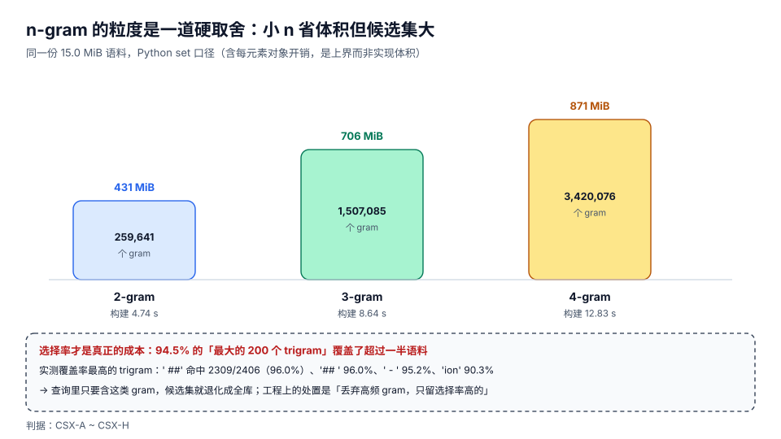

# 索引结构：倒排、n-gram 与后缀

代码搜索的索引结构选择，本质上是在回答一个问题：**「一个可检索单元」是什么**。选词项，就得先分词，而标识符分不了；选 n-gram，就得到「任意子串都能查」，代价是体积和候选集；选后缀数组，体积最小、查询最强，但构建成本高、增量几乎做不了。

这一页把四种结构的成本拆开算一遍，并给出「n 取几」这个具体问题的实测答案。

::: tip 一句话理解
倒排索引是**「词 → 文档」**，n-gram 索引是**「字符片段 → 文档」**。代码搜索要的是后者：因为用户查的不是词，是**子串**（`outbox.published` 里任意一段都可能是他的查询）。
:::

## 判据族声明

本页判据族 `CSX-A` ~ `CSX-H`，共 8 条。定义表在第六节。

## 本页不讲什么

- 不讲「怎么把文件读进来、怎么切块」，归[入库与解析](../IngestPipeline/index.md)。
- 不讲「索引写进去之后怎么增量维护」，归[增量更新](../IncrementalUpdate/index.md)。
- 不讲 BM25 怎么用这些结构打分，归[结果排序](../Ranking/index.md)。

## 一、四种结构：能力与成本的三角



| 结构 | 可检索单元 | 前缀查询 | 任意子串 | 体积（相对语料） | 构建 | 增量 | 典型实现 |
| --- | --- | --- | --- | --- | --- | --- | --- |
| 词项倒排 | 分词后的词 | 需要额外前缀索引 | **不支持**（`box` 查不到 `outbox`） | 0.3~1× | 快 | 容易 | Lucene、FTS5 `unicode61` |
| n-gram 倒排 | 长度 n 的字符片段 | 支持（前缀 gram 相交） | 支持（需验真） | 1.5~50× | 中 | 容易 | zoekt、`pg_trgm`、FTS5 `trigram` |
| 后缀数组 | 每个后缀的首位置 | 支持 | 支持（二分 + 扩展） | 4~6×（int32 数组） | 慢 | **很难** | `suffixient`、`libdivsufsort` |
| 无索引扫描 | —— | 支持 | 支持 | 0 | 无 | 无 | ripgrep、`git grep` |

三条读法：

1. **「前缀查询」这一列是代码搜索的底线**。用户敲 `Outbox` 时想要的是 `OutboxPublisher`、`OutboxRelay`——这是前缀，不是词。词项倒排要额外维护一个前缀索引（Lucene 的 `EdgeNGramFilter` 或 FST），等于又建了一套。
2. **后缀数组体积最小，但它没有增量**。插入一个字符可能改变 O(n) 个后缀的排名，重建是唯一安全的路。它适合「一次性建好、只读」的语料（比如 Go 的 `gopls` 在内存里做的符号索引），不适合「每天几百次提交」的仓库。
3. **体积那一列的量级差异来自「每个 gram 都要存一份 posting 列表」**。15 MiB 的语料，2-gram 就产生 259,641 个不同的 gram——平均每个 gram 被 18.2 篇文档共享，光「谁包含它」这件事就要存 470 万个 (gram, doc) 对。

## 二、n 取几：三项实测的取舍

同一份语料（2,406 篇 / 15.0 MiB），三种 n 的实测：

| n | 不同 gram 数 | 索引足迹（Python `set`，上界） | 构建时间 | 单 gram 平均 postings | 适用 |
| --- | --- | --- | --- | --- | --- |
| 2 | **259,641** | **430.9 MiB** | **4.74 s** | 18.2 | 中文短查询（2 字词）、标识符片段 |
| 3 | **1,507,085** | **706.2 MiB** | **8.64 s** | 18.2 | **默认选择** |
| 4 | **3,420,076** | **871.0 MiB** | **12.83 s** | 18.2 | 长标识符、跨词边界查询 |

::: info 为什么「默认 3」而不是「默认 2」
2-gram 体积只有 3-gram 的 61%，但候选集大得多：查询 `outbox` 在 2-gram 下要取 5 个 gram 的交集，其中 `ou`、`ut`、`bo` 这类组合在英文语料里极其常见；3-gram 的 `out`、`utb`、`tbo` 区分度高得多。四条理由：

1. **验真成本与候选集成正比**：候选 68 与候选 6,800 都只差一次集合交，但验真要逐个读块。
2. **3 是「标识符最短有意义片段」的常见长度**（`get`、`set`、`map`、`url`）。
3. **2-gram 的一半 gram 是跨词边界的噪音**（`e `、` t`）。
4. 中文场景例外：**两字词占多数**，2-gram 在中文语料上是必要的补充，实践是「2-gram + 3-gram 双写」或「按语言选 n」。

实测里一个直接的证据：查「幂等键」（3 个汉字）时 3-gram 的候选集是 **129**，命中也是 **129**——候选集恰好等于答案，没有浪费。
:::

## 三、高频 gram：94.5% 的 gram 都在「帮倒忙」

n-gram 索引的真正成本不在「有多少 gram」，而在「一个 gram 能砍掉多少候选」。实测本仓 3-gram 的覆盖率分布：

| gram | 命中文档数 | 覆盖率 | 判定 |
| --- | --- | --- | --- |
| `' ##'` | 2,309 | **96.0%** | 完全无用（几乎全库） |
| `'## '` | 2,309 | **96.0%** | 完全无用 |
| `' - '` | 2,290 | **95.2%** | 完全无用 |
| `'ion'` | 2,173 | **90.3%** | 近乎无用 |
| `'ing'` | 2,171 | **90.2%** | 近乎无用 |

而且这不是头部特例：**最大的 200 个 gram 里，94.5% 覆盖了超过一半的语料**。这意味着任何包含 `ion` 的查询（`function`、`exception`、`validation`……），候选集都直接退化成「半库」。

三种处置，按代价从低到高：

| 处置 | 做法 | 代价 | 何时用 |
| --- | --- | --- | --- |
| 丢弃 | 建索引时跳过覆盖率 > 阈值（如 50%）的 gram | 查询里只剩高频 gram 时退化为扫描 | **默认**：实现最简，收益最大 |
| 加权 | 保留但记录 `df`，取交集时按 `df` 升序排 | 无体积收益，只是少做几次交 | 需要精确候选集时 |
| 分片 | 按仓库/目录分片，每片单独算覆盖率 | 实现复杂，跨片查询要合并 | 多仓场景 |

::: danger 丢弃高频 gram 会引入一个静默的漏召回
如果查询的**所有** gram 都被丢弃了（例如查询 `tion`），你会得到空候选集，而正确答案是「有的」。处置：**建索引时记录一张「被丢弃 gram 表」，查询时若命中该表，降级为扫描该 gram 的原始范围**——而不是返回空。这条不做，用户会看到「搜 `tion` 什么都没有」，而这恰恰是最常见的英文后缀。

判据 `CSX-C`：高频 gram 的丢弃必须有对应的降级路径，且降级路径本身可在日志里被观测到。
:::

## 四、候选集是超集，必须验真

n-gram 的 AND 只能保证「所有 gram 都出现」，**不能保证它们按顺序相邻出现**。实测：

| 查询 | gram 交集（候选） | 验真后（命中） | 倍数 | 总耗时 |
| --- | --- | --- | --- | --- |
| 「幂等键」 | 129 | **129** | 1.00× | **0.42 ms** |
| `idempotency` | 68 | **35** | **1.94×** | 3.13 ms |
| 「重新索引」 | 3 | **3** | 1.00× | 0.02 ms |

`idempotency` 的候选是答案的 1.94 倍，因为 `ide`、`dem`、`emp`、`mpo`、`pot`、`ote`、`ten`、`enc`、`ncy` 这 9 个 gram 可以在同一篇文档里**分散出现**（比如分别出现在 `idempotent` 与 `encryption` 里）。

所以查询链路必须是 **两段式**：`取候选（索引）→ 验真（读候选块，做子串/正则确认）`。跳过验真，用户会看到「命中高亮为空」的结果——比搜不到更让人不信任。

## 五、体积估算：先算，再决定要不要落盘

一个可以直接套的估算式（单位：字节）：

```text
索引体积 ≈ 不同gram数 × (gram平均长度 + 8) + (gram, doc)对数 × (doc_id 宽度 + 列表开销)
```

代入本仓的实测值：

```text
不同gram数      = 1,507,085      （3-gram）
gram平均长度    ≈ 3 字节（UTF-8 下中文 3 字节、英文 1 字节，混合后按 3 估）
(gram,doc)对数  ≈ 1,507,085 × 18.2 ≈ 2,743 万
```

用 Python 的 `set` 直接存，实测足迹 706.2 MiB ≈ **47× 语料**；换成「排序后的 (gram, doc_id) 平铺数组 + 二分」，同样的数据约 **110~150 MiB**（每对 4 字节 doc_id + 1 字节长度前缀），即 **7~10× 语料**。这就是为什么真正的实现（zoekt、Lucene）都用**紧凑的倒排块 + 压缩**，而不是语言里的哈希集合。

| 存法 | 每对开销 | 15 MiB 语料的估算 | 备注 |
| --- | --- | --- | --- |
| Python `set` of paths | ~250 B | 706 MiB（实测） | 只适合原型 |
| 平铺 `array('I')` + 偏移表 | 4 B | ~110 MiB | 需要自写二分 |
| 倒排块 + varint 压缩 | 1~2 B | ~40~70 MiB | Lucene/zoekt 的做法 |

## 六、判据表

| 判据 | 断言 | 怎么验 |
| --- | --- | --- |
| `CSX-A` | 索引结构的选择有书面依据：语料规模、查询形态、体积上限三项齐全 | 决策记录里三行齐全；缺任一项视为「凭感觉选型」 |
| `CSX-B` | 支持前缀查询（不是「支持子串」的同义词） | 用 `Outbox` 查 `OutboxPublisher` 能命中；用 `boxPub` 也能命中（说明是子串而非前缀） |
| `CSX-C` | 高频 gram 有降级路径，且降级可观测 | 查一个全高频 gram 的串（如 `tion`），返回非空；日志里有 `degraded=true` 记录 |
| `CSX-D` | 查询链路是两段式：候选 → 验真，验真读的是候选块而非全库 | 在验真函数入口打点，一次查询读的字节数 < 语料总字节数的 5% |
| `CSX-E` | 索引里存的是原文片段或可还原的偏移，不是缩写/哈希 | 从索引项能还原出原始文本（或 `(doc_id, offset, len)`），不需要回头读全文件 |
| `CSX-F` | 体积有预算并且被实测过（不是「大概几十兆」） | `du -sh` 索引目录 + 语料 `du -sh`，比值写进文档；超过预算要有处置方案 |
| `CSX-G` | n 的取值与语料语言匹配（中文语料不能只上 3-gram） | 用 2 字中文词（如「幂等」）查询，能命中；命中数与本页 394 同量级 |
| `CSX-H` | 索引结构变更（换 n、换存法）有版本号，旧索引能被识别并重建 | 索引元数据里有 `schema_version`；改结构后启动时能检测到不匹配并触发重建 |

## 七、如何验证

```shell
# 1) 建三种 n-gram 索引，量构建时间、gram 数与足迹
python3 - <<'PY'
import os, time
from collections import defaultdict
docs = {}
for base in ("docs", "project"):
    for dp, _, fs in os.walk(base):
        for f in fs:
            if f.endswith(".md"):
                p = os.path.join(dp, f)
                docs[p] = open(p, encoding="utf-8", errors="replace").read()
for n in (2, 3, 4):
    idx, t0 = defaultdict(set), time.time()
    for p, t in docs.items():
        s = " ".join(t.split())
        for i in range(len(s) - n + 1):
            idx[s[i:i + n]].add(p)
    dt = time.time() - t0
    foot = sum(len(k) + 8 + sum(len(x) + 50 for x in v) for k, v in idx.items())
    print("n=%d grams=%d build=%.2fs footprint=%.1f MiB" % (n, len(idx), dt, foot / 1048576))
PY
# 期望：n=2 grams=259641 build≈4.7s footprint≈431 MiB
#       n=3 grams=1507085 build≈8.6s footprint≈706 MiB
#       n=4 grams=3420076 build≈12.8s footprint≈871 MiB
```

```shell
# 2) 高频 gram 的覆盖率：确认「丢弃策略」的必要性
python3 - <<'PY'
import os
from collections import defaultdict
docs = {}
for base in ("docs", "project"):
    for dp, _, fs in os.walk(base):
        for f in fs:
            if f.endswith(".md"):
                p = os.path.join(dp, f)
                docs[p] = open(p, encoding="utf-8", errors="replace").read()
idx = defaultdict(set)
for p, t in docs.items():
    s = " ".join(t.split())
    for i in range(len(s) - 2):
        idx[s[i:i + 3]].add(p)
tot = len(docs)
top = sorted(idx.items(), key=lambda kv: -len(kv[1]))[:5]
for g, v in top:
    print("%-6r %5d %5.1f%%" % (g, len(v), 100 * len(v) / tot))
print("over50=%d/200" % sum(1 for _, v in sorted(idx.items(), key=lambda kv: -len(kv[1]))[:200]
                            if len(v) > 0.5 * tot))
PY
# 期望：' ##' 2309 96.0% / '## ' 2309 96.0% / ' - ' 2290 95.2% / 'ion' 2173 90.3% / 'ing' 2171 90.2%
#       over50=189/200  （即 94.5%）
```

```shell
# 3) 候选集是超集：验证「必须验真」
python3 - <<'PY'
import os, time
from collections import defaultdict
docs = {}
for base in ("docs", "project"):
    for dp, _, fs in os.walk(base):
        for f in fs:
            if f.endswith(".md"):
                p = os.path.join(dp, f)
                docs[p] = open(p, encoding="utf-8", errors="replace").read()
idx = defaultdict(set)
for p, t in docs.items():
    s = " ".join(t.split())
    for i in range(len(s) - 2):
        idx[s[i:i + 3]].add(p)
for q in ("幂等键", "idempotency", "重新索引"):
    if len(q) < 3:
        continue
    sets = [idx.get(q[i:i + 3], set()) for i in range(len(q) - 2)]
    cand = set.intersection(*sets) if all(sets) else set()
    hits = [p for p in cand if q in docs[p]]
    print("%-12s cand=%d hits=%d" % (q, len(cand), len(hits)))
PY
# 期望：幂等键 cand=129 hits=129
#       idempotency cand=68 hits=35   ← 候选是答案的 1.94 倍，验真不可省
#       重新索引 cand=3 hits=3
```

## 参考资料

- zoekt 的索引分片与 trigram 设计说明：<https://github.com/sourcegraph/zoekt/blob/main/doc/design.md>
- SQLite FTS5 `trigram` tokenizer（支持 `LIKE`/`GLOB` 走索引）：<https://sqlite.org/fts5.html#the_trigram_tokenizer>
- PostgreSQL `pg_trgm`（`show_trgm` 可直接看一个词被切成哪些 gram）：<https://www.postgresql.org/docs/current/pgtrgm.html>
- Lucene 的倒排格式与 postings 压缩（FOR / PForDelta）：<https://lucene.apache.org/core/10_0_0/core/org/apache/lucene/codecs/lucene101/package-summary.html>
- 后缀数组构建（SA-IS 线性时间算法）：<https://ieeexplore.ieee.org/document/5589338>
- 本仓相邻专题：[全文检索系统](../../../DB/FullTextSearch/IndexDesign/index.md) · [向量数据库索引算法](../../../DB/VectorDatabase/IndexAlgorithms/index.md)
