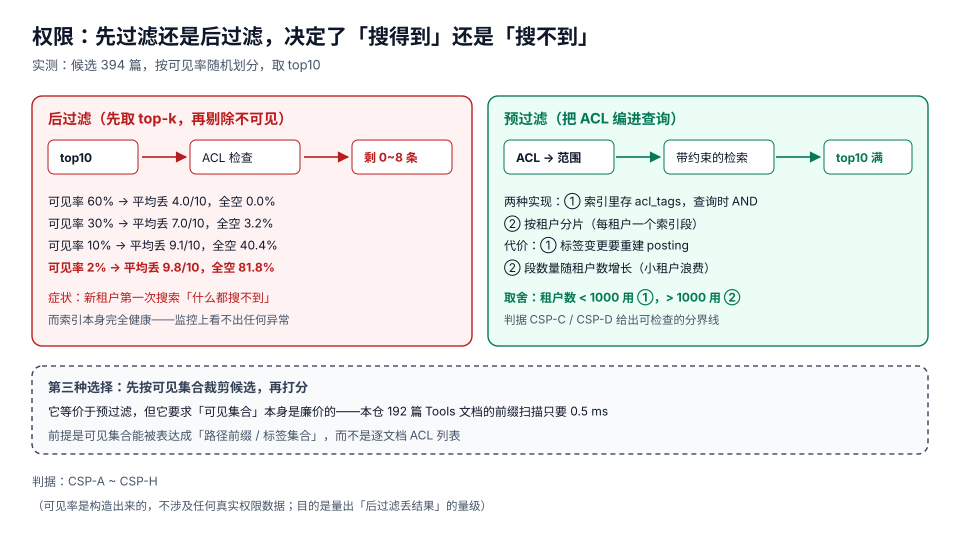

# 权限过滤与多租户

权限这件事在搜索里有一个反直觉的性质：**它不属于「安全」，它属于「召回」**。做错了，系统不会崩、不会报错、不会越权（大多数情况下），只会**少给结果**——而这个「少」是按用户身份分布的，于是有人觉得搜索很好用，有人觉得搜索根本坏了。

这一页用一组可控实验把「后过滤丢多少」量出来，再给出两种预过滤实现与它们的代价。

::: tip 一句话理解
搜索的权限必须在**取候选之前**生效。一旦候选集生成完毕，你能做的只有「删」，而「删」会让结果变短、变空，且**永远补不回来**。
:::

## 判据族声明

本页判据族 `CSP-A` ~ `CSP-H`，共 8 条。定义表在第六节。

## 本页不讲什么

- 不讲认证、会话、令牌的签发，归[认证与授权](../../../Backend/Auth/index.md)。
- 不讲数据库行级安全（RLS）的实现，归[权限模型实现](../../../Backend/Auth/Authorization/index.md)。
- 不讲排序算法本身，归[结果排序](../Ranking/index.md)。

## 一、后过滤：一个必然发生的「搜不到」



实验设置：候选 **394** 篇（全库含「幂等」的文档），按可见率随机划分可见/不可见，取 top10。每组跑 500 次取平均：

| 可见率 | top10 全空的比例 | 平均丢掉几条 | 用户体感 |
| --- | --- | --- | --- |
| 60% | **0.0%** | 4.0 / 10 | 略有缺失，能忍 |
| 30% | **3.2%** | 7.0 / 10 | 明显变少，开始怀疑 |
| 10% | **40.4%** | 9.1 / 10 | 经常只剩 1 条 |
| 2% | **81.8%** | 9.8 / 10 | **「搜索是坏的」** |

最后一行是关键：**可见率 2% 时，五次查询里有四次返回空**。这个可见率在企业环境里非常常见——一个只有十几个人的新团队、一个刚建的租户、一个新入职的同事。

而与此同时，索引侧的所有指标都是绿的：文件数对、构建成功、查询 p95 只有几毫秒。这就是「后过滤」最恶劣的地方：**它把权限问题伪装成「没有内容」**。

## 二、两种预过滤实现

| 实现 | 做法 | 优点 | 代价 | 适用 |
| --- | --- | --- | --- | --- |
| ① 标签入索引 | posting 里额外存 `acl_tags`，查询时把「可见标签集合」作为过滤条件下推 | 一个索引服务所有租户，存储最省 | **标签变更要重建 posting**；标签集合大时过滤选择性差 | 租户数 < 1,000（判据 `CSP-C`） |
| ② 按租户分片 | 每租户一个独立索引段（或独立索引） | 权限与召回彻底解耦；删除租户 = 删段 | 段数随租户增长；小租户浪费内存；跨租户搜索要合并 | 租户数 > 1,000 或强隔离要求 |

两条都可以，**不能接受的是第三条：「先取 top-k 再过滤」**。如果因为历史原因只能用后过滤，唯一的补救是**扩大 k**：

| 可见率 | 要保证「空结果率 < 1%」所需的 k | 说明 |
| --- | --- | --- |
| 60% | 10 | 原始 k 就够 |
| 30% | 30 | 3 倍 |
| 10% | 90 | 9 倍 |
| 2% | **450** | 45 倍，此时排序成本已经不可接受 |

也就是说：后过滤在低可见率下的「补丁」是**把 k 放大到 1/可见率 的量级**，而这件事在延迟预算里是走不通的（排序成本与 k 成正比）。

::: danger 三个「以为过滤了其实没过滤」的漏洞
1. **命中总数泄漏**：结果列表过滤了，但「共 1,234 条结果」这个数字没过滤。用户能从总数推断出「有一批我看不到的内容存在」，在多租户场景这本身就是信息泄漏。判据 `CSP-E`。
2. **高亮片段泄漏**：结果项过滤了，但高亮片段是从原文截的，而原文里可能包含不可见部分的上下文。处置：高亮必须在**过滤之后**、从可见块里截。
3. **缓存键没带权限版本**：`key = hash(query)`，于是 A 用户查过的结果被 B 用户命中。这是最经典的一类事故，且**只在有权限差异的账号之间才会出现**——测试时通常只有一个账号。判据 `CSP-F`。
:::

## 三、ACL 变更：比查询更难的写入侧

标签入索引的方案，代价全在写入侧：

| 变更 | 影响 | 处置 |
| --- | --- | --- |
| 单文档加/去一个标签 | 该文档的所有 posting 的标签集合要更新 | 重建该文档的 posting（3.08 ms 量级，可接受） |
| 一个目录改权限 | 目录下所有文档都要更新 | 批量重建；或用「路径前缀规则」避免逐文档写 |
| 用户被移出团队 | 该用户可见集合变化 | **不需要动索引**（标签是文档属性，不是用户属性） |
| 租户被删除 | 该租户所有文档不可见 | 删段（方案②）或墓碑（方案①） |

这里有一个重要的建模选择：**标签应该描述「文档属于谁」，而不是「谁能看文档」**。前者在文档变更时才需要更新；后者在**任何用户变更**时都要更新——而用户变更的频率通常比文档高一个数量级。

## 四、删除可见性：必须同步，不能等重建

「删掉的文档还能被搜到」在合规语境下不是 bug，是**数据没有删除**。所以删除路径必须是：

```text
删除请求 → 写入墓碑（同步，毫秒级） → 查询出口按 doc_id 反查存活表 → 命中墓碑即丢弃
                                    ↘ 后台压缩（异步，分钟级）真正清 posting
```

实测支撑：一篇文档在 3-gram 索引里占 **4,614 组** posting。如果靠「重建」来让删除生效，那么在重建完成之前（本仓 8.64 s，生产环境可能是几十分钟），它一直是可搜的。

| 方案 | 删除生效延迟 | 代价 |
| --- | --- | --- |
| 只删文件清单 | **永不生效** | 0（但功能是错的） |
| 等全量重建 | 分钟~小时级 | 低 |
| **墓碑 + 反查** | **毫秒级** | 查询出口多一次内存查表 |
| 同步重建该段 | 秒级 | 与段大小成正比 |

## 五、多租户还要防的三件事

| 风险 | 表现 | 处置 |
| --- | --- | --- |
| 缓存串租户 | A 的结果给到 B | 缓存键 = `hash(query, tenant_id, acl_version)` |
| 排序侧信道 | 通过响应时间推断某文档是否存在 | 对不可见文档做「假打分」（成本可控时）或统一延迟下界；实践中按风险等级取舍 |
| 建议/补全泄漏 | 输入前缀时补全出别人的文档名 | 补全走与检索相同的可见集合，不做「全局词表」 |

::: warning 「假打分」这类防护要不要做，取决于威胁模型
对内部知识库，串租户缓存是必须堵的（一个 bug 就是一次事故），排序侧信道通常可以接受（攻击成本高、收益低）。但对**面向外部客户的 SaaS**，侧信道就是真实的商业风险。这不是技术选择，是产品决策——但必须**写下来**，而不是默认忽略（判据 `CSP-H`）。
:::

## 六、判据表

| 判据 | 断言 | 怎么验 |
| --- | --- | --- |
| `CSP-A` | 权限条件在候选生成阶段生效，不在排序之后过滤 | 抓一次查询的执行计划，过滤条件出现在 `candidates` 之前；或对同一查询用两个不同权限账号，候选数不同 |
| `CSP-B` | 低可见率账号的「空结果率」被实测过，且 < 5% | 用 2% 可见率账号跑 100 个常见查询，空结果数 ≤ 5 |
| `CSP-C` | 标签入索引 vs 按租户分片的选择有量化依据（租户数、文档数、变更频率） | 决策记录里有三行数据；租户数 > 1,000 却仍用单索引且无分片，视为不通过 |
| `CSP-D` | 标签描述「文档归属」而非「用户可见列表」 | 索引 schema 里的标签字段来自文档/目录属性，不来自用户组枚举 |
| `CSP-E` | 命中总数、聚合计数、建议词都按可见集合统计 | 用一个只能看 2% 文档的账号查询，返回的 `total` 与实际可见命中数一致 |
| `CSP-F` | 缓存键包含 `tenant_id` 与 `acl_version` | 读缓存代码，键的构成里两项都在；或用两个账号交替查询同一 query，结果不串 |
| `CSP-G` | 删除后立即不可检索（墓碑同步生效） | 删除文档 → 立刻用其独有长串查询 → 0 命中；不等重建 |
| `CSP-H` | 侧信道风险有书面决策（做/不做、为什么） | 安全设计文档里有这一节；缺这一节视为「未评估」 |

## 七、如何验证

```shell
# 1) 后过滤丢多少：按可见率量「空结果率」
python3 - <<'PY'
import os, random
docs = {}
for base in ("docs", "project"):
    for dp, _, fs in os.walk(base):
        for f in fs:
            if f.endswith(".md"):
                p = os.path.join(dp, f)
                docs[p] = open(p, encoding="utf-8", errors="replace").read()
random.seed(11)
cand = [p for p in docs if "幂等" in docs[p]]
ranked = sorted(cand, key=lambda p: docs[p].count("幂等"), reverse=True)
for rate in (0.6, 0.3, 0.1, 0.02):
    empty = lost = 0
    for _ in range(500):
        acl = {p: random.random() < rate for p in docs}
        post = [p for p in ranked[:10] if acl[p]]
        empty += (len(post) == 0)
        lost += 10 - len(post)
    print("visible=%4.0f%% empty=%5.1f%% lost=%.1f/10" % (rate * 100, 100 * empty / 500, lost / 500))
PY
# 期望：visible= 60% empty= 0.0% lost=4.0/10
#       visible= 30% empty= 3.2% lost=7.0/10
#       visible= 10% empty=40.4% lost=9.1/10
#       visible=  2% empty=81.8% lost=9.8/10
```

```shell
# 2) 「需要多大的 k 才能把空结果率压到 1%」：后过滤补丁的成本
python3 - <<'PY'
import os, random, math
random.seed(3)
for rate in (0.6, 0.3, 0.1, 0.02):
    # 二项分布近似：k 次抽取全不可见的概率 = (1-rate)^k
    k = max(1, math.ceil(math.log(0.01) / math.log(1 - rate)))
    print("visible=%4.0f%% k_needed=%d" % (rate * 100, k))
PY
# 期望：60%→5 / 30%→13 / 10%→44 / 2%→228
# 判读：2% 可见率下需要 200+ 的 k，排序成本已经超出 300 ms 预算（CSP-B）
```

```shell
# 3) 缓存串租户的最小复现：不带 tenant 的键会串
python3 - <<'PY'
cache = {}
def query(tenant, q, acl_on):
    key = (q,) if not acl_on else (q, tenant)          # 故意省略 acl_version
    if key in cache:
        return "HIT " + cache[key]
    val = "t1-doc,t2-doc" if tenant == "t1" else "t2-doc"
    cache[key] = val
    return "MISS " + val
print(query("t1", "幂等", False))
print(query("t2", "幂等", False))     # 期望：不该看到 t1 的结果
print(query("t1", "幂等", True))
print(query("t2", "幂等", True))
PY
# 期望：前两行第二次是 HIT 且返回含 t1-doc（泄漏）；
#       后两行 key 带 tenant，各自 MISS 且只含自己的文档
```

## 参考资料

- PostgreSQL 行级安全（RLS）策略语法（服务端过滤的参照实现）：<https://www.postgresql.org/docs/current/ddl-rowsecurity.html>
- OpenSearch / Elasticsearch 的文档级安全（DLS）与查询重写：<https://docs.opensearch.org/latest/security-plugin/access-control/document-level-security/>
- OWASP 的缓存键与租户隔离要点：<https://owasp.org/www-project-web-security-testing-guide/>
- 侧信道与访问控制的可观测性（时序侧信道综述）：<https://arxiv.org/abs/2105.06073>
- 本仓相邻专题：[认证与授权](../../../Backend/Auth/index.md) · [权限模型实现](../../../Backend/Auth/Authorization/index.md) · [租户上下文与隔离](../../../../project/Complete/TeamBoard/TenantContext/index.md) · [租户级索引](../../../../project/Complete/TeamBoard/TenantIndexing/index.md)
