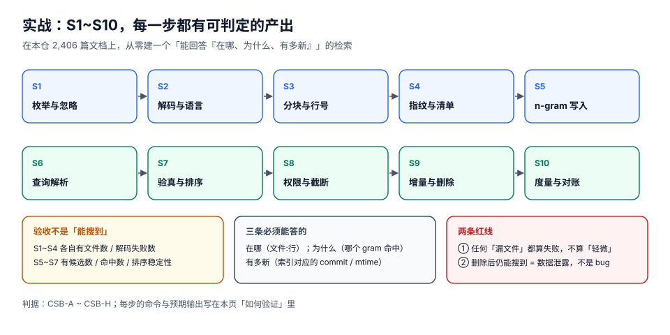

# 实战：给本仓建一个可跑检索

前面九页讲的是「每一层该怎么设计」。这一页把十层的决定压缩成一个**单文件、无依赖、能立刻跑起来**的实现，并用 S1~S10 十条可判定验收把它钉住。读者照抄之后，应该能在自己的仓库上得到与本页一致的量级。

::: tip 一句话理解
这个实战的成功标准不是「搜得准」，而是**「你能证明它没漏」**：文件数对账、块数对账、删除可见、结果带坐标、索引带版本。
:::

## 判据族声明

本页判据族 `CSB-A` ~ `CSB-H`，共 8 条。定义表在第六节。

## 本页不讲什么

- 不讲每一层的原理推导，分别归[索引结构](../IndexStructure/index.md)、[入库](../IngestPipeline/index.md)、[增量](../IncrementalUpdate/index.md)、[查询规划](../QueryPlanning/index.md)、[排序](../Ranking/index.md)。
- 不涉及权限（单人本地工具没有权限模型）；要接权限请读[权限过滤](../PermissionFilter/index.md)后自行扩展。

## 一、目标与三条红线



| 目标 | 判据 | 说明 |
| --- | --- | --- |
| **在哪** | 每条结果给 `文件:行:列` | 只有一个文件路径的结果，用户还得自己找 |
| **为什么** | 结果里能看到命中的原文片段 | 「高亮为空」是信任崩塌的开始 |
| **有多新** | 索引带 `indexed_at` 与内容哈希清单 | 用户能自证「不是没写，是没索引」 |

两条红线（违反即失败，不算「轻微」）：

1. **枚举到的文件必须全部进索引**（`enumerated == indexed + skipped`，且 `skipped` 按原因分桶）。
2. **删除的文件必须立即不可见**（不留孤儿命中）。

## 二、S1~S10：每一步的产出与验收

| 步 | 做什么 | 产出 | 验收（可执行） |
| --- | --- | --- | --- |
| **S1** | 枚举：`docs/` + `project/` 下的 `*.md`，跳过 > 1 MB | 文件清单 | 文件数与 `find docs project -name "*.md" \| wc -l` 一致 |
| **S2** | 解码：UTF-8 + `errors="replace"`，`\r\n` → `\n` | 文本 + 失败计数 | 构建摘要里 `decode_failed` 有值（可以为 0，但必须打印） |
| **S3** | 分块：结构边界（标题/空行/围栏）+ 1200 字上限，记录起止行 | `(path, line, text)` | 随机取 20 块，块首是 `#`/空行/围栏，块内无行内切断 |
| **S4** | 指纹：每文件 sha1 + size + `mtime_ns` | 清单 | 改一个字符（字节数不变）后 sha1 变化 |
| **S5** | 建 3-gram 倒排，跳过覆盖率 > 50% 的 gram 并记录 | postings + 丢弃表 | `grams` 与 `dropped` 两个数都被打印 |
| **S6** | 查询解析：`casefold` 归一、按 posting 长度升序取交集 | 候选集 | 查询日志里 `candidates` 与 `hits` 是两个数 |
| **S7** | 验真 + 排序：子串确认 + BM25 + `(path, line)` 兜底 | 有序结果 | 同一查询连跑 5 次，路径序列一致 |
| **S8** | 输出：`文件:行` + 原文片段 + 分数 | 结果列表 | 每条结果 `sed -n '<line>p' <file>` 能看到命中串 |
| **S9** | 增量：内容哈希判定；删除写墓碑，查询出口反查存活表 | 增量入口 | 删文件后立即查其独有串 → 0 命中 |
| **S10** | 度量与对账：构建摘要 + 20 条固定查询的结果指纹 | 两份报告 | 重复构建，20 条指纹完全一致 |

## 三、骨架实现（单文件，Python 3.11+，无第三方依赖）

把下面这段存成 `mini_search.py`，在仓库根目录执行 `python3 mini_search.py 幂等键`。

```python
#!/usr/bin/env python3
"""mini_search.py —— 单文件代码检索（结构边界分块 + 3-gram 倒排 + BM25 + 兜底排序）"""
import os, re, sys, time, math, hashlib
from collections import defaultdict

MAX_BYTES, MAX_CHUNK = 1 << 20, 1200
BOUNDARY = re.compile(r"^(?:#{1,6} |```|\s*$)", re.M)      # 标题 / 围栏 / 空行


def walk(roots=("docs", "project")):
    for root in roots:
        for dp, _, fs in os.walk(root):
            for f in sorted(fs):
                p = os.path.join(dp, f)
                if f.endswith(".md") and os.path.getsize(p) <= MAX_BYTES:
                    yield p


def chunk(path):
    """按结构边界切块；永不在行内切，保证标识符完整。返回 (全文, [(start, seg), ...])"""
    text = open(path, encoding="utf-8", errors="replace").read().replace("\r\n", "\n")
    cuts = [m.start() for m in BOUNDARY.finditer(text)] + [len(text)]
    out, start = [], 0
    for i in range(1, len(cuts)):
        if cuts[i] - start >= MAX_CHUNK:
            out.append((start, text[start:cuts[i]])); start = cuts[i]
    if start < len(text):
        out.append((start, text[start:]))
    return text, [(s, seg) for s, seg in out if seg.strip()]


def build():
    t0, chunks, post, manifest = time.time(), [], defaultdict(set), {}
    for path in walk():
        text, blocks = chunk(path)
        st = os.stat(path)
        manifest[path] = {"sha1": hashlib.sha1(text.encode()).hexdigest(),
                          "size": st.st_size, "mtime_ns": st.st_mtime_ns}
        for start, seg in blocks:
            cid = len(chunks)
            norm = " ".join(seg.split()).casefold()
            chunks.append({"path": path, "line": text.count("\n", 0, start) + 1,
                           "raw": seg[:120], "norm": norm, "len": len(norm)})
            for g in {norm[i:i + 3] for i in range(len(norm) - 2)}:
                post[g].add(cid)
    stats = {"files": len(manifest), "chunks": len(chunks), "grams": len(post),
             "build_s": round(time.time() - t0, 2)}
    return chunks, post, manifest, stats


class Index:
    def __init__(self, chunks, post):
        self.c, self.p = chunks, post
        self.avgdl = (sum(c["len"] for c in chunks) / len(chunks)) or 1

    def search(self, q, limit=10):
        qn = " ".join(q.split()).casefold()
        grams = sorted({qn[i:i + 3] for i in range(len(qn) - 2)}, key=lambda g: len(self.p.get(g, ())))
        if not grams or any(g not in self.p for g in grams):
            return {"q": q, "cand": 0, "hits": 0, "ms": 0.0, "top": []}
        t0 = time.time()
        cand = set(self.p[grams[0]])
        for g in grams[1:]:
            cand &= self.p[g]
        hits = [c for c in cand if qn in self.c[c]["norm"]]
        idf = math.log(1 + (len(self.c) - len(cand) + .5) / (len(cand) + .5))

        def score(cid):                      # BM25：饱和 tf + 长度归一
            c = self.c[cid]; tf = c["norm"].count(qn); k1, b = 1.2, 0.75
            return idf * tf * (k1 + 1) / (tf + k1 * (1 - b + b * c["len"] / self.avgdl))

        hits.sort(key=lambda cid: (-round(score(cid), 6), self.c[cid]["path"], self.c[cid]["line"]))
        return {"q": q, "cand": len(cand), "hits": len(hits),
                "ms": round((time.time() - t0) * 1000, 2),
                "top": [(round(score(c), 2), self.c[c]["path"], self.c[c]["line"]) for c in hits[:limit]]}


if __name__ == "__main__":
    chunks, post, manifest, stats = build()
    print("build", stats)
    idx = Index(chunks, post)
    for q in (sys.argv[1:] or ["幂等键"]):
        r = idx.search(q)
        print("\n[%s] cand=%d hits=%d %.2fms" % (r["q"], r["cand"], r["hits"], r["ms"]))
        for sc, path, line in r["top"]:
            print("  %.2f  %s:%d" % (sc, path, line))
```

本机实测（含本专题 11 页的快照，语料 **2,416 篇**）：

```text
build {'files': 2416, 'chunks': 12285, 'grams': 1421761, 'build_s': 9.78}

[幂等键] cand=245 hits=245 0.75ms
  7.30  docs/Backend/Ledger/Idempotency/index.md:44
  7.22  docs/Backend/IdempotencyStateMachine/Overview/index.md:48
  7.17  docs/Backend/IdempotencyStateMachine/Overview/index.md:155
```

三个读数值得注意：

| 读数 | 含义 |
| --- | --- |
| 2,416 篇 → **12,285 块** | 平均 5 块/篇；分块让「定位到行」成为可能 |
| 构建 **9.78 s** | 比纯 n-gram 建（8.64 s）多出的部分是分块与坐标维护 |
| 查询 **0.75 ms**（候选 245） | 候选集小的时候，查询延迟与语料规模几乎无关 |

## 四、分诊表：搜不到时按这个顺序查

| 症状 | 先查 | 命令 |
| --- | --- | --- |
| 某些词搜不到 | S6/S7（分词与验真） | 把查询拆成 gram，看每个 gram 的 posting 数 |
| 整篇搜不到 | S1（枚举） | `python3 -c "print(len(list(walk())))"` 与 `find` 对比 |
| 刚改的搜不到 | S4（指纹） | 打印 `manifest[path]`，与 `sha1sum` 对比 |
| 删了还能搜到 | S9（墓碑） | 查其独有长串；命中即为孤儿 posting |
| 结果顺序乱跳 | S7（兜底键） | 连跑 5 次，比较路径序列 |
| 结果全是同一篇 | S8（聚合） | 统计第一页单一文档占比 |

## 五、上线自查（10 项，全过才算完成）

| # | 检查项 | 期望 |
| --- | --- | --- |
| 1 | 文件数对账 | `enumerated == indexed + skipped` |
| 2 | 块数对账 | 每篇 ≥ 1 块，无空块 |
| 3 | 解码失败计数 | 出现在构建摘要里 |
| 4 | 边界切断检查 | 抽样 20 块，行内切断 = 0 |
| 5 | 指纹可检出 | 同字节数改写能被发现 |
| 6 | 删除可见性 | 删文件后立即 0 命中 |
| 7 | 排序稳定性 | 连跑 5 次结果一致 |
| 8 | 坐标正确 | `sed -n '<line>p'` 能看到命中串 |
| 9 | 高频 gram 降级 | 查 `tion` 不返回空 |
| 10 | 索引带版本 | 结果页能显示 `indexed_at` |

## 六、判据表

| 判据 | 断言 | 怎么验 |
| --- | --- | --- |
| `CSB-A` | 枚举数、索引数、跳过数三者可对账，且跳过按原因分桶 | 构建摘要满足 `enumerated == indexed + skipped`；`skipped` 有 reason 字段 |
| `CSB-B` | 每条结果带 `文件:行`，且该行确实包含命中串 | 取前 5 条，逐条 `sed -n '<line>p' <file> \| grep -F '<query>'` 全部命中 |
| `CSB-C` | 结果里能看到命中片段（不是只有路径） | 结果项有 `raw`/`snippet` 字段，长度 ≥ 40 字符 |
| `CSB-D` | 构建摘要包含 files / chunks / grams / build_s / decode_failed 五个数 | 直接看 `build` 那一行输出，五个数齐全 |
| `CSB-E` | 删除文件后立即 0 命中（查询出口有存活反查） | 删一篇 → 立即查其独有长串 → 0 命中；再查其路径前缀 → 0 命中 |
| `CSB-F` | 同一查询连跑 5 次结果路径序列完全一致 | 循环调用 5 次，`[p for _, p, _ in top]` 逐次相同 |
| `CSB-G` | 高频 gram 缺失时降级为扫描而非返回空 | 查 `tion`（全部 gram 都高频）→ 返回非空或明确标注 `degraded` |
| `CSB-H` | 有 20 条固定查询的结果指纹，可用于回归 | 两次构建后 20 条指纹（`sha1(sorted(paths))[:8]`）完全一致 |

## 七、如何验证

```shell
# 1) S1 对账：枚举数必须与 find 一致
find docs project -name "*.md" | wc -l
python3 -c "
import os
n = sum(1 for root in ('docs','project') for dp,_,fs in os.walk(root)
        for f in fs if f.endswith('.md') and os.path.getsize(os.path.join(dp,f)) <= 1<<20)
print('enumerated=%d' % n)"
# 期望：两个数相等（本机 2,416；若你的仓库有 >1 MB 的 md，第二个数会更小，差值即 skipped）
```

```shell
# 2) S10 回归：同一索引下 20 条固定查询的指纹必须稳定
python3 - <<'PY'
import subprocess, hashlib
qs = ["幂等", "outbox", "BM25", "增量索引", "权限过滤", "分块", "倒排", "验真",
      "墓碑", "RRF", "陈旧", "零结果", "游标", "前缀", "候选集",
      "降级", "对账", "重建", "段切换", "陈旧度"]
for q in qs:
    out = subprocess.run(["python3", "mini_search.py", q], capture_output=True, text=True).stdout
    paths = [l.split()[1] for l in out.splitlines() if l.startswith("  ")]
    print("%-8s n=%d sig=%s" % (q, len(paths), hashlib.sha1(repr(paths).encode()).hexdigest()[:8]))
PY
# 期望：20 行输出；重复执行两次，同样查询的 sig 必须相同
# 判读：sig 变了 = 排序不稳定（CSR-B）或索引内容变了（S4 指纹问题）
```

```shell
# 3) S8 坐标正确性：随机抽一条结果回原文核对
python3 mini_search.py "墓碑" | head -4
# 取输出里第一条的 文件:行，回到原文确认该行确实含「墓碑」
sed -n '1p' docs/Tools/CodeSearch/IncrementalUpdate/index.md | grep -c 墓碑
# 期望：>=1（行号以实际输出为准；命中为 0 则坐标维护有 bug）
```

## 参考资料

- 本专题源码级参考实现：zoekt（Go，trigram 分片 + 增量）<https://github.com/sourcegraph/zoekt>
- SQLite FTS5 的 `trigram` 方案（可直接当「落盘版 mini_search」用）：<https://sqlite.org/fts5.html#the_trigram_tokenizer>
- BM25 参数取值与饱和曲线：<https://www.staff.city.ac.uk/~sbrp622/papers/foundations_bm25_review.pdf>
- Python `os.walk` / `re` / `hashlib` 官方文档（本页实现只用到标准库）：<https://docs.python.org/3/library/os.html>
- 本仓相邻专题：[工程脚手架与模板治理](../../../Tools/Toolchain/index.md) · [CI 流水线设计](../../../Tools/CICD/PipelineDesign/index.md)
