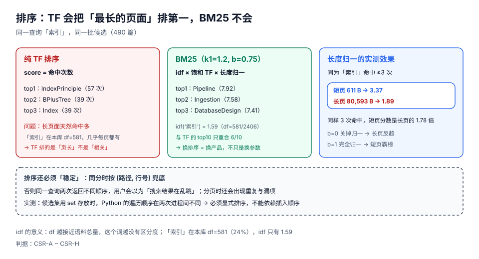

# 结果排序：BM25 与稳定性

排序是搜索里最「玄」的一环，也是最容易被做成「凭感觉调参数」的一环。但代码搜索的排序其实有很硬的结构：**命中的是什么（词/符号/路径）、命中有多密（tf）、这个串有多少区分度（idf）、文档有多长（长度归一）**。四个因子乘起来已经足够，剩下的都是工程细节。

这一页用本仓实测说明两件事：为什么「按命中次数排」会把最长的页面顶到第一，以及为什么「稳定」比「更准」更重要。

::: tip 一句话理解
用户不会因为你把第 3 名排成第 5 名而生气，但会因为**同一查询两次结果不一样**而不再信任结果。排序的第一要求是**可复现**，第二才是相关。
:::

## 判据族声明

本页判据族 `CSR-A` ~ `CSR-H`，共 8 条。定义表在第六节。

## 本页不讲什么

- 不讲候选集怎么取、正则怎么跑，归[查询规划](../QueryPlanning/index.md)。
- 不讲权限怎么过滤，归[权限过滤](../PermissionFilter/index.md)。
- 不讲向量相似度与 RRF 融合，归[语义检索与混合排序](../SemanticSearch/index.md)。

## 一、TF 的页长偏见：一个必然发生的排序错误

同一查询「索引」、同一批 **490** 篇候选，两种排序的 top3：

| 排名 | 纯 TF（按命中次数） | BM25（k1=1.2, b=0.75） |
| --- | --- | --- |
| 1 | `IndexPrinciple`（**57** 次） | `Pipeline`（**7.92**） |
| 2 | `BPlusTree`（39 次） | `Ingestion`（7.58） |
| 3 | `Index`（39 次） | `DatabaseDesign`（7.41） |

两个 top10 **只重合 6/10**。这不是「参数没调好」，而是两种排序在排不同的东西：TF 排的是「**这篇文档里出现了多少次**」，BM25 排的是「**这次命中对区分这个文档有多大贡献**」。

为什么 TF 必然偏长页：本仓单篇最大 **87,340 B**、p99 **27,022 B**、p50 只有 **5,779 B**。一个 87 KB 的页面在同一个词上出现 57 次，只说明它长，不说明它相关。

## 二、BM25 的三个因子



```text
score(D, Q) = Σ_{t∈Q} idf(t) · ( f(t,D) · (k1+1) ) / ( f(t,D) + k1 · (1 - b + b · |D|/avgdl) )
```

| 因子 | 作用 | 本仓读数 | 调参指引 |
| --- | --- | --- | --- |
| `idf(t)` | 越常见的词越不值钱 | `idf('索引') = 1.59`（df=581 / N=2,406） | 不需要调；它由语料算出 |
| `f(t,D)` 与 `k1` | 词频饱和：出现 10 次不比 5 次重要一倍 | `k1=1.2` 时 5 次→约 0.83 饱和值，10 次→0.91 | `k1` 大 → 更看重重复（适合长文）；代码搜索建议 **1.2~1.5** |
| `\|D\|/avgdl` 与 `b` | 长度归一：长文档打折 | 同为命中 3 次：**611 B → 3.37**，**80,593 B → 1.89**（1.78 倍） | `b=0` 关归一（长页反超）；`b=1` 完全归一（短页霸榜）；**0.75 是默认** |

三档 `b` 的取舍很清楚：

| `b` | 效果 | 什么时候用 |
| --- | --- | --- |
| 0 | 不归一，长文档靠 tf 累积胜出 | 语料里「长 = 更权威」（如 API 手册） |
| 0.75 | 默认，长度影响被压到合理范围 | **大多数场景** |
| 1 | 完全归一，分数只看「密度」 | 片段检索（每块长度相近） |

::: info 代码搜索的两个特例
1. **标识符查询不要长度归一**：用户查 `ERR_1846` 时，他想要的那一行可能在一个 500 行的文件里，也可能在 5,000 行的文件里。此时长度完全不该影响排序。处置：对「全大写/含下划线的符号查询」把 `b` 降到 0.2。
2. **路径命中要单独加权**：用户搜 `outbox`，`outbox/Relay/index.md` 这个**路径里就含关键词**的页面，几乎一定比正文里顺带提一句的页面更相关。处置：路径命中加一个固定分（如 `+2.0`），而不是靠 tf。
:::

## 三、路径与字段权重：比调参更有效的三行

| 命中位置 | 建议权重 | 理由 |
| --- | --- | --- |
| 路径 / 文件名 | **+2.0**（固定分） | 文件名是人写的「主题标签」，比正文更可信 |
| H1 / H2 标题 | ×2.0（乘在 tf 上） | 标题里的词是「这篇在讲什么」 |
| 代码块内 | ×1.2 | 代码里的命中通常更「可执行」 |
| 正文 | ×1.0 | 基线 |

实现上不要把这些乘进 BM25 的 `f(t,D)` 里（会破坏饱和曲线），而是**分别算分再线性加权**：

```text
final = 1.0 × bm25(body) + 0.6 × bm25(heading) + 0.3 × bm25(code) + path_boost
```

这样每个字段的 `k1/b` 可以独立调，也便于解释「为什么这条排第一」（判据 `CSO-G` 要求的「为什么」就落在这里）。

## 四、稳定性：同分必须有兜底键

实测过的一个真实故障模式：候选集用 `set` 存放时，Python 的遍历顺序**在不同进程间不同**（受字符串哈希随机化影响，`PYTHONHASHSEED` 未固定时）。于是同一查询两次返回的「同分项」顺序不同，用户看到结果在跳。

| 问题 | 症状 | 解法 |
| --- | --- | --- |
| 同分顺序不稳 | 刷新后第 7、8 名互换 | 排序键用 `(-score, path, line)` 三元组，永不相等 |
| 分页重复/漏项 | 第 2 页出现第 1 页的最后一条 | 同上；且用游标而非 offset（见[查询规划](../QueryPlanning/index.md)第五节） |
| 浮点误差 | 理论同分实际差 1e-16，兜底键没生效 | 分数先量化到 6 位小数再比较 |

```python
# 稳定排序：分数降序 + (路径, 行号) 升序
def sort_key(hit):
    return (-round(hit.score, 6), hit.path, hit.line)

hits.sort(key=sort_key)
```

::: danger 三个「看起来稳定其实不稳」的实现
1. **`dict` 的插入顺序**：Python 3.7+ 保证插入顺序，但候选集来自 `set` 交集，插入顺序本身就不确定。
2. **`sorted` 的 `key` 只给分数**：Python 的 `sort` 是稳定的，但「稳定」只保证**输入顺序相同则输出相同**；输入顺序不确定时，输出也不确定。
3. **多分片归并**：每个分片各自 top-50 再归并时，同分项的顺序取决于分片返回顺序（网络到达顺序）。归并阶段必须重新按兜底键排一次。
:::

## 五、截断与「为什么是这条」

排序之后还有两个决定：

| 决定 | 默认 | 注意 |
| --- | --- | --- |
| 每页条数 | 50 | 排序成本与条数成正比；1,000 条会让 p95 翻倍 |
| 是否按文档聚合 | 是（同一文档最多 3 条） | 否则一个 500 行的文件能占满整页，用户以为「全库只有这一个文件」 |

聚合策略直接影响体感：不加聚合时，搜「索引」的第一页可能全是同一篇 MySQL 索引长文的不同行。本仓 p99 页面有 27 KB，这种「一篇霸屏」是必然发生的。

## 六、判据表

| 判据 | 断言 | 怎么验 |
| --- | --- | --- |
| `CSR-A` | 排序不是纯 TF（存在 idf 与长度归一） | 读打分函数，`idf` 与 `\|D\|/avgdl` 两项都在；或用一个长页与短页同 tf 对比，短页分数更高 |
| `CSR-B` | 排序键包含兜底项（路径/行号），同分顺序确定 | 同一查询连续跑 10 次，结果路径序列完全一致 |
| `CSR-C` | 分数在比较前被量化（或使用整数分），不受浮点误差影响 | 构造两个理论同分的文档，排序稳定且与兜底键一致 |
| `CSR-D` | 路径命中获得显式加权，且权重可配置 | 查 `outbox` 时路径含 `outbox` 的页面排在前 5；把权重设为 0 后排名变化 |
| `CSR-E` | 同一文档在同一页内最多出现 N 条（聚合策略存在） | 取第一页 50 条，统计单一文档占比；应 ≤ N/50 |
| `CSR-F` | 每条结果能给出「命中了哪个字段/哪个 gram」 | 结果项含 `matched_field` 与 `matched_terms`，且与实际高亮一致 |
| `CSR-G` | 排序参数（k1/b/权重）有配置项且有默认值记录 | 配置文件里有 `bm25.k1=1.2`、`bm25.b=0.75`；改值后行为可复现 |
| `CSR-H` | 排序 p95 在预算内（全库检索 ≤ 300 ms）且与候选集大小线性相关 | 候选 500 与候选 5,000 的各跑 200 次，p95 比值 ≈ 候选数比值（±30%） |

## 七、如何验证

```shell
# 1) TF 与 BM25 的 top10 重合度：证明「换排序 = 换产品」
python3 - <<'PY'
import os, re, math
from collections import Counter
docs = {}
for base in ("docs", "project"):
    for dp, _, fs in os.walk(base):
        for f in fs:
            if f.endswith(".md"):
                p = os.path.join(dp, f)
                docs[p] = open(p, encoding="utf-8", errors="replace").read()
N = len(docs)
tok = lambda t: [w.lower() for w in re.findall(r"[A-Za-z][A-Za-z0-9_\-]{1,}|[\u4e00-\u9fff]{2}", t)]
tfs, df = {}, Counter()
for p, t in docs.items():
    tk = tok(t); tf = Counter(tk); tfs[p] = (tf, len(tk))
    for w in tf:
        df[w] += 1
avgdl = sum(dl for _, dl in tfs.values()) / N
q = "索引"
cand = [p for p in docs if q in tfs[p][0]]
def bm25(p, k1=1.2, b=0.75):
    tf, dl = tfs[p]
    f = tf.get(q, 0)
    idf = math.log(1 + (N - df[q] + .5) / (df[q] + .5))
    return idf * f * (k1 + 1) / (f + k1 * (1 - b + b * dl / avgdl))
t10 = {p for p in sorted(cand, key=lambda p: -tfs[p][0].get(q, 0))[:10]}
b10 = {p for p in sorted(cand, key=lambda p: -bm25(p))[:10]}
print("cand=%d overlap=%d/10 idf=%.2f avgdl=%.0f" % (len(cand), len(t10 & b10), 
      math.log(1 + (N - df[q] + .5) / (df[q] + .5)), avgdl))
PY
# 期望：cand≈490 overlap=6/10 idf≈1.59 avgdl≈1165
```

```shell
# 2) 长度归一：同 tf 下短页必须高于长页
python3 - <<'PY'
import os, re, math
from collections import Counter
docs = {}
for base in ("docs", "project"):
    for dp, _, fs in os.walk(base):
        for f in fs:
            if f.endswith(".md"):
                p = os.path.join(dp, f)
                docs[p] = open(p, encoding="utf-8", errors="replace").read()
N = len(docs)
tok = lambda t: [w.lower() for w in re.findall(r"[A-Za-z][A-Za-z0-9_\-]{1,}|[\u4e00-\u9fff]{2}", t)]
tfs, df = {}, Counter()
for p, t in docs.items():
    tk = tok(t); tf = Counter(tk); tfs[p] = (tf, len(tk))
    for w in tf:
        df[w] += 1
avgdl = sum(dl for _, dl in tfs.values()) / N
q = "索引"
cand = [p for p in docs if tfs[p][0].get(q, 0) >= 3]
short = min(cand, key=lambda p: len(docs[p]))
longp = max(cand, key=lambda p: len(docs[p]))
def bm25(p, k1=1.2, b=0.75):
    tf, dl = tfs[p]; f = tf[q]
    return math.log(1 + (N - df[q] + .5) / (df[q] + .5)) * f * (k1 + 1) / (f + k1 * (1 - b + b * dl / avgdl))
print("short bytes=%d score=%.2f" % (len(docs[short]), bm25(short)))
print("long  bytes=%d score=%.2f" % (len(docs[longp]), bm25(longp)))
PY
# 期望：short bytes≈611 score≈3.37 / long bytes≈80593 score≈1.89
# 判读：同样 3 次命中，短页分数是长页的 1.78 倍 —— 这就是 b 的作用
```

```shell
# 3) 稳定性：同分项必须可复现（固定哈希种子前后各跑一次）
for seed in 0 1; do
  PYTHONHASHSEED=$seed python3 - <<'PY'
import os
docs = {}
for base in ("docs", "project"):
    for dp, _, fs in os.walk(base):
        for f in fs:
            if f.endswith(".md"):
                p = os.path.join(dp, f)
                docs[p] = open(p, encoding="utf-8", errors="replace").read()
hits = {p for p, t in docs.items() if "索引" in t}      # set：顺序不稳
print("first3=%s" % [p for p in list(hits)[:3]])
PY
done
# 期望：两次输出可能不同（这正是 bug）；改成 sorted(hits) 后两次必须相同
```

## 参考资料

- BM25 综述（Robertson & Zaragoza，含 k1/b 的取值范围讨论）：<https://www.staff.city.ac.uk/~sbrp622/papers/foundations_bm25_review.pdf>
- Lucene 的 `BM25Similarity` 参数说明（`k1` 默认 1.2、`b` 默认 0.75）：<https://lucene.apache.org/core/10_0_0/core/org/apache/lucene/search/similarities/BM25Similarity.html>
- Elasticsearch 的 `explain` 输出格式（「为什么这条排第一」的工业实现）：<https://www.elastic.co/guide/en/elasticsearch/reference/current/search-explain.html>
- Python 的哈希随机化与 `PYTHONHASHSEED`（为什么 `set` 顺序不稳）：<https://docs.python.org/3/using/cmdline.html#envvar-PYTHONHASHSEED>
- 本仓相邻专题：[全文检索的相关性打分](../../../DB/FullTextSearch/Evaluation/index.md) · [Elasticsearch 的查询 DSL](../../../DB/NoRelational/Elasticsearch/QueryDSL/index.md)
