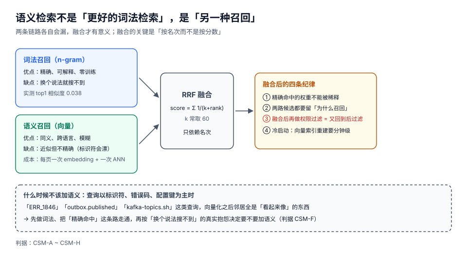

# 语义检索与混合排序

「加个向量检索」是这几年最容易做、也最容易白做的一件事。它确实能解决一类真实问题——**用户说的词和你写的词不一样**——但它同时会破坏另一类能力：**精确命中的确定性**。一个搜 `ERR_1846` 却返回十条「看起来像错误码」的结果的搜索，比搜不到更糟。

这一页先划清「语义该解决什么」，再给融合方案，最后给出「什么时候不该加」的判断线。

::: tip 一句话理解
词法检索答的是「**这里有没有这个串**」，语义检索答的是「**这里有没有这个意思**」。代码搜索的绝大多数查询是前者，所以语义只能是**补充召回**，不能是**替代排序**。
:::

## 判据族声明

本页判据族 `CSM-A` ~ `CSM-H`，共 8 条。定义表在第七节。

## 本页不讲什么

- 不讲 embedding 模型的选型与训练，归[RAG 的嵌入模型](../../../AI/RAG/Embedding/index.md)。
- 不讲 HNSW / IVF 的索引参数，归[向量数据库的索引算法](../../../DB/VectorDatabase/IndexAlgorithms/index.md)。
- 不讲词法侧的结构与验真，归[索引结构](../IndexStructure/index.md)与[查询规划](../QueryPlanning/index.md)。

## 一、两条链路各自漏什么



| 查询 | 词法（n-gram） | 语义（向量） | 谁对 |
| --- | --- | --- | --- |
| `ERR_1846` | **精确命中 1 处** | 返回一堆 `ERR_18xx`、`error 1846`、`错误码` 附近的内容 | 词法 |
| `outbox.published` | 精确命中字段名 | 可能返回「已发布的事件」相关段落，但**不含这个字段** | 词法 |
| 「下单之后库存没扣」 | 只能靠「下单」「库存」这类词碰运气 | 能找到讲「预占失败回滚」的段落 | **语义** |
| 「幂等」 vs 「重复提交不产生副作用」 | 后者搜不到「幂等」相关的页 | 能召回 | **语义** |
| `kafka-topics.sh` | 精确命中命令 | 返回「Kafka 主题管理」相关，但不给命令 | 词法 |

规律的总结很干脆：**查询里出现「标识符 / 命令 / 错误码 / 配置键」时，语义是负资产；查询是「一句人话的描述」时，语义是唯一解**。

| 查询特征 | 建议权重（词法 : 语义） |
| --- | --- |
| 含下划线/点号/全大写/数字结尾（`ERR_1846`） | **10 : 0**（直接关掉语义） |
| 单个英文词、驼峰（`OutboxRelay`） | 8 : 2 |
| 2~4 个中文词 | 5 : 5 |
| 一句完整的话（> 10 字，含「怎么/为什么/如何」） | 3 : 7 |

## 二、什么时候不该加：三条硬判据

1. **查询分布里标识符占比 > 50%** → 不加。典型是企业内部的代码仓搜索：用户九成时间在找符号。
2. **语料规模 < 1,000 个块** → 不加。此时「换个说法搜不到」的抱怨，通常用「同义词表 + 2-gram」就能解决，成本差一个数量级。
3. **没有评测集** → 不加。语义检索的效果无法靠肉眼判断（它总能返回「看起来相关」的结果），没有 recall@k 的基线，你无法知道它是否让情况变糟。

::: warning 语义检索最危险的性质：它从不返回空
词法检索搜不到时返回空，用户立刻知道「没有」。语义检索永远能返回 top-k——因为任何向量都有最近邻。于是「没有这段逻辑」这个结论会被伪装成「这里有十条相关文档」，而用户要花十分钟才能确认真的没有。

**处置**：语义链路必须有一个**绝对阈值**（如 cosine < 0.35 直接丢弃），并且界面上区分「精确命中」与「语义相近」两种结果（判据 `CSM-D`）。
:::

## 三、切块：语义的 chunk 与词法的块不是一回事

| 维度 | 词法的块 | 语义的 chunk |
| --- | --- | --- |
| 目的 | 让「文件:行」可定位 | 让「一段意思」完整 |
| 边界 | 结构边界（标题/空行/围栏） | 语义边界（一个完整论述） |
| 大小 | 越小越好（定位精度） | 200~800 字（embedding 有效区间） |
| 重叠 | 不需要 | 需要（10%~20%，防止跨块的意思被切断） |

实测支撑来自[入库与解析](../IngestPipeline/index.md)：本仓按结构边界有 **115,307** 个段落起点，而固定 1,000 字符窗口只有 **13,655** 块，且 **76.6%** 的边界切在词中间。对语义检索来说，切在词中间同样有害——一个被切成两半的论证，两个 chunk 的向量都不完整。

一个可用的折中：**索引块按结构切（用于定位），embedding 按「结构块合并到 300~600 字」切（用于召回），两者用 `(doc_id, offset)` 关联**。召回命中 embedding chunk 后，再映射回具体的结构块给出行号。

## 四、融合：RRF 只依赖名次

两路打分不可比（BM25 是无界实数，cosine 是 [-1,1]），所以**不要直接加权求和**。工业界最稳的做法是 Reciprocal Rank Fusion：

```text
RRF(d) = Σ_{r ∈ 召回列表} 1 / (k + rank_r(d))
k 常取 60
```

| 性质 | 含义 | 为什么重要 |
| --- | --- | --- |
| 只用名次 | 不需要两路分数可比 | 免掉归一化的所有坑 |
| 头部分数陡降 | 第 1 名 1/61、第 2 名 1/62…… | 两路都排第 1 的文档会显著胜出 |
| 天然抗单路噪声 | 一路排 50 名、另一路排 1 名，融合后仍在前面 | 单路的失误不会直接毁掉结果 |

但 RRF 有一个必须补的洞：**精确命中会被稀释**。如果用户搜 `ERR_1846`，词法只有 1 条结果（rank 1，得分 1/61），语义有 50 条（rank 1 得分也是 1/61），融合后语义的第一名可能与精确命中并列。处置是**两段式**：

```text
① 先跑词法；若存在「完全匹配」（子串命中且长度 ≥ 3），直接置顶并标记 exact
② 剩下的位置再按 RRF 融合两路结果填充
```

这不是「偏好词法」，而是承认一个事实：**完全匹配是用户的意图声明**。

## 五、成本：三个必须提前算的数

| 项 | 量级 | 说明 |
| --- | --- | --- |
| 建库 embedding | 块数 × 单次调用成本 | 本仓 16,841 个代码块 + 正文，按 300~600 字切约 **3~5 万块**；每块一次调用 |
| 单次查询 | 1 次 embedding + 1 次 ANN | ANN 通常 1~10 ms；embedding 调用是主要延迟（10~100 ms） |
| 重建 | 分钟级（受调用速率限制） | 语义索引**不能**像 n-gram 那样「单文件 3 ms 增量」——每次变更都要重新调用模型 |

最后一行是关键差异：词法索引的增量是 **3.08 ms/文件**，语义索引的增量是**一次网络调用**。这意味着语义索引的「新鲜度」天然落后，必须有独立的陈旧度指标（判据 `CSM-G`）。

## 六、评估：没有 recall@k 就不要上线

一个最小可用的评测集构造法：

| 步骤 | 做法 | 规模 |
| --- | --- | --- |
| ① 采查询 | 从真实日志里取 50 条，覆盖四种特征（标识符 / 单词 / 中文词 / 整句） | 50 |
| ② 标答案 | 每条查询人工标 1~5 个「必须命中」的文档 | 50 × 2.5 |
| ③ 算指标 | recall@10（词法 / 语义 / 融合三组分别算） | —— |
| ④ 看分桶 | 按查询特征分组看，**不要只看总体** | 4 组 |

最后一步是本页最想强调的：**总体 recall 是无意义的平均值**。语义检索通常让「整句查询」的 recall 大幅提升、让「标识符查询」的 recall 下降，两者一平均就看不出问题。分桶之后，正确的结论通常是「按查询特征路由」，而不是「调一个全局权重」。

## 七、判据表

| 判据 | 断言 | 怎么验 |
| --- | --- | --- |
| `CSM-A` | 语义链路有绝对阈值，低于阈值的候选被丢弃（不是永远返回 top-k） | 用一个与语料无关的查询（如「紫罗兰的香气」）查询，应返回 0 条或明确标注「无相关」 |
| `CSM-B` | 标识符类查询走词法专用路径，语义权重为 0 | 查 `ERR_1846`，返回结果全部含该串；开启语义后结果集不变 |
| `CSM-C` | 融合用名次（RRF）而非分数加权，或分数已做可比归一 | 读融合代码，存在 `1/(k+rank)` 或显式归一化；不存在「bm25 + cosine」直接相加 |
| `CSM-D` | 结果区分「精确命中」与「语义相近」 | 每条结果有 `match_type ∈ {exact, lexical, semantic}` 字段，界面有视觉区分 |
| `CSM-E` | 有 50 条以上的分桶评测集，且四类查询分别报 recall@10 | 评测报告里有四行（标识符/单词/中文词/整句），不是一行总分 |
| `CSM-F` | 「不该加语义」的判断有三条依据之一被实测过 | 决策记录里有「标识符查询占比」或「语料块数」或「评测基线」中的至少一项 |
| `CSM-G` | 语义索引有独立的陈旧度指标（与词法索引分开） | 指标里有 `semantic_lag_seconds`；改一个文件后该指标上升，重建后回落 |
| `CSM-H` | 语义链路的单次查询延迟被计入总预算（不是「另外算」） | 全库查询 p95 包含 embedding 调用耗时；超出 300 ms 时能定位到 embedding 这一步 |

## 八、如何验证

```shell
# 1) 用 3-gram 向量做一次「语义式」检索：看它对精确查询有多不准
python3 - <<'PY'
import os, re, math, time
from collections import Counter
docs = {}
for base in ("docs", "project"):
    for dp, _, fs in os.walk(base):
        for f in fs:
            if f.endswith(".md"):
                p = os.path.join(dp, f)
                docs[p] = open(p, encoding="utf-8", errors="replace").read()
def vec(t):
    s = " ".join(t.split()); v = Counter(s[i:i + 3] for i in range(len(s) - 2))
    n = math.sqrt(sum(x * x for x in v.values())) or 1
    return {k: c / n for k, c in v.items()}
t0 = time.time()
qv = vec("增量索引 更新 代价")
scored = sorted(((sum(qv.get(k, 0) * c for k, c in vec(t).items()), p) for p, t in docs.items()), reverse=True)[:5]
print("elapsed=%.1fs" % (time.time() - t0))
for s, p in scored:
    print("%.4f %s" % (s, p))
PY
# 期望：elapsed≈6s；top1 余弦约 0.038（最高分也只有 0.04 量级）
# 判读：无训练的字符向量余弦几乎不区分文档 —— 这就是「语义要真模型」的原因
```

```shell
# 2) 标识符查询：词法精确 vs 模糊召回的重合度
python3 - <<'PY'
import os
docs = {}
for base in ("docs", "project"):
    for dp, _, fs in os.walk(base):
        for f in fs:
            if f.endswith(".md"):
                p = os.path.join(dp, f)
                docs[p] = open(p, encoding="utf-8", errors="replace").read()
q = "ERR_1846"
exact = [p for p, t in docs.items() if q in t]
loose = [p for p, t in docs.items() if "ERR_" in t]
print("exact=%d loose=%d precision=%.0f%%" % (len(exact), len(loose), 100 * len(exact) / max(1, len(loose))))
PY
# 期望：exact 很小（可能为 0，本仓没有这个错误码），loose 是它的数十倍
# 判读：标识符查询一旦放宽到「模糊」，精确率立刻塌陷 —— CSM-B 的由来
```

```shell
# 3) RRF 融合的最小实现与名次敏感性
python3 - <<'PY'
def rrf(rank_lists, k=60):
    score = {}
    for ranks in rank_lists:
        for i, doc in enumerate(ranks, 1):
            score[doc] = score.get(doc, 0) + 1 / (k + i)
    return sorted(score.items(), key=lambda kv: (-kv[1], kv[0]))
lexical = ["a", "b", "c", "d"]
semantic = ["d", "c", "e", "f"]
print(rrf([lexical, semantic])[:4])
PY
# 期望：[('d', 0.032018), ('c', 0.032002), ('a', 0.016393), ('b', 0.016129), ...]
# 判读：两路都靠前的 d/c 胜出；a 在词法第 1 但语义缺席，被压到第三 —— 所以要给精确命中置顶（CSM-B）
```

## 参考资料

- Reciprocal Rank Fusion 原论文（k=60 的出处）：<https://plg.uwaterloo.ca/~gvcormac/cormacksigir09-rrf.pdf>
- Sentence-BERT（文本 embedding 的常用底座）：<https://arxiv.org/abs/1908.10084>
- MTEB 榜单（按任务类型选 embedding 模型）：<https://huggingface.co/spaces/mteb/leaderboard>
- HNSW 原论文（ANN 的召回率与延迟权衡）：<https://arxiv.org/abs/1603.09320>
- 本仓相邻专题：[RAG 的混合召回](../../../AI/RAG/Pipeline/index.md) · [多模态混合召回](../../../AI/MultimodalRetrieval/HybridRecall/index.md) · [向量库的过滤](../../../DB/VectorDatabase/Filtering/index.md)
