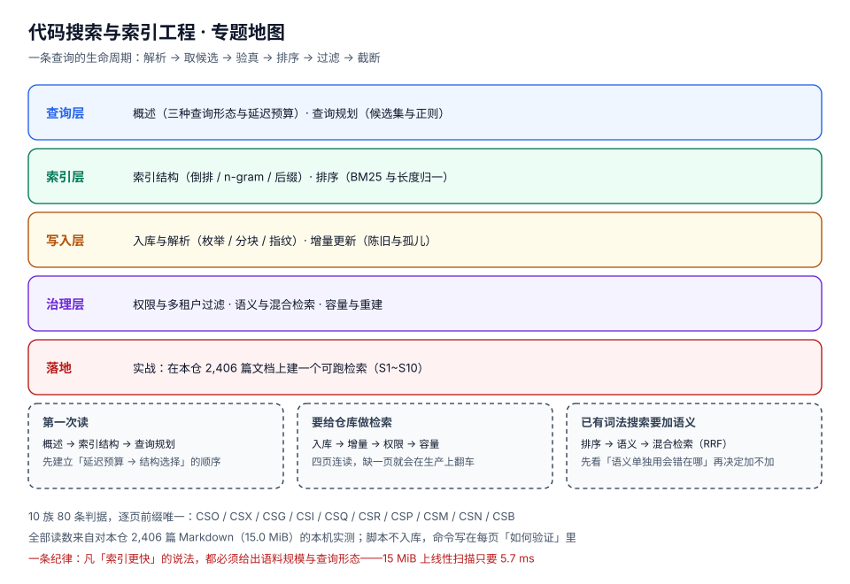

# 代码搜索与索引工程

「搜索」这个功能最容易被当成一个输入框：接一个 `grep`，或者调一个现成的全文检索服务，看上去就完事了。可一旦这个输入框要服务的是**代码**而不是文章，问题会立刻换一批：用户敲的是 `outbox.published`、`ERR_1846`、`kafka-topics.sh`——这些串既不是自然语言词，也不遵守任何分词规则；他要的不是「最相关的十篇文章」，而是**「这个符号在第几行被改过、为什么它会出现」**。

本专题讲的是**代码搜索作为一门索引工程**的那一面：**它必须自己决定「一个可检索单元」是什么、必须自己承担增量与删除的一致性、必须让权限在召回阶段就生效、还要在「精确」与「语义」之间划一条有依据的线**。这四件事决定了你最后交付的是「一个能用的搜索」还是「一个查不到就说没写过的搜索」。

::: tip 一句话理解
全文检索的假设是「**文档是给人读的，词是语言里的词**」；代码搜索的假设是「**文档是给编译器读的，词是标识符**」——把这两个假设混在一起，就会得到「搜 `outbox` 搜不到 `OutboxPublisher`」这类看起来像 bug、其实是设计错误的系统。
:::

## 与相邻专题的分工

| 专题 | 讲什么 | 与本专题的关系 |
| --- | --- | --- |
| 本专题 | **代码搜索工程**：查询形态与延迟预算、索引结构选型、入库与分块、增量与删除一致性、候选集与正则、排序与稳定性、权限过滤、混合检索、容量与重建、实战 | —— |
| [全文检索系统](../../DB/FullTextSearch/index.md) | 搜索引擎侧：倒排索引、分词器、相关性打分、索引更新、集群（10 页） | 那边假设「语料是自然语言」并且「有成熟的检索服务可用」；本专题假设「**语料是源码，且没有现成服务能满足『文件:行:列』这条定位要求**」。分词的坑两边都有，但那边的解是「换分词器」，这边的解是「**根本不分词**」（见[入库与解析](./IngestPipeline/index.md)） |
| [RAG 检索增强](../../AI/RAG/index.md) | 面向大模型的检索：切块、embedding、召回评估、生成衔接 | RAG 的检索目标是一段**能塞进上下文的证据**，允许模糊；代码搜索的目标是**一个坐标**，必须精确。RAG 的 chunk 边界可以按语义切，本专题的 chunk 必须按符号边界切——切错了，前缀查询会静默失效 |
| [向量数据库](../../DB/VectorDatabase/index.md) | HNSW / IVF / 量化 / 过滤 / 运维 | 那边讲「怎么存和怎么查向量」；本专题只在[语义检索与混合排序](./SemanticSearch/index.md)里用它，并且明确写清「什么时候不该用」——`ERR_1846` 这类查询向量化之后邻居全是「看起来像」的东西 |
| [IDE 与编辑器](../../Tools/IDE/Overview/index.md) | 编辑器内搜索、符号跳转、远程开发 | IDE 的搜索是**单仓、单用户、内存里**的；本专题要处理的是**多仓、多用户、有权限**。两者共享「先候选后验真」的思路，但预算不同：IDE 的补全预算是一帧，本专题的补全预算是三帧 |
| [Git 与版本控制](../../Tools/VersionControl/Git/index.md) | `git grep`、历史检索、分支模型 | `git grep` 是**线性扫描 + 无索引**，在 15 MiB 的仓库上只要 5.7 ms（[实测](./QueryPlanning/index.md)）；它的边界是「不能跨仓、不能排相关性、不能做权限」。什么时候该上索引，那页与本专题的[概述](./Overview/index.md)给出同一条判据 |
| [命令行效率](../../Tools/Efficiency/ShellProductivity/index.md) | ripgrep / fd / 管道组合 | 这是**个人效率工具**，不需要索引也不需要服务；本专题是「要给别人用」的版本。判据 `CSO-B` 就是这条分界线 |
| [静态分析与质量门禁](../../Tools/CodeQuality/Overview/index.md) | AST 规则、规则集、门禁 | 静态分析是**预先定义模式**去扫全量；搜索是**用户临时给模式**。前者可以慢（CI 里跑），后者必须快（按键就跑）。两者共用「枚举 + 解析」，但静态分析的产物是告警，搜索的产物是坐标 |
| [工程效能度量](../../Tools/EngineeringMetrics/index.md) | 度量体系、反指标、看板 | 搜索的质量指标（零结果率、点击位置、陈旧度）属于那边的度量体系；本专题[容量与重建](./Operations/index.md)只定义**采集点**，不重复讲看板设计 |

::: warning 版本组织：本专题不建版本目录
按 `AGENTS.md` 第 3 节，**大版本差异才建版本目录**（如 `Spring5/` 与 `Spring6/`、`MySQL57/` 与 `MySQL84/`）。本专题不建，三条理由：

1. **它不是某个产品的文档**，而是一类工程问题的解法。这里出现的「版本」是**库与格式的版本**（Lucene 9/10、SQLite FTS5、pg_trgm、Tantivy、zoekt），它们不是「同一套用法换了个大版本」，而是**可替换的实现**。给每个实现建一个目录，得到的是五份互相矛盾的入门。
2. **真正会分代的是「查询形态」，不是软件版本**。词法检索 → 混合检索是一次能力代际，但它不影响前面九页的任何一条判据：索引结构、增量、删除、权限、容量在两种形态下都成立。所以差异用页内表格标注（[语义检索与混合排序](./SemanticSearch/index.md)第一节），不另开目录。
3. **旧内容没有被覆盖的需求**。本专题是新建的，库内没有「上一代代码搜索」的存量页面（`git grep` 实测「代码索引」0 篇、「zoekt」0 篇、「trigram」1 篇且是顺带提及），不存在「保留旧版、标注状态」的对象。

需要看「该建版本目录」的范式，参考 [Spring5 / Spring6](../../Backend/Java/Frame/Spring/Spring6/index.md)、[SpringCloud 2020 / 2022](../../Backend/Java/Frame/SpringCloud/SpringCloud2022/index.md)、[MySQL 5.7 / 8.4](../../DB/SchemaEvolution/MySQL57/index.md)、[Vue2 / Vue3](../../Frontend/Frame/Vue/index.md)；反过来，「一条路径而不是两套用法」的不建目录范式见[数据库大版本升级](../../Ops/DatabaseUpgrade/index.md)。
:::

## 专题地图

共 10 页正文，按「先定预算 → 再选结构 → 再把数据写进去 → 最后按查询链路走一遍」排列。

| 页面 | 内容 | 适合谁读 |
| --- | --- | --- |
| [概述：代码搜索到底在解决什么问题](./Overview/index.md) | 三种查询形态与三档延迟预算、五种「搜不到」的根因、该不该上索引的四问 | 所有人，先读 |
| [索引结构：倒排、n-gram 与后缀](./IndexStructure/index.md) | 四种结构的成本、n 的取舍、高频 gram 的处置、索引体积的实测与估算 | 要选型的人 |
| [入库与解析：从文件到可检索的块](./IngestPipeline/index.md) | 枚举与忽略规则、编码与语言识别、符号级分块、内容指纹、中文语料的分词陷阱 | 写索引器的人 |
| [增量更新与索引一致性](./IncrementalUpdate/index.md) | 全量 / 增量 / 伪增量三态、`mtime+size` 的漏检、删除与重命名的孤儿 posting、墓碑与压缩 | 被「搜不到昨天改的那句」折磨过的人 |
| [查询规划：解析、候选集与正则](./QueryPlanning/index.md) | 查询语法、AND/OR/NOT、候选集生成与验真、正则的两条路、超时与截断 | 写查询层的人 |
| [结果排序：BM25 与稳定性](./Ranking/index.md) | TF 的页长偏见、BM25 三因子、字段与路径权重、同分兜底、分页游标 | 觉得「结果不准」的人 |
| [权限过滤与多租户](./PermissionFilter/index.md) | 后过滤丢结果的量级、预过滤两种实现、ACL 变更的代价、删除可见性 | 做企业内部搜索的人 |
| [语义检索与混合排序](./SemanticSearch/index.md) | 词法与语义各自漏什么、RRF 融合、chunk 边界、成本与冷启动、什么时候不该加 | 想加向量检索的人 |
| [容量、重建与监控](./Operations/index.md) | 四个要盯的数、四个必采指标、分段重建与双写切换、陈旧度自证 | 要上线的人 |
| [实战：给本仓建一个可跑检索](./Practice/index.md) | S1~S10 十条可判定验收、单文件 Python 实现骨架、分诊表、上线自查 | 想照着做一遍的人 |

## 判据族总览

本专题共 **11 族 88 条判据**（10 章正文 + 1 篇 FAQ），每族 8 条，逐页前缀唯一（已用 `judgeidcheck` 核对全库 0 撞号）：

| 页 | 判据族 | 这一族管什么 | 条数 |
| --- | --- | --- | --- |
| 概述 | `CSO-A` ~ `CSO-H` | 这个场景到底该不该上索引？搜不到时先怀疑哪一层？ | 8 |
| 索引结构 | `CSX-A` ~ `CSX-H` | 选哪种结构？n 取多少？高频 gram 怎么处置？ | 8 |
| 入库与解析 | `CSG-A` ~ `CSG-H` | 哪些文件进来了？按什么边界切？指纹算的是什么？ | 8 |
| 增量更新 | `CSI-A` ~ `CSI-H` | 这次改动会不会被漏掉？删掉的东西还会不会出现？ | 8 |
| 查询规划 | `CSQ-A` ~ `CSQ-H` | 候选集怎么来？验真做了没有？超时怎么收？ | 8 |
| 结果排序 | `CSR-A` ~ `CSR-H` | 排的是「相关」还是「页长」？两次结果一样吗？ | 8 |
| 权限过滤 | `CSP-A` ~ `CSP-H` | 权限在召回前还是召回后生效？ACL 变了索引怎么跟？ | 8 |
| 语义检索 | `CSM-A` ~ `CSM-H` | 该不该加语义？融合之后精确命中还在不在？ | 8 |
| 容量与运维 | `CSN-A` ~ `CSN-H` | 体积、重建、陈旧度、指标，四个数各是多少？ | 8 |
| 实战 | `CSB-A` ~ `CSB-H` | 从零到能回答「在哪、为什么、有多新」，每步怎么验收？ | 8 |
| 常见问题 | `CSF-A` ~ `CSF-H` | 分词、大小写、FTS5、重建耗时、多租户等 12 个高频疑问的正确答案 | 8 |

## 事实与量级速览（2026-10 实测，语料 = 建本专题之前的快照：2,406 篇 Markdown / 15.0 MiB）

| 事实 | 实测读数 | 影响 |
| --- | --- | --- |
| 语料规模 | **2,406 文件 / 15,679,054 B**；单篇 p50 **5,779 B / 188 行**，p99 **27,022 B**，最大 **87,340 B** | 「小语料」的边界比想象中低：这个量级上线性扫描只要几毫秒 |
| 全库线性扫描 | 找「幂等」**5.7 ms**（394 篇命中）；找 `outbox` 前 5 条 **1.5 ms** | **15 MiB 以内，索引买不到延迟**，买的是排序、增量与权限 |
| 空白分词的召回损失 | 查「幂等」：`split()` 命中 **41** 篇，子串命中 **394** 篇 → **召回少 89.6%** | 中文语料上「分词」必须显式设计，默认 `split()` 是静默杀手 |
| 中文「词」的长度 | 344,347 个含中文的 token，平均 **16.8 字符**，最长 **512 字符**（整句一个 token） | 词表 515,711 项里绝大多数是「句子」，不是词 |
| n-gram 成本 | 2-gram **259,641** gram / **430.9 MiB** / 建 **4.74 s**；3-gram **1,507,085** / **706.2 MiB** / **8.64 s**；4-gram **3,420,076** / **871.0 MiB** / **12.83 s** | 每加一个字符，gram 数涨 3~4 倍，体积涨 1.2~1.6 倍 |
| 高频 gram | `' ##'` 覆盖 **2309/2406（96.0%）**、`'## '` 96.0%、`' - '` 95.2%、`'ion'` 90.3%；最大的 200 个 gram 中 **94.5%** 超过半数语料 | 查询里含这类 gram，候选集直接退化成全库 |
| 3-gram 查询 | 「幂等键」候选 **129** → 命中 **129**，**0.42 ms**；`idempotency` 候选 **68** → 命中 **35**，**3.13 ms**（候选是答案的 1.9 倍） | trigram 允许乱序命中，**必须验真**（子串确认） |
| 增量成本 | 全量 **7.41~8.64 s** vs 单文件 **136.49 ms**（87,340 B）→ **54×**；每文件平均 **3.08 ms** | 增量省的是「读别人的字节」，不是「读自己的字节」 |
| 删除的残留 | 删掉一篇文档后，索引里仍有 **4,614 组** posting 指向它 | 「删了还能搜到」是数据泄露级缺陷，不是显示问题 |
| 排序的分歧 | 同一查询「索引」、同一批 **490** 篇候选：TF 的 top10 与 BM25 的 top10 **只重合 6/10**；idf=**1.59**（df=581） | 换排序 = 换产品 |
| 长度归一 | 同为命中 ≥3 次：短页 **611 B → 3.37**，长页 **80,593 B → 1.89**（相差 **1.78 倍**） | `b=0` 关掉归一 → 长页反超；`b=1` → 短页霸榜 |
| 大小写 | 区分大小写查 `Outbox` 命中 **25** 篇；忽略大小写 **89** 篇 → 差 **72%** | 「默认区分大小写」是一半召回被丢掉的原因，且用户不会报这个 bug |
| 后过滤的代价 | 可见率 60% → 平均丢 **4.0/10**、全空 **0.0%**；30% → **7.0/10 / 3.2%**；10% → **9.1/10 / 40.4%**；2% → **9.8/10 / 81.8%** | 「新租户什么都搜不到」的根因通常在这里，而索引健康度指标全是绿的 |
| 正则的回溯 | `(a+)+b` 对 22 个 `a` + 1 个 `c` 耗时 **413.7 ms** | 用户输入的正则是一条**拒绝服务**通道，必须有超时 |

## 三条会静默失效、且构建与自测都不会报的坑

::: danger 这三条不报错，只是不对
1. **默认分词**：用 `text.split()` 建词表。英文语料上一切正常，中文语料上「幂等」这种词根本不进词表（实测召回从 394 掉到 41）。症状是「有些词搜得到、有些词搜不到」，而日志里没有任何错误。判据：`CSG-B`。
2. **用 `mtime + size` 当变更指纹**：`git checkout` 回旧版本、`cp -p`、`rsync -t`、解包，都会让「内容变了但 mtime 与 size 都没变」成为常态。症状是「搜不到昨天刚改的那句」，重启索引进程后自动恢复——于是永远无法复现。判据：`CSI-B`。
3. **先取 top-k 再过滤权限**：索引侧完全健康，只是每次查询都在过滤之后返回一个更短的列表，可见率越低越空。症状是「新同事/新租户说搜索坏了」，而你用管理员账号怎么试都是好的。判据：`CSP-B`。
:::

## 学习路径

1. **先读[概述](./Overview/index.md)**，把「三种查询形态 + 三档延迟预算」记住——后面九页的所有取舍都是在这三档预算下做的。
2. [索引结构](./IndexStructure/index.md) 与 [入库与解析](./IngestPipeline/index.md) 是地基：一个决定「查得多快」，一个决定「查得到什么」。
3. [增量更新](./IncrementalUpdate/index.md) 与 [权限过滤](./PermissionFilter/index.md) 是**两个必须提前设计、事后补不上的东西**——它们改的是写入侧与召回侧的形状。
4. [查询规划](./QueryPlanning/index.md) → [结果排序](./Ranking/index.md)：按查询链路顺序读。
5. [语义检索](./SemanticSearch/index.md) 最后读，先读完它第一节的「什么时候不该加」再决定要不要动手。
6. [容量与运维](./Operations/index.md) 上线前读，[实战](./Practice/index.md) 照着做一遍。
7. 动手过程中被具体问题卡住时查[常见问题](./FAQ/index.md)：分词、大小写、FTS5 `trigram`、重建耗时、多租户五类共 12 问，每问都带实测读数。

## 参考资料

- ripgrep（无索引线性扫描的上限参考，含 `--json` 输出格式）：<https://github.com/BurntSushi/ripgrep>
- zoekt（Google 的代码搜索索引，trigram 分片设计）：<https://github.com/sourcegraph/zoekt>
- Sourcegraph 代码搜索文档（查询语法与 `type:` 过滤器）：<https://sourcegraph.com/docs/code-search>
- Lucene 9/10 数值与文本索引格式：<https://lucene.apache.org/core/documentation.html>
- SQLite FTS5（含 `trigram` tokenizer）：<https://sqlite.org/fts5.html>
- PostgreSQL `pg_trgm`（trigram 相似度与 GIN/GiST 索引）：<https://www.postgresql.org/docs/current/pgtrgm.html>
- BM25 原始论文（Robertson & Zaragoza, 2009）：<https://www.staff.city.ac.uk/~sbrp622/papers/foundations_bm25_review.pdf>
- Reciprocal Rank Fusion（RRF, Cormack et al.）：<https://plg.uwaterloo.ca/~gvcormac/cormacksigir09-rrf.pdf>
- 本仓相邻专题：[全文检索系统](../../DB/FullTextSearch/index.md) · [RAG 检索增强](../../AI/RAG/index.md) · [向量数据库](../../DB/VectorDatabase/index.md)
