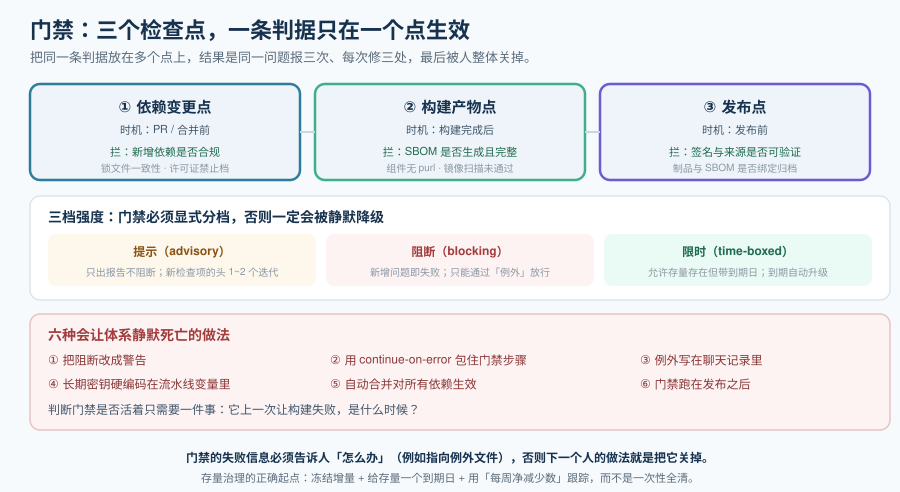

# 门禁与自动化更新

前面五页产出的都是**判断**：清单、优先级、许可证结论、来源验证。这一页把它们变成**动作**——插进流水线，让不通过的构建根本发不出去。

同时这一页还解决另一半问题：**依赖不能只"防"，还得"升"**。一个半年没升过依赖的项目，漏洞队列会越来越长，最后没人敢升。

::: tip 一句话理解
门禁的价值不在"发现"（发现不了价值的报告很多），而在**"拦住"**。
判断一个门禁是否活着，只需要看一件事：**它上一次让构建失败是什么时候**。
:::



## 一、依赖更新机器人：Dependabot 与 Renovate

它是"让依赖保持新鲜"的最低成本手段。两者不是"谁更好"，而是**配置自由度与维护成本的不同组合**：

| 维度 | Dependabot | Renovate |
| --- | --- | --- |
| 平台支持 | 以 GitHub 为主 | GitHub / GitLab / Bitbucket / ADO / Gitea 等 |
| 配置成本 | 几乎为零 | 需要写配置文件，能力也来自这里 |
| 配置文件粒度 | 按生态 / 目录 | 可精细到「某类包在某个条件下降级为哪种策略」 |
| **冷却期默认值（2026-10）** | **默认 3 天**（自 2026-07-14 起，无需配置）；安全更新豁免 | **无默认值**，必须显式配 `minimumReleaseAge` |
| 自动合并 | 官方无 `automerge` 键，需配合平台自动合并 + 元数据动作 | 配置内直接声明条件 |
| 自定义文件支持 | 覆盖 GitHub 选定的常见文件（含 K8s / Helm 等） | 可用正则管理器覆盖"任何含版本号的文件" |
| 汇总与限流 | 每生态默认 5 个未合 PR；安全更新单独额度 | 默认同时 10 个 PR、每小时 2 个 |

**选型口径**：

- **GitHub 上的中小项目（依赖少、非 monorepo）** → Dependabot，零配置起步。
- **多平台 / monorepo / 需要精细策略** → Renovate。
- **无论用哪个**：**冷却期必须显式确认**。用 Dependabot 时确认默认 3 天是否够；用 Renovate 时**必须自己配**，否则它是两者中更激进的那个。

::: danger 关于 Renovate 的一个静默故障
Renovate 42 起，`minimumReleaseAgeBehaviour` 默认为 **`timestamp-required`**：**一个没有发布时间戳的版本会被无限期推迟**。
这在容器镜像源上尤其致命（GHCR / Quay / ECR 常不返回时间戳）——症状是"**某些依赖的更新永远不来**"，而且日志里只有一行警告。
正确做法：对这类源显式设置 `"minimumReleaseAgeBehaviour": "timestamp-optional"`，并接受"这类更新不做年龄检查"这个取舍。
:::

## 二、自动合并的四条边界

自动合并能大幅降低维护成本，但**必须设边界**：

1. **不默认全量自动合并**。至少要把「大版本升级」和「生产依赖」留给人看。
2. **只对信任白名单自动合并**（长期维护良好、用法稳定的包）。
3. **必须先过 CI**：测试、静态检查、锁文件一致性、依赖门禁全部通过才有资格谈自动合并。
4. **把第三方 Action / 插件钉到提交哈希**。`uses: some/action@v1` 的 `v1` 是**可变的**——上游可以随时把 `v1` 指向新代码。用 `pinDigests` 一类能力自动钉住。

```json
// renovate.json 片段：保守但可用的自动合并策略
{
  "extends": ["config:recommended"],
  "minimumReleaseAge": "7 days",
  "dependencyDashboard": true,
  "prConcurrentLimit": 8,
  "automerge": false,
  "vulnerabilityAlerts": {
    "labels": ["security"],
    "minimumReleaseAge": "0 days",
    "prPriority": 20
  },
  "packageRules": [
    { "matchDepTypes": ["devDependencies"], "matchUpdateTypes": ["patch"], "automerge": true },
    { "matchPackageNames": ["@types/*"], "automerge": true },
    { "matchUpdateTypes": ["major"], "automerge": false }
  ]
}
```

## 三、门禁的三档强度

门禁最怕的不是"漏"，而是**"被降级后没人知道"**。所以强度要**显式分档**：

| 档 | 行为 | 适用 | 退出条件 |
| --- | --- | --- | --- |
| **提示（advisory）** | 只产出报告，不阻断 | 新引入的检查项；前 1~2 个迭代 | 观察到误报率可接受后升级为阻断 |
| **阻断（blocking）** | 新增问题即失败 | 清单完整性、来源校验、许可证禁止档、**在野利用漏洞** | 仅通过"例外"放行，例外有到期日 |
| **限时（time-boxed）** | 允许存在但必须带到期日 | 存量问题、经评审的依赖 | 到期自动升级为阻断 |

::: warning 说明
**「限时」这一档是存量治理的关键**：一个几千个组件的老项目，第一天就开阻断会导致没有任何一次构建能通过。正确做法是**冻结增量**（新增的必须干净）+ **给存量一个到期日**，并用盘子里的数字（例如"存量高危 120 条，每周净减少 10 条"）来跟踪，而不是一次性全清。
:::

## 四、门禁挂在哪三个检查点

| 检查点 | 时机 | 能拦什么 | 拦不住什么 |
| --- | --- | --- | --- |
| **依赖变更点** | PR / 合并前 | 新增依赖是否合规、锁文件是否一致、许可证是否禁止档、新引入的高危 | 存量问题（老依赖） |
| **构建产物点** | 构建后 | SBOM 是否生成成功、组件是否全部有 `purl`、镜像扫描是否通过 | 运行期才出现的组件 |
| **发布点** | 发布前 | 签名与来源验证、制品与 SBOM 的绑定、最终清单是否归档 | 已经发布出去的东西 |

::: tip 提示
**三个检查点的判据不能重复**。一个常见的设计错误是把「许可证检查」同时放在三个点上——结果是同一条问题报三次，每次修复都要改三处，最后被人整体关掉。**一条判据只在一个点上生效**。
:::

## 五、实操：一条能跑的门禁流水线

```yaml
# .github/workflows/supply-chain.yml（示意；片段，非完整文件）
name: supply-chain
on:
  pull_request:
  push:
    branches: [main]

permissions:
  contents: read
  id-token: write        # 仅签名任务需要；不要给整个工作流开

jobs:
  dependency-gate:
    runs-on: ubuntu-latest
    steps:
      - uses: actions/checkout@v4

      # 0. 钉住第三方 Action / 插件（阻断可变标签）
      - name: Pin check
        run: |
          ! grep -rnE 'uses:\s+[^@]+@(v[0-9]+|main|master)$' .github/workflows/ \
            || (echo "存在未钉到提交哈希的 Action"; exit 1)

      # 1. 生成 SBOM（与产物同源）
      - name: Generate SBOM
        run: |
          curl -sSfL https://raw.githubusercontent.com/anchore/syft/main/install.sh | sh -s -- -b ./bin
          ./bin/syft dir:. -o cyclonedx-json=sbom.cdx.json

      # 2. 清单自检（阻断）
      - name: SBOM completeness gate
        run: |
          test "$(jq -r '.bomFormat' sbom.cdx.json)" = "CycloneDX"
          test "$(jq '.dependencies | length' sbom.cdx.json)" -gt 0

      # 3. 漏洞门禁：只对「在野利用」与「有修复版本的高危」阻断
      - name: Vulnerability gate
        run: |
          curl -sSfL https://raw.githubusercontent.com/anchore/grype/main/install.sh | sh -s -- -b ./bin
          ./bin/grype sbom:./sbom.cdx.json -o json > findings.json
          CRIT=$(jq '[.matches[] | select(.vulnerability.fix.state=="fixed")
                      | select(.vulnerability.severity=="Critical")] | length' findings.json)
          echo "有修复版本的严重漏洞数：$CRIT"
          test "$CRIT" -eq 0 || (echo "存量例外见 security/exceptions.yaml"; exit 1)

      # 4. 许可证门禁（禁止档）
      - name: License gate
        run: |
          BAD=$(jq -r '.components[] | (.licenses // [])[]
                        | (.license.id // .expression // "UNKNOWN")' sbom.cdx.json \
                | sort -u | grep -cE '^(AGPL|GPL|SSPL|UNKNOWN)' || true)
          test "$BAD" -eq 0 || (echo "发现禁止档或未知许可证：$BAD 项"; exit 1)

      # 5. 归档（清单必须随产物走）
      - uses: actions/upload-artifact@v4
        with:
          name: sbom
          path: sbom.cdx.json
```

**这段流水线的三处刻意的设计**（比内容本身更重要）：

1. **在野利用与"有修复版本"是两条硬门禁**，其余告警不做阻断——否则没人能合并代码。
2. **归档步骤与生成步骤在同一个任务里**，保证「这份清单属于这次构建」。
3. **失败信息里直接指出例外文件的位置**——**门禁必须告诉人"怎么办"，否则下一个人的做法就是把它关掉**。

## 六、例外与豁免的四条纪律

（与[漏洞扫描与优先级](../VulnerabilityScan/index.md)同源，但这里讲它**在流水线里怎么落地**）

1. **例外放在文件里、进版本控制**——而不是聊天记录或工单评论。
2. **例外必须有到期日**，到期必须有人被通知。
3. **例外必须写明生效范围**（仓库 + 组件 + 版本区间 + 理由 + 批准人）。
4. **不允许通配符**：`CVE-2024-*` 这类写法会放过尚未公开的同类漏洞。

```yaml
# security/exceptions.yaml（示意）
exceptions:
  - id: EX-2026-014
    component: pkg:npm/example-lib@1.2.3
    reason: "上游无修复版本，已通过网关层拦截该功能入口"
    approved_by: "security-review-board"
    scope: ["repo:acme/web"]
    expires: "2027-01-31"        # 到期后自动升级为阻断
```

## 七、不要这样做

::: danger 六种会让治理体系静默死亡的做法
1. **把阻断改成警告**。一次紧急发布之后，门禁就再也不会拦任何东西了，而所有人还以为它在工作。
2. **用 `continue-on-error: true` 包住门禁步骤**。它与"改成警告"等价，只是更隐蔽。
3. **例外写在聊天记录里**。半年后没人能解释它为什么存在，也没人敢删。
4. **凭证用长期密钥硬编码在流水线变量里**。这与[来源可信](../Provenance/index.md)里的密钥less方案直接冲突——你花力气做了签名，却把钥匙挂在了门上。
5. **自动合并对所有依赖生效**。一次投毒的上游版本会被自动合进主干，CI 也可能通过（因为恶意代码往往不影响测试）。
6. **门禁跑在发布之后**。发布之后的检查只能事后通报，不能阻断。
:::

## 八、可执行验证

```shell
# 1. 门禁是否真的在阻断（应无输出；有输出说明存在容错写法）
grep -rn "continue-on-error\||| true" .github/workflows/ 2>/dev/null

# 2. 第三方 Action 是否都钉到提交哈希（应无输出）
grep -rnE 'uses:\s+[^@]+@(v[0-9]+|main|master)$' .github/workflows/

# 3. 例外是否都有到期日（应无输出）
grep -nE 'expires:\s*$' security/exceptions.yaml || echo "OK: 例外均有到期日"

# 4. 例外是否使用通配符（应无输出）
grep -nE '(id|component):.*\*' security/exceptions.yaml || echo "OK: 无常通配例外"

# 5. 冷却期是否显式配置（Renovate 场景；无输出则有静默失效风险）
grep -n "minimumReleaseAge" renovate.json || echo "警告：未配置冷却期"
```

## 参考资料

- GitHub Dependabot 官方文档（`dependabot.yml` 的 `cooldown` 字段与默认值、分组与限流）
- Renovate 官方文档（`minimumReleaseAge`、`minimumReleaseAgeBehaviour`、`pinDigests`、`packageRules`）
- GitHub Actions 官方文档（`permissions`、`id-token` 与 OIDC 身份）
- SLSA 规范站点（构建证明在 CI 中的生成方式）
- Sigstore / cosign 官方文档（流水线内签名与验证）
- Anchore Syft / Grype 官方文档（SBOM 生成与门禁用法）
- [依赖与安全治理 · 实战：给一个多语言仓库做依赖治理](../Practice/index.md)（下一步：把六页内容串成一条流程）
