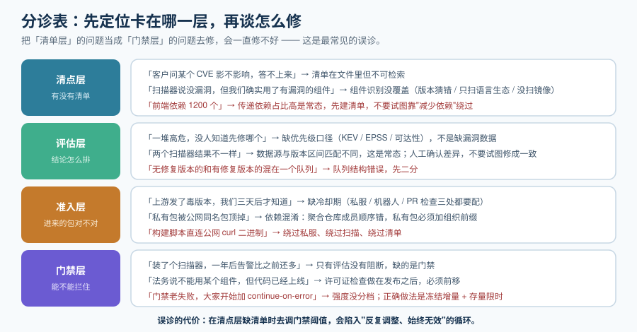

# 常见问题与最佳实践

这一页是**手边工具**：出问题时先看分诊表定位卡在哪一层，再翻对应问答。它同时收录上线自查清单、最佳实践与术语表。

::: tip 一句话理解
依赖治理的问题里有 **80% 不是工具问题，而是"卡在哪一层"没有分清**——把清单层的问题当成门禁层的问题去修，会一直修不好。
:::

## 一、分诊表：症状 → 先查哪里

| 症状 | 先查哪一层 | 为什么 |
| --- | --- | --- |
| 「装了个扫描器，一年后告警比之前还多」 | **门禁层** | 只有评估、没有阻断，说明缺的是门禁而不是工具 |
| 「扫描报告里一堆高危，但没人知道该先修哪个」 | **评估层** | 缺优先级口径（KEV / EPSS / 可达性），不是缺漏洞数据 |
| 「前端依赖 1200 个，感觉像在裸奔」 | **清点层** | 传递依赖占比极高是常态，先建立清单，不要试图"减少依赖"来绕过 |
| 「上游发了毒版本，我们三天后才知道」 | **准入层** | 缺冷却期；三处冷却都要配 |
| 「客户问我们某个 CVE 影不影响，答不上来」 | **清点层** | 缺反查能力——清单在文件里但不可检索 |
| 「扫描器说没有漏洞，但我们确实用了有漏洞的组件」 | **清点层** | 组件识别没覆盖（版本猜错、只扫了语言生态、没扫镜像） |
| 「两个扫描器结果不一样，谁的错」 | **评估层** | 数据源与版本区间匹配不同，**这是常态**；人工确认差异，不要试图修成一致 |
| 「法务说不能用某个组件，但代码已经上线了」 | **门禁层** | 许可证检查做在发布之后；必须前移到合并前或构建中 |
| 「门禁老是失败，大家开始加 `continue-on-error`」 | **门禁层** | 门禁强度设计过严或没有分档；正确做法是"冻结增量 + 存量限时" |
| 「私有包突然被公网同名包顶掉」 | **准入层** | 聚合仓库成员顺序错，属依赖混淆；私有包必须加组织前缀 |
| 「升级机器人打开的 PR 半年没人合」 | **持续层** | 缺自动合并边界与分组策略；也可能冷却期过长导致队列堵死 |
| 「SBOM 交出去了，客户说要素不全」 | **清点层** | 缺最小要素（供应方 / 版本 / 唯一标识 / 依赖关系 / 作者 / 时间戳） |

## 二、十二个高频问答

### 1. SBOM 应该生成几份？

**每个产物一份**。一个仓库有 4 个可独立部署的产物，就要有 4 份清单——否则「哪个模块引入了这个组件」永远答不出来。反过来，**只为整个仓库生成一份**是最常见的错误做法。

### 2. CycloneDX 还是 SPDX？

内部安全流程用 CycloneDX（工具生态宽、原生 VEX），对监管或客户报送用 SPDX（ISO 标准化、许可证表达完整）。**不必二选一**：主流生成器两种都能输出，转换放在导出层。

### 3. 为什么扫描器之间结论不一致？

它们拉的数据源不同（OSV 按生态精确到版本区间，NVD 大量依赖 CPE 与人工标注），版本区间匹配逻辑也不同。**不一致是常态**，双扫只值得用在关键产物上，差异作为人工确认的提示。

### 4. CVSS 高就应该马上修吗？

**不应该。** CVSS 只回答"如果被利用，后果多严重"，不含利用概率。必须叠加 EPSS（被利用的概率）与 KEV（是否已被在野利用）。**KEV 命中优先于其他一切信号**。

### 5. "无修复版本"的漏洞怎么处理？

**单列一条通道**，不参与优先级排序。做法是评估可达性 → 上缓解措施（网关拦截、关闭功能入口）→ 出具 VEX 声明 → 定期复查是否有补丁或可替代组件。把它和有修复版本的条目混在一个队列里，是队列结构错误。

### 6. VEX 到底有什么实际价值？

它让你能正式回答一句话：「我们知道这个组件有 CVE-XXXX，**在我们的用法下不可利用**，理由是……」。这句话在客户安全问卷里出现频率极高。**没有 VEX，你只能每年重复一句"我们正在处理"。**

### 7. 许可证「声明」和「实际」不一致怎么办？

先跑一次源码级扫描拿到结论许可证，然后**逐条人工确认差异**。四种典型成因：声明缺失、声明单一而实际多许可、元数据过期、文件头与 LICENSE 文件冲突。**审计必须以结论为准，不能以元数据为准。**

### 8. LGPL 在 Java / Go 项目里安全吗？

**不能照搬"动态链接可以"的通俗说法**。Go / Rust 通常是静态链接，Java 打成 fat-jar 也接近静态组合。这些场景**必须单独评审**，结论取决于你的实际链接方式与是否修改过源码。

### 9. 冷却期设多少天合适？

没有普适值，但 **3~7 天**是常见起点，大版本 14 天。两个必须知道的事实：**Dependabot 自 2026-07-14 起默认 3 天**（安全更新豁免）；**Renovate 的 `minimumReleaseAge` 无默认值**，不配置就是两者中更激进的那个。

### 10. 私服真的有必要自建吗？

**规模一上来就有必要**。四个理由：上游中断时你的构建还能跑、有下载审计、能做事前准入（封禁与冷却）、所有团队从同一个源取同一份包。**但要有心理准备**：装起来容易，**持续运维才是工作量**——按支持窗口（如 Nexus 约 18 个月）规划升级、给它自己做监控。

### 11. 签名了但不验证，有意义吗？

**没有。** 签名的价值 100% 来自验证环节。而且验证必须校验**签名者身份**（身份正则 + 签发方），只检查"有没有签名"等于没检查——攻击者可以自己签一个。

### 12. 存量几千个高危，从哪开始？

**先冻结增量，再清存量**。三条纪律：① 门禁只拦新增（保证不再恶化）；② 给存量一个到期日，按「每周净减少数」跟踪；③ 先从 KEV 命中与有修复版本的 Critical 入手，其余按优先级排队。**一次性全清的做法一定会失败**。

## 三、上线自查清单

每一项都应该能在 5 分钟内用命令确认：

| # | 检查项 | 判据 |
| --- | --- | --- |
| 1 | 每个产物都有独立 SBOM | 清单数 == 可部署产物数 |
| 2 | SBOM 与产物一起归档 | 给定已发布版本能找回它的清单 |
| 3 | 镜像 SBOM 含 OS 包 | 能搜到 `pkg:deb` / `pkg:rpm` / `pkg:apk` |
| 4 | 组件有跨生态标识 | 缺 `purl` 的组件数可控且已说明 |
| 5 | 有反查能力 | 给组件名能列出受影响产物 |
| 6 | 漏洞队列已二分 | 有/无修复版本分别计数 |
| 7 | 优先级口径已文件化 | 规则在文件里，不在会议纪要里 |
| 8 | KEV 命中为 0 | 与 KEV 清单求交集为空 |
| 9 | 许可证禁止档与 UNKNOWN 为 0 | 或有带到期日的例外 |
| 10 | 第三方声明覆盖全部组件 | 声明条目数接近 SBOM 组件数 |
| 11 | 三处冷却期均已配置 | 私服 + 机器人 + PR 检查 |
| 12 | 门禁真的会失败 | 故意注入问题，构建确实失败 |
| 13 | 没有长期密钥硬编码 | 用密钥less 或最少权限的临时凭证 |
| 14 | 无直连公网源 | 工程配置里没有公网 registry 地址 |
| 15 | 例外都有到期日且可检索 | 无 `expires:` 为空的条目 |

## 四、最佳实践十二条

1. **先建清单，再谈治理**。没有反查能力时，所有讨论都会停在"感觉"层面。
2. **一条判据只在一个检查点生效**。重复检查会导致"改三处才通过"，最终被整体关掉。
3. **队列先二分**（有修复版本 / 无修复版本），再排优先级。
4. **门禁强度必须显式分档**，并且「限时」这一档要有到期日。
5. **例外进版本控制、带到期日、不带通配符**。
6. **冷却期三处都配**：私服、更新机器人、PR 检查。
7. **不要自动合并全部依赖**；先给信任白名单与 devDependencies。
8. **把第三方 Action 与插件钉到提交哈希**，因为标签是可变的。
9. **签名必须验证身份**，不只是验证"有签名"。
10. **`UNKNOWN` 许可证按禁止处理**——无许可证不等于免费使用。
11. **给出任何结论时都带上"数据源 + 时间"**（哪个扫描器、哪个版本的漏洞库），否则结论不可复现。
12. **把外部时钟纳入排期**：例如欧盟 CRA 的报告义务已自 2026-09-11 起适用，全面适用在 2027-12-11。

## 五、术语表

| 术语 | 含义 |
| --- | --- |
| **SBOM** | Software Bill of Materials，描述软件由哪些组件构成的结构化文件 |
| **CycloneDX / SPDX** | 两种主流 SBOM 格式；前者安全优先（ECMA-424），后者许可优先（ISO/IEC 5962） |
| **`purl`** | Package URL，跨生态的组件标识，形如 `pkg:maven/group/artifact@1.0.0` |
| **`CPE`** | 另一种组件标识（常见于传统漏洞库），粒度与准确性弱于 `purl` |
| **VEX** | Vulnerability Exploitability eXchange，声明某个漏洞在你的用法下是否可利用 |
| **KEV** | Known Exploited Vulnerabilities，有证据表明已被在野利用的漏洞清单 |
| **EPSS** | Exploit Prediction Scoring System，预测漏洞被利用的概率（0~1） |
| **CVSS** | 通用漏洞评分系统，衡量漏洞的严重程度（当前活跃版本为 v4.0） |
| **声明许可证 / 结论许可证** | 前者是包元数据写的，后者是扫描源码后得出的；不一致是常态 |
| **SLSA** | 供应链安全等级框架（当前规范 v1.2），含 Build Track 与 Source Track |
| **provenance（溯源 / 证明）** | 描述"谁、在什么环境、用什么源码构建了这个产物"的可验证记录 |
| **keyless 签名** | 用短时证书与 OIDC 身份替代长期私钥的签名方式（Sigstore / cosign） |
| **依赖混淆（Dependency Confusion）** | 用公网同名包顶替私有包的攻击；靠组织前缀与仓库顺序防御 |
| **冷却期（cooldown）** | 新发布版本在一段时间内不可用，用于规避"新版陷阱" |
| **可达性分析** | 判断漏洞代码路径在运行中是否真的会被执行，用于去噪 |
| **例外（waiver / exception）** | 允许某个已知问题暂时存在的正式记录，必须有到期日 |
| **来源（Provenance）/ 完整性（Integrity）** | 前者证明"是谁做的"，后者证明"内容没被改"；两者不可互相替代 |

## 参考资料

- SPDX 官方许可证清单与规范索引（`spdx.org`，清单版本 3.28.0）
- CycloneDX 官方规范仓库与 ECMA-424 标准页面
- OWASP Dependency-Track 官方文档；Anchore Syft / Grype、Aqua Security Trivy、Google OSV-Scanner 官方仓库
- FIRST「CVSS v4.0」与「EPSS」官方说明；CISA「Known Exploited Vulnerabilities」公开清单
- SLSA 规范站点（Version 1.2）与 Sigstore / cosign 官方文档
- GitHub Dependabot 与 Renovate 官方文档（冷却期、分组、自动合并）
- Sonatype Nexus Repository 官方发布说明与支持窗口说明
- 欧盟委员会 Cyber Resilience Act 官方页面与立法摘要
- [依赖与安全治理 · 总览：四条边界](../Overview/index.md)（回到起点复习判据）
