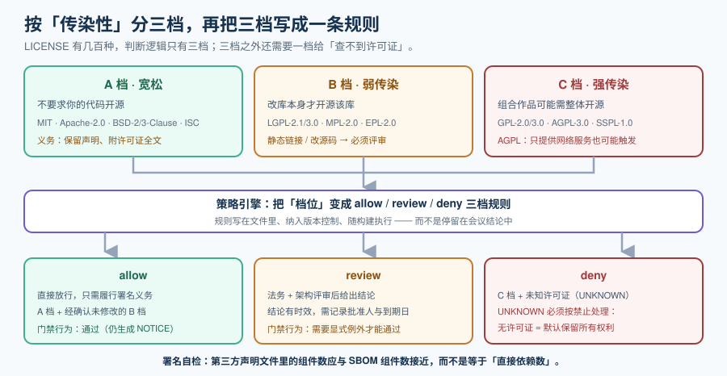

# 许可证合规

漏洞是**技术风险**：一旦有补丁，升上去就结束了。许可证是**法律风险**：它不会因为你升级而消失，也不会因为你不知道而豁免。所以两者的治理节奏完全不同——漏洞按天算，许可证按**发布前**算。

这一页解决三个问题：**这份依赖的许可是什么、它要求我做什么、我能不能接受**。

::: tip 一句话理解
许可证合规的产出不是「一份清单」，而是**一条能在发布前拦住的规则**：把「禁止清单」做成门禁，让不该出现的许可证根本进不了构建产物。
:::



## 一、为什么它比漏洞更容易出事

| 维度 | 漏洞 | 许可证 |
| --- | --- | --- |
| 风险性质 | 技术（可缓解、可隔离） | **法律**（不能靠技术手段消除） |
| 时效 | 有补丁后升级即解决 | **长期**：一次错误分发可能带来持续义务 |
| 发现方式 | 扫描器会持续提醒 | 不主动查就**永远不会有人提醒你** |
| 可逆性 | 可逆（回滚版本） | **弱可逆**：已经分发出去的二进制无法收回 |
| 责任主体 | 工程团队 | **工程 + 法务**（且法务通常事后才知情） |

::: warning 说明
本条最实际的含义：**许可证检查必须发生在构建之前或构建之中，不能发生在发布之后**。发布之后再发现"这个组件不能闭源分发"，代价是重做发布流程甚至召回版本。
:::

## 二、三档分类：按「传染性」而不是按「开不开源」

License 有几百种，但**判断逻辑只需要分三档**——区分标准是「它是否要求你的代码也开源」：

| 档 | 特征 | 典型许可证（SPDX 标识符） | 对你的影响 |
| --- | --- | --- | --- |
| **A. 宽松** | 不要求你的代码开源，只要求保留声明 | `MIT`、`Apache-2.0`、`BSD-2-Clause`、`BSD-3-Clause`、`ISC` | 基本无阻碍；**Apache-2.0 额外含专利授权与 NOTICE 要求** |
| **B. 弱传染** | 修改了**该库本身**时必须开源该库，链接使用不受限 | `LGPL-2.1-only`、`LGPL-3.0-only`、`MPL-2.0`、`EPL-2.0` | 动态链接通常可接受；**静态链接与修改源码必须评审** |
| **C. 强传染** | 与其组合的作品可能需要整体开源 | `GPL-2.0-only`、`GPL-3.0-only`、`AGPL-3.0-only`、`SSPL-1.0` | 闭源分发场景通常**禁止**；`AGPL` 即使只提供网络服务也可能触发义务 |

::: danger 三个最容易被误判的点
1. **`AGPL` 的触发条件是"通过网络提供服务"，而不是"分发二进制"**。很多团队以为"我们不分发、只做 SaaS 所以没事"——**AGPL 恰恰是为这个场景设计的**。
2. **`LGPL` 的"动态链接可以、静态链接不行"是通俗说法，不是法律条文**。Go / Rust 常是**静态链接**，Java 打成 fat-jar 也接近静态组合；这些场景必须单独评审，不能照搬"LGPL 很安全"的印象。
3. **"改了一个字符"就可能触发开源义务**（弱传染档的"修改"）。判定修改与否要**比对原始源码**，不能凭"我们只是调了个参数"。
:::

## 三、声明许可证 ≠ 结论许可证

这是许可证治理里最核心的一组概念：

| 概念 | 英文 | 来源 | 可靠性 |
| --- | --- | --- | --- |
| **声明许可证** | declared license | 包元数据里写的（`package.json` 的 `license` 字段、`pom.xml` 的 `<licenses>`） | **低**：可能是作者随手写的、过期的、或干脆没写 |
| **结论许可证** | concluded license | 扫描源码文件、比对许可证全文与 SPDX 清单后得出的 | **较高**：基于实际文本，但需要人工确认边界情况 |

**两者不一致是常态，四种典型成因**：

1. **声明缺失**：包元数据里没有 `license` 字段，但源文件头里有许可声明。
2. **声明单一、实际多许可**：声明只写 `MIT`，但仓库里某些目录是 `Apache-2.0` 或第三方代码。
3. **元数据过期**：项目从 `GPL` 换成了 `MIT`，但旧版本的元数据没更新（或反过来）。
4. **头部声明与 LICENSE 文件冲突**：文件头写 `MIT`、`LICENSE` 文件是 `Apache-2.0`。

::: tip 提示
**判据**：做许可证审计时，只依赖声明许可证等于「以作者的记性为准」。至少要跑一次**源码级扫描**并比对两者差异——差异本身就是要人工确认的清单。
:::

## 四、义务清单：宽松档也不是"随便用"

「MIT / Apache-2.0 随便用」是不准确的。宽松档同样有义务，只是不要求开源：

| 义务 | 适用 | 落地形式 |
| --- | --- | --- |
| **保留版权声明与许可证文本** | 几乎所有开源许可证 | 交付物里附第三方声明文件（`THIRD-PARTY-NOTICES` / `licenses/` 目录） |
| **声明修改** | 多数许可证 | 在文件头或文档里注明"已修改" |
| **提供 NOTICE 文件内容** | `Apache-2.0` 特有 | 如果有上游 `NOTICE` 文件，必须随分发提供 |
| **专利授权与终止条款** | `Apache-2.0` 特有 | 无需额外动作，但要知道它**会因专利诉讼而终止** |
| **提供对应源码** | 传染档 | 首次分发时提供；后续通过网络分发也要提供 |

**署名的具体做法**（可执行）：

```shell
# 生成第三方声明文件（示例：用 ORT 的 reporter 或等效工具）
# 目标产物：包含「组件名、版本、许可证标识符、许可证全文、版权声明」的文本或 HTML
ort report -i evaluation-result.yml -o out -f NoticeTemplate
# 期望：out/NOTICE 或等价文件，逐个组件列出许可证全文
```

::: danger 署名最常见的两种错误做法
1. **在 README 里写一句"本项目使用了若干开源软件"**——这不构成保留声明。必须是**逐组件的许可证文本与版权行**。
2. **只列直接依赖**。传递依赖同样需要署名。数量上通常差一个数量级：写了 12 个，实际需要写 400 个。
:::

## 五、多许可证与组合

一个组件可能带多个许可证，表达方式决定了你的选择空间：

| 表达式形态 | 含义 | 你的选择 |
| --- | --- | --- |
| `MIT OR Apache-2.0` | **择一**：可以任选一个遵守 | 选对你自己最有利的那个（如规避专利终止条款） |
| `MIT AND Apache-2.0` | **同时**：两个都要满足 | 义务取并集 |
| `GPL-2.0-only WITH Classpath-exception-2.0` | **带例外**：主许可证 + 例外条款 | 例外往往正是让它可用于闭源的关键（Java 生态常见） |
| `GPL-2.0-only` 与 `GPL-3.0-only` 混用 | **不兼容**：两个强传染许可证可能互相冲突 | 必须评审；不能简单"都遵守" |

**兼容性的实用判据**：与其背兼容性矩阵，不如把问题收敛成一句——**「最终分发物的许可证档位 = 所有组件档位中传染性最强的那一个」**。如果不是最强档，就必须有明确的例外条款。

## 六、策略引擎：把结论变成三档策略

许可证结论必须落成**可执行的规则**，否则每次都得重新讨论。三档足够：

```yaml
# license-policy.yaml（示意；实际字段以你选用的工具为准）
policy:
  allow:              # 直接放行，仅需署名
    - MIT
    - Apache-2.0
    - BSD-2-Clause
    - BSD-3-Clause
    - ISC
    - MPL-2.0         # 弱传染，但本产品未修改其源码，经评审确认
  review:             # 需法务 + 架构评审，评审结论有时效
    - LGPL-2.1-only
    - LGPL-3.0-only
    - EPL-2.0
  deny:               # 直接阻断
    - AGPL-3.0-only
    - GPL-2.0-only
    - GPL-3.0-only
    - SSPL-1.0
    - UNKNOWN         # 未知许可证一律按禁止处理
```

::: warning 说明
把 `UNKNOWN` 放进 `deny` 是一条**刻意设计**：无许可证的组件在法律上**默认保留所有权利**，而不是"免费使用"。因此"查不到许可证"绝不能当成"没问题"。
:::

## 七、实操：三条命令

```shell
# 1. 快速看一眼声明许可证（Node 生态）
npx license-checker --summary
npx license-checker --failOn "GPL-3.0-only;AGPL-3.0-only" --production
# 期望：如果存在被禁止的许可证，命令以非 0 退出码结束

# 2. 源码级许可证与版权扫描（跨生态，输出 SPDX 标识符）
scancode -clpieu --json-pp licenses.json --strip-root ./vendor
jq -r '[.files[].license_detections[].license_expression] | group_by(.) | map({lic: .[0], n: length})' licenses.json

# 3. 用 ORT 跑完整链路（分析依赖 → 扫描源码 → 策略评估 → 生成报告）
ort analyze -i . -o out
ort scan -i out/analyzer-result.yml -o out
ort evaluate -i out/scan-result.yml --rules-file rules.kts -o out
ort report -i out/evaluation-result.yml -o out -f WebApp,SpdxDocument,NoticeTemplate
# 期望：out/ 下出现评估结果与 NOTICE 文件；evaluate 步骤对 deny 档返回失败
```

::: tip 提示
对大多数团队，**起点不必是 ORT**——它完整但配置成本高。更现实的路径是：先用生态自带的工具（`license-checker` / Maven 的 `license-maven-plugin`）形成一份声明许可证清单，把 `deny` 档拦起来；等遇到「声明与实际不一致」的真实案例之后，再引入源码级扫描。
:::

## 八、例外与合规流程

许可证例外的处理方式与漏洞例外不同：**漏洞例外由工程决定，许可证例外必须由法务决定**。

| 角色 | 职责 |
| --- | --- |
| 工程 | 提供准确的组件清单与许可证清单（**不要自己判断"应该没事"**） |
| 法务 | 判断档位、给出结论（允许 / 需改造 / 禁止）、决定是否接受例外 |
| 安全 | 把法务结论落成策略文件与门禁，并保证例外有到期日 |

**例外的最小记录字段**：组件 + 版本区间 + 结论 + 理由 + **批准人** + **到期日** + 生效范围。缺任何一项，两年后就没人能解释它为什么存在。

## 九、可执行验证

```shell
# 1. 是否存在 UNKNOWN / 空许可证（应为 0；每个都要人工确认）
jq '[.components[] | select((.licenses // []) | length == 0)] | length' sbom.cdx.json

# 2. 是否存在禁止档许可证（应为 0）
jq -r '.components[] | (.licenses // [])[] | .license.id // .expression // empty' sbom.cdx.json \
  | sort -u | grep -E '^(AGPL|GPL|SSPL)' && echo "发现禁止档许可证" || echo "OK: 无禁止档"

# 3. 第三方声明文件是否存在且覆盖全部组件（数量应接近组件总数，而不是直接依赖数）
grep -c "" THIRD-PARTY-NOTICES.txt
jq '.components | length' sbom.cdx.json
```

第 3 条是**最容易被忽略的自检**：两个数字相差一个数量级，说明只署了直接依赖。

## 参考资料

- SPDX 官方许可证清单（`spdx.org/licenses`，当前清单版本 3.28.0，2026-02-20）与许可证表达式的官方说明（`OR` / `AND` / `WITH` 语义）
- OSS Review Toolkit（ORT）官方文档（Analyzer / Scanner / Evaluator / Reporter 的工作流与策略 DSL）
- ScanCode Toolkit 官方文档（源码级许可证与版权检测）
- SPDX 规范中的许可证表达与 `licenseConcluded` / `licenseDeclared` 字段语义
- 开放源代码促进会（OSI）对「已批准许可证」的公开列表
- [依赖与安全治理 · 门禁与自动化更新](../Automation/index.md)（下一步：把禁止档做成阻断门禁）
