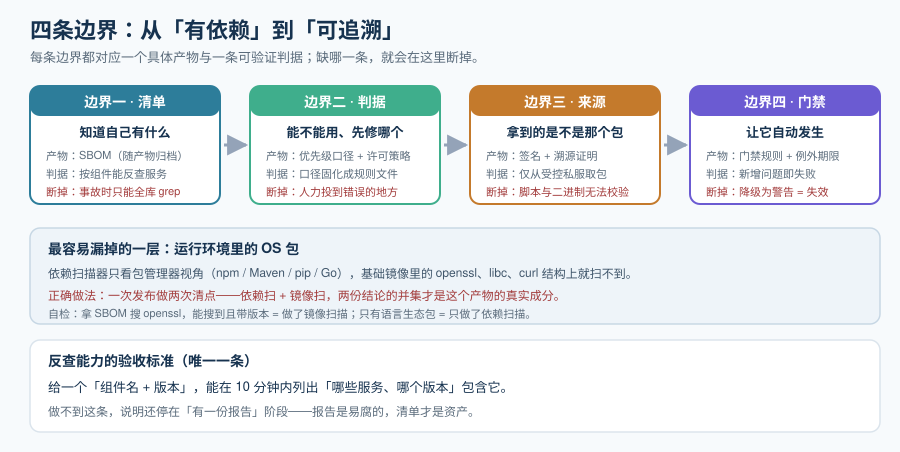

# 总览：依赖治理的四条边界

依赖治理（Dependency Governance / Software Supply Chain Governance）指的是：**对你没有亲自编写的那些代码，建立一套「知情、可判、可拦、可追溯」的流程**。它不解决「代码写得对不对」，它解决的是「**你用的材料合不合规、有没有已知问题、是不是你以为的那一份**」。

本页先不碰任何工具，只把三件事讲清楚：**治理的对象到底是哪些东西、四条必须划清的边界、以及做到什么程度算够**。工具是后面几页的事。

::: tip 一句话理解
依赖治理的产出不是一份报告，而是**一个能在 10 分钟内回答「这个 CVE 影响我们几个服务」的能力**。所有工具与流程都是为这一个动作服务的。
:::

## 一、为什么这是「对象治理」

绝大多数团队第一次做依赖安全时，做的都是**工具治理**：装一个扫描器，跑一次，看到一屏红色的告警，改几天代码，然后没人再打开它。半年后再跑一次，红色的比之前还多。

原因不在工具，而在**对象没有被治理**：

| 工具治理（无效） | 对象治理（有效） |
| --- | --- |
| 关心「用哪个扫描器」 | 关心「我们到底用了哪些组件、谁在维护这份清单」 |
| 产出「本次构建的漏洞列表」 | 产出「**这些服务历史版本各自包含什么**」 |
| 结论随扫描器版本变化 | 结论锚定在**组件 + 版本 + 数据源**上，可复现 |
| 出问题时重新扫一遍 | 出问题时**反查**已有清单，分钟级给出影响面 |

差别的根源在于：**漏洞列表是易腐的，组件清单是稳定的**。同一个组件今天没漏洞、明年可能有；但「我们在 3.2.1 版本里用了 `log4j-core 2.14.1`」这个事实**永远不会变**。所以治理的重心必须放在清单上，扫描只是清单的一种用法。

## 二、治理对象：三层依赖，加一类最常被漏掉的

| 层级 | 包含什么 | 为什么容易被漏 |
| --- | --- | --- |
| **直接依赖** | 你在 `pom.xml` / `package.json` / `go.mod` / `requirements.txt` 里**手写**的那些 | 基本不会漏，因为看得见 |
| **传递依赖** | 直接依赖自己带进来的、你没写过的包 | 一个「只写了 12 个依赖」的前端项目，装完可能是**上千个包**；Java 侧一个 starter 能带进 80 个坐标 |
| **构建与工具依赖** | 构建插件、代码生成器、测试框架、镜像基础层、CI 里拉取的第三方 Action / 插件 | 它们**不进运行期，但有构建权限**——供应链攻击最爱的入口，因为能改产物 |
| **⚠️ 运行环境里的 OS 包** | 容器镜像基础层的 `apt` / `yum` 包、语言运行时自带的库 | 它**不出现在任何 lockfile 里**，只有镜像扫描能看见；依赖扫描器**结构上就看不见它** |

::: danger 最容易出错的一条：把「依赖扫描」当成了「镜像扫描」
1. **错误认知**：装了一个 SBOM 工具，就以为镜像里的东西也清点完了。**实际**：SBOM 生成器扫的是包管理器视角（npm / Maven / pip / Go），基础镜像里的 `openssl`、`libc`、`curl` **不在它的视野里**。
2. **正确做法**：一次发布要做两次清点、两次扫描——**依赖扫**（扫构建出来的组件清单）+ **镜像扫**（扫容器文件系统）。两者的工具可以重合（例如 Trivy 两件事都能做），但**结论集合并集才是这份产物的真实成分**。
3. **判据**：拿一份 SBOM 去搜 `openssl`，如果能搜到且**带版本**，说明做的是镜像扫描；如果只有语言生态的包，说明只做了依赖扫描。
:::

## 三、四条边界

这四条边界对应本专题的四层结构，也是判断「一个团队做到哪一步」的最快方式。



### 边界一：清单的完整性 —— 「知道自己有什么」

**边界内容**：从「依赖声明」走到「组件清单」。判据只有两条：

1. **能否按组件反查服务**：给一个 `组件名 + 版本`，能不能在分钟级列出**哪些服务、哪个版本**包含它。
2. **清单是否与产物绑定**：清单必须**随构建产物一起生成、一起归档**，而不是事后补跑。事后补跑出来的清单描述的是「现在的仓库状态」，不是「当时发出去的那一份」。

**反面案例**：清单存在一个人的笔记本里、或者在 CI 里生成但从不归档。结果是**事故发生时没有可查的对象**，只能全公司 grep。

### 边界二：判据 —— 「能不能用、要不要现在修」

**边界内容**：把「组件清单」变成「结论」。这里的关键不是扫描，而是**判据的定义与决定权的归属**：

| 问题 | 谁决定 | 判据形态 |
| --- | --- | --- |
| 这个漏洞我们要不要修、什么时候修 | **工程**（技术风险） | 三把尺子叠加：CVSS v4.0 严重度 × **EPSS** 利用概率 × **CISA KEV** 是否在野利用 |
| 这个许可证我们能不能用 | **法务 + 工程**（共同） | 传染性分类 + 义务清单，落到「允许 / 需评审 / 禁止」三档策略 |
| 这一次构建能不能过门禁 | **流程**（自动） | 门禁规则文件，且**必须写明例外与例外期限** |

**反面案例**：把「严重度 = 高」直接等同于「今天必须修」。CVSS 高但 EPSS 极低、不在 KEV 里的组件，排在前面会挤掉真正在野被利用的那个——**这是把有限的人力投到错误的地方**。

### 边界三：来源 —— 「拿到的是不是那个包」

**边界内容**：清单和判据都建立在「包是真的」这个前提上。这一层解决的是**完整性与来源**：

1. **完整性**：下载的制品哈希是否与上游公布的一致（`purl` + 校验和）。
2. **来源**：这个制品**是不是从官方源、由官方身份构建出来的**——签名与溯源证明（provenance）。
3. **准入**：企业内部是否只允许从**受控的私服**取包（而不是任一直连公网源）。

**反面案例**：CI 里直接 `curl` 一个公网脚本并执行、`Dockerfile` 里 `ADD` 一个固定 URL 的二进制、`package.json` 里写 `git+http://` 引用。这三种写法**都没有任何环节能验证拿到的东西对不对**。

### 边界四：门禁 —— 「让它自动发生」

**边界内容**：把前面三条变成**流水线里会拦住你的检查**。这里的核心不是「加检查」，而是**强度分档**：

| 档 | 行为 | 适用 |
| --- | --- | --- |
| **提示**（advisory） | 只在报告里出现，不阻断 | 新引入的检查项，前 1~2 个迭代 |
| **阻断**（blocking） | 新增问题即失败 | 清单完整性、来源校验、许可证禁止档、KEV 命中项 |
| **限时**（time-boxed） | 允许存在但**必须带到期日** | 存量问题、经评审的例外；到期无处理则自动升级为阻断 |

**反面案例**：**「门禁一旦不阻断，它就不再是门禁，而是一条评论」**。把阻断改成警告是治理体系最常见的死亡方式——它看起来还在运行，实际上已经没有任何约束力。

## 四、成熟度五档

| 档位 | 特征 | 每档只补一件事 | 典型卡点 |
| --- | --- | --- | --- |
| **L0 无治理** | 依赖是 `latest`、直连公网源、没有清单 | 把版本钉死（`lockfile` 入库、禁止 `SNAPSHOT` / `latest`） | 「钉死就升不动了」——先钉死，再谈自动化升级 |
| **L1 有清单** | 每次构建生成 SBOM 并归档，但没人读 | **让它可查**：把 SBOM 推到一个能按组件反查的库里 | 归档到制品库但不可检索，等于没归档 |
| **L2 有判据** | 有扫描、有优先级口径，修复按排期走 | **把口径写进文件**：优先级公式、许可证三档策略固化成可执行规则 | 口径停留在会议结论里，换个人就变了 |
| **L3 有门禁** | 新增的高危与禁止许可证会阻断合并；例外有到期日 | **补齐来源层**：私服准入 + 签名校验 | 门禁只查清单里的包，不查镜像里的 OS 包 |
| **L4 可持续** | 更新机器人 + 冷却期 + 定期复扫 + 法规时钟纳入排期 | 保持（这一档的敌人是「没人管之后的腐化」） | 报告没人看、例外没人清、机器人 PR 没人合 |

## 五、什么时候不需要做到这个程度

- **内部工具、无人访问、无外部依赖的脚本仓库**：钉死版本 + 定期人工升级即可，不必建门禁。
- **纯前端静态展示站、不处理任何用户数据**：许可证合规仍需看一眼（决定能否闭源分发），但漏洞门禁可以放宽。
- **实验性原型、明确不发布、两周后删除**：不值得投入；但**要把它标记成「实验性」并真的删除**，否则它会悄悄变成生产依赖。

::: warning 说明
反面清单的目的不是「少做」，而是**把力气放在会被真实使用的那部分交付物上**。一个跑得起来的、覆盖 80% 服务的治理流程，胜过一个设计完美但没人用的流程。
:::

## 六、最小起步三步

不动现有工程结构，一个下午可以做完：

1. **生成一次 SBOM，并看一个数字**。用 Syft 对现有构建产物或源码目录生成 CycloneDX JSON，然后数一数组件数量。**这个数字通常会让所有人吃惊**——它是推动后续一切的最好材料。

   ```shell
   # 在项目根目录执行（需先安装 syft）
   syft dir:. -o cyclonedx-json > sbom.cdx.json
   jq '.components | length' sbom.cdx.json
   # 期望输出：一个数字（前端 monorepo 常在 1000 以上，Java 服务常在 200 以上）
   ```

2. **对同一份清单扫一次漏洞，但只看 KEV**。先不解决全部告警，只看「**已知在野被利用**」的那几个。

   ```shell
   # 用上一步生成的 SBOM 直接扫描（无需重新解包）
   grype sbom:./sbom.cdx.json -o table
   # 过滤出「有修复版本」的条目，先不处理「无修复版本」的
   grype sbom:./sbom.cdx.json -o json | jq -r '.matches[] | select(.vulnerability.fix.state=="fixed") | .artifact.name + " " + .artifact.version + " -> " + .vulnerability.id'
   ```

3. **把清单入库，建立反查能力**。把 SBOM 推到一个能按组件检索的库（自建 Dependency-Track 或等价物）。**这一步做完，"影响面反查" 才真正存在**。

::: tip 提示
三步的验收标准很具体：**给出任意一个组件名，能在 10 分钟内列出包含它的服务清单**。做不到这一点，说明还停在「有报告」阶段。
:::

## 七、术语对齐

同一件事在不同工具、不同文档里叫法不同，先把词对齐，后面几页不再解释：

| 术语 | 英文 | 本专题的含义 |
| --- | --- | --- |
| 组件 | component | 一个可识别的软件单元，粒度通常是**包 + 版本**（不是文件） |
| 物料清单 | SBOM（Software Bill of Materials） | 描述「一个软件产物由哪些组件构成」的**结构化文件** |
| 标识符 | `purl`（Package URL） | 跨生态统一的组件标识，形如 `pkg:maven/org.apache.logging.log4j/log4j-core@2.14.1` |
| 声明许可证 | declared license | **包元数据里写的**（`package.json` 的 `license` 字段） |
| 结论许可证 | concluded license | **实际扫描源码文本后得出的**；两者不一致是常态 |
| 漏洞可利用性 | VEX（Vulnerability Exploitability eXchange） | 「这个组件有漏洞，但**在我们的用法下不可利用**」的正式声明 |
| 在野利用 | KEV（Known Exploited Vulnerabilities） | 有**可靠证据表明攻击者已经在用**的漏洞清单 |
| 溯源 | provenance | 「这个产物由谁、在什么环境、用什么源码构建」的**可验证记录** |
| 供应链等级 | SLSA | 衡量构建与源码流程防篡改能力的公开框架（当前规范为 v1.2） |

## 八、可执行验证

读完本页，用这三条命令确认「你在哪一档」：

```shell
# 1. 有清单吗？（有输出 = 至少 L1）
find . -name "sbom*.json" -o -name "*.cdx.json" -o -name "*.spdx.json" | head

# 2. 清单能和产物对上吗？（能按提交哈希找到对应清单 = 清单与产物绑定）
git log --oneline -1

# 3. 门禁有强度吗？（grep 到 "|| true" 或 "continue-on-error" = 事实上已降级）
grep -rn "continue-on-error\||| true" .github/workflows/ 2>/dev/null | head
```

第 3 条尤其值得做：**很多团队的门禁"失败"发生在某次紧急发布时**——为了让发布通过，有人在流水线里加了一行容错，然后再也没有去掉。

## 参考资料

- OWASP Top 10 中对「易受攻击和过时的组件」风险的公开描述
- CycloneDX 官方规范与 SPDX 官方规范（格式层的事实来源）
- OWASP Dependency-Track 官方文档（清单持续管理与反查能力的参照实现）
- CISA「Known Exploited Vulnerabilities Catalog」公开说明与 FIRST「EPSS」模型说明
- SLSA 规范站点（Version 1.2）与 Sigstore 官方文档（来源与溯源层）
- [依赖与安全治理 · 软件物料清单](../SBOM/index.md)（下一步：把边界一做成交付物）
