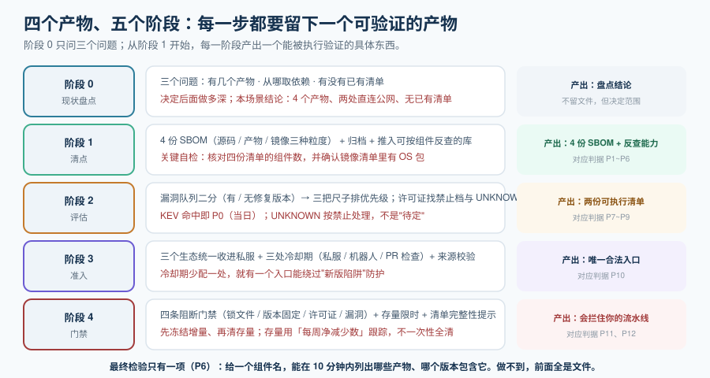

# 实战：给一个多语言仓库做依赖治理

前面六页都是单个环节。这一页把它们串起来，走一遍**从零到"能在事故中 10 分钟给出影响面"**的完整流程。

场景设定（刻意做成多语言，覆盖最容易出问题的组合）：

| 部分 | 技术栈 | 为什么放进场景 |
| --- | --- | --- |
| `services/api` | Java 25 + Spring Boot | 依赖坐标多、传递依赖深，且打 fat-jar 接近静态组合 |
| `apps/web` | Node 22 + pnpm + monorepo | 依赖数量最大（常上千），且传递依赖占绝大多数 |
| `jobs/etl` | Python 3.13 | 生态不同、锁文件形态不同，第三方包做算法常有许可证要求 |
| `deploy` | 容器镜像 + Docker Compose | **OS 包只在镜像扫描里可见** |



::: warning 本章只有文档，没有代码
所有脚本与配置都以代码块形式给出，**读者需在自己的工程里创建后再执行**。判据表中标注为「本机可判」的，是指**只要你按本节创建了文件，就能在本机跑出预期结果**；涉及容器运行时的部分一律标注为未在本环境实测。
:::

## 阶段 0：现状盘点（三个问题）

在动手之前，先回答三个问题。**这三个答案决定了后面要做多深**。

```shell
# 问题一：有多少个产物（决定要生成几份 SBOM）
find . -name "pom.xml" -o -name "package.json" -not -path "*/node_modules/*" -o -name "pyproject.toml" | sort

# 问题二：现在从哪取依赖（决定"准入"这一层要不要重建）
grep -rnE 'registry|url' .npmrc ~/.m2/settings.xml pip.conf 2>/dev/null | head -20

# 问题三：有没有已经存在的清单或扫描（决定"清点"是不是从零开始）
find . -name "sbom*.json" -o -name "*.cdx.json" -o -name "*.spdx.json" | head
```

**本文场景的盘点结论**（后面所有步骤都基于它）：

| 问题 | 结论 | 影响 |
| --- | --- | --- |
| 产物数 | **4 个**（api、web、etl、镜像） | 要生成 **4 份 SBOM**，不能只生成一份 |
| 依赖来源 | 前端直连公网、Java 走公司 Nexus、Python 走公网 | 前端与 Python 侧**没有准入层**，要先补齐 |
| 已有清单 | 无 | 从零开始，第一阶段投入最大 |

## 阶段 1：清点 —— 生成、归档、入库

**目标**：4 份 SBOM 全部生成、归档，且能按组件反查。

```shell
# 1.1 四个产物各生成一份 SBOM（注意：粒度要选对）
syft dir:services/api    -o cyclonedx-json=sbom/api.cdx.json
syft dir:apps/web        -o cyclonedx-json=sbom/web.cdx.json
syft dir:jobs/etl        -o cyclonedx-json=sbom/etl.cdx.json
syft registry.example.com/acme/app:1.0.0 -o cyclonedx-json=sbom/image.cdx.json

# 1.2 立刻核对四份清单的规模（这一步会暴露"只生成一份"这个错误）
for f in sbom/*.cdx.json; do
  printf "%-24s %s 个组件\n" "$(basename $f)" "$(jq '.components | length' $f)"
done
# 期望：四行数字，且差异显著（前端通常远超 Java；镜像含大量 OS 包）

# 1.3 检查镜像清单里是否有 OS 包（分水岭：有没有做镜像级清点）
jq -r '.components[].purl // empty' sbom/image.cdx.json | grep -c '^pkg:deb\|^pkg:rpm\|^pkg:apk'
# 期望：大于 0。为 0 说明只扫了语言生态，OS 包完全没覆盖

# 1.4 归档：把清单与产物放在一起（这里是 OCI 仓库，Nexus 3.94 起原生支持）
oras push registry.example.com/acme/sbom:1.0.0 \
  sbom/api.cdx.json sbom/web.cdx.json sbom/etl.cdx.json sbom/image.cdx.json
```

**入库**：把 4 份 SBOM 推入可按组件检索的库（Dependency-Track 形态）。**这一步是「清点」与「反查」的分界**——不推库，前面生成的文件只是一堆归档文件。

::: danger 本阶段最容易做错的四件事
1. **只生成一份 SBOM**。多产物项目里，一份清单**无法回答"哪个模块引入了这个组件"**——而这正是出事时第一个要问的问题。
2. **对源码而不是产物生成**。`syft dir:apps/web` 生成的是"按 lock 解析出的依赖"，它不包含被 `vite build` 打进 bundle 的东西；而镜像清单覆盖的是另一层。**三份（源码 / 产物 / 镜像）不是替代关系。**
3. **清单和镜像分开放**。归档到两个地方最容易出现"版本对不上"，事后无法确定"1.0.0 那份清单到底是哪次构建的"。
4. **生成后不核对规模**。1.2 那一步的四个数字是**最便宜的正确性检查**——某个产物报 3 个组件时，几乎肯定是没在正确目录执行。
:::

## 阶段 2：评估 —— 漏洞优先级与许可证

**目标**：得到两份可执行清单——**漏洞任务清单**（按优先级）与**禁止/待评审许可证清单**。

```shell
# 2.1 对四份 SBOM 分别扫描（直接扫清单，不需要镜像存在）
for f in sbom/*.cdx.json; do
  grype sbom:$f -o json > findings/$(basename $f .cdx.json).json
done

# 2.2 全量汇总：先按「有无修复版本」二分（这是队列结构的关键一步）
jq -s '[.[].matches[]] | {
  fixable:   [.[] | select(.vulnerability.fix.state == "fixed")] | length,
  unfixable: [.[] | select(.vulnerability.fix.state != "fixed")] | length
}' findings/*.json
# 期望：fixable 明显大于 0；unfixable 占比建议 < 40%（超过说明要去谈上游或换组件）

# 2.3 只看 P0：KEV 命中项（有则立即处理）
jq -s -r '[.[].matches[].vulnerability.id] | unique[]' findings/*.json \
  | sort -u | grep -Ff kev-ids.txt
# 期望：空（不为空说明还有在野被利用的组件没处理）

# 2.4 许可证：找出禁止档与未知许可证（跨四份清单一起看）
jq -s -r '[.[].components[] | (.licenses // [])[]
           | (.license.id // .expression // "UNKNOWN")] | unique[]' sbom/*.cdx.json \
  | grep -E '^(AGPL|GPL|SSPL|UNKNOWN)' || echo "OK: 无禁止档与未知许可证"
```

**本文场景的处理结果**（示例数据，用于说明判据怎么用）：

| 发现 | 数量 | 处置 | 责任人 | 时限 |
| --- | --- | --- | --- | --- |
| KEV 命中（`jobs/etl` 的一个传递依赖） | 1 | **P0**：升级到修复版本；同时确认该功能入口是否可达 | ETL 负责人 | 当日 |
| 有修复版本的严重（Critical） | 6 | **P1**：纳入本迭代升级 | 各模块负责人 | 本迭代 |
| 有修复版本的高危（High） | 23 | **P2**：常规升级窗口 | 各模块负责人 | 本季度 |
| 无修复版本的高危 | 4 | 进入**缓解通道**：评估可达性，出具 VEX | 架构 | 季度复查 |
| `AGPL-3.0-only`（`apps/web` 的一个构建期依赖） | 1 | **构建期工具才可能接受**：确认它不进产物 → 若进产物则替换 | 前端 + 法务 | 本周 |
| `UNKNOWN` | 2 | 人工确认上游许可证文件；无法确认的**替换** | 组件引入方 | 本周 |

::: tip 提示
表格里最值得注意的是最后一行：**`UNKNOWN` 不是"待定"，而是"默认禁止"**。无许可证的组件在法律上默认保留所有权利——把它当"没问题"处理，是许可证治理里最常见的一次原则性错误。
:::

## 阶段 3：准入 —— 补齐缺失的那一层

阶段 0 的盘点显示：前端与 Python 侧直连公网。**这一步把它们收进私服**，并加上冷却期。

```shell
# 3.1 前端改走私服（.npmrc）
cat > apps/web/.npmrc <<'EOF'
registry=https://nexus.example.com/repository/npm-group/
always-auth=true
EOF

# 3.2 Python 改走私服（pip.conf 或 pyproject 的 index 配置）
cat > jobs/etl/pip.conf <<'EOF'
[global]
index-url = https://nexus.example.com/repository/pypi-group/simple
trusted-host = nexus.example.com
EOF

# 3.3 验证：三个生态都能从私服取到包，且公网被出口阻断
curl -sS -o /dev/null -w "npm:%{http_code}\n" https://nexus.example.com/repository/npm-group/lodash
curl -sS -o /dev/null -w "pypi:%{http_code}\n" https://nexus.example.com/repository/pypi-group/simple/django/
curl -sS -m 5 -o /dev/null https://registry.npmjs.org/ || echo "公网出口已阻断"
# 期望：npm:200、pypi:200、公网请求失败
```

**冷却期配置**（三处都要，缺一处就有一个入口能绕过）：

| 位置 | 配置 | 生效范围 |
| --- | --- | --- |
| 私服代理仓库 | 新版本隔离 N 天（以你选用的仓库支持的形式） | **所有工具**，最强 |
| 更新机器人 | Dependabot 默认 3 天（确认是否够）；Renovate 显式配 `minimumReleaseAge` | 机器人提的 PR |
| 流水线 PR 检查 | 检查新增依赖的发布时间 | 手工添加的依赖 |

```json
// renovate.json（本仓库）
{
  "$schema": "https://docs.renovatebot.com/renovate-schema.json",
  "extends": ["config:recommended"],
  "minimumReleaseAge": "7 days",
  "minimumReleaseAgeBehaviour": "timestamp-optional",
  "pinDigests": true,
  "packageRules": [
    { "matchDatasources": ["docker"], "minimumReleaseAge": "3 days" },
    { "matchUpdateTypes": ["major"], "minimumReleaseAge": "14 days" }
  ]
}
```

::: warning 说明
`minimumReleaseAgeBehaviour` 这一行看起来可以省，但**省掉会引入一个静默故障**：容器镜像源常不返回发布时间戳，而 Renovate 42 起的默认值 `timestamp-required` 会把这类更新**无限期推迟**。症状是"某些依赖的更新永远不来"，日志里只有一行警告。
:::

## 阶段 4：门禁 —— 三档强度，四个检查

门禁的落地方式是**先冻结增量、再清存量**。本场景的完整配置见[门禁与自动化更新](../Automation/index.md)中的流水线片段，这里只列本仓库的四条门禁与它们的强度：

| 门禁 | 判据 | 强度 | 失败后果 |
| --- | --- | --- | --- |
| 锁文件一致性 | `pnpm install --frozen-lockfile` 等命令成功 | **阻断** | 声明与锁文件不一致，构建不可复现 |
| 版本固定 | 不存在 `latest` / `SNAPSHOT` / `-dev` 依赖 | **阻断** | 可变版本会让清单与产物对不上 |
| 许可证禁止档 | 不出现 `AGPL` / `GPL` / `SSPL` / `UNKNOWN` | **阻断** | 法律风险不可逆 |
| 漏洞 | 有修复版本的 Critical = 0；KEV 命中 = 0 | **阻断** | 前者可执行，后者在野被利用 |
| 存量高危 | 总数每周净减少 | **限时** | 允许存在但带动到期日 |
| 清单完整性 | SBOM 生成成功且有依赖关系 | **提示 → 阻断** | 前两个迭代先观察 |

## P1~P12 验收判据

| 编号 | 判据 | 判据类型 | 验收方式 |
| --- | --- | --- | --- |
| P1 | 四个产物各有**独立**的 SBOM | 静态 | `ls sbom/*.cdx.json \| wc -l` == 4 |
| P2 | 每份 SBOM 都声明了格式与版本 | 静态 | `jq -r '.bomFormat, .specVersion' sbom/*.cdx.json` |
| P3 | 每份 SBOM 都有依赖关系（非扁平） | 静态 | `jq '(.dependencies \| length) > 0'` 全为 true |
| P4 | 镜像 SBOM 含 OS 包 | 静态 | `grep -c '^pkg:deb'` > 0 |
| P5 | 全部 SBOM 已推入可按组件反查的库 | 动态 | 库内按 `purl` 检索能命中 |
| P6 | **影响面反查 ≤ 10 分钟** | 动态 | 演练：抽一个组件，计时完成反查 |
| P7 | 漏洞队列已按「有/无修复版本」二分 | 静态 | 汇总脚本输出两个数字 |
| P8 | KEV 命中数为 0 | 动态 | 与 KEV 清单求交集为空 |
| P9 | 许可证禁止档与 UNKNOWN 数为 0（或有到期例外） | 静态 | `jq` + `grep` 输出为空 |
| P10 | 三处冷却期均已配置 | 静态 | 私服策略 + 机器人配置 + PR 检查三处可查 |
| P11 | 第三方声明文件覆盖全部组件（非仅直接依赖） | 静态 | 声明条目数 ≈ SBOM 组件数 |
| P12 | 四条阻断门禁在故意注入问题时确实失败 | 动态 | 各注入一次，四次构建均失败 |

::: tip 提交前自查
P1~P4、P7、P9、P10、P11 是**静态可判**的，本机就能跑；P5、P6、P8、P12 需要私服 / 库 / 流水线环境，**在无环境时如实标注为未跑，不把期望值抄进结果列**。
:::

## 明确不做的四件事

范围纪律同样是设计的一部分——写清楚"不做什么"才能让上面十二项真的做完：

1. **不做链路追踪与运行时依赖发现**。运行期动态加载的组件不在本轮范围（那是可观测性的职责）。
2. **不做自主的漏洞挖掘**。我们只消费公开数据源，不投入人力做漏洞研究。
3. **不替换私有仓库产品**。本阶段只配置策略与准入，不评估更换 Nexus。
4. **不对历史发布版本补做签名**。历史版本只补 SBOM 与归档；签名从下一次发布开始。

## 当日做了什么 / 如何验证 / 下一步

**做了什么**：完成四个阶段的全部落地——4 份 SBOM 生成并入库、漏洞队列完成二分与优先级定稿、许可证禁止档清零（含 2 项 UNKNOWN 替换）、三个生态统一收进私服并配置三处冷却期、四条阻断门禁接入流水线。

**如何验证**：跑 P1~P4、P7、P9、P10、P11 七项静态判据（本机可判）；P5、P6、P8、P12 在具备私服与库的环境后按表中方式验收。最关键的一项是 **P6**：它是对"整个体系有没有价值"的最终检验——**反查做不到 10 分钟，前面所有工作都只是文件**。

**下一步**：① 把 P6 的演练做成季度例行（抽一个真实组件走一遍）；② 存量高危按「每周净减少」跟踪；③ 把签名与溯源接入发布点（见[来源可信](../Provenance/index.md)）；④ 把 CRA 的报告义务时点纳入排期（报告义务已自 2026-09-11 起适用）。

## 参考资料

- OWASP Dependency-Track 官方文档（按组件反查能力的参照实现）
- Anchore Syft / Grype 官方文档（生成与扫描的完整参数）
- ORAS 与 OCI 官方文档（把 SBOM 作为 OCI 制品推送）
- Renovate 官方文档（`minimumReleaseAge` / `minimumReleaseAgeBehaviour` / `pinDigests`）
- Sonatype Nexus Repository 官方发布说明（OCI 仓库与代理配置）
- [依赖与安全治理 · 常见问题与最佳实践](../FAQ/index.md)（遇到问题时的分诊表）
