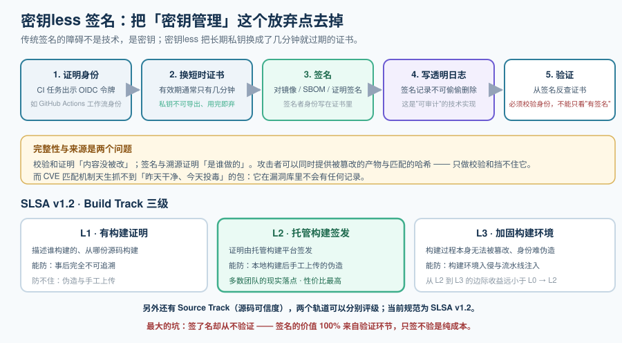

# 来源可信：签名与溯源

前四页有一个共同前提：**你拿到的包，就是你以为的那个包**。这一页专门处理这个前提——它不是在解决「包好不好」，而是在解决「**这个包是不是真的**」。

在供应链攻击里，攻击者通常不写漏洞，而是**伪造身份**：抢注一个相似的包名、劫持一个维护者账号、或者在构建环节把恶意代码塞进产物。**这些问题扫描器一个都发现不了**，因为被投毒的那个版本在发布时可能"看起来完全正常"。

::: info 与「安全加固 · SBOM 与软件供应链」的关系
那页给出了 SLSA 等级表与 `cosign sign` / `cosign verify` 的基本命令。本页补的是**让签名真的有效的那部分**：当前规范版本（SLSA v1.2、v1.1 已 Retired）、keyless 签名的五步链路与它消除了哪个失败模式、**验证必须校验签名者身份**（只检查"有没有签名"等于没检查）、以及分三档的落地策略。**那页告诉你用什么，本页告诉你判什么。**
:::

::: tip 一句话理解
签名与溯源的产出是一句可以验证的话：**「这个产物是由这个仓库的这份源码、在这个构建平台上、由这个身份构建出来的，且内容没有被改过。」**
这句话是抵御「包被掉包」的**唯一**手段。
:::



## 一、供应链攻击的四类真实形态

| 形态 | 做法 | 为什么扫描器无效 | 防御手段 |
| --- | --- | --- | --- |
| **名称抢注 / 依赖混淆** | 在公网源抢注你内部包的同名包；或注册形近名（`lodahs` 冒充 `lodash`） | 它本身没有漏洞，是**正常的包** | 私有包加组织前缀 + 私服顺序 + 来源白名单 |
| **维护者账号劫持** | 拿到账号后发布"合法更新" | 发布者身份在上游看来是**真的** | 冷却期 + 更新机器人的人工确认 + 溯源校验 |
| **构建环境入侵** | 在 CI 里篡改产物（改发布流水线、注入步骤） | 产物内容"正确"，是**构建过程**被污染 | SLSA 等级（托管构建 + 证明文件） |
| **恶意代码直投** | 新版本里直接加窃密逻辑（安装期脚本、`postinstall`） | 无 CVE 可匹配；CVE 匹配**结构上就抓不到它** | 冷却期 + 行为分析类工具 + 降低安装期脚本执行面 |

::: warning 说明
第四类值得单独强调：**CVE 匹配机制天生抓不到"新写的恶意代码"**。一个包昨天干净、今天投毒，在漏洞库里不会有任何记录。所以「依赖漏洞扫描」与「供应链完整性」是两件不同的事，**工具与判据都不重合**。
:::

## 二、两个必须分开回答的问题

| 问题 | 术语 | 回答方式 | 失败形态 |
| --- | --- | --- | --- |
| **内容有没有被改过** | 完整性（Integrity） | 校验和 / 哈希 | 传输被替换、镜像层被篡改 |
| **它是不是由可信身份构建的** | 来源（Provenance） | 签名 + 构建证明 | 名字对、内容哈希对，但**根本不是官方发的那个** |

**只做完整性是不够的**：如果攻击者同时提供"被篡改的产物"和"与之匹配的哈希"，完整性校验会通过。**完整性证明"没坏"，来源证明"是谁做的"。**

## 三、SLSA：把"构建有多可信"分等级

SLSA（Supply-chain Levels for Software Artifacts，读作 "salsa"）是公开的供应链安全框架，**当前规范版本为 v1.2（状态 Approved）**，包含 Build Track 与 Source Track。

**Build Track 的三级**（这一轨道最常用）：

| 等级 | 要求 | 能防住什么 | 实现难度 |
| --- | --- | --- | --- |
| **L1** | 存在构建证明（provenance），描述谁构建的、从哪份源码 | 事后可追溯；防不住伪造 | 低（生成了就达标） |
| **L2** | 证明由**托管构建平台**签发（构建平台与使用者隔离） | 防住"本地构建后手工上传"这类伪造 | 低（用托管 CI 并发布证明即可） |
| **L3** | 构建运行在**加固环境中**，构建过程本身无法被篡改、身份难以伪造 | 防住构建环境入侵 | 中高（需平台支持） |

**Source Track** 是较新的补充，关注源码本身的可信度（谁有权改、改动是否留痕）。两者可分别评级。

::: tip 提示
**多数团队的现实落点是 Build L2**：用托管 CI（如 GitHub Actions 一类）+ 发布构建证明。这一步的性价比极高，**而"从 L2 到 L3"的边际收益远小于"从 L0 到 L2"**。所以正确顺序是：先把 L1/L2 普遍做到，再考虑个别关键产物上 L3。
:::

## 四、密钥less 签名：为什么它让签名这件事变得可行

传统签名的障碍从来不是技术，而是**密钥管理**：谁的私钥、存在哪、怎么轮换、泄漏了怎么吊销。多数团队在这个环节放弃。

**Sigstore 的 cosign 默认使用密钥less（keyless）签名**，把这条链路改成了：

```text
1. 签名者（例如 CI 任务）证明自己的身份（OIDC 令牌，如 GitHub Actions 的工作流身份）
        ↓
2. 换取一张短时证书（有效期通常只有几分钟）
        ↓
3. 用这张证书的私钥签名（私钥不可导出、用完即弃）
        ↓
4. 签名与证书一起写入公开的透明日志
        ↓
5. 验证者不需要预先知道任何公钥：从签名反查证书、从透明日志确认它确实被记录过
```

**关键收益**：**没有长期私钥**，因此没有"私钥泄漏"这个失败模式；也没有"公钥怎么分发"这个前置问题。

**代价**：签名身份绑定在**签发 OIDC 令牌的那个系统**上——所以「CI 里的 `id-token: write` 权限」本身就是一条需要严格控制的边界。

## 五、实操：签名、验证与证明

```shell
# 0. 安装 cosign（Apache-2.0）
# 通过官方 release 获取二进制后校验其校验和，再用它签名

# 1. 对镜像签名（在 CI 中，需要 OIDC 身份；本地可用 --key 走密钥模式）
cosign sign --yes registry.example.com/app/web:1.4.2

# 2. 对 SBOM 文件做 blob 签名
cosign sign-blob --yes sbom.cdx.json --output-signature sbom.cdx.json.sig

# 3. 生成并附加构建证明（attestation）——这是 SLSA 证明的载体
cosign attest --yes --predicate provenance.json \
  --type slsaprovenance registry.example.com/app/web:1.4.2

# 4. 验证：确认签名来自预期的工作流身份
cosign verify \
  --certificate-identity-regexp '^https://github.com/acme/.*' \
  --certificate-oidc-issuer https://token.actions.githubusercontent.com \
  registry.example.com/app/web:1.4.2
# 期望：输出 "Verified OK" 与证书身份信息

# 5. 验证 blob 签名
cosign verify-blob --yes sbom.cdx.json --signature sbom.cdx.json.sig \
  --certificate-identity-regexp '^https://github.com/acme/.*' \
  --certificate-oidc-issuer https://token.actions.githubusercontent.com
```

::: danger 五个让签名形同虚设的写法
1. **验证时只检查"有没有签名"**，不检查**签名者身份**。任何人的签名都会通过——攻击者可以自己签一个。
2. **用 `--insecure-ignore-tlog` 一类参数跳过透明日志校验**。透明日志的意义就是"签名记录不可偷偷删除"。
3. **在 CI 里给 `id-token: write` 开了全局权限**。签发身份的权限越大，能伪造的身份越多。
4. **签名了但从不验证**。签名的价值 100% 来自验证环节；只签不验是纯成本。
5. **把验证失败降级为警告**。与门禁同理：不阻断的校验等于没校验。
:::

## 六、验证策略：分三档，不要一步到位

| 档 | 范围 | 做法 | 适用阶段 |
| --- | --- | --- | --- |
| **一档：记录** | 全部产物 | 生成证明并存档；不阻断 | 起步期（先有数据） |
| **二档：关键产物阻断** | 对外发布的最小集合（生产镜像、对外 SDK、发布包） | 验证签名与身份，失败即失败 | 大多数团队的落点 |
| **三档：全面准入** | 所有进入私服的制品 | 私服层校验来源，不通过的制品无法入库 | 成熟期 |

::: warning 说明
**不要一上来就做三档**：它要求所有上游都有签名，而现实中大量第三方包没有。正确路径是**先对自己构建的产物做二档**（这部分你能完全控制），再逐步要求外部依赖。
:::

## 七、可执行验证

```shell
# 1. 生产镜像是否可验证（应输出 Verified OK）
cosign verify \
  --certificate-identity-regexp '^https://github.com/acme/.*' \
  --certificate-oidc-issuer https://token.actions.githubusercontent.com \
  registry.example.com/app/web:1.4.2 && echo "OK: 来源可验证"

# 2. 构建证明里是否声明了源码仓库与提交（这是溯源的核心字段）
cosign download attestation registry.example.com/app/web:1.4.2 \
  | jq -r '.[0].payload' | base64 -d \
  | jq -r '.predicate.buildDefinition.externalParameters.workflow.repository, .predicate.buildDefinition.resolvedDependencies[0].digest.gitCommit'

# 3. 清单与产物是否绑定（镜像的 SBOM 是否由签名保护）
cosign verify --attachment sbom registry.example.com/app/web:1.4.2 \
  --certificate-identity-regexp '^https://github.com/acme/.*' \
  --certificate-oidc-issuer https://token.actions.githubusercontent.com

# 4. 门禁是否真的在阻断（故意用一个未签名的镜像测试）
cosign verify --certificate-identity-regexp '^https://github.com/acme/' \
  --certificate-oidc-issuer https://token.actions.githubusercontent.com \
  registry.example.com/app/web:unsigned-test
# 期望：非 0 退出码。若返回 0，说明门禁没有生效
```

## 与「可复现构建」的关系：溯源的前提是产物稳定（第 199 天补充）

签名与溯源回答「**这个包是谁用什么构建的**」；可复现构建回答「**同样输入能不能得到同样的字节**」。前者依赖后者，因为一个不稳定的产物会让溯源退化成「只能信口供」：

| 场景 | 有可复现构建 | 无可复现构建 |
| --- | --- | --- |
| 第三方声称「这份产物来自这个提交」 | 任何人可以自己构建一遍比对 | 只能信构建方 |
| 缓存里的产物是否可信 | 字节级可验 | 只能靠权限与审计 |
| 事故后「线上包是不是那次构建的」 | 可回答 | 无法回答 |
| `SOURCE_DATE_EPOCH`、`-trimpath` 这类开关 | 必配 | 通常没人配 |

一条实践上的次序：**先让产物字节稳定（同机双跑一致），再谈跨机器一致，最后才谈签名与证明**。反过来做会出现「签了一个每天都不一样的产物」——签名有效，但它证明不了任何追溯关系。

具体配方（`tar --mtime`、`gzip -n`、`SOURCE_DATE_EPOCH`、`jar` 的时间戳开关）见 [可复现构建](../../BuildCache/Reproducible/index.md)；缓存侧的信任模型（只有 CI 能写、内容哈希校验）见[远程缓存](../../BuildCache/RemoteCache/index.md)。

## 参考资料

- SLSA 规范站点（Version 1.2，Build Track 与 Source Track 的等级定义与要求）
- Sigstore 官方文档（keyless 签名原理、透明日志、OIDC 身份绑定）
- cosign 官方文档（`sign` / `attest` / `verify` / `verify-blob` 的命令与参数）
- CycloneDX 规范中的溯源引用（citations）与证明（attestation）部分，以及 SPDX 3.0 的 build / security profile
- OWASP 对软件供应链风险的公开描述（依赖混淆与投毒类攻击的共同特征）
- Sonatype Nexus Repository 官方发布说明（OCI 仓库对签名与证明的统一承载能力）
- [依赖与安全治理 · 门禁与自动化更新](../Automation/index.md)（下一步：把验证插进流水线）
