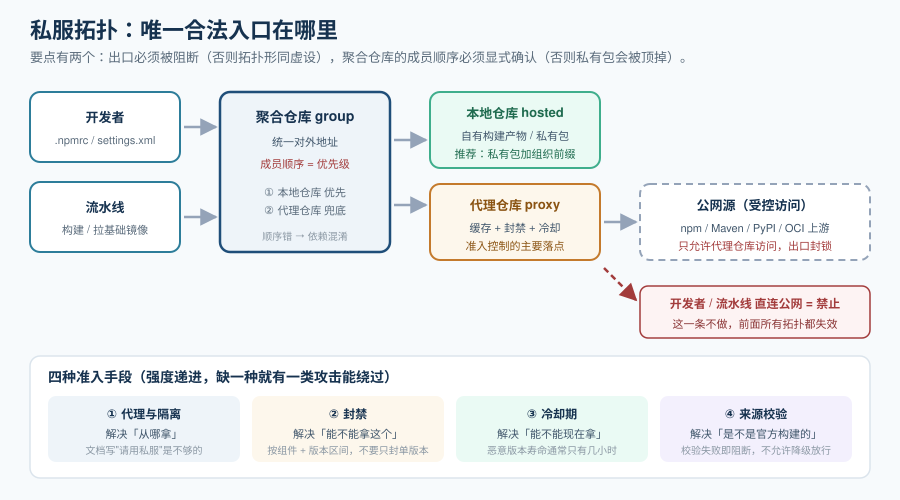

# 私服治理与制品仓库

私服（内部制品仓库，Artifact Repository / Registry）在治理体系里承担一个很具体的角色：**它是依赖进入你组织的唯一合法入口**。前面几页讲的清单、扫描、许可证，默认「你拿到的包是真的」——这个前提**只有靠私服才能兑现**。

这一页讲的是**怎么让仓库从"加速缓存"变成"准入闸门"**。

::: tip 一句话理解
公网源是"路边的摊子"，你想拿什么拿什么；私服是"有门禁的仓库"，**拿什么、什么时候能拿、能不能拿**都由你定。前者的风险不可控，后者的风险可配。
:::



## 一、为什么必须自建一层

不建私服的团队，通常会给出四个理由——这四个理由都站不住：

| 常见理由 | 为什么不成立 |
| --- | --- |
| 「直连公网源也能用」 | 上游中断、证书变更、区域限速、包被撤回（`unpublish`）都会直接打断你的构建；**你已经构建过的产物会变成不可重现** |
| 「我们不需要审计」 | 审计不是"要不要"，而是"什么时候被要求"。客户安全问卷、等保、供应链法规都会问到「你的依赖从哪来」 |
| 「扫描器能拦住坏包」 | 扫描器是**事后的**；私服可以做到**事前的**（封禁、隔离、冷却） |
| 「装一台机器而已」 | 对，但**装完之后要有人在管**——这才是真正的工作量（见本页第七条） |

私服的四个真实价值：

1. **可用性**：上游挂了，你的构建还能跑（已缓存的包仍在）。
2. **可审计**：谁在什么时候下载了什么，有记录。
3. **可准入**：能在包里还没进构建时把它拦掉。
4. **一致性**：所有团队、所有流水线**从同一个源取同一份包**，避免"我这能编译你那编不过"。

## 二、三种仓库类型：代理、本地、聚合

不管哪款产品，概念都是这三类：

| 类型 | 英文 | 作用 | 用途 |
| --- | --- | --- | --- |
| **代理仓库** | proxy | 转发到上游公网源，并缓存下载过的制品 | 日常依赖来源；**冷却与封禁的落点** |
| **本地仓库** | hosted | 存放你自己构建产出的制品 | 公司内部库、私有包、构建产物 |
| **聚合仓库** | group | 把多个仓库聚合成一个地址对外 | 统一入口；**顺序决定优先级** |

**一个常见的做法**（也是推荐的起点）：

```text
团队 / 流水线的取包地址 → 聚合仓库
                            ├── 本地仓库（私有包优先）
                            └── 代理仓库（公网依赖，带缓存与冷却）
```

::: danger 聚合仓库的顺序必须显式确认
聚合（group）里如果**同时有一个本地仓库和一个代理仓库都包含同名包**，取到哪一个取决于**成员仓库的排列顺序**。默认顺序不对时会出现最难排查的一类问题：**私有包被公网同名包顶掉**（依赖混淆攻击 Dependency Confusion 的典型形态）。做法是：**私有包命名一律加组织前缀，并把本地仓库排在代理仓库之前**。
:::

## 三、准入控制的四种手段

| 手段 | 做什么 | 生效位置 | 典型误用 |
| --- | --- | --- | --- |
| **代理与隔离** | 禁止流水线直连公网源，只允许走私服 | 流水线配置 + 网络出口 | 只在文档里写"请走私服"，没有任何强制 |
| **封禁** | 按组件 + 版本区间禁止下载 | 仓库策略 | 只封禁某个精确版本，漏掉同系列的其它版本 |
| **冷却期** | 新发布的版本在 N 天内不可用 | 仓库 / 索引层 | 冷却期设了，但缓存代理"首次拉取即缓存"绕过它 |
| **来源校验** | 只允许来自可信发布的制品（签名 / 溯源） | 仓库或仓库前置 | 校验开了但允许"校验失败时放行" |

::: warning 说明
**四种手段的强度是递进的**：代理隔离解决"从哪拿"，封禁解决"能不能拿这个"，冷却期解决"能不能现在就拿"，来源校验解决"拿到的是不是官方构建的"。只做第一条的团队，规模一大就会在第二条上出问题。
:::

## 四、冷却期：应对"新版陷阱"最便宜的一招

供应链攻击有一个共同特征：**恶意版本的生命周期极短**。攻击者通常在上游修补或被举报后几小时内下架。这意味着——**如果你不在发布后立刻升级，大部分攻击会自动与你无关**。

冷却期就是把这条经验变成配置：**新发布的版本在 N 天内不进入可用集合**。

| 层级 | 实现位置 | 说明 |
| --- | --- | --- |
| **仓库 / 索引层**（最强） | 私服对上游新版本做隔离 | 对所有工具生效，**不依赖各项目配置**；是唯一能覆盖"没有冷却功能的生态"的方式 |
| **更新机器人层** | Dependabot / Renovate 的冷却配置 | 只能约束"机器人提的 PR"，管不住手工 `npm i` |
| **PR 检查层** | CI 里检查新增依赖的发布时间 | 补最后一道；对生态无原生配置的项目有用 |

**当前事实口径（2026-10）**：

- **Dependabot 自 2026-07-14 起默认 3 天冷却期**（无需任何配置），**安全更新豁免**（关键 CVE 立刻提 PR）。
- **Renovate 的 `minimumReleaseAge` 没有默认值**，必须显式配置；配置缺失时它是**更激进的那一个**——这与很多人记忆中的结论正好相反。
- Renovate 42 起 `minimumReleaseAgeBehaviour` 默认为 `timestamp-required`：**一个没有发布时间戳的版本会被无限期推迟**。这对容器镜像源尤其重要（GHCR / Quay / ECR 常不返回时间戳），此时应显式设为 `timestamp-optional`，否则会出现"更新永远不来"的静默故障。

```json
// renovate.json 片段：显式冷却 + 时间戳策略
{
  "minimumReleaseAge": "7 days",
  "minimumReleaseAgeBehaviour": "timestamp-optional",
  "packageRules": [
    { "matchUpdateTypes": ["major"], "minimumReleaseAge": "14 days" },
    { "matchUpdateTypes": ["patch"], "minimumReleaseAge": "3 days" },
    { "matchDatasources": ["docker"], "minimumReleaseAge": "3 days" }
  ]
}
```

## 五、命名与版本纪律

这些纪律看起来琐碎，但每一条都对应过一次真实事故：

| 纪律 | 原因 |
| --- | --- |
| **禁止可变版本进入生产**（`SNAPSHOT` / `latest` / `-dev`） | 同一个坐标今天和明天是不同的内容；**清单与产物对不上，SBOM 就失去意义** |
| **私有包一律加组织前缀**（`@acme/xxx`、`com.acme.xxx`） | 防依赖混淆：公网源上有人会抢注同名包 |
| **制品坐标与源码仓库可互相定位** | 出问题时能反推到提交；这是「可追溯」的最小要求 |
| **镜像、SBOM、签名与证明放在同一个受控分发点** | 分开放最容易出现"版本对不上"；Nexus 3.94.0 起支持原生 OCI 仓库，能把这几类产物放在一起 |
| **保留策略分级**（近期全留、远期留版本 + 清单） | 无限保留会撑爆存储；只留镜像不留清单，等于放弃历史可追溯性 |

## 六、多生态统一入口

一个稍大的组织里，包管理器通常不止一种。私服的价值之一是**把它们收敛到同一套权限与审计之下**：

| 生态 | 典型仓库类型 | 注意点 |
| --- | --- | --- |
| Maven / Gradle | Maven 仓库（proxy + hosted + group） | 快照仓库与发布仓库分开；快照不进生产组 |
| npm / pnpm | npm 仓库（含 scope 权限） | 支持 `@scope` 的私有包；注意 `npm` 的 `publishConfig.registry` 必须写对 |
| Python | PyPI 仓库 | 现代客户端会自动使用 JSON 元数据接口；**升级仓库版本前要先测自定义安装脚本与解析脚本** |
| Go | Go 模块代理 | 需要正确配置 `GOPROXY` 与校验数据库（`GOSUMDB`） |
| 容器镜像 | OCI 仓库（或 Docker 仓库） | 支持代理私有上游（如代理私有 ECR）；镜像标签与 digest 都要能取到 |
| 通用二进制 | raw 仓库 | CI 里下载的工具（`curl` 下来的二进制）也应经此代理，而不是直连公网 |

::: tip 提示
**最容易被漏掉的是最后一行**：CI 脚本里的 `curl -sSL https://.../install.sh | sh`。它绕过了私服、绕过了扫描、绕过了清单——**一个三方脚本在构建机上以完全权限运行**。治理口径应明确：**CI 中不允许直接执行公网脚本**，改为经私服代理二进制并在文档中记录版本与校验和。
:::

## 七、实操与运维要点

```shell
# 1. 确认当前工程没有绕过私服（应无输出，或输出均指向内网地址）
grep -rnE 'https?://(registry\.npmjs\.org|repo1\.maven\.apache\.org|pypi\.org)' \
  package.json pom.xml .npmrc settings.xml requirements.txt 2>/dev/null

# 2. 确认容器构建也走私服（基础镜像地址应指向内网镜像仓库）
grep -n '^FROM' Dockerfile

# 3. 确认拉取到的制品带校验信息（digest 而不是只有 tag）
docker image inspect registry.example.com/app/web:1.4.2 --format '{{ index .RepoDigests 0 }}'
# 期望：@sha256:... 形式；只有 tag 没有 digest 时，"同一版本不同内容"无法被发现
```

**运维这件设施的三个要点**：

1. **按支持窗口规划升级**。以 Nexus Repository 为例，当前最新为 **3.96.3-01**（2026-09-22），典型支持窗口约 **18 个月**、迭代节奏约每月一个版本。这意味着一台"装完就不管"的私服，**两年后会在一个已停止安全支持的状态下继续给全公司发包**。
2. **升级前检查兼容面**。插件兼容性、脚本行为（含 Groovy 类脚本）、以及**客户端行为变化**（例如元数据接口升级后，自研安装脚本或解析脚本可能失效）都要先测。
3. **给私服自己做监控**。私服挂掉的表现不是"包下载失败"，而是**全公司的构建同时变慢或失败**。它应当有自己的可用性告警、缓存命中率监控和上游连通性检查——**它的失败面比大多数业务服务都大**。

## 八、避免这五种做法

::: danger 五种"看起来在治理，实际上没有"的做法
1. **只在文档里写"请使用私服"**：没有任何强制。正确做法是在流水线配置与网络出口两侧同时限制。
2. **把私服当纯缓存**：只配了代理仓库，没有封禁、没有冷却、没有来源校验——**它只是更快，并不更安全**。
3. **封禁只写精确版本**：`ban: lodash@4.17.20` 挡不住 `4.17.21`。封禁按**组件 + 版本区间**写。
4. **允许"校验失败时放行"**：签名校验的价值在于**失败即阻断**。允许降级通过等于没校验。
5. **让流水线直连公网下载工具**：`curl | sh`、`ADD` 一个公网 URL、`git+http://` 依赖——三条都在治理体系之外。
:::

## 九、可执行验证

```shell
# 1. 从私服能否取到包（能取到 = 代理生效）
curl -sS -o /dev/null -w "%{http_code}\n" \
  "https://nexus.example.com/repository/npm-proxy/lodash/-/lodash-4.17.21.tgz"
# 期望：200

# 2. 被封禁的组件是否真的取不到（取不到 = 封禁生效）
curl -sS -o /dev/null -w "%{http_code}\n" \
  "https://nexus.example.com/repository/npm-proxy/<banned-pkg>/-/<banned-pkg>-1.0.0.tgz"
# 期望：403 或 404

# 3. 公网源是否已被出口阻断（应超时或失败）
curl -sS -m 5 -o /dev/null -w "%{http_code}\n" https://registry.npmjs.org/lodash || echo "已阻断"
# 期望：超时 / 连接被拒

# 4. 私有包与公网同名包是否冲突（能取到私有版本 = 顺序正确）
curl -sS "https://nexus.example.com/repository/npm-group/@acme/internal-lib" | jq -r '.versions | keys[]'
```

## 参考资料

- Sonatype Nexus Repository 官方发布说明与「支持窗口 / 升级指引」文档（版本与 OCI 仓库能力的事实来源）
- JFrog Artifactory 官方文档（仓库类型与准入策略）
- CNCF Harbor 官方文档（OCI 制品与签名存储）
- 各生态官方文档中的私有仓库配置：npm `publishConfig`、Maven `settings.xml` 镜像、pip 索引配置、Go `GOPROXY` / `GOSUMDB`
- Sigstore 与 cosign 官方文档（来源校验的签名部分，细节见下一节）
- [依赖与安全治理 · 来源可信：签名与溯源](../Provenance/index.md)（下一步：把"拿到的是官方构建的"变成可验证）
