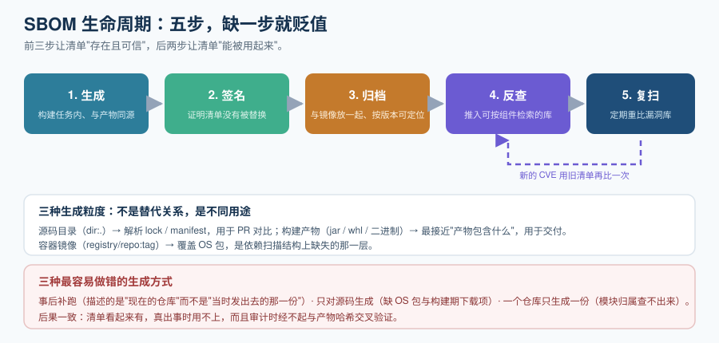

# 软件物料清单（SBOM）

SBOM（Software Bill of Materials，软件物料清单）是一份**结构化的组件清单文件**，回答「这个软件产物是由哪些组件、哪个版本构成的」。它是依赖治理的地基：**没有它，漏洞与许可证都无从查起**，因为两者都是「针对某个组件」的结论。

这一页只讲一件事：**怎么把 SBOM 生成出来并让它长期有用**。它不讲漏洞怎么排序（那是[漏洞扫描与优先级](../VulnerabilityScan/index.md)），也不讲许可证怎么判（那是[许可证合规](../License/index.md)）。

::: info 与「安全加固 · SBOM 与软件供应链」的关系
[安全加固 · SBOM 与软件供应链](../../../Ops/SecurityHardening/SbomSupplyChain/index.md) 从**安全视角**把 SBOM、扫描、SLSA、签名串成一页速览，适合先建立整体认知。
本页从**工程视角**把它拆成可执行的步骤与判据——多出来的主要是三块：**生成粒度与绑定关系**（源码 / 产物 / 镜像三种粒度不是替代关系）、**格式版本的事实**（哪些版本被标准化、哪些字段是新格式独有的）、以及**生命周期的后两步**（归档与定期复扫）。两者是「概览」与「落地」的关系，不重复。
:::

::: tip 一句话理解
SBOM 的价值不在「有一份文件」，而在**它把「我们在用哪些组件」从「散落在几十个 lock 文件里的隐式事实」变成了「一份可被机器查询的显式资产」**。
:::

## 一、SBOM 由四类信息构成

不管用哪种格式，一份可用的 SBOM 必须包含四类信息。少任何一类，它的可用性都会大幅下降：

| 类别 | 内容 | 缺了会怎样 |
| --- | --- | --- |
| **组件标识** | 名称、版本、**`purl`**（跨生态统一标识）、可选 `CPE`、哈希 | 缺 `purl` 就只能靠名字模糊匹配，跨生态查询直接失效 |
| **依赖关系** | 谁依赖谁（有向图） | 缺关系就只能得到「一堆组件」，无法回答「引入路径是什么、能不能通过升级父依赖解决」 |
| **许可证** | 声明的许可证（CycloneDX 用 SPDX 标识符表达） | 缺许可证就还得再跑一次许可证扫描，两份数据可能对不上 |
| **生成元数据** | 生成工具与版本、生成时间、**生成阶段**（设计 / 构建前 / 构建 / 构建后 / 运行）、文档主体 | 缺元数据就说不清「这份清单描述的是哪个时间点、哪个产物」，审计时不成立 |

::: info 关于 `purl` 的重要性
`purl`（Package URL）的形态是 `pkg:<生态>/<命名空间>/<名称>@<版本>`，例如：

```text
pkg:maven/org.apache.logging.log4j/log4j-core@2.14.1
pkg:npm/lodash@4.17.21
pkg:pypi/django@4.2.11
pkg:golang/github.com/gin-gonic/gin@v1.9.1
```

**它是跨工具、跨生态对同一个组件达成一致的关键**。同一个 `openssl`，在 Maven 生态、系统包生态、语言运行时生态里的名字各不相同，只有 `purl` 能把它们收敛到同一个标识上——而"影响面反查"这件事，本质就是一次 `purl` 匹配。
:::

## 二、两种格式：CycloneDX 与 SPDX

这两个是当前事实标准，**监管与客户几乎都接受其中任意一种**。选型不是合规问题，而是**工作流问题**。

| 维度 | CycloneDX | SPDX |
| --- | --- | --- |
| 治理方 | OWASP + Ecma TC54 | Linux Foundation（+ OMG） |
| 标准编号 | **ECMA-424**（现为第二版） | **ISO/IEC 5962:2021**（对应 SPDX **2.2.1**） |
| 当前版本（2026-10） | **1.7**（2025-10 发布）；1.x 线最后一个版本，向后兼容 1.4~1.6 | **3.0.1**（3.0 线 2024-04 发布，3.1 处于候选阶段） |
| 数据模型 | 扁平、**组件为中心**，单一 JSON 序列化 | **元素-关系图**，可 JSON-LD / RDF 表达，可查询 |
| 出身与侧重 | 2017 年，**安全优先**（漏洞关联、依赖图） | 2010 年，**许可证优先**（法务审阅、责任追踪） |
| VEX 支持 | **原生**，工具链成熟（VEX 自 1.4 起） | 3.0 的 Security profile 才引入原生漏洞 / VEX 支持，2.x 没有 |
| 许可证表达 | 够用（可用 SPDX 标识符） | **更完整**（SPDX 许可证清单本身就是规范） |
| 生态工具 | 广（Syft / Trivy / cdxgen / Dependency-Track 原生） | 许可合规工具链深厚（ScanCode / ORT / FOSSA） |
| 典型消费方 | 安全工具、SCA、VEX 工作流 | 法务审阅、监管报送、GitHub、开源办公室 |

**选型建议**（与当前行业实践一致）：

1. **内部生成与安全自动化用 CycloneDX**——工具生态更宽、原生 VEX、对漏洞关联更友好。
2. **对监管与供应商报送用 SPDX**——特别是被明确要求「提供 SPDX」的场景。
3. **两者不必二选一**：主流生成器（Syft / Trivy）都能输出两种格式，先把清单生成出来，格式转换放在导出层做。

::: danger 三个最容易踩的格式坑
1. **把"最新版本"当成"被标准化的版本"**。ISO/IEC 5962:2021 对应的是 SPDX **2.2.1**，不是 3.0.1；CycloneDX 被标准化为 ECMA-424。合同里写「提供符合 ISO 5962 的 SBOM」时，2.2.1 才是那个模板。
2. **以为 SPDX 2.3 已经过时**。实际上大量工具（含不少 Maven 与构建系统插件）仍在输出 2.3，而 **2.3 与 3.0.1 的能力并不相同**（3.0 的 Security profile 才是漏洞 / VEX 的落点）。收到 2.3 的文件时，不要假设它有漏洞信息。
3. **为了兼容下游而主动降低生成版本**。正确做法是**用最新版本生成、在导出时转换**；直接降版本生成会永久丢失新格式独有的字段（例如 1.7 的溯源引用、1.6 的密码学物料 CBOM）。
:::

## 三、最小要素：一份"能交出去"的 SBOM 要有什么

监管与采购常见的要求可归纳为七项最小要素（源自 2021 年美国行政令 14028 之后形成的 NTIA 最小要素，并被后续框架沿用）：

| # | 要素 | 说明 | 常见缺陷 |
| --- | --- | --- | --- |
| 1 | 供应方名称 | 组件的提供方 | 与 CISA 2026 口径的「组件生产者」**不是同一个概念**：生产者指**发起软件的那个实体**，供应方只是提供方；只填供应方可能在监管口径下不合格 |
| 2 | 组件名称 | 与上游一致 | 自行改名导致后续无法匹配 |
| 3 | 组件版本 | 精确版本 | 只写主版本号（`2.x`），漏洞匹配直接失效 |
| 4 | 其他唯一标识 | `purl` / `CPE` | 两者都缺，跨生态查询失效 |
| 5 | 依赖关系 | 谁依赖谁 | 只给扁平列表，无法判断引入路径 |
| 6 | SBOM 作者 | 生成主体 | 只有工具名、没有组织信息 |
| 7 | 时间戳 | 生成时间 | 缺时间戳就无法证明「这是哪个版本的清单」 |

::: warning 说明
「最小要素」是能交出去的下限，不是能用的上限。**只有最小要素的 SBOM 能通过审计，但很难用来定位问题**——后者需要完整的依赖图与 `purl`。
:::

## 四、生成时机与粒度

生成时机只有一个正确答案：**在构建这个产物的同一流水线任务里生成**。



三种粒度，用途不同，**不是替代关系**：

| 粒度 | 命令对象 | 描述什么 | 主要用途 |
| --- | --- | --- | --- |
| **源码目录** | `dir:.` | 按 lock / manifest 解析出的依赖树 | 开发期快速查看、PR 阶段比对新增组件 |
| **构建产物** | `jar` / `whl` / `zip` / 二进制 | **真正被打包进去的东西** | 交付 SBOM（最接近"这份产物包含什么"） |
| **容器镜像** | `registry/repo:tag` 或 `docker:` | 镜像文件系统里的全部包，**含 OS 包** | 与镜像扫描配套，覆盖依赖扫描看不见的那一层 |

::: danger 最容易做错的三种生成方式
1. **事后补跑**。用当前仓库状态生成一份"历史版本"的 SBOM——**这份清单描述的不是那个产物**。审计时一旦被交叉验证（比对产物哈希）就会暴露。
2. **只对源码生成**。源码目录里没有 OS 包、也可能漏掉构建期动态下载的依赖。
3. **一个仓库只生成一份**。多模块 / 多产物项目必须**每个产物一份**，否则「哪个模块引入了这个组件」这个问题永远答不出来。
:::

## 五、完整实操：从零生成一份 SBOM

以下命令均可直接复制执行（macOS / Linux，需先安装二进制）。

```shell
# 1. 安装 Syft（Apache-2.0，无需账号）
curl -sSfL https://raw.githubusercontent.com/anchore/syft/main/install.sh | sh -s -- -b /usr/local/bin
syft version   # 期望输出形如：Version: 1.5x.0

# 2. 对源码目录生成 CycloneDX JSON
syft dir:. -o cyclonedx-json=sbom.cdx.json
jq '.specVersion, (.components | length)' sbom.cdx.json
# 期望输出：一个版本号（如 "1.7" 或生成器支持的最高版本）与一个组件数量

# 3. 对容器镜像生成（覆盖 OS 包）
syft registry.example.com/app/web:1.4.2 -o cyclonedx-json=sbom-image.cdx.json

# 4. 用 Trivy 生成同一份清单的另一种格式（交叉验证组件数量）
trivy image --format cyclonedx --output sbom-trivy.cdx.json app/web:1.4.2

# 5. 转成 SPDX（交给需要 SPDX 的下游）
syft dir:. -o spdx-json=sbom.spdx.json
```

**两个数字必须核对**：

- `jq '.components | length'` 的结果与你对项目的直觉是否差得很远？**差得远是正常的**（传递依赖往往远超预期），但**如果远低于预期**，通常是没在正确目录执行（Syft **不会向上递归查找** manifest 文件）。
- 两个不同工具生成的组件数量**不同也是正常的**：它们的探测规则与数据源不同。差异大时应人工比对，而不是当成 bug 去修。

## 六、SBOM 的生命周期：五步，缺一步就贬值

| 步骤 | 做什么 | 不可省的判据 |
| --- | --- | --- |
| 1. 生成 | 在构建任务内生成，与产物同源 | 清单里的组件版本与产物实际打包内容一致 |
| 2. 签名 | 对 SBOM 文件本身签名（见[来源可信](../Provenance/index.md)） | 能验证「这份清单没有被替换」 |
| 3. 归档 | 与镜像 / 制品**放在一起**，按产物版本可定位 | 给定一个已发布版本，能找回它当时的清单 |
| 4. 反查 | 推入可按组件检索的库（Dependency-Track 一类） | 给定组件，能列出受影响服务 |
| 5. 复扫 | **定期**拿存量的 SBOM 重新比对漏洞库 | 老的、没重构的版本也能被新 CVE 覆盖 |

第 5 步最容易被忽略，也是成本最低的一步：**复扫存量的 SBOM 比重新扫描镜像便宜得多**（不用拉镜像、不用解层，只是一次数据源查询）。

```shell
# 复扫一份存量 SBOM，不需要镜像存在
grype sbom:./sbom.cdx.json -o table
```

::: tip 提示
**长期运行的版本尤其要复扫**。一个跑了一年、期间从未重新构建的服务，只要它的 SBOM 在库里，就会**自动被新 CVE 重新关联**——但前提是你当初真的上传过它。跳过上传的"稳定服务"会完全失去这项覆盖。
:::

## 七、SBOM 的四个限制

必须承认这四点，否则会过度依赖它：

1. **它只是清单，不是判决**。SBOM 说「你用了 log4j-core 2.14.1」，不说「你因此有风险」——后者需要漏洞数据与你的实际用法（这正是 VEX 存在的原因）。
2. **它只反映生成时点**。运行时动态加载的插件、运行时下载的模型文件、被挂载进去的配置**都不在里面**。
3. **它依赖生成器的探测能力**。混淆过的二进制、未按规范的打包方式、自带的 `.so` 文件可能扫不出来。**"SBOM 里没有"不等于"产物里没有"**。
4. **合规交付的是"最小要素"，工程需要的是"完整图"**。检查清单是否齐全与检查清单是否好用，是两个不同的验收。

## 八、可执行验证

做完上面五步，用这四条命令确认：

```shell
# 1. 格式与版本正确
jq -r '.bomFormat, .specVersion' sbom.cdx.json
# 期望：CycloneDX 与一个 1.x 版本号

# 2. 每个组件都有 purl（缺 purl 的组件无法跨生态查询）
jq '[.components[] | select(.purl == null)] | length' sbom.cdx.json
# 期望：0（少量系统包可能确实没有 purl，需人工确认）

# 3. 依赖关系存在（不是扁平列表）
jq '(.dependencies | length) > 0' sbom.cdx.json
# 期望：true

# 4. 镜像 SBOM 里能看到 OS 包（这是"依赖扫 + 镜像扫"是否都做了的分水岭）
jq -r '.components[] | select(.purl != null) | .purl' sbom-image.cdx.json | grep -c "^pkg:deb\|^pkg:rpm\|^pkg:apk"
# 期望：一个大于 0 的数字
```

## 参考资料

- CycloneDX 官方规范仓库与 ECMA-424 标准页面
- SPDX 官网规范索引与 `spdx.org/licenses` 许可证清单（当前清单版本 3.28.0，2026-02-20）
- Anchore Syft 官方仓库与文档；Aqua Security Trivy 官方文档
- OWASP Dependency-Track 官方文档（清单持续管理与反查）
- NTIA「SBOM 最小要素」公开说明，以及 CISA 关于 SBOM 框架与「组件生产者」的最新口径
- [依赖与安全治理 · 漏洞扫描与优先级](../VulnerabilityScan/index.md)（下一步：让这份清单产出结论）
