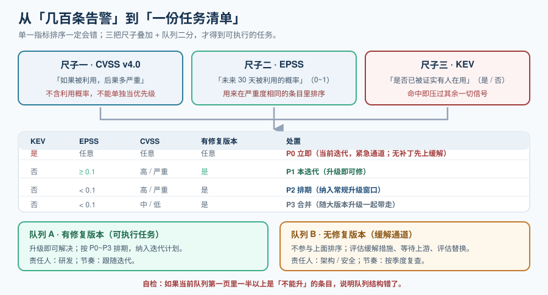

# 漏洞扫描与优先级

漏洞扫描是依赖治理里**唯一一件每天都会产生新输入**的事：组件不变，漏洞数据每天都在增长。所以这一页要解决的核心问题不是「怎么扫」，而是**「扫出来几百条，先修哪一条」**。

答错这个问题的代价非常具体：把「CVSS = 高但从未被利用过」的组件排在最前面，会挤掉那个**已经在野被利用**的组件——**有限的人力投到了错误的地方**。

::: tip 一句话理解
扫描器的输出是**线索**，不是**任务清单**。从线索到任务清单之间那一步——优先级判定——才是这一页的全部内容。
:::



## 一、扫描器到底在做什么

不管哪一款扫描器，内部都是同一条三段链路。理解它才能理解误报从哪里来。

```text
组件识别                →    漏洞匹配                  →    报告
（读了什么、版本是多少）      （和哪个数据源、按什么规则比）      （怎么表述、怎么排序）
```

| 阶段 | 做的事 | 差异来源 |
| --- | --- | --- |
| **组件识别** | 从 lock 文件 / 包数据库 / 文件系统里提取「组件 + 版本」，归一成 `purl` 或 `CPE` | 探测规则不同（是否读 lock、是否解二进制、是否读 OS 包数据库） |
| **漏洞匹配** | 把组件标识送到漏洞数据源，按**受影响版本区间**判断 | **数据源不同**（OSV 按生态精确到版本区间；NVD 大量依赖 CPE 字符串与人工标注） |
| **报告** | 生成表格 / JSON / SARIF，按严重度排序 | 严重度取值口径不同（部分源只有 CVSS v3.1，部分已给 v4.0） |

**由此得到两条必须接受的事实**：

1. **两个扫描器对同一份 SBOM 给出不同结论，是常态而非缺陷**。它们拉的数据源有重叠但不相同，版本区间匹配逻辑也不同。差异应该作为「**去人工确认**」的提示，而不是「**去修工具**」的故障。
2. **扫描器的结论随数据源更新而变化，与你的代码无关**。今天干净的构建，下周可能变红——**这正是"定期复扫"存在的理由**。

## 二、误报（FP）与漏报（FN）从哪来

| 类型 | 成因 | 典型表现 | 处置方向 |
| --- | --- | --- | --- |
| **版本区间误判** | 数据源对受影响区间的描述不准（尤见于 CPE 匹配） | 同一个 CVE 在 A 工具报、B 工具不报 | 以**按生态精确描述的源**（如 OSV / 生态官方公告）为准 |
| **组件识别错** | 从文件系统猜测版本（解包后无法确定） | 报的版本与实际不符 | 优先用**从 lock / manifest 解析**的 SBOM 做扫描 |
| **不可达** | 漏洞代码在依赖里，但**你的用法根本不会执行到** | 报了一片高危，实际不可利用 | 可达性分析、或**VEX 声明** |
| **重复** | 同一漏洞被多个来源以不同 ID 报出（CVE / GHSA / 内部编号） | 一条漏洞刷出三行 | 按 CVE 归并后再统计 |
| **无修复版本** | 上游还没发补丁 | 报了但"没得升" | 单独成组，用**缓解措施**而非升级处理 |

::: danger 最容易出错的判断：把「无修复版本」和「有修复版本」混在一个队列里排
1. **错误做法**：按严重度排一个长队列，前 50 条里有 30 条是「上游无补丁」。团队花两周讨论，一条也没修掉。
2. **正确做法**：**先按「有没有修复版本」二分**。有修复版本的是**可执行任务**（升级即可）；无修复版本的进入另一条通道（评估缓解、等待上游、评估替换）。两个队列的**节奏与责任人不同**。
3. **判据**：翻一下当前队列的第一页——如果有一半以上是「不能升」的条目，说明队列结构错了。
:::

## 三、三把尺子：严重度、可能性、在野利用

单一指标排序一定会错。必须叠加三个维度：

| 尺子 | 回答的问题 | 来源 | 用法要点 |
| --- | --- | --- | --- |
| **CVSS v4.0** | 「如果被利用，后果多严重」 | FIRST（v4.0 是当前活跃版本，v3.1 仍在大量使用） | 它**不含**利用概率；只能看它的严重度档位（低 / 中 / 高 / 严重），不能直接当优先级 |
| **EPSS** | 「未来 30 天内被利用的概率」 | FIRST，分值 0~1 | 用来**在严重度相同的条目里排序**；它是个概率，不是"要不要修"的判据 |
| **KEV** | 「是否已被证实有人在用」 | CISA「已知在野利用漏洞」清单 | **在名单里 = 立即处理**，优先级高于一切其他信号 |

**组合决策矩阵**（用它替代"按严重度排序"）：

| CVSS | KEV 在名单内 | EPSS 高（如 ≥ 0.1） | 处置 |
| --- | --- | --- | --- |
| 任意 | **是** | 任意 | **立即**（当前迭代内，走紧急通道）；无修复版本时先上缓解 |
| 高 / 严重 | 否 | 是 | **本迭代**：有修复版本就升，评估是否可达 |
| 高 / 严重 | 否 | 否 | **排期**：纳入常规升级窗口 |
| 中 | 否 | 是 | **排期偏前**：EPSS 高说明有人盯着这类组件 |
| 中 / 低 | 否 | 否 | **合并处理 / 忽略**：随大版本升级一起带走 |

::: warning 说明
阈值（如 EPSS 0.1）只是**起点**，不是普适真理。正确做法是**用自己过去 12 个月真实修过的高危漏洞**回测一遍：调阈值直到「模型排出的前 20 条」与「你们实际认为最该修的 20 条」重合度足够高。**口径要能用历史事件校准，而不是拍脑袋。**
:::

## 四、把它写成一个可执行口径

优先级不能停留在会议结论里。给它一个可计算的形态，才能进流水线：

```text
priority = f(KEV, EPSS, CVSS, 可达性, 是否有修复版本)

规则（从高到低，先命中先返回）：
  KEV 命中                     → P0（立即）
  有修复版本 且 EPSS ≥ 0.1      → P1（本迭代）
  可达 且 CVSS ≥ 7.0           → P1（本迭代）
  有修复版本 且 CVSS ≥ 7.0      → P2（排期）
  其余                          → P3（随大版本合并）
  无修复版本                    → 单列（走缓解通道，不参与上面排序）
```

**判断这套口径好不好用的唯一标准**：拿它去跑上季度的漏洞列表，看它排出的前 20 条里，**有多少条是你们事后认为"当时确实应该先修的"**。

## 五、四种去噪手段

| 手段 | 做法 | 什么时候用 | 代价 |
| --- | --- | --- | --- |
| **只处理有修复版本的** | 队列二分 | 永远（第一步） | 无 |
| **可达性分析** | 判断漏洞代码路径是否真的可达 | 高危条目多、人力不足时 | 工具通常是商业能力；结论需要复核 |
| **VEX 声明** | 对每个「不可利用」结论出具正式声明 | 需要向客户 / 监管证明「我们评估过」 | 要有人**维护**它；写了就长期有效，不能一写了之 |
| **按 CVE 归并** | 多来源同一漏洞合并计数 | 永远 | 无 |

::: tip 提示
**VEX（Vulnerability Exploitability eXchange）是被低估的工具**。它的作用是让你能回答一句非常具体的话：「我们知道这个组件有 CVE-XXXX，**在我们的用法下不可利用**，理由是……」。这句话在客户安全问卷里出现的频率极高——**没有 VEX，你只能用"我们正在处理"来回答，而这句话每年都要再说一次。**
:::

## 六、例外管理：四条纪律

例外（waiver / 豁免）是治理体系最容易腐化的地方——一处例外批下去，两年后没人记得它为什么存在。

1. **例外必须有到期日**。没有到期日的例外，就是一个永久漏洞。
2. **例外必须写明理由与生效范围**（哪个仓库、哪个组件、哪个版本区间）——「影响 XX 服务」比「已知风险」有用得多。
3. **例外必须可检索**。放在聊天记录里的例外等于不存在；要放进一个能被查询的地方（策略文件、私服的豁免工作流、工单系统均可）。
4. **到期必须有人被通知**。到期不通知，等着的就是一次静默失效。

::: danger 三个真实的例外失控形态
1. **"先合进去，回头再补豁免"**：回头永远不会来，于是规则文件里出现一个没有任何注释的 `ignore` 项。
2. **用通配符图省事**：`ignore: ["CVE-2024-*"]`——一次放过一整年的同类漏洞，包括还没公开的那些。
3. **把阻断改成警告**：为了让某次紧急发布通过，有人把门禁降级。**这一步之后，门禁事实上已经不存在了**，而所有人还会以为它在保护自己。
:::

## 七、实操：从 SBOM 到排序后的队列

```shell
# 1. 直接扫 SBOM（不需要镜像或源码）
grype sbom:./sbom.cdx.json -o json > findings.json

# 2. 只留「有修复版本」的，按严重度与是否在 KEV 排序（需要先准备 KEV 清单）
jq -r '
  .matches[]
  | select(.vulnerability.fix.state == "fixed")
  | [.vulnerability.severity, .artifact.name, .artifact.version,
     .vulnerability.id, .vulnerability.fix.versions[0]]
  | @tsv' findings.json | sort -r | head -30

# 3. 统计总量与严重度分布（先看结构，再看细节）
jq -r '[.matches[].vulnerability.severity] | group_by(.) | map({sev: .[0], n: length})' findings.json

# 4. 交叉验证：换一个扫描器扫同一份 SBOM，比对差异
trivy sbom --format json --output trivy.json ./sbom.cdx.json
jq -r '.Results[].Vulnerabilities[]?.VulnerabilityID' trivy.json | sort -u > trivy.ids
jq -r '.matches[].vulnerability.id' findings.json | sort -u > grype.ids
comm -13 grype.ids trivy.ids   # 只有 Trivy 报的
comm -23 grype.ids trivy.ids   # 只有 Grype 报的
# 期望：两边都有差异（这是正常的）；差异条目人工确认，不要试图"修"成一致
```

::: warning 说明
双扫描器交叉验证**只值得用在关键组件上**。对所有组件做双扫会让队列翻倍、噪音翻倍，而收益集中在少数几个组件上。建议口径：**只对"进生产且对外提供服务"的产物启用交叉验证**。
:::

## 八、可执行验证

```shell
# 1. 队列里"无修复版本"的比例（结构是否健康，建议 < 40%）
jq '[.matches[] | select(.vulnerability.fix.state != "fixed")] | length' findings.json

# 2. 是否存在 KEV 命中项（应为 0；不为 0 说明还有紧急项没处理）
jq -r '.matches[].vulnerability.id' findings.json | sort -u | grep -cFf kev-ids.txt

# 3. 例外清单是否有到期日为空、或使用通配符的条目（应为 0）
grep -nE '(ignore|waiver).*(\*|EXPIRES:\s*$)' policy/*.yaml || echo "OK: 无通配与无期限例外"
```

## 参考资料

- FIRST「CVSS v4.0」规范说明与「EPSS」模型说明页面
- CISA「Known Exploited Vulnerabilities Catalog」公开说明
- Google OSV 项目说明（按生态精确到版本区间的漏洞数据）
- Anchore Grype 与 Aqua Security Trivy 官方文档（输出格式、SBOM 直接扫描）
- OWASP Dependency-Track 官方文档（持续关联与告警）
- CycloneDX 规范中的 VEX 部分（漏洞可利用性声明的字段定义）
- [依赖与安全治理 · 软件物料清单](../SBOM/index.md)（上游：先有清单才谈扫描）
