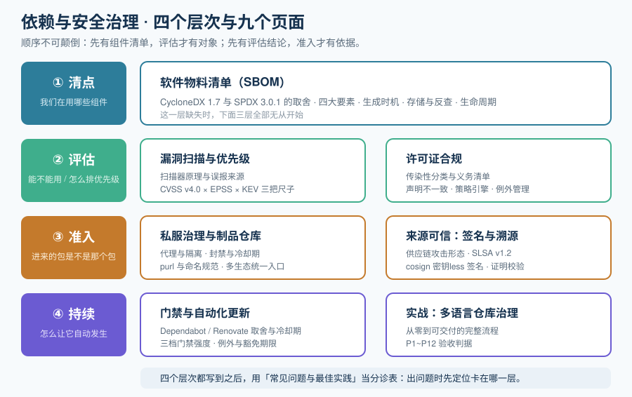

# 依赖与安全治理

一个现代应用的代码里，**自己写的部分通常不到 10%**——剩下的都是别人写的包。依赖治理要回答的就是：这 90% 你既没写过、也没审过，**凭什么敢把它发到生产环境**。

本专题讲的是**把这件事做成流程**：怎么知道自己在用哪些组件（SBOM）、怎么判断其中一个有没有已知漏洞（扫描与优先级）、怎么确认它的许可证允许你这么用（合规）、怎么保证拿到的包没有被掉包（来源可信）、以及怎么让这一切**在流水线里自动拦住**而不是靠人记得去查。

::: tip 一句话理解
依赖治理不是「装几个扫描器」，而是**把「我们在用哪些组件」这个事实变成一份可持续维护、可被机器查询的资产**。
没有这份资产，出了 Log4Shell 级别的公共漏洞，你的第一个动作只能是「全公司 grep 一遍 lock 文件」。
:::

## 与相邻专题的分工

「依赖」「安全」「制品」「流水线」这几个词在不同专题里反复出现，边界必须写死：

| 专题 | 讲什么 | 与本源的关系 |
| --- | --- | --- |
| 本专题 | **依赖这个对象本身的全生命周期治理**：清点（SBOM）、评估（漏洞 / 许可）、来源（签名与溯源）、准入（私服与门禁） | —— |
| [包管理器深入 · 依赖安全](../PackageManager/Security/index.md) | 前端生态的 `lockfile`、npm 生态特有的依赖安全机制、`npm audit` 一类工具 | 那边讲**一种生态里的工具怎么用**，本专题讲**跨生态的治理流程与判据**（Java / Python / Go / 容器镜像同样适用） |
| [构建和依赖管理工具](../Build/index.md) | Maven / Gradle 的依赖声明、版本仲裁、仓库配置 | 那边回答「**依赖怎么声明、怎么解析**」，本专题回答「解析出来的这批东西**能不能放行**」 |
| [CI/CD](../../Tools/CICD/index.md) | 流水线编排、构建、测试、制品归档与部署 | 那边是**执行引擎**，本专题是**插进流水线的检查点**；门禁的「怎么拦」归那边，「拦什么、拦到什么程度」归本专题 |
| [CI/CD · 制品管理](../CICD/Artifacts/index.md) | 制品仓库的通用概念、版本与保留策略 | 那边讲**制品怎么存**，本专题讲**仓库怎么成为准入闸门**（代理与隔离、封禁、来源校验） |
| [前端安全](../../Frontend/Others/Security/index.md) | 前端侧的安全问题（XSS / CSP / 依赖安全概览） | 那边的依赖安全是**前端生态视角的入口**，本专题是**跨生态的完整展开**；两者在「lockfile 一致性」处交接 |
| [前端 · 桌面应用深入](../../Frontend/DesktopApp/index.md) | Tauri / Electron 桌面应用的能力权限模型、打包签名与更新器 | 桌面应用给依赖治理加了**两个额外来源**：① **插件与大版本耦合**——Tauri 插件跟随核心大版本走，跨大版本升级会连带一整批依赖，且部分 crate 已停止维护，必须进清点；② **签名密钥本身是制品**——更新器密钥与代码签名证书一旦泄露，等于把发布通道整体交出去，其保管与轮换要按「制品」而非「配置」来治理。判据见该专题的[打包与签名](../../Frontend/DesktopApp/Packaging/index.md)与[更新器](../../Frontend/DesktopApp/Updater/index.md) |
| [安全加固 · 扫描工具链](../../Ops/SecurityHardening/ScanningToolchain/index.md) | 主机与容器镜像的漏洞扫描、基线检查、密钥扫描 | 那边扫的是**运行环境**（OS 包、镜像层、配置），本专题扫的是**你构建进去的依赖**；同一次发布既要镜像扫也要依赖扫，两者**不可互替** |
| [安全加固 · SBOM 与软件供应链](../../Ops/SecurityHardening/SbomSupplyChain/index.md) | 安全视角的**单页速览**：SBOM 格式、Syft/Trivy、Grype、SLSA 等级、cosign 与准入策略串成一条链 | 那页讲「**链上有哪些环节、用什么工具**」，本专题讲「**每个环节的判据是什么、怎么让它自动拦住**」；那页不涉及许可证合规与漏洞优先级口径，本专题补齐 |
| [安全加固](../../Ops/SecurityHardening/index.md) | 主机 / 集群的加固基线与合规项 | 那边加固「系统」，本专题治理「组件」；供应链攻击常常绕过主机加固，直接命中依赖 |
| [后端 · 微服务](../../Backend/Microservices/index.md) | 服务拆分、注册发现、治理 | 本专题的治理对象是**每个服务的依赖树**，微服务只是把这份树的数量放大到了 N 倍 |
| [容器编排进阶](../../Ops/ContainerOrchestration/index.md) | K8s 编排、镜像拉取、准入控制 | 那边可以在**部署时**用准入策略做最后一道拦截，本专题在**构建时**就把问题拦掉；两道都要，顺序是先构建后部署 |
| [完整项目交付 · 交付物](../../Others/ProjectDelivery/Delivery/index.md) | 交付清单、配置对账、运维手册 | 那边是交付的**总清单**，本专题的 SBOM 与许可证清单是其中**两份必须随版本归档**的附件 |
| [可观测性 · 代码质量](../../Tools/TestingTools/index.md) | 测试工具与质量门禁 | 测试回答「**功能对不对**」，依赖治理回答「**材料合不合规**」；两者都是门禁，判据完全不同 |
| [文档体系建设](../DocsInfra/index.md) | 文档站建设、写作规范、自动化 | 本专题产生的报告（SBOM / 许可证清单 / VEX）需要同样一套「可发布、可追溯」的文档化能力，那边提供方法论 |

## 专题地图

| 页面 | 内容 | 适合谁读 |
| --- | --- | --- |
| [总览：依赖治理的四条边界](./Overview/index.md) | 治理对象是什么、四个层次的产出物、成熟度五档、什么时候**不需要**做到这个程度 | 所有人，先读 |
| [软件物料清单（SBOM）](./SBOM/index.md) | CycloneDX 与 SPDX 的取舍、四大要素、生成时机、存储与复用 | 要交付 SBOM 或被客户要求提供的人，**重点读** |
| [漏洞扫描与优先级](./VulnerabilityScan/index.md) | 扫描器怎么工作、误报从哪来、CVSS / EPSS / KEV 三把尺子、去噪与例外管理 | 每天面对漏洞报告的人，**重点读** |
| [许可证合规](./License/index.md) | 许可证的传染性分类、声明与实际的差异、义务清单、策略引擎与例外 | 会被法务追问的人，**重点读** |
| [私服治理与制品仓库](./Registry/index.md) | 代理与隔离、封禁与冷却、`purl` 与命名规范、多生态统一入口 | 要搭或要接管私服的人 |
| [来源可信：签名与溯源](./Provenance/index.md) | 供应链攻击的真实形态、SLSA 等级、密钥less 签名、证明文件校验 | 要证明「这个包是我们构建的」的人 |
| [门禁与自动化更新](./Automation/index.md) | 更新机器人的取舍、冷却期、门禁的三档强度、例外与豁免期限 | 要配流水线门禁的人，**重点读** |
| [实战：给一个多语言仓库做依赖治理](./Practice/index.md) | 从零到可交付的完整流程，含 P1~P12 验收判据 | 想照着做一遍的人 |
| [常见问题与最佳实践](./FAQ/index.md) | 分诊表、十二问、上线自查清单、术语表 | 所有人 |

## 工具与规范事实速览

按 **2026-10** 口径联网核对。下表只固化「会改变治理方案」的事实，**任何报价与版本请以官方页面为准**：

| 项 | 当前事实（2026-10） | 对治理方案的影响 |
| --- | --- | --- |
| SBOM 格式（安全优先） | **CycloneDX 1.7**（2025-10 发布，2025-12 成为 **ECMA-424 第二版**），是 1.x 线最后一个版本，向后兼容 1.4~1.6；面向 API 的 2.0 在途 | 新落地直接用 1.7；下游工具只认老版本时不要降格式版本，改在导出层做转换 |
| SBOM 格式（合规优先） | **SPDX 3.0.1**（3.0 线 2024-04 发布，3.1 处于候选阶段）；**ISO/IEC 5962:2021** 对应的是 SPDX **2.2.1** | 需要提交给监管或供应商时用 SPDX；注意「ISO 标准化的版本」与「最新版本」不是同一个 |
| SBOM 生成器 | Syft **v1.52.0**、Trivy **v0.74.0**、cdxgen（均为 Apache-2.0，无需账号） | 生成 SBOM 这一步**没有付费理由**；先跑通一个二进制，再谈平台 |
| SBOM 持续管理 | OWASP Dependency-Track **5.1.0**（Apache-2.0，自建）；**最低需要 4GB 内存**，首次启动需等漏洞库镜像同步完成 | 「一堆 SBOM 文件放在制品库里」不等于「能在事故中问出答案」，需要**能按组件反查**的库 |
| 漏洞数据源 | **OSV**（按生态精确到版本区间）、NVD、GitHub Advisory（GHSA）；扫描器之间**结论不一致是常态而非缺陷** | 双扫描器交叉验证只用于**关键组件**；把不一致当提示去人工确认，而不是当故障去修 |
| 优先级标尺 | **CVSS v4.0**（当前活跃版本，v3.1 仍在大量使用）、**EPSS**（由 FIRST 维护）、**CISA KEV**（已知在野利用清单） | 单看 CVSS 排序会把大量「理论可利用」排到前面；必须叠加在野利用信号 |
| 许可证清单 | **SPDX License List 3.28.0**（2026-02-20 发布） | 判别许可证时以 SPDX 标识符为准，不要用「GPL」「Apache」这类口语简称 |
| 自建制品仓库 | Sonatype Nexus Repository **3.96.3-01**（2026-09-22），典型支持窗口约 **18 个月**；3.94.0 起支持**原生 OCI 仓库**，可把镜像、Helm、SBOM、签名与证明放在同一个受控分发点 | 私服不是「装完就不管」的设施，要按 18 个月的节奏规划升级；SBOM 与镜像放一起比放两个地方更不容易丢 |
| 依赖更新机器人 | Dependabot 自 **2026-07-14** 起**默认 3 天冷却期**（安全更新豁免、无需配置）；Renovate 的 `minimumReleaseAge` 无默认值，需显式配置；Renovate 42 起默认 `timestamp-required` | 「谁更保守」的结论已经反转：不配置就是 Renovate 更激进；容器镜像源常不返回时间戳，需显式调 `minimumReleaseAgeBehaviour` |
| 供应链安全等级 | **SLSA v1.2**（状态为 Approved，含 Build Track 与 Source Track）；**v1.1 已标记 Retired** | 引用等级时写清版本号；多数团队实际落点是 Build **L2**（托管构建平台 + 发布证明） |
| 签名与溯源 | Sigstore **cosign v3.1.3**，默认**密钥less（keyless）**：用短时证书绑定 OIDC 身份，签名进公共透明日志 | 「有没有签名」比「签名的密钥存在哪」更重要；密钥less 把最大的运维负担直接消掉了 |
| 合规时钟（欧盟） | **CRA（Regulation (EU) 2024/2847）** 2024-12-10 生效；**报告义务自 2026-09-11 起适用**（24 小时预警 → 72 小时详细通知 → 最终报告）；**全面适用 2027-12-11** | 「先把 SBOM 生成出来」这件事有了外部时钟；报告义务的生效日**早于**全面合规日一年多 |

## 版本组织说明

本专题**不建立版本目录**（不存在 `DependencyGovernance2/` 这类结构），理由有三条：

1. **治理流程本身几乎不换代**。「先清点、再评估、最后准入」这条顺序十年不变；变的是工具与规范。
2. **真正会发生破坏性变化的是两类外部输入**：① 规范格式（CycloneDX 1.x → 2.0、SPDX 3.0 → 3.1）；② 法规生效时点（如欧盟 CRA 的 2026-09-11 与 2027-12-11 两个日子）。这两类变化本专题用 `::: info` 在页内**标注生效时点**处理，旧口径**保留不删除**。
3. **仓库内已有版本目录的范例**可以参考 [Spring6](/docs/Backend/Java/Frame/Spring/Spring6/index.md)（同级的 `Spring5/` 保留并标注为仅存量使用）、Spring Boot 的 `v2/v3/v4` 子树——那里的做法是「旧版本目录保留原内容并标注维护状态，新内容面向最新稳定版」。本专题尚未出现需要按此处理的主题；若将来 SBOM 格式真的发生不兼容换代（例如 CycloneDX 2.0 落地且工具链只支持新版），再按同样方式另建目录。

## 学习路径

建议按「先看清有什么、再决定拦什么、最后把它自动化」的顺序读：

1. 先读 [总览](./Overview/index.md)，把「治理对象」与「四个层次」搞清楚——没搞清楚对象，后面所有工具都会变成「装了就忘」。
2. 再读 [SBOM](./SBOM/index.md)。它是**地基**：没有组件清单，漏洞与许可都无从查起。
3. 然后按需读 [漏洞扫描与优先级](./VulnerabilityScan/index.md) 与 [许可证合规](./License/index.md)——这两页是**每天真的会用到**的判断标准。
4. 接着读 [私服治理与制品仓库](./Registry/index.md) 与 [来源可信](./Provenance/index.md)，这两页决定「**你拿到的包是不是你以为的那个包**」。
5. 再用 [门禁与自动化更新](./Automation/index.md) 把前面四步插进流水线——这一步不做，前面全是文档。
6. 最后读 [实战](./Practice/index.md) 与 [常见问题](./FAQ/index.md)，用它们回头检验。

## 与自建工具链专题的分工

- **本页**讲治理侧：SBOM、漏洞优先级、许可证策略、私服准入与冷却期。
- [自建工具链](../Toolchain/index.md) 讲**发布侧的动作**：自建包怎么推上去、版本号怎么定、变更文件怎么写、发错了怎么弃用。
- 判据：**判据归本页，动作归那边**。本页回答「这个依赖能不能进」；自建工具链回答「我们自己发的这个包怎么让别人装上、并且知道装的是哪一版」。

## 与「浏览器扩展工程」专题的分工（第 177 天补充）

[浏览器扩展工程](../../Tools/BrowserExtension/index.md)的[分发一页](../../Tools/BrowserExtension/Distribution/index.md)与本页在**「最终产物里到底有什么」**这件事上正面相交，但治理手段差别很大：

| 维度 | 本页（依赖治理） | 扩展分发 |
|---|---|---|
| 产物形态 | 包管理器坐标 + lockfile + SBOM | 一个 `.zip` 演进成 `.crx`，**没有 lockfile 概念** |
| 依赖可见性 | 清单可枚举、可审计 | 依赖被压进包体，**商店既不收 SBOM 也不校验** |
| 最大的隐性风险 | 传递依赖的许可证与 CVE | **远程代码**：manifest 或代码里引 CDN 脚本 → 直接拒审 |
| 版本锁定 | lockfile + 完整性哈希 | 只能靠「打包前 `npm ci`、lockfile 入库」这条纪律 |

**三条只有扩展才会踩的坑**：

1. `content_scripts` 里写 `https://cdn.example.com/x.js` 属于**远程代码**，商店审核会拒。同样的写法在网页里只是性能与可用性问题，在扩展里是合规问题。
2. `manifest.json` 的 `minimum_chrome_version` 是**唯一的运行时兼容声明**。写不写、写多少，等于你在替用户决定「装不装得上」——写高了挡住老用户，不写就要自己处理 API 不存在的情况。
3. 打包脚本常把整个 `node_modules` 塞进去，包体轻松过 10 MB；更麻烦的是**把 `.map` 与源码一起发出去**，等于公开全部实现细节。包体审计要进 CI，而不是发版前手动看一眼。

一句话分诊：**「这个依赖能不能进」看本页；「进了之后怎么装到用户机器上、而且装的是哪一版」看那一页。**

## 参考资料

- CycloneDX 官方规范仓库（`CycloneDX/specification`）与 ECMA-424 标准页面
- SPDX 官网（规范、许可证清单、`spdx.org/licenses`）
- OWASP Dependency-Track 官方文档与 GitHub 仓库
- Anchore Syft / Grype、Aqua Security Trivy、Google OSV-Scanner 官方仓库与文档
- SLSA 规范站点（Version 1.2，Build / Source Track）
- Sigstore 与 cosign 官方文档（keyless 签名、透明日志）
- OWASP Top 10 对「易受攻击和过时的组件」的公开描述（风险来源的公认表述）
- Sonatype Nexus Repository 官方发布说明（版本与支持窗口）
- 欧盟委员会 Cyber Resilience Act 官方页面与 Summary of the legislative text
- [依赖与安全治理 · 常见问题与最佳实践](./FAQ/index.md)（本专题的术语表与自查清单）
