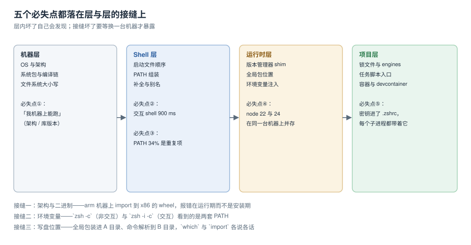

# 四层边界与五个必失点

「环境搭好了」这句话没有判定标准，所以它几乎总是假的。真正可判的说法是四句话：机器层的架构与库对得上、shell 层的启动耗时与 PATH 在预算内、运行时层的版本可预测、项目层的依赖能被同一个解释器装上。**层内坏了自己会发现，层与层的接缝坏了要等换一台机器才暴露**——本页的五个必失点全部落在接缝上。



本页判据族 `DEV-A` ~ `DEV-H`，共 8 条。定义表在第六节。

## 四层各自回答一个问题

| 层 | 由什么构成 | 它回答的问题 | 坏了的现象 |
| --- | --- | --- | --- |
| 机器层 | OS、CPU 架构、系统库、文件系统 | **能不能装** | 装到一半报 `No matching distribution`、`GLIBC_2.xx not found` |
| shell 层 | 启动文件、`PATH`、补全、别名、函数 | **你在哪个解释器里敲命令** | `command not found`、终端卡、别名只在某些窗口生效 |
| 运行时层 | 语言解释器、版本管理器、全局包目录 | **同一行命令跑的是哪个版本** | `node -v` 与文档不一致、全局命令装完找不到 |
| 项目层 | 锁文件、任务脚本、容器、`.envrc` | **别人能不能复现** | 换机器报 `ModuleNotFoundError`、锁文件被悄悄改写 |

四层的判定代价差别很大：机器层要跑一条 `uname -m` 加一次真实安装；shell 层要跑 15 次计时；运行时层要对比两条 `command -v`；项目层要在一台干净机器（或干净容器）上跑一遍 bootstrap。**代价越大的层，越容易长期没人验证**，于是它成为事故的来源。

## 五个必失点

### ① 架构与二进制：报错出现在运行期而不是安装期

在 arm 机器上装到一个 x86 的 wheel，`pip install` 常常是成功的——因为 wheel 名字里带 `manylinux_x86_64` 也能被接受，直到 `import` 那一刻才报 `mach-o file, but is an incompatible architecture`。反过来，某些包在安装时就会编译失败，看起来「装不上」。

判定的最小动作是两条命令，而不是「重装试试」：

```shell
uname -m                       # arm64 或 x86_64
python3 -c "import platform,sys; print(platform.machine(), sys.version)"
```

两者必须一致，且与**依赖产物**的架构一致。容器里更隐蔽：镜像可能是多架构 manifest，`docker pull` 自动选了 `linux/arm64`，而团队文档写的是 `x86_64` 的编译参数。

### ② 交互 shell 启动 746 ms：每次开窗口都付一次

本机实测（zsh 5.9，15 次取 p50）：空配置 **14.2 ms**，真实 `~/.zshrc` **746 ms**。这 52 倍里，**660 ms 全部来自 nvm 的默认初始化**——它不只是 `source nvm.sh`，还会解析默认版本并改写 `PATH`。

更完整的对照：

| 配置 | p50 | 相对空配置 |
| --- | --- | --- |
| 空 `.zshrc` | 14.2 ms | 1.0× |
| `nvm.sh --no-use` | 97.9 ms | 6.9× |
| `nvm.sh`（默认） | 673.8 ms | 47.5× |
| `nvm.sh` + `bash_completion` | 724.1 ms | 51.0× |
| 真实 `~/.zshrc` 全量 | 746.0 ms | 52.5× |

一次 746 ms 不算什么，但一天开 30 个窗口、每个窗口再起 5 个 tmux 窗格，就是几十分钟的纯等待，而它发生在**最不该被打断的时刻**（想敲命令的那一秒）。

### ③ PATH 34% 是重复项

本机 `PATH`：**35 项，唯一 23 项**，重复 12 项（34%），总字符长度 1,608。来源很具体：`.zshrc` 里四行不同顺序的 `PATH=…:$PATH` / `PATH=$PATH:…` 叠加，每次 `source` 再加 3 项（实测 `source` 1 次 → 10 项、2 次 → 13 项、3 次 → 16 项、5 次 → 22 项）。

重复本身不报错，但它带来两个后果：

1. **解析变慢**：未命中一次命令，1 项 **6.34 µs**、10 项 **47.64 µs**、35 项 **164.52 µs**、100 项 **491.08 µs**——近似线性，77 倍。
2. **「谁先被找到」变得不可预测**：同名二进制在两处存在时，先命中的那个赢，而先命中哪个取决于叠加顺序。

### ④ 同一台机器上两个 node

```shell
$ zsh -c   'node -v'     # v22.22.2
$ zsh -i -c 'node -v'    # v24.21.0
```

两条命令中间只差一个 `-i`。原因不是装了两个版本（确实装了两个），而是**nvm 在交互 shell 里改了 `PATH`，非交互 shell 里没改**。这意味着：终端里 `node` 是 24、CI 与 `make` 子进程里是 22，而「Node 版本不兼容」的报错通常长这样：

```text
Error [ERR_REQUIRE_ESM]: require() of ES Module ... not supported
```

看到这种报错时，先跑那两条 `command -v`，比升级依赖更快定位。

### ⑤ 密钥在 `export` 之后属于全机可见

本机实测：起一个带 `DB_PASSWORD` 的子进程，`ps eww -p <pid>` 的输出 **19,793 字节**里能直接搜到明文。改成不 `export` 的命令级变量后，子进程里 `'DB_PASSWORD' in os.environ` 从 **True** 变成 **False**。

这条最容易被当成「洁癖」：它不报错、不影响功能、只在进程存活期间可读。但同机任意用户可读、会进崩溃转储、会随子进程上报，且往往连带进 dotfiles 仓库——一次提交之后就永久留在历史里。

## 五问决策：先问哪一层

遇到「环境问题」，按下面五问依次回答，第一个答「不知道」的那一层就是当前该修的层：

1. **这台机器的架构与系统库是什么？** 不知道 → 机器层。
2. **这条命令在哪种 shell 模式下被执行？读的是哪几个文件？** 不知道 → shell 层。
3. **`command -v` 指向哪个绝对路径，它属于哪个版本？** 不知道 → 运行时层。
4. **同一份代码在干净容器里能不能跑起来？** 不知道 → 项目层。
5. **密钥是怎么进到进程里的？** 不知道 → 密钥卫生（见[密钥卫生](../Secrets/index.md)）。

这五问的顺序不能颠倒：在不知道架构的情况下排查「版本不对」，最常见的结局是装了第三个版本，问题从「版本不对」变成「三个版本都不对」。

## 一次「从零开工」的时间线

把上面的东西串成一条可验收的路径（本机实测耗时，不含下载）：

| 步骤 | 动作 | 判定 | 典型耗时 |
| --- | --- | --- | --- |
| 1 | 确认架构与 OS 版本 | `uname -m` / `sw_vers` | < 10 ms |
| 2 | 装 shell 框架与补全 | `zsh -i -c exit` 计时 | 10~100 ms |
| 3 | 装版本管理器并锁版本 | `.nvmrc` 与 `node -v` 一致 | 1~3 min（含下载） |
| 4 | 装包管理器与依赖 | `--frozen-lockfile` 成功 | 1~5 min |
| 5 | 起依赖服务 | `docker compose ps` 全 healthy | 10~60 s |
| 6 | 跑一次冒烟 | 一条命令返回 `ok` | < 30 s |
| 7 | 记录版本矩阵 | 四行版本号写进 README | < 1 min |

第 7 步最常被跳过，而它是唯一能让下一个人知道「应该是什么版本」的东西。

## 四条常见误解

::: danger 四条听起来对、但会被读数推翻的说法
1. **「终端慢是因为插件装太多」**——本机 746 ms 里 660 ms 是 nvm，占 88%；插件与别名合计约 28 ms。先量再删插件。
2. **「`export` 只是为了方便，反正只有我自己用这台机器」**——`ps eww` 对同机任意用户可读，且进程崩溃时的转储、子进程的错误上报都会带上环境变量。
3. **「`command not found` 就是没装」**——多数情况是装了但不在 `PATH` 里，或 `PATH` 被后加载的文件覆盖。先 `command -v`，再 `ls` 那个目录。
4. **「用容器就一定可复现」**——容器锁住了系统库与解释器，但**锁不住挂载进来的 `node_modules`**、也锁不住宿主 `PATH` 上的工具。卷挂载是复现性最常见的破口。
:::

::: tip 一条能立刻跑的体检
把下面这段贴进终端，四行输出就是四层的当前状态。任何一行与团队文档不一致，就从那一层开始查。

```shell
uname -m && sw_vers -productVersion 2>/dev/null || cat /etc/os-release | head -2
zsh -c 'command -v node'; zsh -i -c 'command -v node'
echo "$PATH" | tr ':' '\n' | sort | uniq -d | wc -l
env | wc -l
```
:::

## 判据表

| 编号 | 看什么现象 | 判成什么 | 不满足时改哪里 |
| --- | --- | --- | --- |
| `DEV-A` | `uname -m` 与依赖产物架构一致 | 一致才算通过 | 换镜像 manifest / 重装对应架构的包 |
| `DEV-B` | 交互 shell 启动 p50 有数值且记录在 README | 无记录即不通过 | 补[启动预算](../StartupBudget/index.md)的计时步骤 |
| `DEV-C` | `PATH` 重复项为 0 | 有重复即不通过 | 改用 `typeset -U path` 或去重赋值 |
| `DEV-D` | 交互与非交互 `command -v` 指向同一路径 | 不一致即不通过 | 统一启动文件，版本切换放项目级 |
| `DEV-E` | 密钥不出现在任何启动文件中 | 出现即不通过 | 改进程级注入（见[密钥卫生](../Secrets/index.md)） |
| `DEV-F` | 干净容器里能跑通 bootstrap | 跑不通即不通过 | 补锁文件与系统依赖 |
| `DEV-G` | 版本矩阵四行写进 README | 缺行即不通过 | 补 README「环境」小节 |
| `DEV-H` | 每个症状都有一条可执行判定命令 | 靠「重装试试」即不通过 | 按[分诊表](../FAQ/index.md)补命令 |

## 验证方式

```shell
# 1) 四层体检：四行输出，与团队文档逐行比对
uname -m
zsh -c 'command -v node'; zsh -i -c 'command -v node'
echo "$PATH" | tr ':' '\n' | sort | uniq -d | wc -l

# 2) 启动耗时（15 次取中位数，不看单次）
for i in {1..15}; do /usr/bin/time -p zsh -i -c exit; done 2>&1 | grep real | sort -k2 -n | sed -n '8p'

# 3) 空环境可复现性：应当返回 NOT_FOUND，说明「能跑」依赖了环境变量
env -i PATH=/usr/bin:/bin zsh -c 'command -v node || echo NOT_FOUND'
```

预期：第 1 步第二行两条路径**相同**（若不同，即为 `DEV-D` 失败）；第 2 步得到 200 ms 以内的数（本机基线是 746 ms，属未优化状态）；第 3 步返回 `NOT_FOUND`——这是**正常**的，它证明你的环境依赖了 `PATH`，而不是系统装了全局 node。

## 参考资料

- POSIX.1-2017：*Shell Command Language*（命令查找与 `PATH` 语义）
- zsh 官方文档：*Startup Files*（四类启动文件与读取顺序）
- Node.js 官方文档：*Modules: Packages*（`engines` / `packageManager`）、Corepack
- Docker 官方文档：*Multi-platform images*（manifest list 与 `--platform`）
- 本仓库相邻专题：[shell 启动链路](../ShellStartup/index.md)、[PATH 与运行时版本](../PathAndRuntime/index.md)、[环境可复现](../Reproducibility/index.md)
