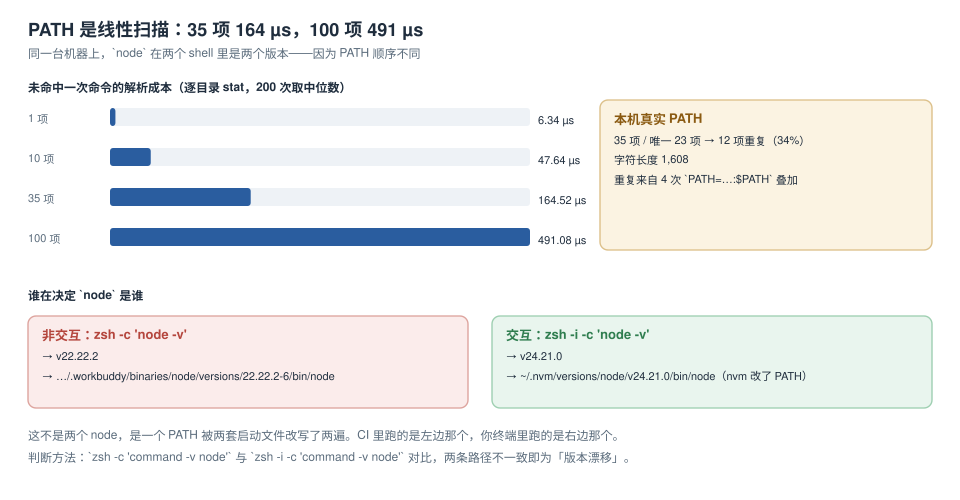

# PATH 与运行时版本：谁先被找到

`command not found` 和「版本不对」是同一件事的两个说法：它们都在问「这个名字最终落到了磁盘上哪个绝对路径」。`PATH` 是一个有序目录列表，shell 从左往右找第一个命中——所以**顺序就是优先级**，而顺序由一堆启动文件与版本管理器叠加决定，没人能靠记忆复现。

本页用两条实测把这件事钉住：PATH 的解析成本随项数线性增长；同一台机器上 `node` 在两种 shell 模式里是两个版本。



本页判据族 `PTH-A` ~ `PTH-H`，共 8 条。定义表在第六节。

## 一、解析是线性扫描，成本可以算

未命中一次命令，shell 要把 `PATH` 里每个目录与命令名拼一次，做一次 `stat`。本机实测（200 次取中位数）：

| PATH 项数 | 未命中一次耗时 | 相对 1 项 |
| --- | --- | --- |
| 1 项 | **6.34 µs** | 1.0× |
| 10 项 | **47.64 µs** | 7.5× |
| 35 项 | **164.52 µs** | 26.0× |
| 100 项 | **491.08 µs** | 77.5× |

近似线性，斜率约 **4.9 µs/项**。这个数看着很小，但它乘在两个地方：

1. **每次「命令不存在」的探测**：脚本里常见的 `command -v foo >/dev/null 2>&1 || install_foo` 判断，在长 PATH 上每次多花几百微秒；一个 bootstrap 脚本里几十处这种判断，就是几十毫秒。
2. **交互式补全与提示符**：每次按 Tab、每次重绘提示符，都可能触发多次解析。

::: tip 那「命中」是不是更便宜
不一定。命中成本取决于目标在列表里的**位置**——在第 1 项就是一次 `stat`，在第 35 项就是 35 次。所以「把常用的目录放前面」不只是习惯，是真实收益。
:::

## 二、去重：34% 是重复项

本机真实 `PATH`：**35 项，唯一 23 项**，重复 **12 项（34%）**，字符串总长 **1,608** 字符。来源是 `.zshrc` 与 `.zprofile` 里四处不同写法的追加：

```shell
export PATH=$MAVEN_HOME/bin:$PATH
PATH=$PATH:/usr/local/sbin
export PATH=$PATH:/usr/local/sbin
export PATH=/usr/local/sbin:$PATH
export PATH=${PATH}:/usr/local/mysql/bin
```

后三行把 `/usr/local/sbin` 放进去三次，而且**顺序不同**——`/usr/local/sbin:/usr/local/bin` 与 `/usr/local/bin:/usr/local/sbin` 是两种不同的优先级。这不会报错，只会让「哪个 `python3` 生效」变成不可预测。

### 两种去重写法，选一种

```zsh
# 写法 A：用 zsh 的 path 数组（推荐，自动与 PATH 双向同步）
typeset -U path                 # 声明去重
path=(/usr/local/sbin $path)    # 前插
path+=($HOME/.local/bin)        # 后插

# 写法 B：纯 sh 也能跑（CI 与容器里更通用）
prepend_path() {
  case ":$PATH:" in
    *":$1:"*) ;;                # 已存在则跳过
    *) PATH="$1:$PATH" ;;
  esac
}
prepend_path /usr/local/sbin
export PATH
```

实测 `path+=` 连 source 的膨胀效果（合成 `.zshrc`，每次 `source` 追加 3 项）：**1 次 → 10 项，2 次 → 13 项，3 次 → 16 项，5 次 → 22 项**。`typeset -U` 之后这个增长变为 0——这正是「幂等」在 shell 里的含义：**跑两遍和跑一遍结果一样**。

## 三、同一台机器上两个 node

本机在同一分钟内的两条命令：

```shell
$ zsh -c   'command -v node'
/Users/cuifendemac/.workbuddy/binaries/node/versions/22.22.2-6/bin/node
$ zsh -i -c 'command -v node'
/Users/cuifendemac/.nvm/versions/node/v24.21.0/bin/node
```

对应版本分别是 **v22.22.2** 与 **v24.21.0**。原因：nvm 在交互 shell 的初始化里把 `~/.nvm/versions/node/v24.21.0/bin` 插到了 `PATH` 最前面；非交互 shell 不读 `.zshrc`，于是走的是系统/宿主注入的那一项。

这类缺陷的判定只需一行，但**必须在同一个 shell 会话里对同一条命令做两次不同模式的探测**：

```shell
for m in "-c" "-i -c" "-l -i -c"; do
  printf '%-10s %s\n' "$m" "$(zsh $m 'command -v node')"
done
```

三种模式给出三种答案时，问题不在 node，在启动文件分层。**修法不是在 CI 里加 `export PATH`，而是让版本选择只发生在一个地方**：

| 做法 | 谁生效 | 适合 |
| --- | --- | --- |
| `.nvmrc` + 显式 `nvm use` | 所有 shell，但需要一步显式动作 | 本地开发 |
| `package.json` 的 `engines` + Corepack | `pnpm` / `yarn` 自动，`node` 需外部保证 | 项目内统一包管理器 |
| `.tool-versions`（asdf / mise） | 进入目录即生效（配合 shell 钩子） | 多语言同仓 |
| 容器镜像固定版本 | 容器内所有进程一致 | CI 与生产 |

::: danger 「在 CI 里 `export PATH` 一下就好了」
这是把缺陷搬了个位置：本地仍是两套版本，CI 里是第三套。一旦本地代码用到了 v24 才有的 API（例如新的 `RegExp` 标志），CI 用的 v22 会以「语法错误」的形式报在完全无关的行上。

**统一版本的正确位置是项目层（`.nvmrc` / `engines` / 镜像），不是某个 shell 的启动文件。**
:::

## 四、版本管理器：三种机制，三种代价

| 工具 | 机制 | 切换成本 | 典型坑 |
| --- | --- | --- | --- |
| nvm | 改写 `PATH` 指向具体版本目录 | `nvm use` 约 0.3~1 s（本机 `nvm exec` 跨版本 p50 **982.7 ms**） | 只在交互 shell 生效；不同窗口可不同版本 |
| fnm | 同样改 `PATH`，但用 Rust 实现 + `--use-on-cd` 钩子 | 显著更低（毫秒级） | 钩子依赖 shell 集成，非交互 shell 不触发 |
| asdf / mise | `shim` 目录放拦截脚本，运行时读 `.tool-versions` | 每次调用多一次 shim 解析 | shim 目录必须在 `PATH` 最前，且 shim 自身的解释器开销会叠加到每次调用 |
| volta | shim + 内置下载 | 一次安装后稳定 | 只覆盖 Node 生态 |

**shim 与 PATH 改写的关键差别**：PATH 改写是「切换时改一次、之后零成本」；shim 是「每次调用都过一次拦截脚本」。本机实测 `node -v` 直接调用 **25.6 ms**，而跨版本 `nvm exec` **982.7 ms**——同一个二进制，包装层不同，差 **38 倍**。

所以选型的第一问不是「哪个流行」，而是：**你的切换频率高还是调用频率高**。一天切 3 次版本、调用 3000 次命令 → 选 PATH 改写（nvm/fnm）；一天切 30 次、调用 300 次 → 选 shim（asdf/mise）。

## 五、`hash`：shell 的缓存会让你的修复延迟生效

zsh 会缓存「命令名 → 绝对路径」的映射（`hash` 表）。改了 `PATH` 之后，同名命令仍可能走旧路径：

```shell
$ hash -r          # 清空缓存（zsh 也可用 `rehash`）
$ hash             # 查看当前缓存
```

这条在「我明明改了 PATH 但 `which` 还是旧的」场景里是唯一解释。CI 里一般不会遇到（每次都是新进程），本地调试时经常遇到。

## 六、判据表

| 编号 | 看什么现象 | 判成什么 | 不满足时改哪里 |
| --- | --- | --- | --- |
| `PTH-A` | `PATH` 重复项为 0 | 有重复即不通过 | 用 `typeset -U path` 或 `prepend_path` |
| `PTH-B` | 同一命令在 `-c` 与 `-i -c` 下路径相同 | 不同即不通过 | 把版本选择收敛到项目层 |
| `PTH-C` | `PATH` 项数 ≤ 40 且有记录 | 超限或无记录即不通过 | 合并目录、删无效项 |
| `PTH-D` | 版本管理器初始化不重复改写 `PATH` | 每次 source 都增长即不通过 | 加存在性判断 |
| `PTH-E` | 切换版本后 `hash -r` 已执行 | 未执行即不通过 | 切换脚本里补一行 |
| `PTH-F` | 全局包安装目录与当前解释器一致 | 装完找不到即不通过 | 用 `npm prefix -g` 核对目录 |
| `PTH-G` | shim 目录位于 `PATH` 最前 | 不在最前即不通过 | 调整追加顺序 |
| `PTH-H` | CI 中 `node -v` 与 `.nvmrc` 一致 | 不一致即不通过 | CI 里显式 setup 或改用镜像 |

## 验证方式

```shell
# 1) 重复项（输出应为空）
echo "$PATH" | tr ':' '\n' | sort | uniq -d

# 2) 项数与字符长度
echo "$PATH" | tr ':' '\n' | wc -l
printf '%s\n' "${#PATH}"

# 3) 三种模式下的同一命令（应指向同一路径）
for m in "-c" "-i -c" "-l -i -c"; do printf '%-10s %s\n' "$m" "$(zsh $m 'command -v node')"; done

# 4) 全局包目录（应与当前 node 同前缀）
npm prefix -g; command -v node
```

预期：第 1 步为空；第 2 步本机基线是 35 / 1,608（未优化）；第 3 步三行一致；第 4 步两个前缀相同。

## 参考资料

- POSIX.1-2017：*Command Search and Execution*（`PATH` 的查找顺序与 `ENOEXEC` 处理）
- zsh 官方文档：*Parameters*（`path` 与 `PATH` 的双向绑定、`typeset -U`）、*Builtins*（`hash` / `rehash`）
- nvm 官方 README：`nvm use` / `nvm exec` / `--no-use`
- fnm 官方文档：`--use-on-cd`、`--version-file-strategy`
- asdf 官方文档：*Shims*（shim 的解析路径与性能说明）
- 本仓库相邻专题：[shell 启动链路](../ShellStartup/index.md)、[工具链](../../Toolchain/index.md)、[环境可复现](../Reproducibility/index.md)
