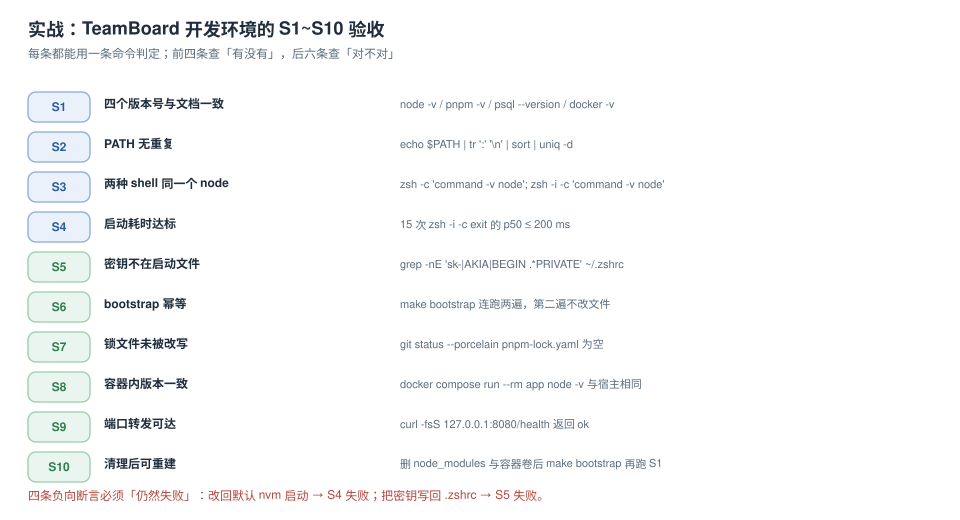

# 实战：一套可验收的开发环境

前面九页讲的都是单点判据，本页把它们串成一条**可执行、可复跑、可否定**的路径：以本库的 TeamBoard 项目为例，从一台干净机器走到「能跑起来、能跑测试、能提交」，并给出十条验收与四条负向断言。

选 TeamBoard 是因为它的依赖面刚好覆盖四层：node 运行时（运行时层）、pnpm 与锁文件（项目层）、PostgreSQL + Redis 容器（项目层）、shell 脚本与 `make`（shell 层）。



本页判据族 `BST-A` ~ `BST-H`，共 8 条。定义表在第六节。

## 一、版本矩阵：先写下来，再要求一致

| 组件 | 版本 | 谁读它 | 校验命令 |
| --- | --- | --- | --- |
| Node.js | **24.21.0**（`.nvmrc` 写 `24.21.0`） | `nvm use`、CI 的 setup-node | `node -v` |
| pnpm | **12.8.1**（`packageManager` 字段） | Corepack | `pnpm -v` |
| PostgreSQL | **18.6**（`compose.yaml` 镜像 tag） | docker compose | `psql --version` / `docker compose ps` |
| Redis | **8.2** | docker compose | `docker compose ps` |
| Docker Engine | **27.1.1** / Compose **v2.29.1** | 脚本里的 `docker compose` | `docker -v` |
| Make | 系统自带 | `make bootstrap` | `make -v` |

::: info 为什么版本矩阵要写进 README 而不是只写在 `.nvmrc`
`.nvmrc` 只钉住 node。psql 客户端、compose 版本、`make` 这些**不在任何锁文件里**的东西，只能靠文档传递。S1 的作用就是把「文档写的」与「机器上的」对齐——它是唯一能发现「文档过期」的验收。
:::

## 二、六步基线：从干净机器到能开工

| 步 | 动作 | 判定 | 失败时看哪 |
| --- | --- | --- | --- |
| 1 | 确认架构与系统版本 | `uname -m` 与镜像架构一致 | [四层边界](../Overview/index.md) 必失点① |
| 2 | 装 shell 框架，控制启动耗时 | `zsh -i -c exit` p50 ≤ 200 ms | [启动预算](../StartupBudget/index.md) |
| 3 | 装 node 与 pnpm，锁版本 | `node -v`、`pnpm -v` 与矩阵一致 | [PATH 与运行时](../PathAndRuntime/index.md) |
| 4 | 起依赖服务 | `docker compose ps` 全 `healthy` | [环境可复现](../Reproducibility/index.md) |
| 5 | 装依赖并建库 | `pnpm install --frozen-lockfile` 成功、`pnpm db:migrate` 成功 | 锁文件 / 迁移 |
| 6 | 跑冒烟 | `pnpm test:smoke` 全绿 | 依赖服务是否真的可用 |

六步的顺序不能换：第 4 步没起来就跑第 5 步，`db:migrate` 会以「连接被拒」失败，而这个报错会把人引向「数据库配置错」——实际上是容器还没 healthy。

## 三、bootstrap：一个入口、三个目标

```makefile
# Makefile
.PHONY: bootstrap deps services db check smoke

bootstrap: deps services db check     # 一条命令走完四步

deps:                                  # ① 依赖
	@need=$(tr -d 'v \n' < .nvmrc); have=$$(node -v 2>/dev/null | tr -d 'v' || echo none); \
	  [ "$$need" = "$$have" ] || { echo "node 需要 $$need，当前 $$have"; exit 1; }
	corepack enable
	pnpm install --frozen-lockfile

services:                              # ② 依赖服务
	docker compose up -d --wait postgres redis

db:                                    # ③ 建库与迁移
	pnpm db:migrate

check:                                 # ④ 自检并打印版本矩阵
	@printf 'node=%s pnpm=%s pg=%s redis=%s\n' \
	  "$$(node -v)" "$$(pnpm -v)" \
	  "$$(docker compose exec -T postgres postgres --version | awk '{print $$3}')" \
	  "$$(docker compose exec -T redis redis-server --version | awk '{print $$3}' | cut -d= -f2)"
```

`--wait` 是关键：它让 `docker compose up` **等到 healthy 才返回**，而不是「容器已启动」就返回。「已启动」与「可用」之间差着一次初始化，这正是第 4 步最常见的坑。

::: danger `depends_on` 不保证可用
```yaml
# 错的：只保证启动顺序
depends_on: [postgres]
# 对的：等到健康检查通过
depends_on:
  postgres:
    condition: service_healthy
```

裸写 `depends_on` 时，应用启动比数据库初始化快，于是第一次连接被拒，而容器状态全是 `Up`。日志里能看到 `connection refused` → 重试 → 成功的序列，很容易被当成「偶发」放过。
:::

## 四、S1~S10 验收：每条一条命令

| 编号 | 验收项 | 命令 | 期望 |
| --- | --- | --- | --- |
| S1 | 版本矩阵与 README 一致 | `node -v; pnpm -v; docker -v` | 三行与矩阵逐字相符 |
| S2 | `PATH` 无重复 | `echo "$PATH" \| tr ':' '\n' \| sort \| uniq -d` | 无输出 |
| S3 | 两种 shell 同一个 node | `zsh -c 'command -v node'; zsh -i -c 'command -v node'` | 两行路径相同 |
| S4 | 启动耗时达标 | 15 次 `zsh -i -c exit` 取 p50 | ≤ 200 ms |
| S5 | 启动文件无密钥 | `grep -nE 'sk-\|AKIA\|BEGIN .*PRIVATE' ~/.zshrc` | 无输出 |
| S6 | bootstrap 幂等 | `make bootstrap` 连跑两遍后 `git status --porcelain` | 空 |
| S7 | 锁文件未被改写 | `git status --porcelain pnpm-lock.yaml` | 空 |
| S8 | 容器内版本一致 | `docker compose run --rm --no-deps app node -v` | 与 S1 相同 |
| S9 | 服务可达 | `curl -fsS 127.0.0.1:8080/health` | `200` 与 `ok` |
| S10 | 清理后可重建 | 删 `node_modules` + `docker compose down -v` 后 `make bootstrap`，再跑 S1 | 全部重新通过 |

### 四条负向断言（必须仍然失败）

验收的价值一半在「正向能过」，另一半在「负向仍然失败」。只做正向的验收，会在环境被悄悄改坏之后照样全绿。

| 负向断言 | 怎么造 | 期望结果 |
| --- | --- | --- |
| N1 | 把 nvm 初始化改回不带 `--no-use` | **S4 失败**（p50 > 500 ms） |
| N2 | 把一行假密钥写回 `~/.zshrc` | **S5 失败**（grep 命中） |
| N3 | 在 `PATH` 前面插一个重复目录 | **S2 失败**（出现重复项） |
| N4 | 在容器里挂载宿主 `node_modules` | **S8 失败**（原生模块报错） |

造完必须还原，并把「还原」也写成一条命令：

```shell
git -C ~/.dotfiles checkout -- .          # 还原启动文件
docker compose down -v && make bootstrap  # 还原容器与依赖
```

## 五、复跑：把验收变成一条命令

```shell
#!/bin/sh
# verify.sh —— 十条验收合成一个退出码
set -u
fail=0
chk() { printf '%-4s %-28s ' "$1" "$2"; shift 2; if "$@" >/dev/null 2>&1; then echo PASS; else echo FAIL; fail=1; fi; }

chk S2  "PATH 无重复"      sh -c '[ -z "$(echo "$PATH" | tr ":" "\n" | sort | uniq -d)" ]'
chk S3  "两模式同一 node"  sh -c '[ "$(zsh -c "command -v node")" = "$(zsh -i -c "command -v node")" ]'
chk S5  "启动文件无密钥"    sh -c '! grep -qE "sk-[A-Za-z0-9]{16,}" ~/.zshrc'
chk S7  "锁文件未改写"      sh -c '[ -z "$(git status --porcelain pnpm-lock.yaml)" ]'
chk S9  "健康检查可达"      curl -fsS -m 3 http://127.0.0.1:8080/health

[ "$fail" -eq 0 ] && echo "ALL PASS" || { echo "HAS FAIL"; exit 1; }
```

S1、S4、S6、S8、S10 需要人或较长时间，留在人工清单里；脚本覆盖的是**能在 5 秒内跑完的五条**——这五条恰好是「最容易被悄悄改坏」的那五条。

## 六、判据表

| 编号 | 看什么现象 | 判成什么 | 不满足时改哪里 |
| --- | --- | --- | --- |
| `BST-A` | 版本矩阵六行写进 README 且 S1 全对 | 缺行或对不上即不通过 | 补矩阵或修机器 |
| `BST-B` | `make bootstrap` 是唯一入口 | 多个手工步骤即不通过 | 收敛到 Makefile |
| `BST-C` | 服务启动用 `--wait` / `service_healthy` | 裸 `depends_on` 即不通过 | 改 compose |
| `BST-D` | S1~S10 十条验收都有命令与期望 | 缺期望值即不通过 | 补「期望」列 |
| `BST-E` | 四条负向断言造得出来且确实失败 | 造不出即不通过 | 按第四节造 |
| `BST-F` | 负向造完后有还原命令 | 只造不还原即不通过 | 补还原步骤 |
| `BST-G` | 五条快检合成一个脚本、退出码可判 | 靠肉眼比对即不通过 | 写 `verify.sh` |
| `BST-H` | S10（清理后重建）真实跑过一次 | 没跑过即不通过 | 删依赖与卷后重建 |

## 验证方式

```shell
# 1) 一条命令从零到能跑（首次约 3~8 分钟，取决于下载）
make bootstrap

# 2) 十条验收里的快检
./verify.sh          # 期望末行 ALL PASS

# 3) 幂等
make bootstrap >/dev/null && git status --porcelain    # 期望空

# 4) 清理后重建（最彻底的一条）
rm -rf node_modules && docker compose down -v && make bootstrap
```

预期：第 1 步末尾打印四行版本矩阵；第 2 步 `ALL PASS`；第 3 步无输出；第 4 步重跑后第 2 步仍能 `ALL PASS`。第 4 步失败通常意味着「有一份依赖只存在于某人的机器上」，而不是「bootstrap 写错了」。

## 参考资料

- GNU Make 官方手册：*Phony Targets*、*Recipe Syntax*（`$$` 转义）
- Docker Compose 官方文档：`up --wait`、`depends_on.condition`
- Corepack 官方文档：`packageManager` 字段的启用方式
- TeamBoard 项目章节：[多租户与隔离](../../../../project/Complete/TeamBoard/MultiTenancy/index.md)、[技术选型与版本基线](../../../../project/Complete/TeamBoard/TechStack/index.md)
- 本仓库相邻专题：[环境可复现](../Reproducibility/index.md)、[启动预算](../StartupBudget/index.md)、[密钥卫生](../Secrets/index.md)
