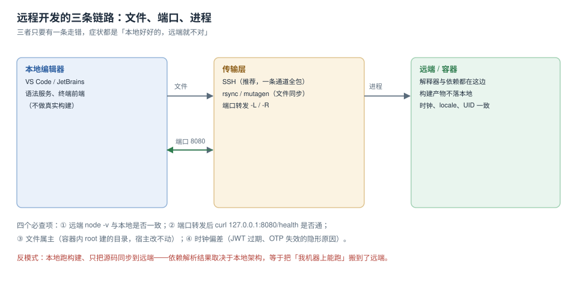

# 远程开发：文件、端口、进程

远程开发的本质是**把「在这台机器上执行」拆成三件事**：文件在哪、端口怎么通、进程跑在哪。三者只要有一条走错，症状都长成「本地好好的，远端就不对」——因为你在本地看到的文件和远端执行的代码已经不是同一份。



本页判据族 `RMT-A` ~ `RMT-H`，共 8 条。定义表在第五节。

## 一、三条链路，各自的一致性判据

| 链路 | 常见做法 | 一致性判据 | 破坏后的症状 |
| --- | --- | --- | --- |
| 文件 | SSH FS / VS Code Remote / rsync / mutagen | 本地与远端的文件哈希一致 | 改了没生效、`git status` 两边不同 |
| 端口 | `ssh -L` / `ssh -R` / 编辑器自动转发 | `curl 127.0.0.1:<port>/health` 通 | 页面打不开、热更新连不上 |
| 进程 | 远端 shell / 容器内 exec | 远端 `node -v` 与 `.nvmrc` 一致 | 构建产物在本地架构上生成 |

一条纪律贯穿三者：**构建必须发生在「进程」那条链路的终点**。在本地跑构建、只把源码同步过去，等于把本地架构与本地依赖树一起搬到远端——只是换了个地方复现「我机器上能跑」。

## 二、文件：三种同步方式的代价

| 方式 | 机制 | 延迟 | 适合 | 风险 |
| --- | --- | --- | --- | --- |
| 远端挂载（SSH FS / 编辑器 Remote） | 读文件时按需拉取 | 每次 IO 一次网络往返 | 小项目、低频读写 | `node_modules` 里几万个小文件会把编辑器拖死 |
| `rsync`（手动或钩子） | 全量/增量同步 | 同步那一刻 | 构建机、部署 | 忘记同步、`--delete` 误删远端 |
| `mutagen` / `unison` | 双向实时同步 | 秒级 | 大项目、需要双向 | 冲突时生成 `.sync-conflict` 文件 |

**排除清单比同步本身更重要**。以下目录永远不要同步：

```shell
rsync -az --delete \
  --exclude '.git/' --exclude 'node_modules/' --exclude 'dist/' \
  --exclude '.venv/' --exclude '__pycache__/' \
  ./ deploy@host:/srv/app/
```

`node_modules` 不同步的理由不是体积，而是**原生模块按架构编译**：本地 x86 的 `binding.node` 到 arm 远端直接报 `Module did not self-register`。

## 三、端口：`-L` 与 `-R` 的区别，一句话说清

```shell
# 本地 8080 → 远端 8080（你访问 localhost，实际打到远端）
ssh -N -L 8080:127.0.0.1:8080 deploy@host

# 远端 9000 → 本地 3000（远端进程访问 localhost:9000，实际打到你的机器）
ssh -N -R 9000:127.0.0.1:3000 deploy@host
```

记忆法：**`-L` 是把远端的服务拉到本地，`-R` 是把本地的服务推到远端**。二者都默认只监听 `127.0.0.1`——这正是安全默认值，别为了「让同事也能访问」改成 `0.0.0.0`。

::: danger 三个「端口通了但连不上」的原因
1. **服务只听 `127.0.0.1`，而你连的是容器 IP**：容器内 `--host 0.0.0.0` 才对外可连，很多 dev server 默认只听 loopback。
2. **`-L` 的目标写成了 `localhost`**：在远端解析 `localhost` 可能命中 IPv6 `::1`，而服务只听 IPv4。改成 `127.0.0.1`。
3. **热更新的 WebSocket 端口没转发**：页面能开、保存不刷新。看浏览器控制台的 `ws://` 地址，把它也加一条 `-L`。
:::

## 四、时钟与属主：两个不报错的不一致

| 项 | 现象 | 判定命令 | 修法 |
| --- | --- | --- | --- |
| 时钟偏差 | JWT 一签发就过期、OTP 校验失败、日志时间错位 | `date -u; ssh host date -u` | 开 NTP；容器内不覆盖宿主时钟 |
| 文件属主 | 容器内 root 建的目录，宿主改不动、`git` 报 dubious ownership | `ls -ln`、`git status` 的提示 | 容器内用非 root 用户 + 固定 UID 映射 |

时钟偏差超过 30 秒时，很多「凭据无效」的报错其实与凭据无关。这条在跨时区团队里最常见：远端是 UTC、本地是 +08，`date` 看着差 8 小时，但如果两边时区正确，`date -u` 应当一致——**判据要用 `-u`，不要看本地时间**。

## 五、一次远程排查的完整时间线

「远端不对」的排查最忌跳步。下面这条顺序**每一步都有一个可观测的输出**，任一步输出异常就停在那里，不要往下走：

| 序 | 动作 | 命令 | 异常说明什么 |
| --- | --- | --- | --- |
| 1 | 确认连的是哪台机器 | `ssh host 'hostname; uname -m'` | 连错机器 / 连到大盘而不是应用机 |
| 2 | 确认代码是哪一版 | `ssh host 'cd /srv/app && git rev-parse --short HEAD'` | 同步没生效 / 部署了旧镜像 |
| 3 | 确认解释器是哪一版 | `ssh host 'node -v'` | 与 `.nvmrc` 不一致 |
| 4 | 确认依赖装没装 | `ssh host 'cd /srv/app && ls node_modules/.bin'`（看是否有输出） | 依赖没装 / 装错架构 |
| 5 | 确认进程在不在 | `ssh host 'ss -ltnp'` 中找 `:8080` | 进程没起 / 起在别的端口 |
| 6 | 确认端口通不通 | `ssh -N -L 8080:127.0.0.1:8080 host &` 后 `curl -fsS 127.0.0.1:8080/health` | 转发没建 / 服务只听容器内网 |
| 7 | 确认日志说了什么 | `ssh host 'journalctl -u app -n 50 --no-pager'` | 前六步都对，问题在业务逻辑 |

六步里最容易跳过的是第 2 步。**「我明明推了」与「远端跑的是哪个 commit」是两件事**——CI 失败、镜像 tag 复用、同步脚本的 `--delete` 把新文件删掉，都会让两者分叉，而症状完全一样。

## 六、远程开发的三种形态与代价

| 形态 | 文件在哪 | 进程在哪 | 适合 | 主要代价 |
| --- | --- | --- | --- | --- |
| 远端挂载（编辑器 Remote-SSH） | 远端磁盘 | 远端 | 单机开发、需要远端资源 | 每次 IO 一次网络往返，`node_modules` 会拖慢索引 |
| 本地编辑 + 同步（rsync / mutagen） | 本地为主 | 远端 | 网络差、需要离线编辑 | 同步延迟与冲突文件 |
| 全容器（devcontainer + 远端 Docker） | 容器卷 | 容器 | 团队一致、CI 同构 | 首次构建慢，卷挂载有性能损耗 |

三种形态的**判据是同一条**：`ssh host 'cd /srv/app && node -v && git rev-parse --short HEAD'` 的输出，与你本地 `node -v && git rev-parse --short HEAD` 一致。不一致就说明你处于「混合形态」——本地跑一半、远端跑一半，这类配置的问题最难复现。

## 七、判据表

| 编号 | 看什么现象 | 判成什么 | 不满足时改哪里 |
| --- | --- | --- | --- |
| `RMT-A` | 远端 `node -v` 与 `.nvmrc` 一致 | 不一致即不通过 | 远端按 `.nvmrc` 安装 |
| `RMT-B` | 构建发生在远端或容器内 | 本地构建后同步产物即不通过 | 把 `build` 放到远端执行 |
| `RMT-C` | 文件同步排除 `node_modules` / `dist` / `.git` | 未排除即不通过 | 补 `--exclude` |
| `RMT-D` | 端口转发后 `curl 127.0.0.1:<port>/health` 返回 200 | 不通即不通过 | 检查监听地址与 `-L` 目标 |
| `RMT-E` | WebSocket 端口也已转发 | 页面不热更新即不通过 | 补一条 `-L` |
| `RMT-F` | `date -u` 两侧一致（±5 s） | 偏差超限即不通过 | 开 NTP / 校时 |
| `RMT-G` | 容器内文件属主为映射用户 | `root` 属主即不通过 | 用 `remoteUser` + UID 映射 |
| `RMT-H` | 远端 `git status` 与本地一致 | 显示不同文件即不通过 | 修同步规则而非强推 |

## 一次完整演练：从「远端不对」到定位

七步时间线的用法不是从头跑到尾，而是**从最可能的一步切进去**。三种典型切法：

| 症状 | 从第几步切入 | 为什么 |
| --- | --- | --- |
| 页面 404 | 第 2 步（commit） | 八成是部署了旧版本，代码根本没上去 |
| 页面 502 | 第 5 步（进程） | 进程没起或起在别的端口，转发是通的 |
| 接口报错但页面正常 | 第 7 步（日志） | 进程与端口都对，问题在业务 |
| 保存不刷新 | 第 6 步（端口） | 主端口通了，WebSocket 端口没转发 |

每一次切进去，**输出都必须被记下来**（commit、端口、版本）。这不是形式主义：远端排查的第二次往往在两天后、由另一个人做，而「上次查到哪一步」是唯一能省下时间的线索。

## 验证方式

```shell
# 1) 远端运行时版本
ssh deploy@host 'cd /srv/app && node -v'      # 与 .nvmrc 一致

# 2) 端口可达（转发已建立的前提下）
curl -fsS -m 3 http://127.0.0.1:8080/health   # 期望 200 与 ok

# 3) 时钟（两侧都用 -u）
date -u; ssh deploy@host date -u

# 4) 文件一致性（比对单个关键文件的哈希）
shasum -a 256 package.json | cut -c1-16
ssh deploy@host 'shasum -a 256 /srv/app/package.json' | cut -c1-16
```

预期：第 1 步版本相同；第 2 步返回 200；第 3 步两行时间差在 5 秒内；第 4 步两个哈希前缀相同。第 4 步不一致时，先查同步规则，**不要先查代码**。

## 参考资料

- OpenSSH 官方手册：`ssh(1)` 的 `-L` / `-R` / `-N` / `ExitOnForwardFailure`
- VS Code 官方文档：*Remote Development*（`Remote - SSH`、`Dev Containers`、端口转发）
- mutagen 官方文档：*Synchronization modes*（two-way-safe / one-way-replica）
- rsync 官方手册：`--delete`、`--exclude-from`、`-a` 的语义
- git 官方文档：`safe.directory`（属主不一致导致 `dubious ownership`）
- 本仓库相邻专题：[远程开发（编辑器侧）](../../IDE/RemoteDev/index.md)、[环境可复现](../Reproducibility/index.md)、[容器](../../../Ops/Docker/index.md)
