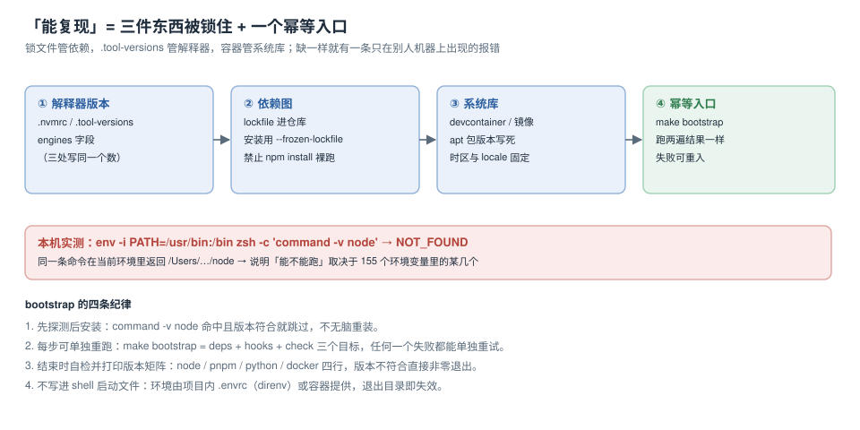

# 环境可复现：锁住三件东西

「在我机器上能跑」这句话之所以无法反驳，是因为它没说是哪台机器。可复现的严格定义是：**在一台干净的机器上，按仓库里的文字步骤执行，得到同一个结果**。要让这句话成立，需要三样东西被锁住（解释器版本、依赖图、系统库），加一个幂等入口（跑两遍结果一样）。

本页的两个读数都很朴素，但都是判定「锁没锁住」的直接证据：同一条命令在空环境里返回 `NOT_FOUND`；当前环境里有 **155** 个变量在参与决定它能不能跑。



本页判据族 `RPR-A` ~ `RPR-H`，共 8 条。定义表在第六节。

## 一、判定的最小实验：`env -i`

复现性不是靠「我觉得都装了」来判断，而是靠**把环境剥空再跑一次**：

```shell
$ env -i PATH=/usr/bin:/bin zsh -c 'command -v node || echo NOT_FOUND'
NOT_FOUND
$ zsh -c 'command -v node'
/Users/cuifendemac/.workbuddy/binaries/node/versions/22.22.2-6/bin/node
```

第一条命令只保留了 `PATH=/usr/bin:/bin`，`node` 就不存在了。这说明：**「这台机器能跑」依赖的不是安装，而是环境变量**——具体是哪几个，取决于你的 155 个变量里哪些被用到了。

`env -i` 的三种用法，价值依次递增：

| 用法 | 证明什么 |
| --- | --- |
| `env -i PATH=/usr/bin:/bin cmd` | 命令是否依赖额外环境 |
| `env -i HOME=$HOME PATH=... make bootstrap` | bootstrap 是否依赖你的 shell 配置 |
| `docker run --rm -v "$PWD":/w -w /w <image> make bootstrap` | 系统库与解释器是否也锁住了 |

只有第三种能证明「换一台机器也行」。前两种只能证明「不依赖 shell 配置」。

## 二、三件要锁的东西

### ① 解释器版本：同一份数字写三处，且能被校验

| 位置 | 谁读它 | 作用 |
| --- | --- | --- |
| `.nvmrc` | `nvm use` / CI 的 setup-node | 本地与 CI 的 node 版本 |
| `.tool-versions` | asdf / mise | 多语言同仓时的统一入口 |
| `package.json` 的 `engines` | `pnpm install` 的告警 | 安装期的软校验 |

三处写同一个版本号，问题不是冗余，而是**它们会漂**。所以必须有一条命令能一次比对三处：

```shell
# 三处版本必须一致：.nvmrc / package.json engines / 实际运行版本
want_nvmrc=$(tr -d 'v \n' < .nvmrc)
want_engine=$(node -p "require('./package.json').engines.node.replace(/[^0-9.]/g,'')" 2>/dev/null || echo none)
have=$(node -v | tr -d 'v')
printf 'nvmrc=%s engine=%s actual=%s\n' "$want_nvmrc" "$want_engine" "$have"
[ "$want_nvmrc" = "$have" ] && echo VERSION_OK || echo VERSION_MISMATCH
```

::: tip `engines` 不是强制，`packageManager` 才是
`engines` 默认只在安装时打印告警（`EBADENGINE`）。真正会把包管理器版本钉死的是 `packageManager` 字段配合 Corepack：

```json
{ "packageManager": "pnpm@12.8.1" }
```

从此 `pnpm` 命令的版本由仓库决定，不由某台机器上的全局安装决定。
:::

### ② 依赖图：锁文件必须进仓库，安装必须走锁文件

| 命令 | 会不会改锁文件 | 什么时候用 |
| --- | --- | --- |
| `pnpm install` | 可能（依赖有更新时） | 本地加依赖 |
| `pnpm install --frozen-lockfile` | 不会，且不一致时**报错** | CI、bootstrap、容器构建 |
| `npm ci` | 不会，`package-lock.json` 与 `package.json` 不一致直接失败 | npm 项目 |

`--frozen-lockfile` 的价值不在于快，而在于**把「锁文件与 manifest 不一致」变成一个立即失败的构建**，而不是一次静默的依赖升级。

### ③ 系统库：容器或 devcontainer 才能锁住

解释器与依赖都锁了，仍然会失败在系统库上：`libvips` 版本不一致导致图片处理结果不同、`icu` 版本不同导致 `Intl` 格式化输出不同、时区数据库不同导致日期差一天。这类差异**只出现在跨机器**，本地永远复现不出来。

## 三、devcontainer：把四层压成一份

```json
{
  "name": "teamboard-dev",
  "image": "mcr.microsoft.com/devcontainers/base:bookworm",
  "features": {
    "ghcr.io/devcontainers/features/node:1": { "version": "24.21.0" },
    "ghcr.io/devcontainers/features/docker-in-docker:1": {}
  },
  "containerEnv": { "TZ": "Asia/Shanghai", "LANG": "C.UTF-8" },
  "postCreateCommand": "corepack enable && pnpm install --frozen-lockfile",
  "remoteUser": "vscode"
}
```

四个字段各自解决一类漂移：

| 字段 | 锁住什么 | 不写的后果 |
| --- | --- | --- |
| `image` | 系统库、`apt` 源 | 换台机器 `libvips` 版本就变 |
| `features` | 解释器与工具版本 | 镜像里的 node 太老 |
| `containerEnv` | 时区、locale | 日期与排序在不同机器上不同 |
| `postCreateCommand` | 依赖安装方式 | 有人 `pnpm install`、有人 `npm i` |

::: danger 容器里最常被破坏的一条：把宿主 `node_modules` 挂进去
为了「改代码即时生效」，很多人把项目目录整体挂载，包括 `node_modules`。后果是：容器内的 `node` 是 24，`node_modules` 里的原生模块却是宿主（架构或版本不同）编译的，报错长这样：

```text
Error: Module did not self-register: '.../binding.node'
```

修法是在容器里用**匿名卷**盖住这个目录，让容器自己装：

```yaml
volumes:
  - .:/workspace
  - /workspace/node_modules      # 匿名卷，容器内独立
```
:::

## 四、bootstrap：幂等的四条纪律

```makefile
.PHONY: bootstrap deps hooks check
bootstrap: deps hooks check

deps:
	@command -v node >/dev/null || { echo "缺 node，见 README"; exit 1; }
	@corepack enable
	pnpm install --frozen-lockfile

hooks:
	@git config core.hooksPath .githooks && echo "hooks: ok"

check:
	@printf 'node=%s pnpm=%s docker=%s\n' "$$(node -v)" "$$(pnpm -v)" "$$(docker -v | awk '{print $$3}' | tr -d ,)"
```

| 纪律 | 为什么 | 反例 |
| --- | --- | --- |
| 先探测后安装 | 避免每次重装、避免版本被覆盖 | 无条件 `curl … sh` 装最新版 |
| 每步可单独重跑 | 失败时只重试坏的那一步 | 一个巨型脚本，失败只能从头来 |
| 结束打印版本矩阵 | 让人能贴进 issue | 只打印 `done` |
| 不写进 shell 启动文件 | 环境属于项目，不属于人 | 在 `.zshrc` 里 `export DATABASE_URL` |

::: warning 「先探测后安装」的一个真实反例
`command -v node` 命中但版本是 18，脚本直接跳过安装，后面 `pnpm install` 报 `Unsupported engine`。所以探测必须**同时判存在与版本**：

```shell
need=$(tr -d 'v' < .nvmrc)
have=$(node -v 2>/dev/null | tr -d 'v' || echo none)
[ "$need" = "$have" ] || { echo "node 需要 $need，当前 $have"; exit 1; }
```
:::

## 五、判据表

| 编号 | 看什么现象 | 判成什么 | 不满足时改哪里 |
| --- | --- | --- | --- |
| `RPR-A` | `.nvmrc`（或 `.tool-versions`）存在且与 `node -v` 一致 | 不一致即不通过 | 统一版本并重装 |
| `RPR-B` | 锁文件进仓库且 CI 用 `--frozen-lockfile` | 用裸 `install` 即不通过 | 改 CI 与 bootstrap |
| `RPR-C` | `env -i` 下 bootstrap 能跑到第一个真实失败点 | 直接 `NOT_FOUND` 即不通过 | 在脚本里显式声明依赖 |
| `RPR-D` | `make bootstrap` 连跑两遍结果一致 | 第二遍有新改动即不通过 | 去掉无条件覆盖 |
| `RPR-E` | 容器内 `node -v` 与 `.nvmrc` 一致 | 不一致即不通过 | 修 `features` 版本 |
| `RPR-F` | `node_modules` 在容器内是独立卷 | 挂载宿主目录即不通过 | 加匿名卷 |
| `RPR-G` | `TZ` 与 `LANG` 在容器内显式设置 | 依赖宿主默认即不通过 | 补 `containerEnv` |
| `RPR-H` | 版本矩阵四行打印在 bootstrap 末尾 | 只打印 done 即不通过 | 补 `check` 目标 |

## 验证方式

```shell
# 1) 空环境：应当停在「缺 node」，而不是停在某个未知错误
env -i PATH=/usr/bin:/bin HOME="$HOME" make bootstrap

# 2) 幂等：第二遍不应产生任何文件改动
make bootstrap >/dev/null && git status --porcelain | grep -v '^$' || echo CLEAN

# 3) 版本三处一致
printf 'nvmrc=%s actual=%s\n' "$(tr -d 'v \n' < .nvmrc)" "$(node -v | tr -d 'v')"

# 4) 容器内一致性（需要 docker）
docker compose run --rm --no-deps app node -v
```

预期：第 1 步以「缺 node」的**明确提示**退出（这就是「显式声明依赖」的效果）；第 2 步输出 `CLEAN`；第 3 步两值相等；第 4 步与 `.nvmrc` 相同。

## 参考资料

- Node.js 官方文档：*package.json* 的 `engines` 与 `packageManager` 字段、Corepack
- pnpm 官方文档：`--frozen-lockfile`、`pnpm install --offline`
- npm 官方文档：`npm ci` 与 `package-lock.json` 的一致性检查
- devcontainers 规范：*devcontainer.json reference*（`features` / `containerEnv` / `postCreateCommand` / `mounts`）
- Docker 官方文档：*Volumes*（匿名卷与绑定挂载的覆盖顺序）
- 本仓库相邻专题：[PATH 与运行时版本](../PathAndRuntime/index.md)、[容器](../../../Ops/Docker/index.md)、[流水线设计](../../CICD/PipelineDesign/index.md)
