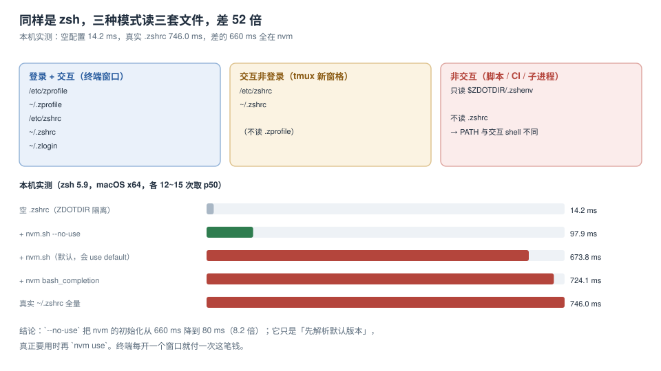

# shell 启动链路：746 ms 花在哪

打开一个终端窗口，在你敲下第一个字符之前，shell 已经执行了几十个文件：`/etc/zshenv`、`~/.zshenv`、`/etc/zprofile`、`~/.zprofile`、`/etc/zshrc`、`~/.zshrc`、`~/.zlogin`，以及它们各自 `source` 的东西。这段执行没有输出，所以没人看得见它——直到某天你发现自己每次开会前都要等一秒才能敲 `git status`。

本页只做两件事：说清**哪些文件在什么模式下被执行**，以及**怎么在不改自己配置的前提下把耗时拆到每一段**。



本页判据族 `SHL-A` ~ `SHL-H`，共 8 条。定义表在第七节。

## 一、三种模式，三套文件

zsh 的启动文件按**两个维度**决定读哪些：是不是**登录** shell（`-l`，或终端模拟器把 shell 作为登录进程启动），是不是**交互** shell（`-i`，有提示符、能读键盘）。

| 文件 | 登录 + 交互 | 交互非登录 | 非交互 | 说明 |
| --- | --- | --- | --- | --- |
| `/etc/zshenv` | ✅ | ✅ | ✅ | **唯一对所有模式都执行**的文件，改它影响一切 |
| `~/.zshenv` | ✅ | ✅ | ✅ | 同上；`PATH` 写这里，CI 也会背上 |
| `/etc/zprofile` | ✅ | — | — | 登录专有 |
| `~/.zprofile` | ✅ | — | — | 放 `path_helper`、`brew shellenv` 一类 |
| `/etc/zshrc` | ✅ | ✅ | — | 交互专有 |
| `~/.zshrc` | ✅ | ✅ | — | 别名、补全、提示符、版本管理器 |
| `~/.zlogin` | ✅ | — | — | 登录后最后执行 |

三条推论，是本页后面所有结论的基础：

1. **`~/.zshrc` 对非交互 shell 不执行**：`zsh -c 'node -v'`、`make`、CI 里的 `run:` 步骤，都看不到你在 `.zshrc` 里写的别名与 `PATH` 追加。

   ::: danger 这一条是「本地能跑、CI 不行」的第一大来源
   `.zshrc` 里 `export PATH="$HOME/.nvm/versions/node/v24.21.0/bin:$PATH"`，终端里 `node -v` 是 v24，CI 的 `run: node -v` 是镜像自带的 v20。**它不是「环境不一致」，而是「这段代码在 CI 里根本没执行」**。
   正确做法：版本选择用 `.nvmrc` / `.tool-versions` + 项目内 bootstrap，或在 CI 里显式 `actions/setup-node`。
   :::

2. **`~/.zshenv` 是唯一会污染一切的切入点**：为了「让 GUI 应用也能读到环境变量」，很多人把 `export` 搬进 `.zshenv`。代价是每个子进程（包括编辑器、构建、CI 里被调起的 shell）都执行它。**除了 `PATH` 与极少数真正全局的变量，别往这里放东西。**

3. **登录 shell 比交互 shell 多读两个文件**：本机实测登录+交互 **893.7 ms**、交互 **907.6 ms**——在这台机器上二者几乎相同，因为成本被 `.zshrc` 里的 nvm 完全主导。当 `.zshrc` 很轻时，`.zprofile` 的差异才会显出来（常常是 `brew shellenv` 与 `path_helper`）。

## 二、把耗时拆到每一段（不改自己的配置）

想优化就得先归因，而归因最怕「改了配置再测」——改坏了回不去，改错了也说不清是哪一行。做法是用 `ZDOTDIR` 把 shell 指到一个**临时目录**，在那里放一个只含待测片段的 `.zshrc`：

```shell
mkdir -p /tmp/zdot-probe
: > /tmp/zdot-probe/.zshrc                 # 先测空配置基线
for i in {1..15}; do
  ZDOTDIR=/tmp/zdot-probe /usr/bin/time -p zsh -i -c exit
done 2>&1 | grep real | awk '{print $2}' | sort -n | sed -n '8p'
```

`sed -n '8p'` 取的是 15 次里的中位数。**不要看单次**：同一条命令在本机会在 12~22 ms 之间跳，单次读数的误差足以把结论带偏一个数量级。

然后把片段一行一行加进 `/tmp/zdot-probe/.zshrc`，每加一段测一次。本机结果：

| 加到 `.zshrc` 里的内容 | p50 | 相对上一行 |
| --- | --- | --- |
| 空 | **14.2 ms** | 基线 |
| `autoload -Uz compinit && compinit` | — | 见下表 |
| `source "$NVM_DIR/nvm.sh" --no-use` | **97.9 ms** | +83.7 ms |
| `source "$NVM_DIR/nvm.sh"`（默认） | **673.8 ms** | +659.6 ms |
| 再加 `nvm/bash_completion` | **724.1 ms** | +50.3 ms |
| 真实 `~/.zshrc` 全量 | **746.0 ms** | +21.9 ms |

::: warning 同一段代码，两个数：97.9 与 673.8
差的这 576 ms 不是随机的，是 `--no-use` 这个参数省下的。不带它时，`nvm.sh` 在初始化阶段就会去解析默认 alias 并把对应版本目录塞到 `PATH` 最前面；带上它则只定义函数、不动 `PATH`，等你真的敲 `nvm use` 时再切。

代价是：新开的 shell 里 `node` 用的是**系统或其他来源**的版本，需要显式 `nvm use`。这一点必须写进 README，否则下一个人会以为 nvm 没装上。
:::

## 三、`compinit`：18 ms 到 58 ms，再到 35 ms

补全初始化是第二大的固定成本。本机三种写法：

| 写法 | p50 | 说明 |
| --- | --- | --- |
| 不做补全 | 18.2 ms | 基线（含框架自身开销） |
| `autoload -Uz compinit && compinit` | **58.3 ms** | 每次启动都检查补全文件的安全与时效 |
| `autoload -Uz compinit && compinit -C` | **35.2 ms** | 跳过安全检查，快 **23.1 ms** |

`-C` 的代价是**放弃对补全文件权限与属主的检查**，所以官方建议的折中是「一天做一次全量检查，其余启动用 `-C`」：

```zsh
# ~/.zshrc
autoload -Uz compinit
if [[ -n ${ZDOTDIR:-$HOME}/.zcompdump(#qN.mh+24) ]]; then
  compinit            # 超过 24 小时，做一次完整检查
else
  compinit -C         # 否则跳过检查
fi
```

这段写法的可验证点在于：连开三次 shell，`~/.zcompdump` 的 mtime 只在第一次变化。

## 四、惰性加载：把「可能用到」推到「真的用到」

对只在少数场景用到的重型插件（版本管理器、云 CLI 补全、`kubectl` 补全），正确的做法不是删掉，而是**推迟到第一次调用**：

```zsh
# 惰性 nvm：第一次执行 nvm 时才加载
nvm() {
  unset -f nvm
  export NVM_DIR="$HOME/.nvm"
  [ -s "$NVM_DIR/nvm.sh" ] && . "$NVM_DIR/nvm.sh"
  nvm "$@"
}
```

代价与风险要一起写清：

| 收益 | 代价 |
| --- | --- |
| 启动不再付 660 ms | 第一次 `nvm` 调用慢 660 ms |
| 只在需要时加载 | 补全（Tab 补 `nvm` 子命令）在首次调用前不可用 |
| 对 `node`/`npm` 无影响 | 若依赖 nvm 改写的 `PATH`，惰性加载后 `node` 变成系统版本——**这是最容易踩的坑** |

::: danger 惰性加载 nvm 会让 `node` 悄悄换版本
惰性函数只拦截 `nvm` 这个名字，不会执行 `nvm use default`，所以 `PATH` 里没有 nvm 的版本目录。表现是：`nvm -v` 正常、`nvm use 24` 之后 `node -v` 正常，但**开新窗口直接 `node -v` 会拿到另一个版本**。

要么「惰性 + 显式 `nvm use`」，要么「`--no-use` 的 eager 加载」——两者都不能既省时间又自动切版本。选一个并写进 README。
:::

## 五、测量边界：哪些数不能当 SLA

| 项 | 能不能当 SLA | 原因 |
| --- | --- | --- |
| 交互 shell 启动 p50 | 可以 | 与硬件、配置强相关，同机可复跑，波动 ±10% |
| 首次启动（冷缓存） | 不建议 | 受磁盘与系统缓存影响，可差 2~3 倍 |
| `nvm exec` 单次调用 | 可以，但要说明场景 | 本机 p50 **982.7 ms**，它是「跨版本执行」的税，不是启动成本 |
| `ps eww` 输出字节数 | 不建议 | 只用于证明「可读」，字节数取决于环境变量数量 |

## 六、一次完整的启动时间线（本机，未优化）

```text
14.2 ms   框架自身
43.7 ms   compinit（完整检查）
659.6 ms  nvm 默认初始化        ← 88% 在这里
28.5 ms   其余别名 / 插件 / 提示符
─────────
746.0 ms  合计（p50，15 次）
```

优化后的目标形态（`--no-use` + `compinit -C`）：**约 145 ms**，其中 nvm **97.9 ms**、补全 **35.2 ms**、其余约 12 ms。收益 **5.1 倍**，代价是「新窗口需显式 `nvm use`」这一条纪律。

## 七、判据表

| 编号 | 看什么现象 | 判成什么 | 不满足时改哪里 |
| --- | --- | --- | --- |
| `SHL-A` | 交互 shell 启动 p50 有记录数值 | 无记录即不通过 | 按本页第二节补计时 |
| `SHL-B` | `~/.zshenv` 中除 `PATH` 外无 `export` | 有即不通过 | 移到 `.zshrc` 或项目 `.envrc` |
| `SHL-C` | `.zshrc` 里 `PATH` 追加不超过 1 处 | 超过即不通过 | 合并为一处并去重 |
| `SHL-D` | 版本管理器初始化带 `--no-use` 或惰性加载 | 两者皆无即不通过 | 二选一，并写进 README |
| `SHL-E` | `compinit` 有 24 小时缓存判断 | 每次全量检查即不通过 | 按第三节写法替换 |
| `SHL-F` | 启动耗时能拆成「框架/补全/版本管理器/其余」四段 | 只有总数即不通过 | 用 `ZDOTDIR` 隔离法逐段测 |
| `SHL-G` | 计时取 15 次中位数 | 用单次读数即不通过 | 见第二节的 `sed -n '8p'` 取中位法 |
| `SHL-H` | 惰性加载后 `node -v` 的行为已写进 README | 未说明即不通过 | 补「首次需 `nvm use`」的提示 |

## 验证方式

```shell
# 1) 基线：空配置（隔离测量，不动自己的 .zshrc）
mkdir -p /tmp/zdot-probe && : > /tmp/zdot-probe/.zshrc
for i in {1..15}; do ZDOTDIR=/tmp/zdot-probe /usr/bin/time -p zsh -i -c exit; done 2>&1 \
  | grep real | awk '{print $2}' | sort -n | sed -n '8p'
# 期望：≈ 14 ms（本机 14.2 ms）

# 2) 真实配置
for i in {1..15}; do /usr/bin/time -p zsh -i -c exit; done 2>&1 \
  | grep real | awk '{print $2}' | sort -n | sed -n '8p'
# 期望：与 README 记录的预算比对；本机未优化状态为 ≈ 746 ms

# 3) 定位主因：给 .zshrc 加三行计时（临时，测完删掉）
#    zmodload zsh/datetime; t=$EPOCHREALTIME; ... ; print $(( EPOCHREALTIME - t ))
```

预期：第 1 步与第 2 步的差值就是你的配置成本。若第 2 步 > 300 ms，先按第二节用 `ZDOTDIR` 逐段加，**不要直接开始删插件**——本机 88% 的成本来自 nvm，删十个插件也省不下它。

## 参考资料

- zsh 官方文档：*Files*（`/etc/zshenv` … `~/.zlogin` 的读取顺序与条件）、*Options*（`LOGIN` / `INTERACTIVE`）
- zsh 官方文档：*Completion System*（`compinit` 的 `-C` 与 `-d` 参数、`zcompdump` 的缓存语义）
- nvm 官方 README：`--no-use` 与 `nvm use` 的行为差异
- Apple 文档：`path_helper(8)`（macOS 上 `/etc/zprofile` 调用它重排 `PATH`）
- 本仓库相邻专题：[PATH 与运行时版本](../PathAndRuntime/index.md)、[启动预算](../StartupBudget/index.md)、[Shell 效率](../../Efficiency/ShellProductivity/index.md)
