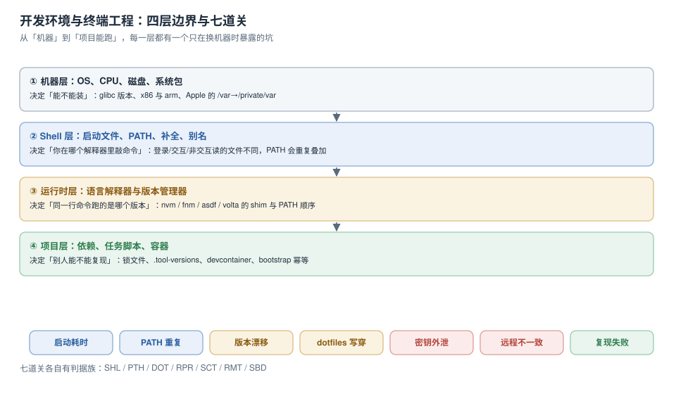

# 开发环境与终端工程

一个新人入职，第一步不是写代码，是让命令跑起来。这一步通常被当成「装几个东西」，于是没人给它定判据——直到某天出现四种症状：`command not found`、`node -v` 和文档写的不是一个数、终端每开一个窗口卡一秒、换台机器就报 `ModuleNotFoundError`。这四个症状各自看着像「环境问题」，其实是同一条链上四个环节的缺陷：**shell 读哪些文件、PATH 怎么组装、版本由谁决定、密钥放在哪**。

本专题只讲这条链，而且只用一种证据：本机跑出来的读数。

::: tip 一句话理解
开发环境不是「装好了」，而是**四层边界各有一条可执行的判定命令**：机器层查架构与库、shell 层查启动耗时与 PATH、运行时层查「哪个版本」、项目层查「别人能不能复现」。
:::

::: info 本专题与相邻专题的分工
本专题回答「**这台机器上的命令为什么是这个行为、换一台机器怎么还能一样**」，不回答「某个编辑器/某个工具怎么用」。十处最容易混淆的邻居，边界一次写死：

| 相邻专题 | 那边回答什么 | 本专题回答什么 |
| --- | --- | --- |
| [IDE 概述](../IDE/Overview/index.md) | 编辑器的功能、插件生态、快捷键 | 编辑器之外那层：命令解析、运行时版本、启动耗时 |
| [远程开发](../IDE/RemoteDev/index.md) | 编辑器的远程模式怎么开、隧道怎么建 | 远程之后「文件/端口/进程」三条链路各自的一致性判据 |
| [配置同步](../IDE/ConfigSync/index.md) | 插件与设置怎么在设备间同步 | dotfiles 本身的仓库结构与写穿风险 |
| [终端工具](../Efficiency/Terminal/index.md) | 终端模拟器、复用器、字体与配色 | 终端启动时 shell 到底执行了什么、花在哪 |
| [Shell 效率](../Efficiency/ShellProductivity/index.md) | 别名、函数、快捷键、历史检索技巧 | 这些配置**放在哪个文件**、代价是多少 |
| [工具链](../Toolchain/index.md) | 编译器、SDK、多版本共存 | 多版本共存之后「谁先被找到」 |
| [构建与依赖管理](../Build/index.md) | 构建生命周期、依赖解析规则 | 依赖能不能被**同一个解释器**装上 |
| [密钥治理](../../Ops/SecurityHardening/SecretGovernance/index.md) | 密钥的存储、轮换、权限模型 | 密钥「怎么进入进程环境」以及怎么不进 |
| [流水线设计](../CICD/PipelineDesign/index.md) | CI 阶段划分、缓存、门禁 | 本地与 CI 的环境差异从哪来、怎么对齐 |
| [容器](../../Ops/Docker/index.md) | 镜像、网络、卷 | 用容器把「四层」压成一份可复现的产物 |
:::

::: warning 本专题为什么不按大版本建目录
本库对有大版本代际差异的主题按版本目录组织（如 [Spring5/Spring6](../../Backend/Java/Frame/Spring/index.md)、[MySQL57/MySQL84](../../DB/SchemaEvolution/MySQL84/index.md)），旧版本保留并标注状态。本专题**不建版本目录**，三条理由：

1. **它是一类工程问题，不是一款产品的文档**：`PATH` 的解析规则、shell 启动文件的读取顺序由 POSIX 与各 shell 的实现定义，二十年来没有代际断层。
2. **并存的差异是「工具选型」而不是「版本代际」**：nvm / fnm / asdf / volta 是同一问题的四种解法，用一张对照表覆盖（见[PATH 与运行时版本](PathAndRuntime/index.md)），不值得为每个工具开一套章节。
3. **版本差异已经收敛进表格**：凡涉及「哪个版本开始支持」的地方，正文都用行内标注（如 zsh 5.9 的 `compinit -C`、macOS 的 `/etc/zprofile`），不需要另立目录。

若将来出现规范级断层（例如 shell 启动文件模型被取代），再按版本目录补建，且**不覆盖本目录**。
:::

## 目录

- [四层边界与五个必失点](Overview/index.md)
- [shell 启动链路：746 ms 花在哪](ShellStartup/index.md)
- [PATH 与运行时版本：谁先被找到](PathAndRuntime/index.md)
- [dotfiles：符号链接与写穿](Dotfiles/index.md)
- [环境可复现：锁住三件东西](Reproducibility/index.md)
- [密钥卫生：别让它进环境变量](Secrets/index.md)
- [远程开发：文件、端口、进程](RemoteDev/index.md)
- [启动预算与优化顺序](StartupBudget/index.md)
- [实战：一套可验收的开发环境](Practice/index.md)
- [常见问题与分诊](FAQ/index.md)

## 专题地图

## 判据纪律

沿用全库写法：**每页 8 条**，编号形如 `SHL-A`，逐页前缀唯一，可被 `utils/audit` 下的判据类巡检机械核对。每条判据都要能回答三件事：**看什么现象、判成什么、不满足时改哪里**。

| 页 | 判据族 | 条数 | 这一族管什么 |
| --- | --- | --- | --- |
| 四层边界与五个必失点 | `DEV-A` ~ `DEV-H` | 8 | 边界划分、判定命令、接缝责任 |
| shell 启动链路 | `SHL-A` ~ `SHL-H` | 8 | 读取顺序、逐段计时、惰性加载 |
| PATH 与运行时版本 | `PTH-A` ~ `PTH-H` | 8 | 去重、解析成本、shim、版本一致性 |
| dotfiles | `DOT-A` ~ `DOT-H` | 8 | 安装模式、写穿、漂移检测、回滚 |
| 环境可复现 | `RPR-A` ~ `RPR-H` | 8 | 锁定、幂等、空环境、容器对齐 |
| 密钥卫生 | `SCT-A` ~ `SCT-H` | 8 | 注入方式、可见面、扫描、轮换 |
| 远程开发 | `RMT-A` ~ `RMT-H` | 8 | 文件、端口、进程、时钟 |
| 启动预算 | `SBD-A` ~ `SBD-H` | 8 | 预算表、测量方法、优化顺序 |
| 实战 | `BST-A` ~ `BST-H` | 8 | 六步基线、十条验收、负向断言 |
| 常见问题 | `ENQ-A` ~ `ENQ-H` | 8 | 症状分诊、自查、错误建议 |

合计 **10 族 80 条**。

## 事实与版本速览（2026-10 核对）

| 项 | 现状 | 对本专题的影响 |
| --- | --- | --- |
| 实测 shell | **zsh 5.9（x86_64-apple-darwin22）** | 所有毫秒读数在这个版本上跑出来；读取顺序与 bash 不同，切换 shell 要重看第一节 |
| 实测机器 | macOS **x64**（Intel），APFS 大小写不敏感 | 大小写不敏感会让「路径拼错但能跑」的缺陷潜伏到 Linux 上才爆 |
| 交互 shell 启动 p50 | **746.0 ms**（`~/.zshrc` 全量）/ **14.2 ms**（空配置） | 差 **52 倍**，其中 **660 ms** 来自 nvm 的默认初始化 |
| PATH 规模 | **35 项 / 唯一 23 项**，12 项重复（**34%**） | 重复来自 4 次 `PATH=…:$PATH` 叠加，解析成本随项数线性增长 |
| 命令解析成本 | 未命中：1 项 **6.34 µs** → 100 项 **491.08 µs**（**77 倍**） | `command not found` 的延迟不是零，PATH 越长越慢 |
| 同一台机器的 node | 非交互 **v22.22.2** / 交互 **v24.21.0** | 「版本不对」先查 shell 模式，而不是查有没有装 |
| `node -v` 直接调用 | p50 **25.6 ms**；`nvm exec` 跨版本调用 p50 **982.7 ms** | 版本管理器是「每次调用都收税」，不是只在启动时收一次 |
| 环境变量数量 | **155** 个 | 可复现性论证的分母：能不能跑取决于其中某几个 |
| `.zshrc` 里的 `export` | **11** 处 | 每一处都会进入之后所有子进程的环境 |

::: warning 关于「实测」的诚实标注
本专题的数字分两类，正文逐处标注：

- **本机可复跑**：macOS x64 + zsh 5.9，计时用 `time.perf_counter()` 包住子进程，每个用例 **12~15 次取中位数**，脚本一次性、**不入库**。同一段脚本重跑，绝对值会有 ±10% 浮动，**倍数与排序稳定**。
- **规范口径**：shell 读哪些文件、`PATH` 的查找顺序、`compinit` 的缓存语义属于规范行为，以各 shell 与工具的官方文档为准，本专题只写「能观测到的现象」。

三处必须说清的局限：① 读数来自一台 **Intel Mac**，Apple Silicon 上的绝对毫秒会不同（尤其冷启动与首次 exec）；② 只有一次测量的项（如 `ps eww` 的输出字节数）不适合当 SLA，它要说明的是「会不会被看到」而不是「多大」；③ 「启动耗时」高度依赖磁盘缓存状态，本专题统一用**热态中位数**，冷态另注。
:::

## 三条底线

1. **交互与非交互是两套环境**：`zsh -c 'node -v'` 给 **v22.22.2**，`zsh -i -c 'node -v'` 给 **v24.21.0**，同一台机器、同一分钟。你终端里能跑，不代表 CI 里能跑——这一条解释了一半「我本地是好的」。
2. **慢的原因通常不是插件多**：空 `.zshrc` **14.2 ms**，加上 nvm 默认初始化变 **673.8 ms**。nvm 的 `--no-use` 把它压回 **97.9 ms**（**8.2 倍**），代价只是首次 `nvm use` 手动一次。
3. **`export` 出去的密钥是全机可读的**：子进程带 `DB_PASSWORD` 启动后，`ps eww -p <pid>` 的 **19,793 字节**输出里能直接搜到明文。改成 `DB_PASSWORD=… cmd`（不 export）后，子进程的 `'DB_PASSWORD' in os.environ` 变成 **False**。

## 场景跳转

| 你现在的处境 | 从这里开始 |
| --- | --- |
| 刚拿到一台新机器，要从零配到能开工 | [实战](Practice/index.md) 的 S1~S10 |
| 终端每开一个窗口就卡 | [shell 启动链路](ShellStartup/index.md) → [启动预算](StartupBudget/index.md) |
| `command not found` 但文件明明在 | [PATH 与运行时版本](PathAndRuntime/index.md) |
| 版本和文档对不上 | [PATH 与运行时版本](PathAndRuntime/index.md) 的「两种 shell 两个 node」 |
| 想把 dotfiles 纳入版本管理 | [dotfiles](Dotfiles/index.md) |
| 换机器就报依赖错 | [环境可复现](Reproducibility/index.md) |
| 发现密钥写在了 `.zshrc` 里 | [密钥卫生](Secrets/index.md) |
| 远程机器上「本地好好的」 | [远程开发](RemoteDev/index.md) |

## 参考资料

- zsh 官方文档：*Files*（`/etc/zshenv`、`/etc/zprofile`、`/etc/zshrc`、`/etc/zlogin` 与用户级同名文件的读取顺序）、*Parameters*（`path` 数组与 `PATH` 的双向绑定）
- POSIX.1-2017：*Environment Variables*（`PATH` 的查找语义、命令未找到时的行为）
- nvm 官方 README：`--no-use` 参数与 `nvm use` 的差异、`nvm exec` 的用法
- Node.js 官方文档：`engines` 字段、`packageManager` 字段（Corepack）
- devcontainers 规范：*devcontainer.json* 的 `features` / `mounts` / `postCreateCommand`
- 1Password 官方文档：*CLI `op run`*（进程级注入、模板变量替换）
- 本仓库相邻专题：[IDE 概述](../IDE/Overview/index.md)、[远程开发](../IDE/RemoteDev/index.md)、[终端工具](../Efficiency/Terminal/index.md)、[密钥治理](../../Ops/SecurityHardening/SecretGovernance/index.md)
