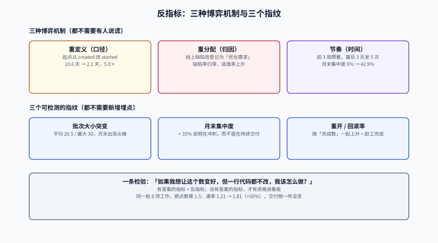

# 反指标：古德哈特与度量博弈

> 当一个指标成为目标，它就不再是一个好指标。
> —— 古德哈特定律（Goodhart, 1975）

这句话在工程组织里的具体版本是：**任何被用来评价人的指标，都会在两个月内变成一份关于「如何让这个指标好看」的说明书，而不再是关于交付的描述。**

本页不讨论「哪些指标不好」，而是讨论**为什么好指标会变坏**、**变坏时有什么可检测的痕迹**、以及**不用指标评价个人时，还能靠什么**。

::: tip 一句话定位
反指标不是「错误的指标」，而是**激励结构一旦挂上去就会自我毁灭的指标**。
识别它们的方法不是看定义，而是问一句：**如果我想让这个数变好，但一行代码都不改，我该怎么做？** 有答案的，就是反指标。
:::

本页判据族 `EMA-A` ~ `EMA-H`，共 8 条。定义表在第七节。



## 一、五类典型反指标

| 反指标 | 看起来在度量 | 一行代码不改的「优化」方法 | 真实后果 |
| --- | --- | --- | --- |
| **代码行数 / 提交数** | 产出量 | 拆函数、加空行、把格式化单独提交 | 代码更难读；评审成本上升 |
| **个人速率（故事点）** | 个人产能 | 重估刻度、拆项、抢小项 | 团队协作瓦解，没人愿意做难项（实测刻度 ×1.5 即「提升」50%） |
| **缺陷数（越少越好）** | 质量 | 不登记、降级、合并成一条、标成「需求」 | 缺陷转入地下，逃逸率反而上升 |
| **评审意见数** | 评审质量 | 多提无关紧要的 nit、拆成多条 | 评审噪声变大，真正的问题被淹没 |
| **AI 生成代码占比** | 工具采纳 | 让 AI 重写已有代码、把注释也算进去 | 与交付无关；掩盖了「生成快、验证慢」的真问题 |

::: danger 判断反指标的统一检验：三个问题
1. **它度量的是「我做了什么」，还是「系统交付了什么」？** 前者可被个人直接操纵。
2. **它有没有天然的「上限」？** 没有上限的指标（行数、提交数、PR 数）必然被无限优化。
3. **变好时，会不会同时让另一个重要指标变坏？** 会，而且没人会主动报告那一个。
:::

## 二、三种博弈机制

被考核的人不会「作弊」，他们会**合理地适应规则**。适应方式只有三种：

| 机制 | 动作 | 例子 | 检测难度 |
| --- | --- | --- | --- |
| **重定义（口径）** | 改统计口径，不改行为 | 把「周期时间」起点从创建改成开始做 | 低（口径表有版本） |
| **重分配（归因）** | 把工作挪到另一个桶里 | 线上缺陷改登记为「优化需求」 | 中（要跨系统对账） |
| **节奏（时间）** | 改工作的发生时间 | 月末冲刺合并、季度末停止发布 | 高（要看时间分布） |

### 重定义：口径是最容易被改的东西

口径变更往往有正当理由（「以前的口径不合理」）。可怕之处在于：**它不需要任何人同意，只需要一个人在 SQL 里改一行。**

本地实测：同一批 900 条变更，`created → deployed` 是 **10.6 天**，`started → deployed` 是 **2.1 天**。把起点往后挪一格，「交付周期」立刻改善 **5.0 倍**，流程一点没动。

对策只有一个：**口径进版本表 + 看板显示版本号**（见[数据管道](../DataPipeline/index.md)）。

### 重分配：把缺陷变成需求

「生产缺陷数」下降的一个常见原因是：它被登记成了「体验优化」。系统里没有任何一条记录叫「缺陷」，于是缺陷率为 0。

对策：**跨系统对账**——缺陷数必须能与事件系统的 `incident` 表、客服工单数对上。三个数各自独立采集，任一个突然下降而另两个没降，就是重分配的信号。

### 节奏：月末冲刺与季度冻结

```text
正常月份：部署均匀分布（每周 2 次）
被考核后：前 3 周攒着，最后 3 天发 5 次
```

部署频率的月度总量没变，但**月末集中度**从 0% 变成 42.9%（当月 7 次发布里 3 次落在最后 3 天）。这个形状的代价是：月末的批次特别大，失败时影响面特别广。

## 三、三个可检测的指纹

组织行为一旦被指标扭曲，数据分布会先变形。以下三个指纹都不需要访谈，直接从数据算：

| 指纹 | 算法 | 正常形状 | 被博弈的形状 |
| --- | --- | --- | --- |
| **批次大小突变** | 每部署携带的变更数，按月看 P50/P90 | 稳定在个位数~十几 | 月末/季末出现 30+ 的尖峰 |
| **月末集中度** | 每月最后 3 天的部署数 ÷ 当月部署数 | 约 10%（均匀分布） | > 35%（冲刺） |
| **重开 / 回滚率** | 重开项数 ÷ 完成项数；回滚部署 ÷ 部署数 | 稳定低位 | 随「完成数」上升而上升（赶工完成） |

::: tip 这三个指纹的共同点：它们都不需要新的埋点
部署时间、批次大小、状态迁移历史，本来就是流动与交付指标的数据源。换言之：**你已经在采集能发现博弈的数据，只是没有去看它的形状。**
:::

## 四、个体化度量的四个后果

把效能指标挂到个人，后果不是「工程师不高兴」这么简单，而是四个可观测的系统变化：

1. **难项没人接**：难项的周期长、失败率高，在个人指标上必然吃亏。三个月后，技术债没人动。
2. **协作退化为交易**：「这个 PR 你帮我看看」变成「这算谁的产出」。评审时长上升，因为没人愿意白干。
3. **数据开始说谎**：重分配与节奏两种机制会同时启动，管理层的仪表盘越来越好看，交付越来越慢。
4. **优秀的人先走**：能被指标公平衡量的人，往往是那些做常规工作的人；真正解决问题的人，指标上通常不好看。

::: danger 「只看团队不看个人」不是道德立场，是测量学立场
团队级指标的方差里，有相当大一部分来自**任务难度**与**系统状态**，而不是个人能力。用这样的信号去区分个人，信噪比太低——低到不如掷硬币。
如果一定要评价个人，可用的信号是**同行评审 + 具体事件回顾 + 抽样观察**，它们慢、不可扩展，但这恰恰是它们没被污染的原因。
:::

## 五、不用个人指标，那用什么

Forsgren 等人的 SPACE 框架给了五个维度，它的价值不在「五个都要测」，而在于**提醒你只测了一个**：

| 维度 | 问的问题 | 可用的信号（团队级） | 不要用的信号 |
| --- | --- | --- | --- |
| **Satisfaction / Well-being** | 大家对工作满意吗？ | 季度匿名问卷、离职意向、on-call 负担 | 「满意度打分」挂绩效 |
| **Performance** | 交付的结果好吗？ | 逃逸率、CFR、SLO 达成 | 缺陷数（越少越好） |
| **Activity** | 系统在动吗？ | 部署次数、变更数（**只做分母/上下文**） | 提交数、行数 |
| **Communication / Collaboration** | 协作顺畅吗？ | 评审等待时长、跨团队阻塞项 | 评审意见数 |
| **Efficiency / Flow** | 流动顺吗？ | 周期时间、流动效率、WIP | 个人利用率 |

::: warning 「Activity 只做上下文」是什么意思
部署次数这类活动量，适合回答「这个系统有没有在动」，**不适合回答「这个团队好不好」**。
把它放进看板没问题，但必须与其他四维并列呈现；单独拿它做结论，就是把它变成了反指标。
:::

## 六、判据族

| 判据 | 约定 | 定错了会怎样 | 怎么验证 |
| --- | --- | --- | --- |
| `EMA-A` | 效能指标不得作为个人绩效考核的直接输入 | 重分配与节奏两种博弈启动，数据失真 | 指标消费清单里无「个人绩效」用途 |
| `EMA-B` | 禁止排行榜（个人/团队排名） | 排名把系统问题转成个体竞争，协作退化 | 看板无 `rank` / `leaderboard` 组件 |
| `EMA-C` | 任何指标必须能通过「一行代码不改能否变好」检验 | 通过检验的指标就是反指标 | 指标体系文档含该检验记录 |
| `EMA-D` | 活动量指标（提交数/行数/PR 数）只能做上下文，不得单独成结论 | 团队优化活动量而非交付 | 活动量指标旁必须有结果指标 |
| `EMA-E` | 缺陷类指标必须与事件系统、客服工单三向对账 | 缺陷被登记成「优化」，缺陷率归零 | 月度对账表三列齐全 |
| `EMA-F` | 必须监控三个博弈指纹（批次大小、月末集中度、重开率） | 博弈发生 2~3 个月后才被察觉 | 指纹报表按月产出 |
| `EMA-G` | 综合分（一个数概括研发效率）禁止用于任何决策 | 权重可以调，结论就可以被定向生产 | 无综合分指标，或标注「仅展示」 |
| `EMA-H` | 团队级评价必须至少覆盖 SPACE 的两个以上维度 | 单维评价必然被优化到失真 | 季度评价表含 ≥2 个维度 |

## 七、如何验证

```sql
-- 验证 EMA-F：月末集中度（示例数据：正常月份 vs 冲刺月份）
WITH d(month, deployed_at) AS (VALUES
  ('2026-08', timestamptz '2026-08-04 10:00'), ('2026-08', timestamptz '2026-08-07 10:00'),
  ('2026-08', timestamptz '2026-08-11 10:00'), ('2026-08', timestamptz '2026-08-14 10:00'),
  ('2026-08', timestamptz '2026-08-18 10:00'), ('2026-08', timestamptz '2026-08-21 10:00'),
  ('2026-08', timestamptz '2026-08-25 10:00'), ('2026-08', timestamptz '2026-08-28 10:00'),
  ('2026-09', timestamptz '2026-09-01 10:00'), ('2026-09', timestamptz '2026-09-08 10:00'),
  ('2026-09', timestamptz '2026-09-15 10:00'), ('2026-09', timestamptz '2026-09-22 10:00'),
  ('2026-09', timestamptz '2026-09-28 10:00'), ('2026-09', timestamptz '2026-09-29 10:00'),
  ('2026-09', timestamptz '2026-09-30 10:00')
)
SELECT month,
       count(*) AS deploys,
       count(*) FILTER (
         WHERE deployed_at >= date_trunc('month', deployed_at) + interval '1 month' - interval '3 days'
       ) AS last3d,
       round(100.0 * count(*) FILTER (
         WHERE deployed_at >= date_trunc('month', deployed_at) + interval '1 month' - interval '3 days'
       ) / count(*), 1) AS month_end_share_pct
FROM d GROUP BY month ORDER BY month;
```

实测输出（8 月均匀分布、9 月最后 3 天挤了 3 次）：

```text
  month  | deploys | last3d | pct
---------+---------+--------+------
 2026-08 |       8 |      0 |  0.0
 2026-09 |       7 |      3 | 42.9
```

```shell
# 验证 EMA-A / EMA-G：指标消费清单里不该出现个人绩效或综合分（返回空即合规）
grep -rn "performance_review\|personal_score\|overall_score" config/metrics.* 2>/dev/null
```

```sql
-- 验证 EMA-E：缺陷数与事件数是否对得上（偏差 > 20% 需要人工解释）
SELECT (SELECT count(*) FROM em.bug WHERE found_stage='prod') AS prod_bugs,
       (SELECT count(*) FROM em.incident)                     AS incidents,
       round(100.0 * ((SELECT count(*) FROM em.bug WHERE found_stage='prod')
                    - (SELECT count(*) FROM em.incident))
             / nullif((SELECT count(*) FROM em.incident), 0), 1) AS delta_pct;
-- 预期：60 / 4 / 1400.0 —— 差距巨大不是错，而是必须先解释「一个事件对应多少工单」
```

::: tip 上面那个 1400% 是故意留的
它说明「缺陷数」与「事件数」根本不是同一粒度：一个事件可以被 30 个用户各报一次（本项目实测），也可以一个工单都不报。
所以对账的目的不是让两个数相等，而是**让「一个事件对应多少工单」这个换算系数保持稳定**；系数突然变了，才是信号。
:::

## 八、替代做法：抽样与定性

指标不可用时，不是「什么都不看」，而是换成**成本更高、但不容易被污染**的方法：

1. **结构化抽样**：每月随机抽 5 个已交付需求，回溯全链路（从提出到上线）的等待点，形成叙事。
2. **事件复盘**：每次 P1/P2 事件都做无责复盘，记录「系统里哪一处让我们看不见/反应慢」。
3. **值班负担**：on-call 被叫次数、夜间告警数、恢复耗时——这类数据难以伪造，且直接对应人的体验。
4. **同行评审**：晋升与评价用具体项目证据 + 同侪判断，不用指标分数。

::: warning 抽样的唯一缺点是「不可扩展」
但效能度量本来就不该扩展到「评价每个人」。它该扩展到「看清系统」——5 个抽样需求足以暴露系统的等待结构，而 500 个人的指标分数不能。
:::

## 与「技术决策与评审」的分工（第 178 天补充）

本页回答「指标被优化之后会变成什么样」（批次变大、月末集中、重开率）；[技术决策与评审](../../../Others/TechDecision/index.md) 回答「决策过程本身该被怎么度量」——第 178 天新增的四个指标（僵尸决策率、缺判据率、缺未采纳意见率、重开率）就是这条线。

| 这件事 | 归哪边 | 边界在哪 |
| --- | --- | --- |
| Goodhart / Campbell 效应 | **指标会改变行为** | 「决策周期缩短」被当 KPI 会催生草率通过 |
| SPACE 框架防单维优化 | **多维度对冲** | 决策质量的四个指标也要成组看，不能单看一个 |
| 三个作弊指纹 | **怎么发现被优化** | 「重开率归零」是最典型的被优化痕迹：不是决策变好了，是没人敢提异议 |
| 口径版本化 | **跨期可比** | 判据的定义改了却不改版本，历史结论会被静默重算 |

本页特有的一个坑：**「决策重开率降到 0」是一个危险信号，不是一个好成绩。** 完全不重开通常意味着三件事之一：异议没有被记录、触发条件写不出来、或者重开的成本高到没人愿意提。健康的区间是「非零但低」，并且每次重开都能指到记录里那条触发条件——**能指出来，才说明机制在起作用**。
## 参考资料

- Goodhart, C.，《Problems of Monetary Management: The U.K. Experience》，1975（古德哈特定律原始表述）。
- Campbell, D. T.，《Assessing the Impact of Planned Social Change》，1976（Campbell 定律：指标一旦用于社会决策就 corrupted）。
- Forsgren, N. 等，《The SPACE of Developer Productivity》，ACM Queue，2021（五维框架与「不要用单维指标」的论证）。
- DORA，《DORA's software delivery performance metrics》常见陷阱一节（把指标设为目标、单指标统治、跨主体比较）。
- Strathern, M.，《Improving Ratings: Audit in the British University System》，1997（「当指标成为目标，它就不再是好指标」的社会学版本）。
- 本仓库相邻专题：[研发效能度量总览](../index.md)（四类指标的分工）与[交付效能度量](../Estimation/index.md)（估算口径）
