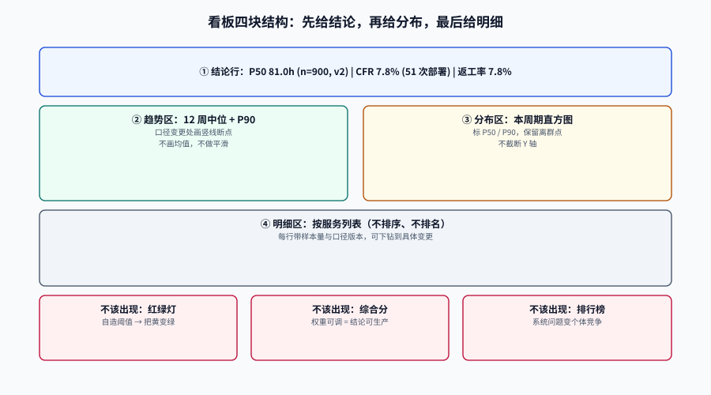

# 看板表达：让图说真话

同一份数据，换一种画法，可以得出相反的结论。这不是修辞：**把两个服务的 P90 取平均**这件事，在会议室里看起来完全正常，得到的数却比真实合并值高 **28.7%**，而且**不等于任何一个服务**。

本页讲的是「最后一公里」：数据算对了，怎么画、怎么标注、怎么让别人不误读。它的核心主张只有一句：**看板上的每一个数字，都要能被追溯到一条能跑通的查询与一个写明的口径。**

::: tip 一句话定位
一张看板只回答一个问题。回答「趋势」的图和回答「分布」的图不能是同一张——前者要时间轴，后者要直方图。
把两者混在一张图上，读者会用趋势的直觉去读分布，然后得出「平均 3 天」这种谁都不信的结论。
:::

本页判据族 `EMV-A` ~ `EMV-H`，共 8 条。定义表在第七节。




## 一、三种图，三种问题

| 问题 | 该用什么图 | 关键要素 | 常见错法 |
| --- | --- | --- | --- |
| **趋势**：这个月比上个月好吗？ | 折线（中位 + P90 两条），带区间带 | 时间轴、口径版本竖线、样本量 | 只画均值；把口径变更点连成一条平滑线 |
| **分布**：典型情况与尾部各是什么样？ | 直方图 / 箱线图 / 散点 | 分桶边界、P50/P90 标注、离群点保留 | 用饼图表示连续量；截断 Y 轴隐藏尾部 |
| **构成**：这些时间花在哪？ | 堆叠条（等待 vs 加工） | 分段定义、单位一致 | 把「等待」和「加工」用同一种颜色 |

**一张看板的标准结构**（四块，从上到下）：

```text
① 结论行：3 个数字 + 各自的样本量 + 口径版本
   变更前置时间 P50 81.0h (n=900, v2) | CFR 7.8% (51 次部署) | 返工率 7.8%
② 趋势区：12 周中位 + P90，两条线，口径变更处画竖线
③ 分布区：本周期的周期时间直方图，标出 P50/P90
④ 明细区：按服务的表格（不聚合），可下钻到具体变更
```

::: warning 结论行必须带 `n`
不带样本量的数字会被当成「事实」而不是「估计」。本项目实测：18 个样本的中位 8.7 小时，95% 区间 [6.5, 16.4]——**上下差 2.52 倍**。
看到这个区间，没人会问「为什么这周比上周慢了 1 小时」；看不到，这个会就要开一小时。
:::

## 二、分位数不可加总：一个必须写进规范的事实

分位数不是线性算子。两组数据各自算 P90 再平均，和合并后算 P90，是两个不同的数：

| 服务 | 样本量 | P50 | P90 |
| --- | --- | --- | --- |
| A（慢、量小） | 100 | 121.4 h | 162.9 h |
| B（快、量大） | 9,900 | 90.1 h | 102.9 h |
| **未加权平均** | —— | **105.4 h** | **132.9 h** |
| **合并后重算** | 10,000 | **89.9 h** | **103.2 h** |

未加权平均的 P90 比真实合并值高 **28.7%**；P50 高 **17.2%**。

::: danger 两种错法，第二种更常见
1. **未加权平均各实例的分位数**（上表）：小样本的慢实例被放大，得到 132.9 h。
2. **按流量加权平均分位数**：看起来更合理，但仍然是错的——加权平均分位数 ≠ 合并分位数。它只是「离真实值更近一点」，没有任何理论保证。

唯一正确的做法：**分位数只能在原始数据上算**。如果拿不到原始数据（跨系统聚合），就只能报「各实例分位数的分布」（例如 12 个实例的 P90 从 60 h 到 180 h），而不是一个平均值。
:::

**可复算的演示**（Python 3 标准库）：

```python
import random
R = random.Random(20261020)
a = [R.gauss(120, 30) for _ in range(100)]      # 慢、量小
b = [R.gauss(90, 10) for _ in range(9900)]      # 快、量大

def p90(xs):
    xs = sorted(xs); k = 0.9 * (len(xs) - 1); f = int(k)
    c = min(f + 1, len(xs) - 1)
    return xs[f] + (xs[c] - xs[f]) * (k - f)

print(round((p90(a) + p90(b)) / 2, 1), round(p90(a + b), 1))
```

运行输出：

```text
132.9 103.2
```

## 三、累计曲线：最会骗人的一种图

累计部署数、累计完成需求数——这类曲线**永远上升**，所以「看起来一直在进步」。它的问题不是错，而是**没有信息**：

| 图 | 能回答 | 不能回答 |
| --- | --- | --- |
| 累计曲线 | 「总量到多少了」 | 「最近变快还是变慢」——斜率变化被前期基数掩盖 |
| 每期增量（柱状） | 「这一期做了多少」 | 「长期趋势」——需要看移动平均 |
| 移动中位（折线） | 「趋势方向」 | 「极端月份」——被平滑掉了 |

::: tip 累计曲线的唯一合法用途
对外汇报「我们今年一共发了 240 次」。凡是要判断「快慢」，都必须换成**每期增量**或**移动中位**。
一个可操作的检查：**如果你把这张图的时间轴压缩一半，结论会变吗？** 累计曲线不会变（永远上升），说明它没有承载时间信息。
:::

## 四、口径注释三行

每张图下面必须有三行小字，缺一行就会被误读：

```text
口径：change_lead_time v2（first_commit_at → deployed_at），中位 + P90
样本：近 12 周，900 条人工变更（排除 60 条 bot），覆盖率 100%
排除：无（若排除，写明排除项与原因，例如「不含回滚重发」）
```

| 行 | 写什么 | 漏了会怎样 |
| --- | --- | --- |
| **口径** | 指标名 + 版本 + 起止事件 + 统计量 | 读者按自己的口径理解，得出不同结论 |
| **样本** | 时间窗、条数、是否排除机器人 | 「n=12」被当成「n=900」 |
| **排除** | 排除了什么、为什么 | 排除项成为隐藏的选择性偏差 |

::: danger 最常见的隐瞒不是撒谎，是省略
「本季度变更前置时间改善 18%」——如果这个数字排除了「超过 30 天的变更」（理由是「异常值」），那它改善的其实是**统计口径**，不是交付。
排除项必须写在图上，而且要写**排除了多少条**。读者有权知道分母被动过。
:::

## 五、图上不该出现的四样东西

| 不该出现 | 为什么 | 替代 |
| --- | --- | --- |
| **红绿灯打分**（红/黄/绿三档） | DORA 已在 2025 报告停用四档分档；红绿灯是自造阈值，且会引发「把黄变绿」的行为 | 画趋势 + 目标线，让读者自己判断 |
| **综合分**（一个数概括研发效率） | 权重可以调，结论就可以被定向生产 | 五个指标并列，不做加权 |
| **排行榜**（团队/个人排名） | 把系统问题转成个体竞争，协作退化 | 按服务列明细，不排序 |
| **无样本量的百分比** | 3/4 = 75% 与 300/400 = 75% 在图上长得一样 | 每个百分比旁标 `n` |

::: warning 「目标线」也要小心
画一条「P90 < 5 天」的目标线是合理的，但必须同时说明：**这条线是怎么来的**（业务约束？客户承诺？还是去年随便定的？）。
没有来源的目标线，会在三个月后变成「为什么还没到」的质询，而不是改进的参照。
:::

## 六、颜色与阈值：三条规则

1. **涨跌色不要用于「好坏」**：周期时间下降是好事，失败率下降也是好事，但它们的箭头方向相反。用统一的「好=绿、坏=红」会与直觉冲突（尤其在中文语境里红=涨）。
2. **阈值只在有行动时设置**：一条告警阈值背后必须有一个「超过了就做什么」。没有动作的阈值只是装饰。
3. **异常用形状不用颜色**：色盲用户约占男性 8%，只靠颜色区分会丢失信息。用虚线、标记点、直接标注数值。

## 七、判据族

| 判据 | 约定 | 定错了会怎样 | 怎么验证 |
| --- | --- | --- | --- |
| `EMV-A` | 分位数只能在原始数据上计算，禁止对分位数求平均 | 未加权平均使 P90 虚高 28.7%（132.9 vs 103.2） | 聚合 SQL 里无 `avg(percentile...)` |
| `EMV-B` | 每个数字旁必须标样本量 `n` | n=18 与 n=900 被同等对待 | 图表配置含 `sample_size` 字段 |
| `EMV-C` | 每张图必须有三行注释（口径/样本/排除） | 读者按自己的口径理解，争论无解 | 页面模板含注释块 |
| `EMV-D` | 口径变更必须在趋势图上画竖线断点 | 口径改善被读成交付改善 | 图配置含 `version_markers` |
| `EMV-E` | 禁止红绿灯分档与综合分 | 自造阈值引发「把黄变绿」的行为 | 看板无 `status_color` / `overall_score` |
| `EMV-F` | 禁止排行榜（团队与个人） | 系统问题转成个体竞争 | 明细表按服务名排序，不按指标值 |
| `EMV-G` | 累计曲线只能用于总量陈述，趋势必须用每期增量或移动中位 | 「永远上升」被读成「持续改善」 | 趋势图 X 轴为周期，非累计 |
| `EMV-H` | 阈值必须绑定动作，且在图上标注来源 | 无来源阈值变成质询工具 | 阈值配置含 `owner` 与 `action` |

## 八、如何验证

```sql
-- 验证 EMV-A：两个样本量差 99 的分组，平均分位数 vs 合并分位数
WITH a AS (SELECT generate_series(1,100)::numeric h),        -- 100 条，量小
     b AS (SELECT generate_series(1,9900)::numeric h),       -- 9900 条，量大
     pa AS (SELECT percentile_cont(0.5) WITHIN GROUP (ORDER BY h) p FROM a),
     pb AS (SELECT percentile_cont(0.5) WITHIN GROUP (ORDER BY h) p FROM b)
SELECT round((SELECT p FROM pa)::numeric, 1) AS p50_a,
       round((SELECT p FROM pb)::numeric, 1) AS p50_b,
       round((((SELECT p FROM pa) + (SELECT p FROM pb)) / 2)::numeric, 1) AS avg_of_p50,
       round((SELECT percentile_cont(0.5) WITHIN GROUP (ORDER BY h)
              FROM (SELECT h FROM a UNION ALL SELECT h FROM b) u)::numeric, 1) AS pooled_p50;
```

实测输出：

```text
 p50_a | p50_b  | avg_of_p50 | pooled_p50
-------+--------+------------+------------
  50.5 | 4950.5 |     2500.5 |     4900.5
```

`avg_of_p50` 只有 `pooled_p50` 的一半——分位数一旦离开原始数据，就不再是同一个量。

```shell
# 验证 EMV-B / EMV-C：图表配置里是否缺 sample_size 与注释
grep -L "sample_size" config/dashboards/*.json 2>/dev/null
grep -L "口径：" config/dashboards/*.json 2>/dev/null
# 两条都返回空 = 全部配齐
```

```shell
# 验证 EMV-E / EMV-F：看板配置里不该出现红绿灯与排行榜（返回空即合规）
grep -rn "status_color\|leaderboard\|overall_score" config/dashboards/ 2>/dev/null
```

::: tip 看板的「验证」与指标不同
指标的正确性靠 SQL 复算；看板的正确性靠**他测**——找一个没参与制作的人，只看图回答三个问题：这个数是多少、样本多大、口径是什么。
三个都答对，这张图才算合格。这个测试比任何配置检查都有效，且不需要工具。
:::

## 参考资料

- DORA，《DORA's software delivery performance metrics》常见陷阱：<https://dora.dev/guides/dora-metrics-four-keys/>
- Few, S.，《Show Me the Numbers》，2012（图表选择与分位数呈现的经典参考）。
- Cairo, A.，《The Truthful Art》，2016（可视化中的尺度、截断与误导）。
- WCAG 2.2，1.4.1 Use of Color：<https://www.w3.org/WAI/WCAG22/Understanding/use-of-color.html>
- PostgreSQL 18 文档，`percentile_cont` / `percentile_disc` 语义差异：<https://www.postgresql.org/docs/18/functions-aggregate.html>
