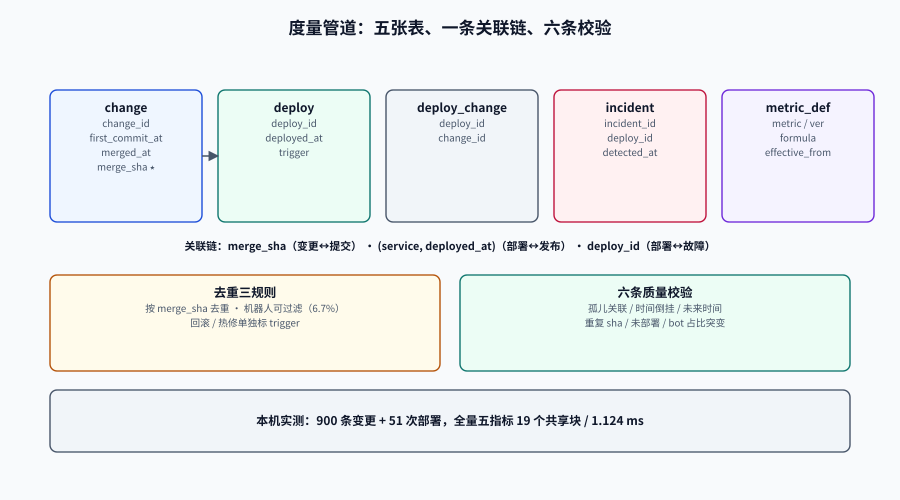

# 数据管道：事件、关联、去重与口径版本

效能度量做到第二个月一定会遇到同一类问题：**两个人都说自己在算「变更前置时间」，数字差 40%，代码都对。**

原因几乎总在数据层：一个人关联的是 `deploy` 表的时间，另一个人关联的是发布系统里的「开始部署」时间；一个人把机器人提交算进去，另一个人过滤了；一个人按 `merge_sha` 去重，另一个人按 `pr_number`——而一个 PR 合了三次。

本页给一条能落地的管道：**五张表、一条关联链、三组去重规则、六条质量校验**。它的目标不是「数据准确」（那不可能），而是**让不准确的地方可被发现**。

::: tip 一句话定位
度量管道的第一原则：**原始事件不可变，派生指标可重算。**
只要事件表留得住、口径表有版本，任何一次口径变更都能在十分钟内重算出历史曲线；反之，口径一改，历史就没了。
:::

本页判据族 `EMP-A` ~ `EMP-H`，共 8 条。定义表在第七节。




## 一、五张表：最小可用模型

```sql
-- 1) 变更：一次合入主干的行为
CREATE TABLE change (
  change_id       bigserial PRIMARY KEY,
  service         text        NOT NULL,
  author          text        NOT NULL,
  is_bot          boolean     NOT NULL DEFAULT false,
  first_commit_at timestamptz NOT NULL,          -- DORA 口径的起点
  merged_at       timestamptz NOT NULL,          -- 进入主干的时刻
  merge_sha       text        NOT NULL,
  UNIQUE (merge_sha)                             -- 同一个提交只能是一条变更
);

-- 2) 部署：一次生产发布
CREATE TABLE deploy (
  deploy_id   bigserial PRIMARY KEY,
  service     text        NOT NULL,
  deployed_at timestamptz NOT NULL,              -- 服务恢复可用的时刻，不是「开始滚动」
  trigger     text        NOT NULL,              -- planned / hotfix / rollback
  UNIQUE (service, deployed_at)                  -- 同服务同刻只算一次
);

-- 3) 部署 ↔ 变更：多对多，一个部署带多个变更
CREATE TABLE deploy_change (
  deploy_id bigint NOT NULL REFERENCES deploy,
  change_id bigint NOT NULL REFERENCES change,
  PRIMARY KEY (deploy_id, change_id)
);

-- 4) 事件：生产故障（只记「需要立即介入」的）
CREATE TABLE incident (
  incident_id bigserial PRIMARY KEY,
  deploy_id   bigint      NOT NULL REFERENCES deploy,
  detected_at timestamptz NOT NULL,
  recovered_at timestamptz,                      -- NULL 表示仍在恢复中
  severity    text        NOT NULL
);

-- 5) 口径注册表：指标的定义与版本
CREATE TABLE metric_def (
  metric         text NOT NULL,                  -- cfr_by_deploy
  ver            int  NOT NULL,
  scope          text NOT NULL,                  -- service:<name> / org
  events         text NOT NULL,                  -- first_commit_at -> deployed_at
  formula        text NOT NULL,                  -- 分子与分母的表达式
  aggregation    text NOT NULL,                  -- median / ratio / count_per_week
  effective_from date NOT NULL,
  retired_at     date,                           -- NULL = 现行
  PRIMARY KEY (metric, ver)
);
```

::: warning 五张表里最容易做错的是第 2 张
`deployed_at` 到底记哪个时刻？三个候选：开始滚动、滚动完成、健康检查通过。选错会让「恢复时间」系统性偏短（你以为已经恢复了，其实流量还没切回来）。
本项目取**健康检查通过**的时刻，理由是：只有这时用户才真的能用到。这个选择要写进 `metric_def.events`，不能只活在某个人的记忆里。
:::

## 二、关联链：三个键，三种用途

| 键 | 连接什么 | 为什么不能换 |
| --- | --- | --- |
| `merge_sha` | 变更 ↔ 提交 | 唯一且不可变；用 `pr_number` 会把「一个 PR 多次合并」算成一次 |
| `(service, deployed_at)` | 部署 ↔ 发布记录 | 换 `deploy_tag` 会把重发算成新部署（tag 会变） |
| `deploy_id` | 部署 ↔ 故障 | 只有它能回答「这次失败是哪次发布引起的」 |

**一次变更可能被部署多次**（回滚后重发、灰度扩量）。这时 `deploy_change` 会有多行，而「变更前置时间」只能取**第一次部署**：

```sql
SELECT DISTINCT ON (dc.change_id)
       dc.change_id, d.deployed_at
FROM deploy_change dc JOIN deploy d USING (deploy_id)
ORDER BY dc.change_id, d.deployed_at;        -- 第一次部署，不是最后一次
```

::: danger 用「最后一次部署」算前置时间，会系统性地把回滚过的变更算成很慢
一个改了 3 次才上稳的变更，第一次部署在 40 小时、最后一次在 200 小时。用最后一次，它会被记成「200 小时的慢变更」；而真正该被记录的是：**它在 40 小时就到了生产，然后失败了两次**——后者属于失败率，不属于前置时间。
:::

## 三、去重三规则

| 规则 | 做什么 | 不做会怎样 | 实现 |
| --- | --- | --- | --- |
| **按变更去重** | 一个 `merge_sha` 只算一条变更 | 同一提交在多个分支被合并，前置时间样本被重复计入 | `UNIQUE (merge_sha)` |
| **机器人可过滤** | `is_bot` 标记，报表可切换 | 依赖升级机器人拉低中位数（本项目 60/900 = 6.7%） | 采集时按作者名后缀 `[bot]` 判定 |
| **回滚/热修单独标** | `trigger` 三值，返工率只数 rollback + hotfix | 返工率恒为 0，「悄悄回退」完全不可见 | 发布系统回调时带 trigger |

::: tip 机器人该不该排除：给一个可复算的答案
本项目实测：人工 81.0 小时（840 条）、机器人 73.0 小时（60 条），差 8 小时、约 10%。
**行业里的争论（「机器人提交算不算产能」）在这个量级下没有意义**——两种口径都能用，只要在报表上标注。真正需要警惕的是机器人占比突然从 6.7% 涨到 40%（有人把自动化脚本都算成变更了），那是数据管道故障，不是产能提升。
:::

## 四、时区与工作日：三个必须写死的约定

| 约定 | 错误写法 | 后果 |
| --- | --- | --- |
| **时区** | `deployed_at::date`（依赖会话时区） | UTC 会话下，本地 10-01 08:00 的部署被算成 09-30，月度统计错位一天 |
| **工作日** | 用自然日算「等了几天」 | 周五下午提交、周一上午合并，被记成「等了 3 天」，实际只有 1 个工作日 |
| **发布窗口** | 用「部署日期」判断是否在窗口内 | 跨时区团队里，窗口判断会因会话时区不同而不同 |

正确写法：

```sql
-- 统一按业务时区折算，且显式声明
SET TIME ZONE 'Asia/Shanghai';

-- 「工作日等待」：用 generate_series 数工作日，而不是 (end - start)/86400
WITH d AS (
  SELECT generate_series(
           date_trunc('day', timestamptz '2026-09-04 17:00+08'),
           date_trunc('day', timestamptz '2026-09-07 10:00+08'),
           interval '1 day') AS day
)
SELECT count(*) FILTER (WHERE extract(isodow FROM day) < 6) AS workdays
FROM d;
-- 自然日 4 天，工作日 2 天（周六、周日不计）
```

::: danger 时区错位是最难被发现的一类错
它不报错，只让某个月的数字莫名其妙地偏移 1 天。当年月边界正好落在发布窗口上（例如每月 1 日是周二），这个偏移会稳定地重复出现，看起来像「1 号这天特别慢」。
写法上只有一个要求：**所有时间列用 `timestamptz`，所有统计显式 `SET TIME ZONE` 或用 `AT TIME ZONE`**，禁止裸 `::date`。
:::

## 五、口径版本化：让历史可重算

`metric_def` 表存在的唯一理由：**口径会变，而且必须能证明它变过。**

| 场景 | 做法 |
| --- | --- |
| 新增指标 | 插入 `ver=1`，`effective_from` = 上线日 |
| 修改口径（例如起点从 `created` 改 `started`） | **不修改旧行**，插入 `ver=2`，并把旧行 `retired_at` 填上 |
| 双写期 | 新旧两版并行算 2~4 周，差异写进变更说明 |
| 看板切换 | 看板上标注「口径 v2 自 2026-10-01 起」，历史曲线在切换点画竖线 |

```sql
-- 查某天生效的口径（这就是「当时那个数字是按什么算的」）
SELECT metric, ver, formula, aggregation
FROM metric_def
WHERE metric = 'change_lead_time'
  AND effective_from <= date '2026-09-15'
  AND (retired_at IS NULL OR retired_at > date '2026-09-15');
```

::: warning 「修改历史数据」和「标注断点」只能选一个
- 选**重算**：历史曲线连续，但你已经发出去的月报数字会变，需要解释。
- 选**断点**：历史不可比，但每次说的都是当时的事实。

两种都行，**混着来不行**：既重算又不说明，等于让所有历史结论失效；既断点又在同一张图上连成一条线，等于自己制造了一个「改善」的假象。
:::

## 六、六条质量校验：每天跑一次

这些查询的共同点是：**正常情况下返回 0 行**。它们不保证数据正确，只保证「错得能被发现」。

```sql
-- Q1 孤儿关联：deploy_change 指向不存在的变更或部署
SELECT count(*) AS orphan FROM deploy_change dc
LEFT JOIN change c USING (change_id) LEFT JOIN deploy d USING (deploy_id)
WHERE c.change_id IS NULL OR d.deploy_id IS NULL;

-- Q2 时间倒挂：部署早于合并
SELECT count(*) AS inverted
FROM change c JOIN deploy_change dc USING (change_id) JOIN deploy d USING (deploy_id)
WHERE d.deployed_at < c.merged_at;

-- Q3 未来时间：时钟漂移或手工导入错误
SELECT count(*) AS future_rows
FROM change WHERE first_commit_at > now() OR merged_at > now() OR merged_at < first_commit_at;

-- Q4 重复 sha：唯一约束失效（多见于手工补数据）
SELECT count(*) AS dup_sha
FROM (SELECT merge_sha FROM change GROUP BY 1 HAVING count(*) > 1) s;

-- Q5 未部署的变更：采集中断，或长期挂在分支上
SELECT count(*) AS never_deployed
FROM change c LEFT JOIN deploy_change dc USING (change_id)
WHERE dc.change_id IS NULL;

-- Q6 机器人占比突变：基线 6.7%，超过 25% 需要解释
SELECT round(100.0 * count(*) FILTER (WHERE is_bot) / count(*), 1) AS bot_pct
FROM change WHERE first_commit_at > now() - interval '30 days';
```

本机实测（900 条变更 / 51 次部署 / 60 条机器人）：

```text
orphan | inverted | future_rows | dup_sha | never_deployed | bot_pct
-------+----------+-------------+---------+----------------+---------
     0 |        0 |           0 |       0 |              0 |     6.7
```

::: tip Q5 是最有价值的一条
`never_deployed` 不为 0 有两种可能：① 采集断了（部署事件没进来）；② 真的有一批变更挂着没发。
这两种情况的处置完全不同，但**都得先看见**。很多团队的「变更前置时间」算不出来，根因就是 Q5 常年大于 0——样本里只有「已部署」的那部分，天然乐观。
:::

## 七、性能：这件事不需要大数据栈

900 条变更、51 次部署、1 张关联表，全量算一次五个指标的计划是：

```text
 Aggregate (actual time=1.106..1.107 rows=1)
   Buffers: shared hit=19
   ->  Hash Join (actual time=0.233..0.657 rows=900)
         ->  Hash Join (actual time=0.215..0.473 rows=900)
               ->  Seq Scan on deploy_change (actual time=0.005..0.059 rows=900)
               ->  Seq Scan on change (actual time=0.003..0.094 rows=900)
```

**19 个共享块、1.124 ms**。也就是说：直到单表上千万行、或需要秒级刷新时，才需要列存/物化视图。

::: warning 先别上「度量平台」
很多团队第一步就买一套研发效能平台，结果口径对不上、数据接不全，半年后放弃。
正确顺序：**先用五张表 + 六条校验跑通一个服务**，确认口径能被团队接受，再考虑平台。平台解决的是「多服务聚合与权限」，不是「口径定义」。
:::

## 八、判据族

| 判据 | 约定 | 定错了会怎样 | 怎么验证 |
| --- | --- | --- | --- |
| `EMP-A` | 原始事件表只追加、不更新（除 `incident.recovered_at`） | 历史被覆盖后无法重算，口径变更变成不可逆 | 表上无 `UPDATE` 权限，或只允许特定列更新 |
| `EMP-B` | 变更以 `merge_sha` 为唯一键 | 重复计入让样本虚高、中位偏移 | `UNIQUE (merge_sha)` 存在且 Q4 恒为 0 |
| `EMP-C` | 变更前置时间取第一次部署 | 回滚过的变更被记成「极慢」，混淆前置时间与稳定性 | 查询用 `DISTINCT ON ... ORDER BY deployed_at` |
| `EMP-D` | 机器人变更必须标记 `is_bot`，报表可切换 | 机器人占比变化被误读为产能变化 | Q6 有基线（6.7%）且可解释 |
| `EMP-E` | 所有时间列 `timestamptz`，统计显式声明时区 | 月边界错位一天，且稳定重复 | DDL 中无 `timestamp`（无时区）列 |
| `EMP-F` | 口径变更只新增 `metric_def` 行，不修改旧行 | 「当时那个数按什么算的」无法回答 | 旧行 `retired_at` 非空且内容未变 |
| `EMP-G` | 六条质量校验每日执行，结果进监控 | 数据缺口长期存在，指标静默乐观 | 六条查询有定时任务与告警 |
| `EMP-H` | 关联链三个键（sha / service+time / deploy_id）不得替换 | 换键产生系统性偏差（重发算新部署等） | 关联 SQL 只使用这三个键 |

## 九、如何验证

```sql
-- 1) 一键跑六条校验，任何一条非 0 都要先解释再出报表
SELECT
  (SELECT count(*) FROM em.deploy_change dc
     LEFT JOIN em.change c USING (change_id) LEFT JOIN em.deploy d USING (deploy_id)
   WHERE c.change_id IS NULL OR d.deploy_id IS NULL)                     AS q1_orphan,
  (SELECT count(*) FROM em.change c JOIN em.deploy_change dc USING (change_id)
     JOIN em.deploy d USING (deploy_id) WHERE d.deployed_at < c.merged_at) AS q2_inverted,
  (SELECT count(*) FROM em.change WHERE merged_at < first_commit_at)      AS q3_time_order,
  (SELECT count(*) FROM (SELECT merge_sha FROM em.change GROUP BY 1 HAVING count(*)>1) s) AS q4_dup,
  (SELECT count(*) FROM em.change c LEFT JOIN em.deploy_change dc USING (change_id)
   WHERE dc.change_id IS NULL)                                            AS q5_never_deployed,
  (SELECT round(100.0*count(*) FILTER (WHERE is_bot)/count(*),1) FROM em.change) AS q6_bot_pct;
```

实测输出：

```text
 q1_orphan | q2_inverted | q3_time_order | q4_dup | q5_never_deployed | q6_bot_pct
-----------+-------------+---------------+--------+-------------------+------------
         0 |           0 |             0 |      0 |                 0 |        6.7
```

```sql
-- 2) 验证 EMP-F：口径表里旧版本必须带 retired_at，且只有一行现行
SELECT metric, count(*) AS versions,
       count(*) FILTER (WHERE retired_at IS NULL) AS current_rows
FROM em.metric_def GROUP BY metric;
-- 预期：每个 metric 的 current_rows = 1；>1 说明两版同时「现行」，看板会算两遍
```

```shell
# 3) 验证 EMP-E：DDL 里不该出现无时区的 timestamp（返回空即合规）
grep -rn "timestamp without time zone\|  timestamp," sql/ 2>/dev/null
```

## 参考资料

- PostgreSQL 18 官方文档，日期/时间类型与 `AT TIME ZONE`：<https://www.postgresql.org/docs/18/datatype-datetime.html>
- PostgreSQL 18 官方文档，`percentile_cont` 与有序集聚合：<https://www.postgresql.org/docs/18/functions-aggregate.html>
- DORA，《DORA's software delivery performance metrics》中关于「按服务度量」与采集可行性的说明：<https://dora.dev/guides/dora-metrics-four-keys/>
- Kim, G. 等，《The DevOps Handbook》，2016（变更与部署事件作为度量基石的实践来源）。
- Kleppmann, M.，《Designing Data-Intensive Applications》，2017（不可变事件日志与派生视图的通用模式）。
