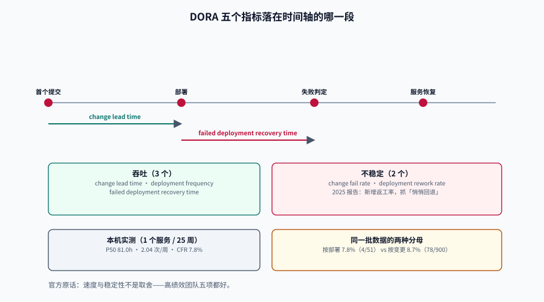

# 交付指标：DORA 五个指标的口径与分母

DORA 的五个指标是目前唯一有**连续十年以上、跨行业样本**支撑的交付度量。它们好用的原因不是「权威」，而是两条工程属性：**口径窄**（只覆盖提交到生产这一段）和**可自动采集**（版本库与发布系统里本来就有这些事件）。

也正因为口径窄，它们最常被误用成它们不测量的东西。本页先把官方口径钉死，再讲四个在真实仓库里一定会遇到的坑：分母错位、计数口径、批次大小、跨服务混算。

::: tip 一句话定位
五个指标分成两组：**吞吐**（多久能过去）与**不稳定**（过去之后会不会回来）。
官方明确说过这两组**不是取舍关系**——高绩效团队五项都好——所以任何「我们选择了稳，所以慢」的说法，在这套指标下是站不住的。
:::

本页判据族 `EMD-A` ~ `EMD-H`，共 8 条。定义表在第七节。




## 一、五个指标与官方定义

| 指标 | 官方定义（译） | 单位 | 官方建议的聚合 | 采集点 |
| --- | --- | --- | --- | --- |
| **Change lead time**（变更前置时间） | 一次变更从**提交进版本控制**到**部署进生产**所花的时间 | 小时/天 | 中位 | Git 首个提交 + 发布记录 |
| **Deployment frequency**（部署频率） | 一段时间内的部署次数，或两次部署之间的间隔 | 次/周 | 按周期计数（率） | 发布系统 |
| **Failed deployment recovery time**（失败部署恢复时间） | 从一次**失败且需要立即介入**的部署，到恢复服务所花的时间 | 小时 | 中位 | 发布记录 + 事件记录 |
| **Change fail rate**（变更失败率） | **需要立即介入**（回滚或热修）的部署占比 | % | 比值 | 发布 + 事件 |
| **Deployment rework rate**（部署返工率） | **非计划、由生产事件触发**的部署占比 | % | 比值 | 发布（trigger 字段） |

::: warning 三条口径细节，官方文件里写得很清楚，但看板经常写错
1. **起点是「提交进版本控制」，不是「需求创建」**。所以它不衡量需求响应速度，只衡量「代码写完到上线」。
2. **「需要立即介入」是关键词**。一个自己恢复的抖动、一次用户无感的告警，**不算**失败部署；把这类算进去，失败率会虚高到没有行动意义。
3. **恢复时间 ≠ MTTR**。官方在 2023 年把 MTTR 换成 FDRT，正是因为 MTTR 把「基础设施故障、第三方降级」和「代码回归」混在一个桶里，均值又被长尾拖走。FDRT 只算**部署引起的失败**，且用中位。
:::

## 二、2026 年的状态：五个指标，但没有「四档」了

这一段每年都在变，写看板前必须核对，否则会把已经退役的东西当目标：

| 事项 | 现状（2026-10 核对） | 对看板的影响 |
| --- | --- | --- |
| 指标数量 | **五个**（新增 `deployment rework rate`），不再是「四个键」 | 还写「四大指标」的模板已经过期 |
| 绩效分档 | DORA **2025 报告停用 Elite / High / Medium / Low**，改用**七个团队画像**（profile） | 「我们在 Elite 档吗」没有官方口径；红绿灯是自造的，要自己解释 |
| 报告重心 | 2025 报告：近 5,000 人样本、**90%** 在工作中使用 AI；AI 采用与**更高吞吐 + 更高不稳定**相关 | 评估 AI 效果时不能只看吞吐，必须同时看返工与失败率 |
| 2026 报告 | 《ROI of AI-assisted Software Development》（2026-05）：J 曲线、500 人组织首年 ROI 约 **39%**、回本约 **8 个月**、失败率 **5% → 6%**、停机成本约 **34.4 万美元**（官方自述为「高不确定度估算」） | 引用时必须带「估算」二字，不能当基准线 |

::: danger 别把「第三方转述的分位数」当官方阈值
2025 报告里确有分布读数（例如「按需部署 16.2%」「变更前置时间 < 1 天 15%」「失败率 0~4% 占 16.7%」），但它们是**样本分布**，不是达标线。
把它们写成「< 1 天 = 优秀」会让团队去优化一个与自身业务无关的数字；正确用法是：**当作参照系，说明「我们在分布里的哪个位置」，然后讨论这个位置是否符合我们的业务约束**。
:::

## 三、分母错位：同一个 8.7% 和 8.7% 不是一回事

本地实测（900 个变更 / 51 次部署 / 4 次失败部署，PostgreSQL 18.6）：

```sql
-- 两种分母，同一批数据
WITH failed AS (SELECT DISTINCT deploy_id FROM em.incident)
SELECT (SELECT count(*) FROM failed)                                  AS failed_deploys,
       (SELECT count(*) FROM em.deploy)                               AS all_deploys,
       round(100.0*(SELECT count(*) FROM failed)/(SELECT count(*) FROM em.deploy),1) AS cfr_by_deploy,
       (SELECT count(*) FROM em.deploy_change dc JOIN failed f USING (deploy_id))    AS changes_in_failed,
       round(100.0*(SELECT count(*) FROM em.deploy_change dc JOIN failed f USING (deploy_id))
             /(SELECT count(*) FROM em.change),1)                     AS cfr_by_change;
```

实测输出：

```text
 failed_deploys | all_deploys | cfr_by_deploy | changes_in_failed | cfr_by_change
----------------+-------------+---------------+-------------------+---------------
              4 |          51 |           7.8 |                78 |           8.7
```

**按部署算 7.8%，按变更算 8.7%**。差异的来源不是误差，是**批次大小**：4 次失败部署一共带走了 78 个变更，平均每次 19.5 个（全库平均批次 20.5、最大 30）。

::: tip 这条差异本身就是一条结论
`cfr_by_change` 高、`cfr_by_deploy` 低，说明**一次失败会连带一批变更**——这是「批量太大」的直接证据，比任何「请拆小 PR」的口号都有说服力。
反过来，如果 `cfr_by_change` 远低于 `cfr_by_deploy`，说明失败常常来自**部署自身**（配置、迁移、依赖），而不是某个变更的逻辑。
:::

所以指标名必须自带分母：`cfr_by_deploy`、`cfr_by_change`、`rework_by_deploy`。裸名 `cfr` 一律视为口径缺失。

## 四、计数口径：47 个提交、12 次合并、5 次部署

同一周的同一批工作，用三种粒度数，会得到三个相差近十倍的数字：

| 粒度 | 计数 | 倍数 | 谁会用这个数 |
| --- | --- | --- | --- |
| 提交数（commits） | 47 | **9.4×** | 「活跃度」看板（最没有意义，但最容易做） |
| 合并数（merges / PR） | 12 | 2.4× | 「PR 吞吐」（比提交好，但仍不是交付） |
| 部署数（deploys） | 5 | 1.0× | DORA 部署频率 |

**部署的计数边界**要写死，否则同一个系统能算出三个频率：

- 一次部署里包含多次重启 / 多次滚动更新 → 记 **1 次**（按「发布单」而不是按「容器重启」）。
- 回滚算不算部署？**算**，但要打 `trigger='rollback'`；它同时进入返工率的分子。
- 热修（hotfix）算不算？**算**，`trigger='hotfix'`，同样进返工分子。
- 同一天多次部署到不同环境（staging / prod）→ **只算 prod**。
- 机器人提交要不要排除？**部署频率不排除**（机器人部署也是部署），但**变更前置时间要能过滤**（本项目 900 条变更里 60 条来自 `dependabot[bot]`，占 6.7%）。

## 五、批次大小：一个贯穿五个指标的隐藏变量

| 观察 | 数字 | 结论 |
| --- | --- | --- |
| 平均每批变更数 | **20.5** | 一次部署带二十个变更，失败时定位成本高 |
| 最大批次 | **30** | 出现事故时「到底是谁引入的」需要二分 |
| 4 次失败部署带走的变更 | **78**（平均 19.5/次） | 失败影响面 = 批次大小 |
| Google 内部约 900 万次变更 | 中位 **24 行**、中位 **1 名**评审 | 高绩效系统的变更**很小**（第三方引用） |

::: warning 批次大小是「一个变量影响五个指标」的唯一一个
批次变大 → 变更前置时间变长（要等同一批的其他改动）、部署频率下降、恢复时间变长（定位更难）、失败率上升（一次带入更多风险）、返工率上升（回滚要回滚一整批）。
所以「拆小批量」不是风格建议，它是五个指标共同的杠杆。DORA 官方指南也把「减少变更批量」列为改善五个指标的**首要建议**。
:::

## 六、跨服务混算：为什么官方专门警告这件事

官方指南的原话大意是：这些指标最适合**按单个应用或服务**度量；把多个团队或整个组织的数字混在一起是**有问题的**，因为上下文差异太大。

用本地数据演示这个「问题」有多大：

```sql
-- A：按周二/周五发布（900 条）；B：每日发布（90 条，6~10 小时）
WITH a AS (
  SELECT extract(epoch FROM d.deployed_at - c.first_commit_at)/3600 h
  FROM em.change c JOIN em.deploy_change dc USING (change_id) JOIN em.deploy d USING (deploy_id)
), b AS (SELECT 6.0 + (g % 5) AS h FROM generate_series(1, 90) g)
SELECT 'A' scope, round(percentile_cont(0.5) WITHIN GROUP (ORDER BY h)::numeric,1) p50
FROM a
UNION ALL SELECT 'B', round(percentile_cont(0.5) WITHIN GROUP (ORDER BY h)::numeric,1) FROM b
UNION ALL SELECT 'A+B', round(percentile_cont(0.5) WITHIN GROUP (ORDER BY h)::numeric,1)
  FROM (SELECT * FROM a UNION ALL SELECT * FROM b) u;
```

实测输出：

```text
 scope |  p50
-------+-------
 A     | 81.0
 B     |  8.0
 A+B   | 77.0
```

合并后的 77.0 小时**既不描述 A，也不描述 B**：B 的 8 小时被 900 条 A 的数据完全淹没，而 A 的 81 小时被拉低了 4 小时。如果拿这个数去汇报「公司整体变更前置时间 77 小时」，它是真的，但**没有任何决策价值**。

::: tip 要汇总就汇总指标，不要汇总数据
正确做法：报表行 = 服务，列 = 五个指标；公司级只呈现「各服务的分布」（例如 12 个服务里，中位从 4 h 到 96 h），而不是一个大平均数。
如果一定要一个数，只能报**中位数的中位数**并注明「这是 12 个服务中位的中间值，不代表任何一个服务」。
:::

## 七、判据族

| 判据 | 约定 | 定错了会怎样 | 怎么验证 |
| --- | --- | --- | --- |
| `EMD-A` | 五个指标全部按官方定义实现，含 `deployment rework rate` | 缺返工率时，「悄悄回滚再重发」这类不稳定完全不可见 | 指标清单含五项，版本注明「dora-5」 |
| `EMD-B` | 变更前置时间的起点是首个提交、终点是生产部署 | 用需求创建当起点会把它变成 lead time，与官方不可比 | SQL 里 join 的是 `change.first_commit_at` 与 `deploy.deployed_at` |
| `EMD-C` | 失败率与返工率的分母必须写进指标名 | 同名不同分母共存，讨论无解 | 指标名匹配 `_(by_deploy\|by_change)$` |
| `EMD-D` | 部署计数边界写死（按发布单、含回滚与热修、只算 prod） | 同一系统算出三个频率 | 发布表有 `trigger` 且枚举值固定 |
| `EMD-E` | 每个指标必须标注主体（单服务），禁止跨服务混合原始数据 | 混算产生「谁都不是」的数（77.0 vs 81.0/8.0） | 汇总接口入参为单 `service` |
| `EMD-F` | 变更前置时间必须能过滤机器人提交 | 机器人高频小提交拉低中位数 | 报表含 `human_only` 开关，实测 60/900 为 bot |
| `EMD-G` | 恢复时间的终点是「服务恢复」，起点是「判定失败」 | 用「发现时间」当起点会低估，用「报告关闭」会高估 | 事件表同时有 `detected_at` 与 `recovered_at` |
| `EMD-H` | 引用任何行业分位数必须标年份与「样本分布 / 官方阈值」 | 被当成达标线，团队优化无关指标 | 基准行含 `kind` 列（distribution / threshold） |

## 八、如何验证

```sql
-- 验证 EMD-A：五个指标一次算齐（本项目 em schema）
WITH lt AS (
  SELECT extract(epoch FROM d.deployed_at - c.first_commit_at)/3600 AS h
  FROM em.change c JOIN em.deploy_change dc USING (change_id) JOIN em.deploy d USING (deploy_id)
), failed AS (SELECT DISTINCT deploy_id FROM em.incident)
SELECT
  round(percentile_cont(0.5) WITHIN GROUP (ORDER BY h)::numeric, 1) AS change_lead_time_p50_h,
  round((SELECT count(*)::numeric / (extract(epoch FROM max(deployed_at)-min(deployed_at))/604800)
         FROM em.deploy), 2)                                        AS deploy_freq_per_week,
  (SELECT count(*) FROM failed)                                     AS failed_deploys,
  round(100.0*(SELECT count(*) FROM failed)/(SELECT count(*) FROM em.deploy), 1) AS cfr_by_deploy,
  round(100.0*(SELECT count(*) FROM em.deploy WHERE trigger='hotfix')
        /(SELECT count(*) FROM em.deploy), 1)                       AS rework_rate
FROM lt;
```

实测输出（51 次部署跨 25.00 周 / 900 条变更）：

```text
 change_lead_time_p50_h | deploy_freq_per_week | failed_deploys | cfr_by_deploy | rework_rate
------------------------+----------------------+----------------+---------------+-------------
                   81.0 |                 2.04 |              4 |           7.8 |         7.8
```

```sql
-- 验证 EMD-F：机器人提交对中位数的影响（应略有差异，不应巨大）
SELECT c.is_bot,
       round(percentile_cont(0.5) WITHIN GROUP (
         ORDER BY extract(epoch FROM d.deployed_at - c.first_commit_at)/3600)::numeric, 1) AS p50_h,
       count(*) AS n
FROM em.change c JOIN em.deploy_change dc USING (change_id) JOIN em.deploy d USING (deploy_id)
GROUP BY c.is_bot ORDER BY c.is_bot;
```

实测输出（人工 81.0 h / 机器人 73.0 h / 各 840 与 60 条）：差异存在但不足以改变结论——**这正是应该被记录下来的量级判断**，而不是每次都重新争论「要不要排除机器人」。

```shell
# 验证 EMD-D：发布表的 trigger 枚举里有没有 rollback / hotfix（缺则返工率算不出来）
psql -Atc "SELECT DISTINCT trigger FROM em.deploy ORDER BY 1;"
```

## 与「构建缓存」的分工：别把构建时长直接当效能指标（第 199 天补充）

构建时长是**结果**，不是**原因**，而且它对口径极度敏感：

| 口径 | 看到的数 | 会得出什么错误结论 |
| --- | --- | --- |
| 平均构建时长 | 被大量短构建拉低 | 「我们很快」，而发布路径上的长构建没被看见 |
| 只统计成功的构建 | 排除了「失败重跑」的成本 | 缓存导致的失败（假命中后的排障重跑）被整段抹掉 |
| 不做「命中/未命中」分层 | 命中与冷启混在一起 | 缓存优化上线后数字没动，被误判为无效 |
| 按「构建次数」算总成本 | 缓存带来的**高命中**反而降低总时长 | 会奖励「把缓存关掉、多跑几次」这种反直觉的行为 |

一条可执行的建议：把构建时长拆成 **`local 命中 / remote 命中 / 未命中`** 三段分别统计，并且**同时看「总耗时」与「假命中导致的返工次数」**。前者是效率，后者是正确性；只报前者，团队会逐渐学会「为了数字好看而放宽缓存」——那正好是把错的东西做得更快。

测量方法与四个指标的完整定义见 [构建缓存与可复现构建](../../BuildCache/Overview/index.md)第三节。

## 参考资料

- DORA，《DORA's software delivery performance metrics》：<https://dora.dev/guides/dora-metrics-four-keys/>（五指标定义、吞吐/不稳定分组、常见陷阱）
- DORA，《A history of DORA's software delivery metrics》：<https://dora.dev/insights/dora-metrics-history>（MTTR → FDRT 的改名理由）
- DORA，《State of AI-assisted Software Development》(2025)：<https://dora.dev/research/>
- DORA，《ROI of AI-assisted Software Development》(2026-05)：<https://dora.dev/ai/roi/calculator>
- Forsgren, N., Humble, J., Kim, G.，《Accelerate》，2018（四指标原始论述）。
- Farley, D.，《Modern Software Engineering》，2021（小批量与「better software faster」的论证）。
