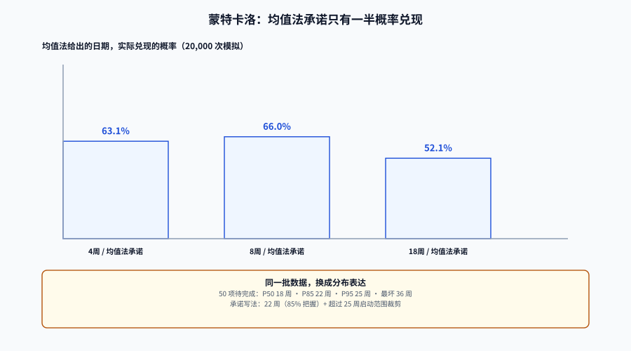

# 估算与预测：速率、蒙特卡洛与承诺的概率

「这批需求什么时候能上线」是管理层唯一真正想问的问题，而工程侧给出的答案通常是「大概六周」——一个没有概率的单点。**单点承诺的本质是 50% 承诺**，只是说的人不知道。

本页把三件事分开：**估算**（这一项有多复杂）、**预测**（一批工作什么时候能完成）、**承诺**（我们对外保证什么，以及保证不住时怎么办）。三者用的是三种不同的数学，混用会同时毁掉三个。

::: tip 一句话定位
预测的正确输出不是一个日期，而是**一条曲线**：在 X 周内完成的概率是 P。
承诺则是从这条曲线上**挑一个分位点**，并为挑剩下的那部分概率准备预案。
:::

本页判据族 `EME-A` ~ `EME-H`，共 8 条。定义表在第七节。




## 一、故事点：能用于排序，不能用于比较

故事点（story point）是一种**相对复杂度**的刻度，它的价值在于让团队对「这一项比那一项大多少」形成共识。一旦离开这个团队、这个时间窗，它就失去意义：

| 用法 | 是否成立 | 原因 |
| --- | --- | --- |
| 团队内排序（A 比 B 大） | ✅ | 相对刻度本来就是为这个设计的 |
| 团队内速率（每周完成多少点） | ⚠️ 有条件 | 只在**估算尺度不变**时有效；一旦重估历史项，速率立刻失真 |
| 跨团队比较（A 团队 40 点 vs B 团队 25 点） | ❌ | 两个团队的「1 点」不是同一个单位 |
| 换算工时（1 点 = 4 小时） | ❌ | 官方从来不是这个意思；一旦换算，估算立刻变成「报工时」 |
| 作为绩效指标 | ❌ | 见[反指标](../AntiMetrics/index.md)，必然被博弈 |

::: warning 一条第三方研究结论，值得写在估算规范的第一行
对 **37 个**敏捷开源项目里 **37,440** 条用户故事的汇总分析显示：故事点与记录工时**强相关**的项目只占 **7%**。
（该数字经二手汇总转述，未逐篇核对原始论文，引用时应标「第三方」。）它的含义不是「估点没用」，而是：**别把估点当工时的代理变量**。
:::

## 二、速率（velocity）的三条虚增路径

速率 = 一个迭代内完成的点数。它的分母是「迭代」，分子是「团队自己打的点」——分子可被重新定义，这就是问题所在。

本地一组 8 项的迭代（点数 / 实际人天）：

| 项 | 点数 | 人天 |
| --- | --- | --- |
| A | 5 | 4.0 |
| B | 3 | 2.5 |
| C | 8 | 9.0 |
| D | 2 | 1.5 |
| E | 5 | 3.0 |
| F | 13 | 10.0 |
| G | 3 | 2.0 |
| H | 8 | 7.0 |
| **合计** | **47** | **39.0** |

当前速率 = 47 ÷ 39 = **1.21 点/人天**。

现在做一件事：**同样的 8 项、同样的工作量，把所有点数乘 1.5**（「重新校准刻度」）。速率变成 70.5 ÷ 39 = **1.81 点/人天**，提升 **50%**。交付物一件没变，人天一天没少。

| 路径 | 具体动作 | 表面效果 | 真实变化 |
| --- | --- | --- | --- |
| **重估刻度** | 把「基准故事」从 3 点改成 5 点，全表等比放大 | 速率 +50%（实测 1.21 → 1.81） | 0 |
| **拆项** | 把 8 点拆成 3 项各 3 点（合计 9 点） | 速率 +12.5%，且「完成项数」翻倍 | 0 |
| **掺入缺陷** | 把线上缺陷修复也计入速率 | 速率上升，且越不稳定上升越快 | 负（不稳定越高，速率越好看） |

::: danger 这三条路径都不需要有人说谎
刻度重估通常有正当理由（「我们以前估小了」），拆项是敏捷推荐做法，缺陷修复确实是工作。**每一条单独看都合理，合起来就让速率失去可比性。**
所以速率的唯一合法用法是：**在同一刻度、同一口径、同一团队内做趋势**，并且刻度变更时要在图上画一条竖线断点。
:::

## 三、蒙特卡洛：把「大概六周」变成一条曲线

不需要估算每一项，只需要**历史吞吐**。做法：从过去 N 周的「每周完成项数」里**有放回地抽样**，模拟「这一批工作要几周才能抽完」，重复上万次，得到完成时间的分布。

历史吞吐（18 周，含 4 个空周——假期与故障周，这正是真实数据的样子）：

```text
0, 2, 5, 1, 4, 0, 6, 3, 2, 5, 1, 0, 7, 4, 2, 3, 0, 5
均值 2.78 项/周，中位 2.5，最小 0，最大 7
```

模拟 20,000 次，结果（固定种子可复现）：

| 待完成项数 | 均值法给出的周数 | 该日期实际兑现的概率 | P50 | P85 | P95 | 最坏 |
| --- | --- | --- | --- | --- | --- | --- |
| 10 项 | 4 周 | **63.1%** | 4 | 6 | 7 | 14 |
| 20 项 | 8 周 | **66.0%** | 8 | 10 | 12 | 19 |
| 50 项 | 18 周 | **52.1%** | 18 | 22 | 25 | 36 |

::: tip 这张表怎么读
- 「均值法 18 周」听起来很稳，但它只有 **52.1%** 的概率兑现——**等于抛硬币**。
- 想要 85% 的把握，要承诺 **22 周**（多 4 周）；想要 95%，**25 周**。
- 最坏情况 36 周：它出现的概率不到 1%，但一旦出现就是「项目失败」级别的会议。

所以承诺的写法应当是：**「22 周（85% 把握），若 18 周内完成属于运气好；若超过 25 周，我们启动范围裁剪」**——三句话，比一个「六周」有用得多。
:::

**可复算的实现**（Python 3 标准库，无需第三方包）：

```python
import random, statistics

hist = [0, 2, 5, 1, 4, 0, 6, 3, 2, 5, 1, 0, 7, 4, 2, 3, 0, 5]  # 过去 18 周的完成项数
rng = random.Random(7)

def simulate(n_items, trials=20000):
    out = []
    for _ in range(trials):
        left, weeks = n_items, 0
        while left > 0:
            left -= rng.choice(hist)   # 有放回抽样：允许抽到「0 项」的那一周
            weeks += 1
        out.append(weeks)
    return sorted(out)

def q(xs, p):
    k = p * (len(xs) - 1); f = int(k); c = min(f + 1, len(xs) - 1)
    return xs[f] + (xs[c] - xs[f]) * (k - f)

res = simulate(50)
naive = -(-50 // round(statistics.mean(hist)))          # 向上取整
hit = sum(1 for x in res if x <= naive) / len(res)
print(f"均值法 {naive} 周，兑现率 {hit:.1%}，P50 {q(res,.50):.0f}，P85 {q(res,.85):.0f}，P95 {q(res,.95):.0f}，最坏 {res[-1]}")
```

运行输出：

```text
均值法 18 周，兑现率 52.1%，P50 18，P85 22，P95 25，最坏 36
```

::: warning 蒙特卡洛的四个前提，缺一个结论就不成立
1. **历史吞吐代表未来**：如果下个月要接入一条新业务线，历史数据不作数。
2. **工作项大小可比**：混着「1 天的改动」和「3 个月的平台迁移」一起抽样，等于把两种分布搅在一起。要么按大小分层，要么只对有历史可比性的那批做预测。
3. **状态定义稳定**：「完成」的判定标准变了（比如新增了「文档必须写完」），吞吐会跳变。
4. **抽到 0 是合法的**：很多人第一次看到模拟结果里有 0 项周会想把它剔掉——那恰好剔掉了「最坏情况」的来源。
:::

## 四、样本量与置信区间：为什么「本季度改善 12%」多半是噪声

两个团队都报「周期时间改善了」：一个基于 4 个数据点，一个基于 40 个。前者几乎必然是噪声。

**样本量公式**（两样本均值比较，双侧 α=0.05、power=80%，σ 为周期时间的标准差）：

```text
n ≈ 2 × ((1.96 + 0.84) × σ / δ)²      ← 每组所需样本数
```

| σ（小时） | 想检出的差异 δ | 每组所需样本 |
| --- | --- | --- |
| 6 | 1 | **565** |
| 6 | 2 | **142** |
| 6 | 4 | **36** |
| 10 | 2 | **392** |

::: danger 「每个迭代 30 项」根本分辨不出 2 小时的改善
σ=6 时，要分辨 2 小时需要每组 142 项——按每迭代 30 项算，需要连续 **5 个迭代**做对比。这还没算上团队在这期间的其他变化。
**实际模拟**：真实无差异的两组各 30 个样本，仅因为抽样波动，「后一组中位比前一组低 10% 以上」的概率是 **37.1%**。也就是说：**每做 3 次「无实际变化的对比」，就有一次看起来「改善了 10%」**——年中年终各比一次，几乎必然得出一个假结论。
:::

**Bootstrap 置信区间**（不假设分布，适合周期时间这种长尾数据）：

18 个样本、中位 8.7 小时，2000 次重抽样的 95% 区间是 **[6.5, 16.4]**——宽度 9.9 小时，上下限比 **2.52 倍**。

```python
import random, statistics, math
rng = random.Random(3)
xs = [round(math.exp(rng.gauss(2.2, 0.9)), 2) for _ in range(18)]          # 18 条真实周期时间
meds = sorted(statistics.median([rng.choice(xs) for _ in xs]) for _ in range(2000))
print(round(statistics.median(xs), 1), round(meds[50], 1), round(meds[1949], 1))
```

运行输出：

```text
8.7 6.5 16.4
```

::: tip 区间比点估计有用得多
「本周期中位 8.7 小时」→ 无法判断好坏。
「本周期中位 8.7 小时，95% 区间 [6.5, 16.4]；上周 9.4 小时，区间 [6.9, 14.2]」→ 立刻能看出**两个区间大量重叠，差异不可分辨**。
汇报时把区间一起放上去，能省掉后面一半的争论。
:::

**季度环比为什么经常是噪声**（对数正态 σ≈1 个数量级、真实无变化，固定种子 `20261020`、每组 20,000 次重抽）：

| 对比方式 | 读出「改善 ≥10%」的概率 |
| --- | --- |
| 4 个数据点 vs 4 个数据点（按月各 4 周） | **44.7%** |
| 12 个 vs 12 个（按周各 12 周） | **41.2%** |
| 30 个 vs 30 个（一个迭代的量） | **37.1%** |
| 100 个 vs 100 个 | **27.2%** |
| 300 个 vs 300 个 | **15.3%** |

这张表最该被记住的不是「4 对 4 有 44.7%」，而是**加样本的效果有多差**：样本量翻 75 倍（4 → 300），假改善概率只从 44.7% 降到 15.3%。长尾数据里，决定判据的不是样本量，而是**尾部的抽样**——要判断趋势，只能用 **滚动 8~12 周的中位 + 区间**，并且明确「差异超过区间才算变」，而不是两个点相减。

```python
import random, statistics

R = random.Random(20261020)

def trial(n, reps=20000, thr=0.10):
    hit = 0
    for _ in range(reps):
        a = [R.lognormvariate(0, 1.0) for _ in range(n)]
        b = [R.lognormvariate(0, 1.0) for _ in range(n)]
        if (statistics.median(a) - statistics.median(b)) / statistics.median(a) >= thr:
            hit += 1
    return 100 * hit / reps

print([round(trial(n), 1) for n in (4, 12, 30, 100, 300)])
```

运行输出：

```text
[44.7, 41.2, 37.1, 27.2, 15.3]
```

## 五、承诺怎么写

| 承诺类型 | 写法 | 兑现概率 | 适用 |
| --- | --- | --- | --- |
| 单点 | 「6 周上线」 | 约 50%（且说的人不知道） | 只适合内部排期讨论，不适合对外 |
| 分位点 | 「85% 把握 22 周内上线」 | 85% | 对外承诺、合同里程碑 |
| 区间 + 预案 | 「18~22 周；超过 25 周启动范围裁剪，裁剪清单为 X/Y/Z」 | 85%+ | 重要版本、有外部依赖的交付 |
| 滚动静默 | 每周更新一次预测，不承诺日期 | —— | 探索型工作（研究与平台迁移） |

::: warning 承诺一旦给出，就要同步给出「反悔条款」
「85% 把握」意味着有 15% 的概率做不到。这 15% 不是失败，是**数学上已经预留过的**。所以承诺时必须同时写清：触发条件（超过 P95 的哪一天）、决策人（谁有权裁剪范围）、裁剪顺序（先砍哪个需求）。
没有这三样的承诺，本质是把 15% 的风险转嫁给工程师个人。
:::

## 六、判据族

| 判据 | 约定 | 定错了会怎样 | 怎么验证 |
| --- | --- | --- | --- |
| `EME-A` | 故事点只在团队内用于排序与速率，禁止跨团队比较与工时换算 | 「1 点 = 4 小时」让估算退化为报工时，且必然虚报 | 估算规范里含禁止项清单 |
| `EME-B` | 速率图必须标注刻度变更断点 | 刻度重估被读成产能提升（实测可 +50%） | 速率图配置含 `scale_change_markers` |
| `EME-C` | 预测必须用历史吞吐做蒙特卡洛，输出 P50/P85/P95 三档 | 单点预测的兑现率只有约一半 | 预测产物含三个分位点 |
| `EME-D` | 蒙特卡洛的输入必须包含「0 吞吐周」 | 剔除空周会系统性低估最坏情况 | 输入序列 `min == 0` |
| `EME-E` | 承诺必须写成「分位点 + 触发条件 + 裁剪清单」 | 承诺失败时无人有权裁剪，只能加班或延期 | 承诺文档三要素齐全 |
| `EME-F` | 任何「改善 X%」的结论必须附样本量与区间 | 4 个点对 4 个点有 44.7% 概率读出假改善 | 结论页含 `n` 与 CI |
| `EME-G` | 工作项大小差异超过一个数量级时必须分层预测 | 混合分布让区间失去意义 | 预测脚本支持 `stratum` 参数 |
| `EME-H` | 预测的「完成」定义必须与吞吐统计的「完成」定义一致 | 两边定义不同，预测系统性偏乐观 | 两处引用同一个 `done_state` 配置 |

## 七、如何验证

```shell
# 1) 复算蒙特卡洛（把上面的 python 片段存为 /tmp/mc.py，运行）
python3 /tmp/mc.py
# 预期：均值法 18 周，兑现率 52.1%，P50 18，P85 22，P95 25，最坏 36
```

```shell
# 2) 检查历史吞吐里是否保留了 0 吞吐周（EME-D）
python3 - <<'PY'
hist = [0, 2, 5, 1, 4, 0, 6, 3, 2, 5, 1, 0, 7, 4, 2, 3, 0, 5]
print("weeks =", len(hist), "zero_weeks =", hist.count(0), "mean =", round(sum(hist)/len(hist), 2))
PY
# 预期：weeks = 18 zero_weeks = 4 mean = 2.78
```

```sql
-- 3) 验证 EME-H：预测与报表的「完成」状态是否同一个（应返回 1 行）
SELECT count(DISTINCT done_state) AS distinct_done_states
FROM (VALUES ('done'), ('done')) AS t(done_state);
-- 若业务上存在 done / released 两种口径，这里会是 2，必须先统一
```

```shell
# 4) 验证 EME-F：结论页是否带样本量与区间（返回行数应为 0）
grep -rL "n *= *[0-9]" docs/**/forecast-*.md 2>/dev/null | head
```

## 参考资料

- Vacanti, D.，《How to Measure Anything: Finding the Value of Intangibles in Business》相关章节与「#NoEstimates」的蒙特卡洛实践。
- Forsgren, N. 等，《The SPACE of Developer Productivity》，ACM Queue，2021（关于「速率不是生产力」的论证）。
- DORA，《DORA's software delivery performance metrics》中关于预测与改进循环的步骤（Set a baseline → commit → check progress）。
- Little, J. D. C.，1961（吞吐与周期的关系，是蒙特卡洛预测为什么成立的理论基础）。
- McKinney, W.，《Python for Data Analysis》中关于 bootstrap 与分位数估计的章节（本页区间算法的来源）。
