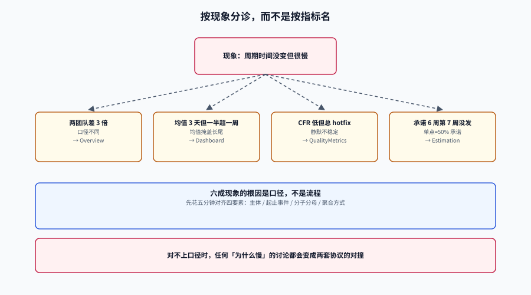

# 常见问题与最佳实践

本页是分诊台：按**你看到的现象**查，而不是按指标名查。每一行都指向一个能立刻做的动作，而不是一个概念。

本页判据族 `EMX-A` ~ `EMX-H`，共 8 条。定义表在第七节。




## 一、十类现象分诊

| 现象 | 最可能的原因 | 先做这一件事 | 详见 |
| --- | --- | --- | --- |
| 「两个团队的交付周期差 3 倍」 | 口径不同（起点/终点/分母） | 把两边的四个口径要素并排写出来，通常在第 2 行就发现不同 | [总览](../Overview/index.md) |
| 「周期时间没变，但大家觉得很慢」 | 流动效率低（大量等待） | 算一次流动效率：增值 ÷ 总时长，多半低于 20% | [流动指标](../FlowMetrics/index.md) |
| 「部署频率上去了，故障也上去了」 | 批次变大 + 验证不足 | 看平均批次大小与失败部署带走多少变更 | [交付指标](../DeliveryMetrics/index.md) |
| 「CFR 很低，但总在 hotfix」 | 静默不稳定，失败没被记录 | 把返工率与 CFR 并排看，差值大就是攒批修复 | [质量指标](../QualityMetrics/index.md) |
| 「平均 3 天，但一半需求超过一周」 | 均值掩盖长尾 | 换成 P50 + P90 两条线 | [看板表达](../Dashboard/index.md) |
| 「承诺 6 周，第 7 周还没发」 | 单点承诺 = 50% 承诺 | 用历史吞吐做蒙特卡洛，承诺改报 P85 | [估算与预测](../Estimation/index.md) |
| 「上月改善 12%，这月又回去了」 | 样本太小，读到的是噪声 | 算区间；4 对 4 个点有 44.7% 概率读出假改善 | [估算与预测](../Estimation/index.md) |
| 「换个系统统计，同一个指标差一倍」 | 去重规则或关联键不同 | 对一遍 `merge_sha` 与「部署」的计数边界 | [数据管道](../DataPipeline/index.md) |
| 「度量一上绩效，数字立刻变好」 | 古德哈特，博弈已启动 | 查三个指纹：批次大小、月末集中度、重开率 | [反指标](../AntiMetrics/index.md) |
| 「不知道从哪开始」 | 没有问题，只有指标清单 | 先写一句话问题（主体 + 起止 + 统计量） | [实战](../Practice/index.md) |

::: tip 分诊的第一步永远是「问口径」
上表十行里有六行的根因都是口径，而不是流程。所以在讨论「为什么慢」之前，先花五分钟对齐四个要素，通常能省掉一小时的争论。
:::

## 二、十二个高频问题

**Q1：五个指标都要做吗？**
不必。先做「变更前置时间 + 部署频率」，它们的数据最容易采；等有发布与事件记录后再补失败率与返工率。恢复时间需要事件系统，通常最后做。

**Q2：部署频率按天算还是按周算？**
按周，且要归一化。`部署次数 ÷ 天数 × 7` 能让 7 天窗口与 30 天窗口可比。按天算会在「一天发 5 次、其余 6 天为 0」时得到 0.71 次/天这种没人能直觉理解的数。

**Q3：一次部署带 20 个变更，前置时间算哪一个？**
每个变更各自算自己的（从各自首个提交到这次部署）。**不要**用「最后一个变更的提交时间」，那会让整批看起来都很快。

**Q4：回滚算不算一次部署？**
算，且要打 `trigger='rollback'`。它同时进入返工率的分子。把回滚排除，会让部署频率虚低、返工率归零。

**Q5：机器人的提交要排除吗？**
变更前置时间建议可切换（本项目实测差异约 10%：81.0 vs 73.0 小时）；部署频率不排除。关键是**占比突变要告警**（基线 6.7%，超 25% 需解释）。

**Q6：周期时间用自然日还是工作日？**
业务方看自然日，团队改进看工作日。两个都算，但**报表上必须标是哪个**，且不要跨口径比较。

**Q7：需求拆得很细，样本量很大，是不是就准了？**
不一定。拆得细会让「一个需求的周期」变成「一个子任务的周期」，与业务感知脱节。样本量与代表性是两件事。

**Q8：只有一个团队，能不能做跨团队对比？**
不能，也不需要。DORA 官方明确说过这些指标适合**按单个应用或服务**度量，跨主体混合是有问题的（本项目实测混算得到 77.0 h，而两个服务分别是 81.0 与 8.0）。

**Q9：老板要一个「研发效率分」，怎么回？**
给五个指标的趋势，不给综合分。理由：权重可以调，结论就可以被定向生产。如果必须给一个数，标注「仅展示，不用于决策」，并写清权重。

**Q10：覆盖率能当质量指标吗？**
只能当过程量。质量的结果量是逃逸率与返工率。覆盖率 80% 但断言无效，比 40% 有效断言更糟。

**Q11：度量要不要上 BI / 度量平台？**
先用五张表跑通一个服务（本项目实测全量五指标 19 个共享块 / 1.124 ms）。平台的成本不在钱，在**口径对齐**——平台不会替你想清楚分母。

**Q12：季度复盘时怎么呈现「没有改善」？**
直接说「不可分辨」，并给出两组数、样本量、区间。这比编一个 5% 的改善更能建立信任，也直接指出下一步（继续攒样本 or 换更大的杠杆）。

## 三、上线自查十二项

发布第一版度量看板前，逐条打勾：

| # | 检查项 | 判定方式 |
| --- | --- | --- |
| 1 | 每个指标都填满口径四要素 | 注册表四列非空 |
| 2 | 指标名自带分母（`cfr_by_deploy`） | `grep` 无裸名 |
| 3 | 周期指标一律 P50 + P90 | 图表配置两个统计量 |
| 4 | 每个数字旁有样本量 | 图表含 `sample_size` |
| 5 | 每张图有三行注释（口径/样本/排除） | 模板含注释块 |
| 6 | 口径变更版本化并有断点标注 | `metric_def` 有 `ver` 与 `effective_from` |
| 7 | 六条数据质量校验每日运行 | 有定时任务与告警 |
| 8 | 无红绿灯、无综合分、无排行榜 | 配置里搜不到 |
| 9 | 分位数不在聚合层计算 | 聚合 SQL 无 `avg(percentile...)` |
| 10 | 未完成项的在制时长可见 | 报表有 `in_progress_over_30d` |
| 11 | 度量用途声明里无「个人绩效」 | 消费方清单已签 |
| 12 | 通过「他测」：外人能答出三个问题 | 有记录 |

::: danger 第 11 项要「签」，不是「说」
「我们不会拿它考核」这句话在压力下会失效。写进文档、写明谁批准的、写明变更需要谁同意——**流程上的约束比承诺可靠**。
:::

## 四、术语速查

| 术语 | 含义 | 一句话提醒 |
| --- | --- | --- |
| **Lead time（前置时间）** | 创建 → 上线 | 业务方视角，含全部排队 |
| **Cycle time（周期时间）** | 开始做 → 完成 | 团队视角，去掉「还没轮到我」 |
| **Change lead time** | 首个提交 → 上线 | DORA 口径，可自动采集 |
| **WIP（在制品）** | 同时进行中的项数 | 与周期成正比（Little 定律） |
| **Flow efficiency（流动效率）** | 增值时间 ÷ 总时长 | 常见值 10%~20% |
| **CFR（变更失败率）** | 需立即介入的部署 ÷ 部署 | 分母是**部署**，不是变更 |
| **Rework rate（返工率）** | 非计划、由事件触发的部署 ÷ 部署 | 抓「悄悄回退」的那部分不稳定 |
| **FDRT（失败部署恢复时间）** | 判定失败 → 服务恢复 | 不是 MTTR，只算部署引起的失败 |
| **Batch size（批次大小）** | 一次部署带的变更数 | 一个变量影响五个指标 |
| **Little's law** | `L = λW` | 反推 WIP 上限的工具 |
| **Monte Carlo（蒙特卡洛）** | 用历史吞吐有放回抽样做预测 | 输出是分布，不是日期 |
| **Goodhart's law** | 指标成为目标就不再是好指标 | 检验：一行代码不改能否变好 |

## 五、十条最佳实践

1. **先有问题，再有指标**：没有问题支撑的指标，三个月后一定被问「这个数说明什么」。
2. **口径写在表里，不写在 Wiki 里**：Wiki 会过期，表不会（`metric_def` 有 `effective_from`）。
3. **分位数只在原始数据上算**：任何形式的「平均分位数」都是错的。
4. **永远带样本量与区间**：`n=18` 和 `n=900` 是两个世界。
5. **中位 + P90 成对出现**：均值只用于容量估算。
6. **按服务度量，汇总只汇总指标**：混算会产生「谁都不是」的数。
7. **一次只改一个约束**：改五个，归因不了，最后只能归因于「大家不配合」。
8. **把「不可分辨」当成合法结论**：它是诚实，也是下一步的输入。
9. **不进个人绩效**：这是测量学要求，不是道德要求。
10. **故意弄坏一次数据，验证校验真的在跑**：恒为 0 的校验比没有校验更危险。

## 六、五种「听起来对」的错误建议

| 建议 | 为什么错 | 更接近对的说法 |
| --- | --- | --- |
| 「先定 KPI，再倒推指标」 | 倒推出来的指标一定可被操纵 | 先定问题与约束，指标是观测手段 |
| 「覆盖率到 80% 质量就有保障」 | 覆盖率是过程量，与逃逸率弱相关 | 覆盖率 + 逃逸率 + 变异测试一起看 |
| 「平均周期 3 天，说明我们很快」 | 均值掩盖长尾，且不描述任何人的体验 | P50 3 天、P90 9 天，两者一起说 |
| 「把所有人的指标放一张榜上，自然会有动力」 | 排行榜把系统问题转成个体竞争 | 按服务列明细，不排序 |
| 「数据要 100% 准确才能用」 | 永远等不到；且「准确」没有定义 | 先让错误可被发现（六条校验），再逐步收敛 |

## 七、判据族

| 判据 | 约定 | 定错了会怎样 | 怎么验证 |
| --- | --- | --- | --- |
| `EMX-A` | 分诊表必须按「现象」而非「指标名」组织 | 读者知道指标名就不会来查分诊表了 | 表首列为现象描述 |
| `EMX-B` | 每个高频问题必须给出可执行动作 | 只解释概念，读者仍然不知道做什么 | 每问含「怎么做」一句 |
| `EMX-C` | 上线自查项必须可机器判定或有明确判定方式 | 「感觉差不多」的检查等于没检查 | 每项含判定方式列 |
| `EMX-D` | 术语表必须与指标注册表用词一致 | 文档与看板两个名字，读者对不上 | 术语名出现在 `metric_def` |
| `EMX-E` | 错误建议条目必须给出「更接近对的说法」 | 只否定不建设，读者无法行动 | 每行含替代说法 |
| `EMX-F` | 引用行业数字必须标来源与年份 | 二手数字被当官方阈值 | 数字旁有出处 |
| `EMX-G` | 本页不得引入新指标族（只做解释与索引） | 分诊页变成第二套定义，口径分裂 | 本页仅 `EMX` 一族 |
| `EMX-H` | 自查项 11（用途声明）必须有批准人与变更条件 | 「不会考核」的口头承诺在压力下失效 | 文档含批准人与变更流程 |

## 八、如何验证

```shell
# 1) 术语与指标注册表一致性（EMX-D）：术语名应能在注册表里找到
psql -Atc "SELECT metric FROM metric_def ORDER BY 1;" | sed -n '1,20p'
# 与第四节术语表对照，缺失的要么补注册表，要么从术语表删除
```

```shell
# 2) 自查第 8 项（EMX-C）：看板里不得有红绿灯/综合分/排行榜
grep -rn "status_color\|overall_score\|leaderboard" config/dashboards/ 2>/dev/null
# 返回空 = 通过
```

```shell
# 3) 自查第 9 项（EMX-E）：聚合层不得计算分位数平均
grep -rn "avg(.*percentile" sql/ config/ 2>/dev/null
# 返回空 = 通过
```

::: tip 这三条检查加起来不到十秒
把能自动化的检查写成脚本、挂进 CI，剩下的靠人（他测、评审）。**不要试图把「口径是否合理」自动化**——那需要判断力，而判断力恰恰是这套东西里最贵的部分。
:::

## 参考资料

- DORA，《DORA's software delivery performance metrics》与常见陷阱：<https://dora.dev/guides/dora-metrics-four-keys/>
- DORA Quick Check：<https://dora.dev/quickcheck>
- Forsgren, N. 等，《The SPACE of Developer Productivity》，ACM Queue，2021。
- Goodhart, C.，1975；Campbell, D. T.，1976（两条定律的原始出处）。
- PostgreSQL 18 文档，聚合与窗口函数：<https://www.postgresql.org/docs/18/functions-aggregate.html>
