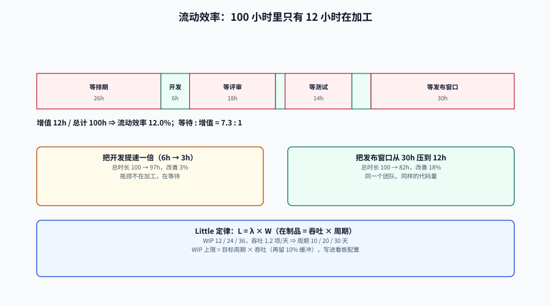

# 流动指标：周期时间、在制品与流动效率

如果只能保留一类效能指标，选流动类。原因很实际：**它最难被个人操纵**。

「写了多少行」「合并了多少 PR」是个人行为，改一下提交习惯就能变；「一批需求从进入到出去花了多久」是系统行为，想改善它必须改系统——减在制品、拆小批量、缩短评审等待、增加发布窗口。这也是为什么精益/看板体系里，流动指标是唯一被当作**约束识别工具**的一类。

::: tip 一句话定位
流动指标回答的是一个不等式：**需求在这套系统里，有多少时间在被加工，有多少时间在等人。**
绝大多数团队的第一反应是「我们做得慢」，而数据往往显示「我们等得久」。
:::

本页判据族 `EMF-A` ~ `EMF-H`，共 8 条。定义表在第七节。




## 一、三个「周期」必须先对齐

| 名称 | 起止 | 谁关心 | 典型用途 | 常见误用 |
| --- | --- | --- | --- | --- |
| **Lead time（前置时间）** | `created` → `deployed` | 业务方、客户 | 对外承诺、端到端体验 | 拿来评价团队效率（把「没排期」的时间算成研发慢） |
| **Cycle time（周期时间）** | `started` → `deployed` | 团队自己 | 识别工序间的等待 | 用来对外承诺（少算了排期，承诺必崩） |
| **Change lead time（变更前置时间）** | `first_commit` → `deployed` | DORA / 平台团队 | 自动化采集、跨团队可比 | 拿来衡量「需求响应速度」（提交时需求已经等过一轮了） |

三者之间不是精度关系，而是**包含关系**：

```text
created ────────────── lead time ──────────────────────────▶ deployed
   │                                                          ▲
   ├── 排队（可能几周）──┤                                    │
   │                     started ──── cycle time ─────────────┤
   │                          │                               │
   │                          ├─ first_commit ─ change LT ────┤
   │                          │                               │
   └── 都包含「发布窗口等待」这一段 ────────────────────────────┘
```

::: danger 三个周期混用最常见的两种翻车
1. **对外承诺用 cycle time**：销售按「我们 2 天就能做完」承诺客户，实际客户等的是 lead time（10.6 天）。本地实测同一批数据：`created → deployed` 是 **10.6 天**，`started → deployed` 是 **2.1 天**，**5.0 倍**。
2. **对内改进用 lead time**：团队被告知「交付周期 6 周」，于是去优化开发速度；可 6 周里有 4 周花在「等排期」和「等发布窗口」——优化开发那一周，最多只能改善 1/6。
:::

## 二、Little 定律：在制品、吞吐与周期时间的恒等式

Little 定律说：稳定系统里，**平均在制品数 L = 吞吐率 λ × 平均停留时间 W**。它不是经验规律，是数学恒等式（1961 年证明），所以它可以反着用：**给定目标周期和实际吞吐，就能算出在制品上限**。

| 在制品（WIP） | 吞吐（项/天） | 由 `W = L / λ` 得到的平均周期 | 含义 |
| --- | --- | --- | --- |
| 12 | 1.2 | **10.0 天** | 当前状态 |
| 24 | 1.2 | **20.0 天** | 吞吐不变、在制品翻倍 → 周期直接翻倍 |
| 36 | 1.2 | **30.0 天** | 同一个团队、同一批人，只是「同时开着的事」更多 |

::: warning 这张表最容易被误读成「WIP 越少越好」
错。WIP 降到 0 意味着没活干。它真正说明的是：**在你没法立刻提高吞吐的前提下，降低 WIP 是唯一能缩短周期的杠杆**。
反过来说，如果团队把 WIP 从 24 降到 12，但吞吐也从 1.2 掉到 0.6（人闲着了、切换成本反而上升），周期一点没变——这时候该查的是瓶颈工序，不是继续砍 WIP。
:::

**WIP 上限怎么定**（可执行算法）：

```text
目标周期 W*（业务能接受的天数）
当前吞吐 λ（近 8 周完成项数 ÷ 天数，用中位数更稳）
WIP 上限 = W* × λ        ← 向上取整，再留 10% 缓冲
例：目标 10 天、λ = 1.2 项/天 → 上限 12；若目标是 7 天 → 上限 8.4 → 取 9
```

这个数要写进看板配置（每列一个上限），并且**超限时不允许拉新卡**——否则上限只是一句口号。

## 三、流动效率：把「等」算出来

流动效率 = **增值时间 ÷ 总前置时间**。这是本页最容易被忽略、也最有解释力的一个数。

本地一份真实形状的分段（单位：小时）：

| 阶段 | 时长 | 类型 |
| --- | --- | --- |
| 等排期 | 26.0 | 等待 |
| 开发 | 6.0 | 增值 |
| 等评审 | 18.0 | 等待 |
| 改评审意见 | 2.0 | 增值 |
| 等测试 | 14.0 | 等待 |
| 测试 | 4.0 | 增值 |
| 等发布窗口 | 30.0 | 等待 |
| **合计** | **100.0** | 增值 12.0 / 等待 88.0 |

流动效率 = 12.0 ÷ 100.0 = **12.0%**；等待 : 增值 = **7.3 : 1**。

::: tip 12% 意味着什么
一个需求在系统里待 100 小时，其中 88 小时没有人在动它。把开发速度提高一倍（6 h → 3 h），总时长从 100 变 97，**改善 3%**。
而把「等发布窗口」从 30 h 压到 12 h（每天都能发），总时长从 100 变 82，**改善 18%**——同样的团队、同样的代码量。
这就是为什么流动效率必须先算：它告诉你钱该花在哪一段。
:::

**等待通常来自四类源头**，对策完全不同：

| 等待类型 | 典型时长量级 | 真实原因 | 对策 |
| --- | --- | --- | --- |
| 等排期 | 天~周 | 产能被占、优先级不清 | 限制在制、明确 WIP 上限、按队列而非按人分配 |
| 等评审 | 小时~天 | 评审人是瓶颈、PR 太大 | 小批量（中位 24 行）、指定评审人、SLA |
| 等环境/测试 | 小时~天 | 环境排队、测试数据不可用 | 按需环境、测试数据流水线（见[测试数据与仿真环境](../../TestDataSimulation/index.md)） |
| 等发布窗口 | 小时~天 | 发布流程按周、审批串行 | 提高发布频率、自动化审批、变更分级 |

## 四、分布形状：为什么「平均 3 天」会骗人

同一份 900 条变更（`first_commit → deployed`，小时）：

| 统计量 | 值 | 读法 |
| --- | --- | --- |
| 中位（P50） | **81.0 h**（3.4 天） | 一半的变更在 3.4 天内上线 |
| P90 | **129.0 h**（5.4 天） | 每 10 个变更里有 1 个超过 5.4 天 |
| 均值 | **86.2 h** | 比中位高 6.4%，被尾部轻微拉高 |
| 最长 | **377.0 h**（15.7 天） | 24 个变更超过 10 天 |
| 去掉最长 5% 后 | 均值 → **78.2 h**、中位 → **77.0 h** | 均值降 9.3%，中位降 4.9% |

::: warning 「平均值」在周期类指标上有两个具体问题
1. **它不是任何人的体验**：平均值 86.2 h 意味着「如果所有人排成一队，队尾那个人等待的时间」——但没人排在队尾，每个人都只经历自己那一条。
2. **它对尾部极其敏感，而尾部恰恰是用户投诉的来源**：24 个超过 10 天的变更，只占 2.7%，却贡献了「这个需求怎么还没上线」的全部记忆。
:::

所以流动指标的**呈现纪律**是：中位 + P90 成对，永远不单独出现均值。均值只在做容量与成本估算（例如「平均占用多少人天」）时使用，且必须标注「用于估算，不用于评价」。

## 五、实现要点：状态迁移事件表

周期时间不能从「当前状态」算出来，只能从**状态迁移历史**算。最小可用模型是一张不可变的事件表：

```sql
CREATE TABLE work_item_transition (
  id           bigserial PRIMARY KEY,
  item_id      bigint      NOT NULL,
  from_state   text,                       -- 首次进入时为 NULL
  to_state     text        NOT NULL,       -- todo / doing / review / test / done
  occurred_at  timestamptz NOT NULL,
  actor        text        NOT NULL,
  UNIQUE (item_id, occurred_at, to_state)   -- 幂等：同刻同状态只记一次
);

-- 周期时间：首次进入 doing → 首次进入 done
WITH s AS (
  SELECT item_id,
         min(occurred_at) FILTER (WHERE to_state = 'doing') AS started_at,
         min(occurred_at) FILTER (WHERE to_state = 'done')  AS done_at
  FROM work_item_transition
  GROUP BY item_id
)
SELECT round(percentile_cont(0.5) WITHIN GROUP (
         ORDER BY extract(epoch FROM done_at - started_at)/86400)::numeric, 2) AS p50_days,
       round(percentile_cont(0.9) WITHIN GROUP (
         ORDER BY extract(epoch FROM done_at - started_at)/86400)::numeric, 2) AS p90_days,
       count(*) AS n
FROM s
WHERE started_at IS NOT NULL AND done_at IS NOT NULL;
```

三个必须处理的细节：

1. **重开（reopen）**：一个项 `done → doing → done`，用 `min()` 取首次进入、`min()` 取首次完成，会把重开后的时间算漏。正确做法是取**最后一次** `done`，或者把重开单独计一次（`reopen_rate` 本身就是个好指标）。
2. **回退（backward move）**：`review → doing` 是正常现象，不要过滤，但要统计次数——回退次数是「需求没想清楚」的直接证据。
3. **状态名漂移**：看板列改过名（`In Progress` → `doing`），历史事件里两种都存在。必须有一张**状态映射表**，且映射也带生效日期。

::: danger 用「当前状态 + 更新时间」估周期时间，是最常见的错
很多团队没有事件表，就用「工单的 `updated_at` − `created_at`」代替。这个数会受到**任何无关编辑**（改个标签、加个评论）影响，且完全无法区分「在等待」还是「在加工」。
先补事件表，再谈度量。事件表本身也是[数据管道](../DataPipeline/index.md)的地基。
:::

## 六、把「等待」拆出来的 SQL

有了分段事件，就能算流动效率。关键是先定义**哪些状态算增值**：

```sql
WITH seg AS (
  SELECT item_id,
         to_state,
         occurred_at,
         lead(occurred_at) OVER (PARTITION BY item_id ORDER BY occurred_at) AS next_at
  FROM work_item_transition
), dur AS (
  SELECT item_id, to_state,
         extract(epoch FROM next_at - occurred_at)/3600 AS hours
  FROM seg WHERE next_at IS NOT NULL
)
SELECT round(sum(hours) FILTER (WHERE to_state IN ('doing','test'))::numeric, 1) AS active_h,
       round(sum(hours)::numeric, 1)                                              AS total_h,
       round((100 * sum(hours) FILTER (WHERE to_state IN ('doing','test')) / sum(hours))::numeric, 1) AS flow_efficiency_pct
FROM dur;
```

::: warning 「增值」的定义会改变结论，所以要写死
同一份数据，把「等评审」算成增值，流动效率能从 12.0% 变成 32.0%；把「测试」也算成等待，会掉到 6.0%。
**定义必须写在指标注册表里，并附一句理由**（例如「评审期间没有人在改这份代码，故记为等待」）。这不是学术洁癖：不同团队用不同定义算出的流动效率放一起比，比不出来的东西比出来的多。
:::

## 七、判据族

| 判据 | 约定 | 定错了会怎样 | 怎么验证 |
| --- | --- | --- | --- |
| `EMF-A` | 每个流动指标必须标明用的是 lead time / cycle time / change lead time 中的哪一个 | 三者混用导致对内对外口径打架 | 指标名或描述含三者之一，无裸名「周期时间」 |
| `EMF-B` | 周期时间必须由状态迁移事件计算，禁止用 `updated_at - created_at` 近似 | 无关编辑污染数据，且无法拆等待 | 计算 SQL 的输入表是 `*_transition` |
| `EMF-C` | 重开必须计入（取最后一次 `done` 或单独统计 `reopen_rate`） | 周期被系统性低估 | `reopen_rate` 是报表必备列 |
| `EMF-D` | 流动效率的「增值状态」清单必须写入指标注册表并附理由 | 不同团队口径不同却互相比较 | 注册表存在 `value_added_states` 字段 |
| `EMF-E` | 每列必须有 WIP 上限，超限时禁止拉入新项 | WIP 无界增长，周期按 Little 定律线性变长 | 看板配置里每列 `wip_limit` 非空 |
| `EMF-F` | WIP 上限必须由 `W* × λ` 算出并记录推导 | 上限靠感觉定，要么形同虚设要么卡死 | 配置文件含 `wip_limit_derivation` 一行算式 |
| `EMF-G` | 报表必须同时给出「在制超期项数」（如 > 30 天未完成） | 幸存者偏差使堵塞的系统看起来很快 | 每期报表含 `in_progress_over_30d` |
| `EMF-H` | 周期指标一律中位 + P90，均值需标注用途 | 均值掩盖长尾，改善尾部的工作无法被看见 | 看板配置两个统计量齐备 |

## 八、如何验证

以下命令本机可执行（PostgreSQL 18.6；样例数据用 `generate_series` 造，脚本不入库）：

```sql
-- 验证 EMF-C：重开会让「首次完成」低估周期
WITH t AS (
  SELECT * FROM (VALUES
    (1, 'doing', timestamptz '2026-09-01 09:00'),
    (1, 'done',  timestamptz '2026-09-03 09:00'),
    (1, 'doing', timestamptz '2026-09-04 09:00'),
    (1, 'done',  timestamptz '2026-09-10 09:00')
  ) AS v(item_id, to_state, occurred_at)
)
SELECT min(occurred_at) FILTER (WHERE to_state='done') AS first_done,
       max(occurred_at) FILTER (WHERE to_state='done') AS last_done,
       max(occurred_at) FILTER (WHERE to_state='done')
         - min(occurred_at) FILTER (WHERE to_state='done') AS undercount
FROM t;
```

实测输出（`undercount` 为 7 天——取首次完成会少算这 7 天）：

```text
      first_done      |      last_done      | undercount
----------------------+---------------------+------------
 2026-09-03 09:00:00+08 | 2026-09-10 09:00:00+08 | 7 days
```

```sql
-- 验证 EMF-E：Little 定律自检（L 与 λ×W 必须接近；差太多说明事件有断档）
WITH s AS (
  SELECT item_id,
         min(occurred_at) FILTER (WHERE to_state='doing') AS a,
         min(occurred_at) FILTER (WHERE to_state='done')  AS b
  FROM work_item_transition GROUP BY item_id
), span AS (
  SELECT min(a) AS t0, max(b) AS t1 FROM s WHERE a IS NOT NULL AND b IS NOT NULL
)
SELECT (SELECT count(*) FROM s WHERE a IS NOT NULL AND b IS NULL)::numeric
         / nullif(extract(epoch FROM (SELECT t1-t0 FROM span))/86400, 0) AS lam,
       (SELECT avg(extract(epoch FROM b-a)/86400) FROM s WHERE b IS NOT NULL) AS w,
       (SELECT avg(extract(epoch FROM b-a)/86400) FROM s WHERE b IS NOT NULL)
         * (SELECT count(*) FROM s WHERE a IS NOT NULL AND b IS NULL)::numeric
         / nullif(extract(epoch FROM (SELECT t1-t0 FROM span))/86400, 0) AS little_L;
```

::: tip `little_L` 与实际在制数的偏差超过 30%，先别改流程
它几乎总是意味着三件事之一：① 事件表有断档（某状态没记）；② 统计窗口内有大量项在窗口外完成；③ 系统不处于稳定状态（刚大规模拉新需求）。
这三种情况下算出来的周期时间都不可用，改流程只会把噪声当反馈。
:::

```shell
# 验证 EMF-E：每列是否都配了 WIP 上限（返回空即全部配齐）
grep -L "wip_limit" config/board-columns.* 2>/dev/null
```

## 参考资料

- Little, J. D. C.，《A Proof for the Queuing Formula: L = λW》，Operations Research 9(3)，1961。
- Reinertsen, D.，《Principles of Product Development Flow》，2009（排队论在研发系统中的工程化表述，WIP 上限与批量大小的推导）。
- Anderson, D.，《Kanban: Successful Evolutionary Change for Your Technology Business》，2010（流动效率与看板度量的实践来源）。
- DORA，《Working in small batches》能力说明：<https://dora.dev/capabilities/working-in-small-batches/>
- Forsgren, N. 等，《Accelerate》，2018（第 2 章关于 lead time 的可采集性论证）。
