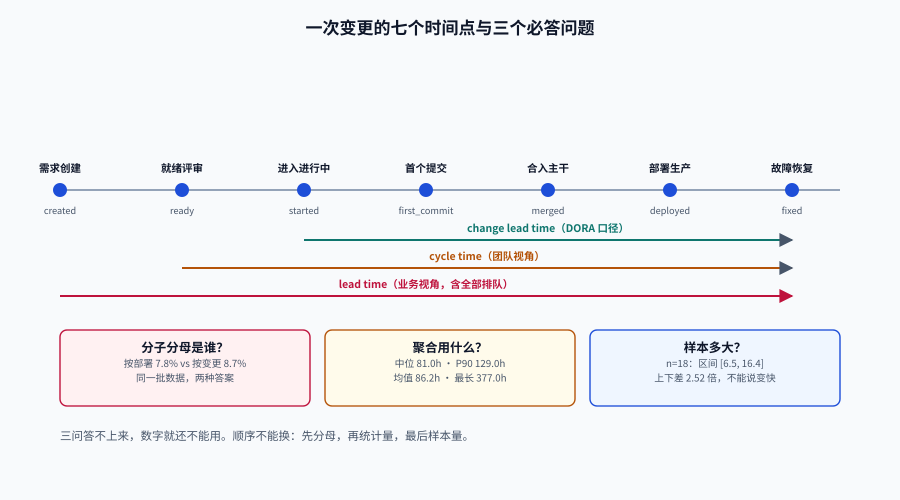

# 总览：三个必答问题与五种失败模式

研发效能度量的全部难度不在「算」，而在「算之前」：**你要统计的那个东西，边界在哪里。**

一次改动从「有人提了个想法」到「用户用上了」，中间至少有七个可以当起点、四个可以当终点的时刻。任选两个组成一个区间，都能叫「交付周期」，数值可以相差 5 倍——而且每一个都不算错。所以本页不给指标清单，只给**判断一套指标是否可信的四要素**，以及五种「数字全绿但结论全错」的失败模式。

::: tip 一句话定位
效能度量是一套**协议**：先约定「谁、从哪一刻到哪一刻、除以谁、怎么汇总」，再谈数字。协议没写清楚之前，任何比较都是在比两份不同的协议。
:::

本页判据族 `EMO-A` ~ `EMO-H`，共 8 条。定义表在第七节。




## 一、三个必答问题

任何一个效能数字被人报出来，先问三句，答不上来就不用往下算：

1. **分子分母是谁？** 「变更失败率 8.7%」——是 8.7% 的**部署**失败，还是 8.7% 的**变更**失败？两者差多少，取决于一次部署里塞了多少个变更。本地实测（900 个变更 / 51 次部署 / 4 次失败部署）：按部署算是 **7.8%**，按变更算是 **8.7%**——同一天、同一批数据，两种答案。
2. **聚合用了什么统计量？** 平均、中位、P90 是三个完全不同的故事。同一份 900 条变更的数据，中位 81.0 小时、P90 129.0 小时、均值 86.2 小时、最长 377.0 小时；去掉最长的 5% 之后，**均值降 9.3%、中位数只降 4.9%**——均值被尾部拉着走，中位数不理它。
3. **样本多大、误差多少？** 18 个样本的中位是 10.7 小时，bootstrap 95% 区间是 **[6.1, 13.6]**，宽度 7.4 小时、上下比 2.21 倍。这意味着「这个月比上个月快了 1 小时」在这个样本量下**根本不可分辨**。

::: danger 三个问题的顺序不能换
先定分母，再定统计量，最后谈样本量。反过来做（先看数字、再找口径解释）就会得到「为了结论挑口径」——这是度量工作里最常见的一种自欺，且它不需要任何人有恶意。
:::

## 二、口径四要素

一套口径写不全，就一定会漂。把下面四行写进 `metric_def` 表（结构见[数据管道](../DataPipeline/index.md)），缺一行就不许上线：

| 要素 | 要回答的问题 | 写错的典型后果 |
| --- | --- | --- |
| **主体（scope）** | 统计的是**一个服务**、一个团队、一个仓库，还是「整个研发部」？ | 跨服务混算。两个服务各自 P50 是 81.0 h 与 8.0 h，混起来变 **77.0 h**，谁都不是这个数 |
| **起止事件（events）** | 起点用哪个事件、终点用哪个事件？ | 从「创建」算是 10.6 天，从「开始做」算是 2.1 天，**5.0 倍** |
| **分子分母（formula）** | 分子是部署还是变更？分母排除了机器人提交吗？ | 机器人提交混进来会把部署频率抬高一截（本项目实测 900 条变更里 60 条来自 `dependabot[bot]`，占 6.7%） |
| **聚合（aggregation）** | 窗口多长、用中位还是均值、分位数怎么算？ | 周中位数再求平均 ≠ 全量中位数（25 周不等量样本复算：**101.5 h** vs **113.5 h**，低 10.6%）；两个服务各报 P90 再平均 = 132.9 h，而真实合并 P90 = 103.2 h |

四要素里最容易漏的是**主体**，因为它看起来「不言自明」。而 DORA 官方指南专门用一整条注意事项写这件事：这些指标**最好按单个应用或服务度量**，把多个团队或整个组织的数字混在一起是**有问题的**，因为上下文差异太大。

## 三、七个时间点：起止事件的选择

一条变更的生命周期里，能被当成时间戳的时刻至少有七个。它们之间的差值，构成了所有「周期类」指标：

| 时间点 | 事件 | 谁记录 | 常见误用 |
| --- | --- | --- | --- |
| `created` | 需求/工单创建 | 需求系统 | 当交付周期起点 → 把「还没人看」的等待也算成研发慢 |
| `ready` | 通过就绪评审（DoR） | 需求系统 | 好起点，但很多团队没有这个状态 |
| `started` | 首次进入「进行中」 | 看板 | 最常见的周期时间起点 |
| `first_commit` | 第一个提交进版本库 | Git | **DORA 的 change lead time 起点**，可自动化采集 |
| `merged` | 合入主干 | Git/评审系统 | 常被当成终点，但此时用户还没拿到 |
| `deployed` | 部署到生产 | 发布系统 | 大多数交付指标的终点 |
| `fixed` | 故障修复完成 | 事件系统 | 恢复时间的终点，注意是「恢复」不是「定位」 |

::: warning 「交付周期」在不同语境下指三件不同的事
- **Lead time（前置时间）**：`created` → `deployed`，客户视角，包含全部排队。
- **Cycle time（周期时间）**：`started` → `deployed`（或 `started` → `merged`），团队视角，去掉「还没轮到我」的等待。
- **Change lead time（变更前置时间）**：`first_commit` → `deployed`，DORA 口径，因为只有它**能被版本库自动采集**，不依赖人手动改状态。

三者不是精度差异，是**语义差异**。写看板时必须写清用的是哪一个，否则「我们周期时间 2 天」和「我们交付周期 2 周」会同时成立且互不矛盾。
:::

## 四、度量的三种用途，只有两种能共用一套数字

| 用途 | 问的问题 | 数字的特征 | 能不能公开到个人 |
| --- | --- | --- | --- |
| **诊断** | 系统里哪个环节在等待？ | 要看分布与构成，允许脏一点 | 不能，也不需要 |
| **预测** | 这批需求大概什么时候能完？ | 要区间，要历史吞吐，要样本量 | 不能 |
| **考核** | 这个人/团队干得好不好？ | 一旦用于考核，**数据本身会变** | 这正是问题所在 |

第三种用途不是「更严格的第二种」，它是**另一种物理过程**：被测量者会针对指标调整行为。DORA 官方指南把它列进常见陷阱的第一条——把指标设为目标、忽略古德哈特定律，团队就会去 game 这些指标。

::: danger 一个真实形状：把部署频率挂到个人
第一周：每人每天合并 1~2 个小 PR，部署频率漂亮。
第三周：为了「一次部署算一次成绩」，改动开始攒批——**一次部署带 20.5 个变更**（这是本项目实测的平均批次大小，最大 30）。
第五周：部署频率没降多少，但**一次失败部署会一次性带走 78 个变更**（实测），失败影响面变成原来的二十倍。

指标在变好的同时，系统在变坏。这就是为什么本专题把[反指标](../AntiMetrics/index.md)单独写一页。
:::

## 五、五种失败模式

这五种失败都能让数字「看起来完全正常」，构建不会报错，会议上没人质疑，但结论是错的。

| 失败模式 | 表现 | 本地可复算的数字 | 对策 |
| --- | --- | --- | --- |
| **混算（blend）** | 把不同服务/团队的数字合在一起报 | 服务 A 中位 81.0 h、服务 B 中位 8.0 h，合并中位 **77.0 h** | 口径四要素里的「主体」写死为单服务；要汇总就汇总**各服务的指标**，不汇总**原始数据** |
| **口径漂移（drift）** | 中途改了起点/终点，曲线出现「跳变」 | 起点从 `created` 换成 `started`，10.6 天变 2.1 天（**5.0×**） | 口径进版本表；看板标注「v3 自 2026-07-01 起」；旧数据要么重算要么断点 |
| **分母错位（denominator）** | 失败率的分母用了部署，却按变更解释 | 7.8%（按部署）vs 8.7%（按变更），同一批数据 | 分母写进指标名，如 `cfr_by_deploy` 而不是 `cfr` |
| **均值掩盖（mean hides tail）** | 平均值正常，尾部很难看 | 中位 81.0 h / 均值 86.2 h / P90 129.0 h / 最长 377.0 h（15.7 天） | 一律中位 + P90 成对呈现；均值只在做容量/成本估算时用 |
| **幸存者偏差（survivorship）** | 只统计「已完成」的项，卡住的项永远不在样本里 | 卡了 60 天还没完成的项不进入任何周期统计 | 同时报「未完成项的在制时长」，或按**进入时间**切片（cohort）而不是按完成时间 |

::: warning 第五种最隐蔽
按「完成时间」切片（这个月完成了哪些）会自动排除掉**所有卡住的东西**。团队越堵，样本越好看。
正确做法是按**进入时间**切片：这个月**进入**流程的 40 项，到月底完成了 22 项、在制 18 项，其中 5 项已超 30 天。这三个数字一起看，才知道系统真实状态。
:::

## 六、五步决策路径

第一次给一个团队做度量，按这五步走，不要跳：

```text
1. 定问题（不是定指标）
   「为什么需求从提出到上线要 6 周？」→ 这个问题决定了要看流动，不是看产出
2. 定主体与边界
   一个服务 / 一个团队 / 一条流水线，只选一个，写进 scope
3. 定起止事件与分母
   查一遍现有系统里这些事件到底有没有、准不准（多半缺一半）
4. 先跑一个月，只看分布与样本量
   不设目标、不做排名、不进绩效，只回答「我们现在的形状是什么」
5. 选一个约束改，改完用同一口径复测
   一次只改一个，否则归因不了
```

::: tip 第 4 步为什么要「只看不动」
第一个月的数字几乎一定包含大量口径错误与数据缺口（孤儿部署、时间倒挂、机器人混入）。这时候拿它做目标，等于把错误固化成 KPI。
本专题的[实战](../Practice/index.md)把这一步写成 S1~S10 的验收序列，就是为了让「先看清」变成一个有终点的动作。
:::

## 七、判据族

| 判据 | 约定 | 定错了会怎样 | 怎么验证 |
| --- | --- | --- | --- |
| `EMO-A` | 每个指标必须能填满口径四要素（主体/起止/分子分母/聚合） | 四要素缺一项，数字就不可比，讨论必然变成口径之争 | 指标注册表里四列非空的比率 = 100% |
| `EMO-B` | 指标名必须自带分母或口径后缀（如 `cfr_by_deploy`） | 同名不同分母的指标会在同一张看板上共存 | `grep` 指标名清单，无裸名 `cfr` / `lead_time` |
| `EMO-C` | 周期类指标一律「中位 + P90」成对呈现，均值仅用于容量估算 | 单报均值会把长尾藏起来（尾部使均值 +9.3%、中位 +4.9%） | 看板配置里每个周期指标至少两个统计量 |
| `EMO-D` | 主体（scope）必须写入指标定义，且汇总只能汇总指标、不汇总原始数据 | 混算产生「谁都不是」的数（77.0 h） | 汇总接口的入参里不允许出现多服务 ID |
| `EMO-E` | 口径变更必须升版本并带生效日期，历史数据要么重算要么断点标注 | 曲线跳变被解释成「流程改善」 | `metric_def` 表 `ver` 单调、`effective_from` 非空 |
| `EMO-F` | 统计周期类指标时必须同时给出未完成项的在制时长 | 幸存者偏差让「越堵越好看」 | 每期报表含 `in_progress_over_30d` 一列 |
| `EMO-G` | 度量结果不得用于个人考核；如需评价，只用系统指标 + 抽样 + 定性 | 数据被博弈，指标与交付脱钩 | 指标消费方清单里无「绩效」用途 |
| `EMO-H` | 任何对外引用的行业基准必须标注来源、年份与「官方/第三方」 | 二手数字被当成官方阈值，团队按错误目标优化 | 基准行含 `source` 与 `year` 两列 |

## 八、如何验证

以下命令本机可执行（PostgreSQL 18.6，脚本不入库，只用于核对口径差异）：

```sql
-- 验证 EMO-C：同一批数据，三个统计量差多少
WITH x AS (
  SELECT extract(epoch FROM deployed_at - first_commit_at)/3600 AS h
  FROM em.change c JOIN em.deploy_change dc USING (change_id) JOIN em.deploy d USING (deploy_id)
)
SELECT round(percentile_cont(0.5) WITHIN GROUP (ORDER BY h)::numeric, 1) AS p50_h,
       round(percentile_cont(0.9) WITHIN GROUP (ORDER BY h)::numeric, 1) AS p90_h,
       round(avg(h)::numeric, 1) AS mean_h,
       count(*) AS n
FROM x;
```

实测输出（900 条变更、51 次部署）：

```text
 p50_h | p90_h | mean_h |  n
-------+-------+--------+-----
  81.0 | 129.0 |   86.2 | 900
```

```sql
-- 验证 EMO-D：混算的偏差（B 服务用 90 条 6~10 小时的合成数据做对照）
WITH a AS (
  SELECT extract(epoch FROM d.deployed_at - c.first_commit_at)/3600 h
  FROM em.change c JOIN em.deploy_change dc USING (change_id) JOIN em.deploy d USING (deploy_id)
), b AS (SELECT 6.0 + (g % 5) AS h FROM generate_series(1, 90) g)
SELECT 'A' scope, round(percentile_cont(0.5) WITHIN GROUP (ORDER BY h)::numeric,1) p50 FROM a
UNION ALL SELECT 'B', round(percentile_cont(0.5) WITHIN GROUP (ORDER BY h)::numeric,1) FROM b
UNION ALL SELECT 'A+B', round(percentile_cont(0.5) WITHIN GROUP (ORDER BY h)::numeric,1)
  FROM (SELECT * FROM a UNION ALL SELECT * FROM b) u;
```

实测输出：

```text
 scope |  p50
-------+-------
 A     | 81.0
 B     |  8.0
 A+B   | 77.0
```

`A+B` 的 77.0 既不描述 A（81.0）也不描述 B（8.0）——这就是为什么汇总只能汇总指标。

```shell
# 验证 EMO-F：报表里有没有「在制超期」这一列（返回空说明缺失）
grep -L "in_progress_over_30d" docs/**/metrics-*.md 2>/dev/null
```

### 复算「周中位再求平均」的偏差

口径四要素里「聚合」那一行给了两个读数。第一个可以用 20 行标准库脚本复现（固定种子，脚本不入库）：

```python
import random, statistics

R = random.Random(20261021)                  # 固定种子，读数可复现
sizes = [R.randint(3, 60) for _ in range(25)] # 25 周，周量 3~60 条（节假日 / 冲刺）
weeks = []
for n in sizes:
    mu = 4.0 + 0.02 * n                       # 量大的周更慢：批次大 → 等得久
    weeks.append([R.lognormvariate(mu, 0.55) for _ in range(n)])

allv  = [x for w in weeks for x in w]
wm    = [statistics.median(w) for w in weeks]
pooled = statistics.median(allv)
avg    = statistics.mean(wm)
wavg   = sum(m * len(w) for m, w in zip(wm, weeks)) / len(allv)
print(f"n={len(allv)} pooled={pooled:.1f} avg={avg:.1f} wavg={wavg:.1f}")
```

运行输出：

```text
n=684 pooled=113.5 avg=101.5 wavg=116.8
```

判读：**等权平均每周中位**低估 10.6%（小样本周被给了和 60 条的大周一样的权重）；**按周量加权**后 116.8 与真实 113.5 只差 2.9%，但加权平均分位数依然**没有理论保证**——它只是离得近一点。唯一正确的做法仍是回到原始数据算。

## 九、四种不该做度量的场景

1. **团队还在救火，且故障原因未明**：此时所有指标都在抖，读数是噪声，先做事后分析（postmortem）比做度量有用。
2. **数据源还没打通**：`deployed` 事件只能靠人手动填，那这个字段的准确率大约等于填表人的心情；先修数据源。
3. **上级已经内定了结论**：度量会被反向工程成「证明结论」的材料，这时候最专业的做法是拒绝出数，而不是出一份「配合」的数。
4. **团队规模 < 5 且全在同一个房间**：信息通过对话传递比通过看板快，度量只会增加填报负担。

## 参考资料

- DORA，《DORA's software delivery performance metrics》：<https://dora.dev/guides/dora-metrics-four-keys/>（五指标、吞吐/不稳定分组、「按单服务度量」与古德哈特陷阱的官方表述）
- DORA，《How to empower software delivery teams》：<https://dora.dev/guides/how-to-empower-software-delivery-teams/>
- Forsgren 等，《The SPACE of Developer Productivity》，ACM Queue，2021。
- Goodhart, C.，《Problems of Monetary Management: The U.K. Experience》，1975。
- Campbell, D. T.，《Assessing the Impact of Planned Social Change》，1976（Campbell 定律：指标一旦用于决策，就失去作为指标的价值）。
