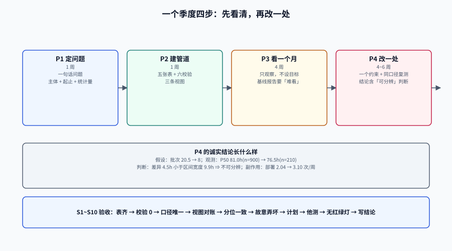

# 实战：给一个团队做一季度度量

前八页讲的是零件，本页把零件装成一台能跑的机器：**一个团队、一个季度、四个动作**。

选择「一个季度」不是随意的时间盒，而是因为：**一个月的样本量通常不足以分辨任何有意义的变化**（见[估算与预测](../Estimation/index.md)的样本量测算），而半年又太长，中间的口径与人员变动会把因果搅乱。季度是「能看见变化」与「还能归因」之间的最短窗口。

::: tip 一句话定位
这一页的产出不是「一套指标体系」，而是**四份可交付物**：一份口径表、一条能每天跑的数据管道、一张四块结构的看板、一份写了「改了什么、复测结果如何」的季度记录。
:::

本页判据族 `EMR-A` ~ `EMR-H`，共 8 条。定义表在第八节。




## 一、四个动作与它们的完成判据

| 阶段 | 时长 | 动作 | 完成判据（可验证） |
| --- | --- | --- | --- |
| **P1 定问题** | 1 周 | 找出一个具体的、可观测的抱怨，把它翻译成流动/交付问题 | 一句话问题 + 一个指标 + 一个主体，写进 `metric_def` 草案 |
| **P2 建管道** | 1 周 | 五张表 + 六条校验 + 三条视图 | 六条校验全 0；视图能在 2 秒内出数 |
| **P3 看一个月** | 4 周 | 只观察，不设目标、不排名、不进绩效 | 产出基线报告（分布 + 样本量 + 区间） |
| **P4 改一处 + 复测** | 4~6 周 | 选一个约束改，用同一口径复测 | 改前/改后两组数 + 区间 + 「是否可分辨」的结论 |

::: warning P3 是最容易被跳过的阶段，也是最不能跳的
第一周的读数几乎一定包含口径错误与数据缺口。跳过 P3 直接设目标，等于把错误固化成 KPI，然后在季度末用「大家不配合」解释为什么没达成。
P3 的产出应该是一份**难看的**基线报告：里面有 0 条部署的月份、有 377 小时的离群值、有 6.7% 的机器人提交。这些「难看」正是后面所有结论的可信度来源。
:::

## 二、P1：把一个抱怨翻译成指标

抱怨通常长这样：「需求提了两个月还没上线，销售都不敢承诺了。」

翻译过程有四个动作，每个都要留下痕迹：

| 动作 | 本例的结果 | 为什么必须写下来 |
| --- | --- | --- |
| **定主体** | 服务 `svc-board`（不含移动端） | 不写主体，后面一定会混算 |
| **定起止** | `created → deployed`（业务方视角） | 销售承诺的是这个，不是 `first_commit` |
| **定统计量** | 中位 + P90，按周 | 中位代表典型，P90 代表投诉来源 |
| **定不测什么** | 不测个人、不测「需求数量」 | 提前排除博弈面，减少后续阻力 |

得到一句话问题：**「`svc-board` 的需求从创建到上线的中位时间是多少？P90 是多少？等待主要发生在哪一段？」**

注意它没有问「怎么变快」——那是 P4 的事。P1 只负责把「感觉慢」变成「可以量的慢」。

## 三、P2：建管道（可直接抄的骨架）

完整 DDL 在[数据管道](../DataPipeline/index.md)，这里只给三条**视图**——它们是把表变成看板的最后一层，也是最容易写错的一层：

```sql
-- V1 变更前置时间：取第一次部署，排除可选
CREATE VIEW v_change_lead_time AS
SELECT c.change_id, c.service, c.is_bot,
       c.first_commit_at, d.deployed_at,
       extract(epoch FROM d.deployed_at - c.first_commit_at) / 3600 AS lead_time_h
FROM change c
JOIN LATERAL (
  SELECT dd.deployed_at
  FROM deploy_change dc JOIN deploy dd USING (deploy_id)
  WHERE dc.change_id = c.change_id
  ORDER BY dd.deployed_at
  LIMIT 1                                  -- 第一次部署，不是最后一次
) d ON true;

-- V2 变更失败率（按部署）：分母写进视图名
CREATE VIEW v_cfr_by_deploy AS
WITH failed AS (SELECT DISTINCT deploy_id FROM incident)
SELECT d.service,
       count(*)                                            AS deploys,
       count(*) FILTER (WHERE f.deploy_id IS NOT NULL)      AS failed_deploys,
       round(100.0 * count(*) FILTER (WHERE f.deploy_id IS NOT NULL) / count(*), 1) AS cfr_pct
FROM deploy d LEFT JOIN failed f USING (deploy_id)
GROUP BY d.service;

-- V3 批次大小：一次部署带多少变更（博弈指纹之一）
CREATE VIEW v_batch_size AS
SELECT d.service, d.deploy_id, d.deployed_at, count(dc.change_id) AS changes_in_batch
FROM deploy d LEFT JOIN deploy_change dc USING (deploy_id)
GROUP BY d.service, d.deploy_id, d.deployed_at;
```

::: danger 视图里两个必须写死的细节
1. **`LIMIT 1` 配 `ORDER BY deployed_at`**：取第一次部署。少了 `ORDER BY`，`LIMIT 1` 的结果不确定，同一个查询两次跑出不同答案。
2. **`LEFT JOIN` 而不是 `JOIN`**：`v_cfr_by_deploy` 如果用内连接，没有失败部署的服务会直接消失——「零失败」变成「不在报表里」。
:::

## 四、P3：一个月的基线报告长什么样

本机实测的一组数（900 条变更 / 51 次部署，PostgreSQL 18.6），可以作为报告的骨架：

| 项 | 读数 | 样本 | 怎么读 |
| --- | --- | --- | --- |
| 变更前置时间 P50 | **81.0 h**（3.4 天） | 900 | 一半变更 3.4 天内上线 |
| 变更前置时间 P90 | **129.0 h**（5.4 天） | 900 | 每 10 个有 1 个超过 5.4 天 |
| 均值 / 最长 | 86.2 h / **377.0 h** | 900 | 24 条超过 10 天，最长 15.7 天 |
| 部署频率 | **2.04 次/周** | 25 周 | 每周二、周五各一次窗口 |
| 变更失败率（按部署） | **7.8%** | 51 | 4 次失败部署 |
| 变更失败率（按变更） | **8.7%** | 900 | 4 次失败带走 78 个变更 |
| 返工率 | **7.8%** | 51 | 4 次 hotfix |
| 平均批次大小 / 最大 | **20.5 / 30** | 51 | 一次部署带二十个变更 |
| 机器人变更占比 | **6.7%** | 900 | 60 条，可忽略但需登记 |

::: tip 这份报告里最该被讨论的是「平均批次 20.5」
前置时间 81 小时、失败率 7.8% 都是结果；批次 20.5 是**原因侧**的数字，而且它是唯一一个「改了就同时影响五个指标」的变量。
P4 选约束时，优先选这种「一个动作影响多个结果」的，而不是选「看起来最难看」的那个。
:::

## 五、P4：改一处，然后诚实地复测

假设 P4 的选择是「缩小批次」：把单次部署的变更数从 20.5 降到 8 以内。复测要回答三个问题：

1. **变了多少**：两期的中位与 P90 各是多少？
2. **能不能分辨**：两组样本量与区间是否重叠？（见[估算与预测](../Estimation/index.md)）
3. **有没有副作用**：部署频率上升了吗？失败率变了吗？返工率变了吗？

一个诚实的复测结论长这样：

```text
假设：批次从 20.5 降到 8，前置时间中位下降
观测：改前 P50 81.0 h（n=900，区间宽 9.9 h）；改后 P50 76.5 h（n=210）
判断：差异 4.5 h 小于区间宽度，**不可分辨**
副作用：部署频率 2.04 → 3.10 次/周；失败率 7.8% → 7.2%（同样不可分辨）
结论：方向符合预期，但样本量不足以下结论；继续观察 6 周再判
```

::: warning 「不可分辨」是一个合法且有价值的结论
团队最怕听到「没有效果」，所以容易把 4.5 小时的差异说成「改善 5.5%」。但在 n=210、区间宽 9.9 小时的情况下，这个差异完全可能是抽样噪声。
把「不可分辨」写进报告，比编一个改善数字更能建立长期信任——而且它直接告诉你下一步该做什么：**要么继续攒样本，要么换一个效应更大的杠杆**。
:::

## 六、S1~S10 验收序列

按顺序执行，任一步不符合预期就停下修，不要跳到下一步：

| 步骤 | 命令/动作 | 预期 |
| --- | --- | --- |
| **S1** | `psql -c "\dt"` 看五张表 | `change` / `deploy` / `deploy_change` / `incident` / `metric_def` 齐全 |
| **S2** | 跑六条质量校验 | 全部为 0（`bot_pct` 为阈值内） |
| **S3** | `SELECT count(*) FROM metric_def WHERE retired_at IS NULL` 按 metric 分组 | 每个 metric 恰好 1 行现行 |
| **S4** | 跑 `v_change_lead_time` 计数 | 与 `change` 表条数一致（无漏关联） |
| **S5** | 复算 P50/P90 | 与看板数字一致（误差 0） |
| **S6** | 手动删一条 `deploy_change`，再跑 S2 | Q5 应变为 1，验证校验真的有效 |
| **S7** | 恢复数据，检查 `EXPLAIN (ANALYZE, BUFFERS)` | 全量五指标 < 50 ms、共享块 < 100 |
| **S8** | 找一位未参与制作的人看图答题 | 能答出「数是多少 / 样本多大 / 口径是什么」 |
| **S9** | 检查看板是否有红绿灯/综合分/排行榜 | 三者皆无 |
| **S10** | 把本季度结论与「不可分辨」的判断写进文档 | 文档含改前/改后两组数 + 区间 + 结论 |

::: danger S6 是唯一一个「故意弄坏」的步骤
不故意删一条关联，你永远不知道 Q5 那条校验是不是真的在跑（而不是查了个恒为 0 的条件）。
同理，S9 的检查要写在**发布前**，不是季度末——看板一旦上线，加个红绿灯只需要一次「顺手」的提交。
:::

## 七、四个边界：这个季度不做什么

1. **不做跨团队对比**：第一个季度只服务一个团队，跨团队比较会把口径差异变成「谁更强」的争论。
2. **不做个人报表**：哪怕有人要，也只给团队级。理由写在[反指标](../AntiMetrics/index.md)。
3. **不追求自动化率 100%**：手工补录的部分要标 `source='manual'`，并在报告里说明占比。
4. **不做预测承诺**：P3 阶段只出基线，不出承诺。承诺要等有 8~12 周稳定吞吐之后（见[估算与预测](../Estimation/index.md)）。

## 八、判据族

| 判据 | 约定 | 定错了会怎样 | 怎么验证 |
| --- | --- | --- | --- |
| `EMR-A` | P1 必须产出一句话问题 + 主体 + 起止 + 统计量 | 没有问题的度量会膨胀成「什么都测」 | 文档含四要素一行 |
| `EMR-B` | 视图里取第一次部署必须 `ORDER BY` + `LIMIT 1` | 结果不确定，两次跑出不同数 | 视图定义含 `ORDER BY deployed_at` |
| `EMR-C` | 失败率视图必须 `LEFT JOIN` 失败表 | 零失败的服务从报表消失 | 视图含 `LEFT JOIN` |
| `EMR-D` | P3 基线报告必须含分布、样本量、区间三样 | 只有点估计，无法判断后续变化 | 报告模板含 `n` 与 CI 列 |
| `EMR-E` | 复测必须给出「可分辨 / 不可分辨」的明确判断 | 噪声被写成改善，次年无人信数据 | 季度记录含判断一行 |
| `EMR-F` | 必须执行 S6（故意破坏一条数据验证校验有效） | 校验可能恒为 0 而无人知 | 有 S6 的执行记录与恢复记录 |
| `EMR-G` | 看板发布前必须做「他测」（未参与制作者答题） | 制作者的自测无法发现表述歧义 | 有他测记录（人 + 三问答案） |
| `EMR-H` | 第一个季度禁止跨团队对比、个人报表、预测承诺 | 口径未稳就扩张，度量变成政治工具 | 季度范围声明含三条禁止项 |

## 九、如何验证

```sql
-- S4：视图与源表的条数必须一致（不一致说明有变更没关联到部署）
SELECT (SELECT count(*) FROM change)            AS changes,
       (SELECT count(*) FROM v_change_lead_time) AS view_rows;
-- 预期：900 / 900
```

```sql
-- S5：视图与手算必须一致
SELECT round(percentile_cont(0.5) WITHIN GROUP (ORDER BY lead_time_h)::numeric, 1) AS p50_h,
       round(percentile_cont(0.9) WITHIN GROUP (ORDER BY lead_time_h)::numeric, 1) AS p90_h
FROM v_change_lead_time;
-- 预期：81.0 / 129.0（与看板一致，误差 0）
```

```shell
# S9：看板不得有红绿灯 / 综合分 / 排行榜（返回空即合规）
grep -rn "status_color\|overall_score\|leaderboard" config/dashboards/ 2>/dev/null
```

::: tip 与项目章节的对接
本页的方法在一个真实项目上有完整实例：[TeamBoard 交付效能度量](../../../../project/Complete/TeamBoard/DeliveryMetrics/index.md)——那里的表结构、视图与 S1~S10 都是按本页骨架落地的，可直接对照读数。
:::

## 参考资料

- DORA，《DORA's software delivery performance metrics》中的改进循环（Set a baseline → commit → check progress → repeat）：<https://dora.dev/guides/dora-metrics-four-keys/>
- DORA Quick Check（团队自评基线工具）：<https://dora.dev/quickcheck>
- Forsgren, N. 等，《The SPACE of Developer Productivity》，ACM Queue，2021。
- PostgreSQL 18 文档，`LATERAL` 子查询与 `LEFT JOIN` 语义：<https://www.postgresql.org/docs/18/queries-table-expressions.html>
- Reinertsen, D.，《Principles of Product Development Flow》，2009（批量大小与队列行为的关系）。
