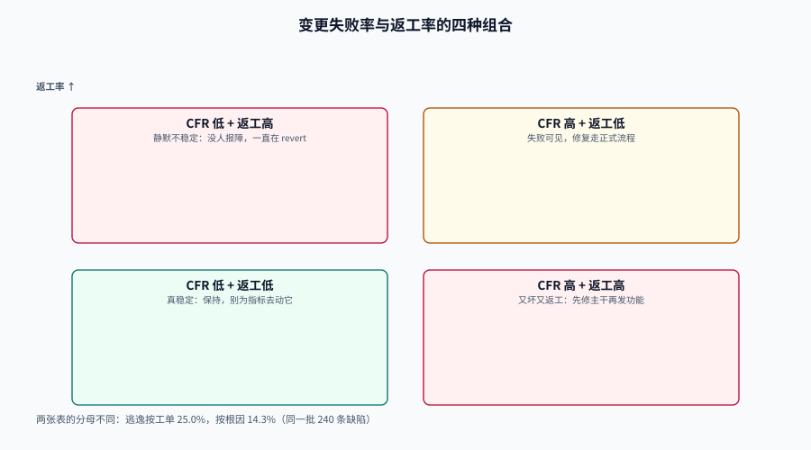

# 质量指标：逃逸、返工与变更失败

质量指标是效能度量里最容易被「做漂亮」的一类：缺陷可以关掉、可以合并、可以降级、可以标成「非缺陷」。于是同一个季度，缺陷数下降了 40%，用户投诉上升了 30%——两个数字都是真的。

本页只保留四个**能追溯到生产事件**的质量指标，并把它们的口径与常见操纵路径写清楚。核心判断是一句话：**质量指标必须锚在「用户是否受影响」上，任何锚在「我们记录了什么」上的质量指标都可以被记录方式改掉。**

::: tip 一句话定位
质量指标回答两个问题：**有多少错误流到了用户那里（逃逸）**，以及**修复它们花掉了多少产能（返工）**。
前者是效果，后者是代价。只看前者会低估成本，只看后者会漏掉「用户已经跑了」。
:::

本页判据族 `EMQ-A` ~ `EMQ-H`，共 8 条。定义表在第七节。




## 一、四个指标与它们的锚点

| 指标 | 定义 | 锚点 | 分母 | 主要操纵路径 |
| --- | --- | --- | --- | --- |
| **缺陷逃逸率**（escape rate） | 生产阶段发现的缺陷 ÷ 全部缺陷 | 用户是否受影响 | 缺陷工单（或根因） | 把生产缺陷登记成「需求」或「优化」 |
| **缺陷密度**（defect density） | 缺陷数 ÷ 规模（KLOC / 变更数 / 功能点） | 代码量 | 规模度量 | 换分母、AI 生成代码不计入 |
| **变更失败率**（change fail rate） | 需立即介入的部署 ÷ 部署数 | 部署事件 | 部署 | 把回滚算成「计划内」 |
| **部署返工率**（rework rate） | 非计划、由生产事件触发的部署 ÷ 部署数 | 部署事件 | 部署 | 把热修打包进下一次计划发布 |

::: warning 「逃逸」的定义有三个边界，必须写死
1. **预发/灰度阶段发现的算不算逃逸？** 不算——用户没受影响。但如果灰度已对 100% 用户开放，那就已经是生产。
2. **同一次故障被 30 个用户各报一次，算 1 个还是 30 个？** 按工单算是 30，按根因算是 1。这会直接改变结论（见下节实测）。
3. **上线后一周才发现的算不算？** 算，但要有窗口（通常 30 天）。窗口外的算「存量缺陷」，不进入当期逃逸率。
:::

## 二、逃逸率：工单口径与根因口径差 10.7 个百分点

本地实测（240 条缺陷工单，PostgreSQL 18.6）：

```sql
SELECT count(*) AS tickets,
       count(*) FILTER (WHERE found_stage='prod') AS escaped_tickets,
       round(100.0*count(*) FILTER (WHERE found_stage='prod')/count(*),1) AS escape_by_ticket,
       count(DISTINCT root_cause) AS causes,
       count(DISTINCT root_cause) FILTER (WHERE found_stage='prod') AS escaped_causes,
       round(100.0*count(DISTINCT root_cause) FILTER (WHERE found_stage='prod')
             /count(DISTINCT root_cause),1) AS escape_by_cause
FROM em.bug;
```

实测输出：

```text
 tickets | escaped_tickets | escape_by_ticket | causes | escaped_causes | escape_by_cause
---------+-----------------+------------------+--------+----------------+-----------------
     240 |              60 |             25.0 |     63 |              9 |            14.3
```

同一批数据：**按工单 25.0%，按根因 14.3%**。

差异的来源很具体：60 条生产缺陷工单里，有一个根因被 30 个用户各报了一次（同一个按钮点了没反应）。按工单算，这一次故障贡献了 12.5 个百分点的逃逸率；按根因算，它只是 9 个逃逸根因之一。

::: tip 两个口径都要，但用途不同
- **按工单（25.0%）**：反映**用户影响面**——30 个人受影响就是 30 次体验损伤，客服成本也按这个算。
- **按根因（14.3%）**：反映**工程有效性**——我们漏掉了 9 个问题，而不是 60 个。改进措施（补什么测试、加什么门禁）应该按这个定优先级。

只报一个数，就会在「用户很生气」和「我们只漏了 9 个 bug」之间反复摇摆，谁也说服不了谁。
:::

## 三、严重度：平均值会把 31 个 blocker 抹平

同一批缺陷按严重度（1 = blocker，4 = minor）统计：

```sql
SELECT round(avg(severity)::numeric,2) AS avg_sev,
       count(*) FILTER (WHERE severity=1) AS blocker,
       count(*) FILTER (WHERE severity=4) AS minor,
       round(100.0*count(*) FILTER (WHERE severity=1)/count(*),1) AS blocker_pct
FROM em.bug;
```

实测输出：

```text
 avg_sev | blocker | minor | blocker_pct
---------+---------+-------+-------------
    3.25 |      31 |   166 |        12.9
```

平均严重度 3.25——在一个 1~4 的刻度上，读起来像「基本都是小问题」。实际上有 **31 个 blocker（12.9%）**。

::: danger 平均严重度是「不能用的指标」的教科书案例
它是**序数刻度**（ordinal scale）被当成**等距刻度**（interval scale）在用：blocker 到 major 的差距，不等于 minor 到 trivial 的差距。
正确做法只有两个：**报分布**（1/2/3/4 各多少），或者用加权分（blocker×100 + major×10 + minor×1）并明确权重是人为设定的、不可跨团队比较。
:::

## 四、缺陷密度：分母一换，结论能翻十倍

```sql
SELECT round(240.0/(SELECT count(*) FROM em.change), 3)             AS bugs_per_change,
       round(1000.0*240/(SELECT sum(24) FROM em.change), 4)         AS bugs_per_kloc_if_24_lines;
```

实测输出：

```text
 bugs_per_change | bugs_per_kloc_if_24_lines
-----------------+---------------------------
           0.267 |                  11.1111
```

两个数都对，但**没有一个能跨团队比**：

| 分母 | 适用 | 陷阱 |
| --- | --- | --- |
| 千行代码（KLOC） | 同一代码库的历史趋势 | 语言密度不同（Python 的 1000 行 ≠ Java 的 1000 行）；**AI 生成代码算不算**；删代码会「提高」密度 |
| 变更数 | 跨语言、跨项目可比性稍好 | 大 PR 与小 PR 权重相同；一次批量重构会把分母冲高 |
| 功能点 / 需求数 | 对业务方友好 | 「功能」的粒度没有统一标准，且需求会拆会合 |
| 每千次部署 | 与交付节奏挂钩 | 部署频率高的团队天然「密度低」，与质量无关 |

::: warning 缺陷密度只在一个场景下有决策价值
**同一个仓库、同一套语言、同一套统计口径、连续多个版本的趋势**。离开这四个「同一」，它就是在比两种不同的尺子。
跨团队比较请改用**逃逸率 + 返工率**，它们锚在事件上，不锚在代码量上。
:::

## 五、返工率与变更失败率：四种组合，四种病

DORA 把这两个指标都归入「不稳定」。它们的分工很细：

- **变更失败率**：部署之后**需要立即介入**（回滚或热修）的比例 → 抓「看得见的失败」。
- **部署返工率**：**非计划、由生产事件触发**的部署比例 → 抓「悄悄回滚再重发」的那种不稳定。

四种组合对应四种完全不同的组织状态：

| 组合 | 现象 | 诊断 | 该做什么 |
| --- | --- | --- | --- |
| CFR 高 + 返工低 | 失败都触发了告警/投诉，修复走正式流程 | 失败可见，修复有序 | 降失败率（测试、灰度、小批量） |
| **CFR 低 + 返工高** | 没人报障，但一直在 revert / hotfix | **静默不稳定**：失败被「快速抹平」了 | 先修可观测性——你可能根本不知道自己坏了 |
| CFR 高 + 返工高 | 又坏又返工 | 系统性质量问题 | 停发新功能，先修主干（测试/评审/环境） |
| CFR 低 + 返工低 | 真稳定 | 健康 | 保持，别为了指标去动它 |

::: danger 「CFR 低」单独看是最危险的读数
一个团队连续三个月 CFR = 2%，看起来很好。但当月的返工率是 18%——意味着近五分之一的部署是「上了又退、退了又上」。
这些动作没有触发任何事故流程，因为**没有用户报障**（可能灰度只放了 5%，也可能坏的是没人用的功能）。这就是 DORA 官方为什么要新增返工率这个指标：**它专门抓「失败没被记录」的那部分不稳定。**
:::

本地实测里两者恰好相等（各 7.8%），因为 4 次失败部署全部走了 hotfix：

```text
 failed_deploys | cfr_by_deploy | rework_rate
----------------+---------------+-------------
              4 |           7.8 |         7.8
```

::: tip 相等不是巧合，是流程形状
「一坏就发 hotfix」的团队，CFR ≈ 返工率；「先回滚、攒着一起发」的团队，返工率会明显高于 CFR。
所以这两个数的**差值**本身就是一条组织信息：差值越大，说明修复越倾向于「攒批」。
:::

## 六、速度与稳定必须成对出现

DORA 官方指南明确写过：研究反复显示**速度与稳定性不是取舍关系**，高绩效团队五项都好，低绩效团队五项都差。

这条结论的工程含义是：**任何「我们选择了稳，所以慢」的说法，都需要用数据检验，而不是当公理接受。**

| 说法 | 检验方法 | 常见结果 |
| --- | --- | --- |
| 「我们评审很仔细，所以慢」 | 看评审等待时长 vs 评审发现缺陷数 | 等待占 60% 以上，实际评审只占 15%——慢在排队不在评审 |
| 「我们发布频率低是为了稳」 | 看批次大小与失败率的关系 | 批次越大失败率越高（一次带 20.5 个变更），低频反而更不稳 |
| 「测试覆盖率 80%，质量有保障」 | 看逃逸率与覆盖率的相关性 | 覆盖率与逃逸率弱相关；漏掉的往往是**没人想到要测的组合** |

::: warning 覆盖率是过程量，逃逸率是结果量
把覆盖率当质量指标，等于用「我们做了多少检查」代替「漏了多少」。两者在**测试写得对**的前提下相关，但方向相反时会骗人：写了 80% 覆盖率的无效断言，比 40% 的有效断言更糟——因为它让人放心。
:::

## 七、判据族

| 判据 | 约定 | 定错了会怎样 | 怎么验证 |
| --- | --- | --- | --- |
| `EMQ-A` | 逃逸率必须同时给出工单口径与根因口径 | 单口径会在「用户影响」与「工程有效性」之间反复摇摆 | 报表两列齐全（实测 25.0% / 14.3%） |
| `EMQ-B` | 「生产」的边界写死（预发/灰度/全量三档，灰度全量即生产） | 灰度期缺陷被排除，逃逸率虚低 | 缺陷表 `found_stage` 枚举固定 |
| `EMQ-C` | 逃逸统计必须有时间窗（默认 30 天），窗外算存量 | 无窗口时旧缺陷不断进入当期，趋势被污染 | 缺陷表有 `found_at`，查询带窗口 |
| `EMQ-D` | 禁止使用平均严重度，必须报分布或明示权重的加权分 | 序数刻度被当等距用（均值 3.25 掩盖 31 个 blocker） | 报表无 `avg_severity` 字段 |
| `EMQ-E` | 缺陷密度必须声明分母类型与语言/生成代码口径 | 换分母让结论翻十倍，且不可跨团队比 | 指标名含分母后缀，如 `_per_kloc` |
| `EMQ-F` | CFR 与返工率必须成对呈现，并解释两者差值 | 只报 CFR 会漏掉静默不稳定 | 看板同屏两个数 |
| `EMQ-G` | 回滚与热修都必须打 `trigger` 标签并进入返工分子 | 回滚被算成「计划内发布」时返工率归零 | 发布表 `trigger` 覆盖 rollback/hotfix |
| `EMQ-H` | 覆盖率不得单独作为质量结论，必须与逃逸率并列 | 过程量代替结果量，团队对覆盖率优化而非对缺陷优化 | 质量报告含逃逸率一栏 |

## 八、如何验证

```sql
-- 验证 EMQ-A：两个口径的差（本机可跑）
SELECT round(100.0*count(*) FILTER (WHERE found_stage='prod')/count(*),1) AS escape_by_ticket,
       round(100.0*count(DISTINCT root_cause) FILTER (WHERE found_stage='prod')
             /count(DISTINCT root_cause),1) AS escape_by_cause
FROM em.bug;
-- 预期：25.0 / 14.3（60 条生产工单来自 9 个根因，其中一个被 30 个用户各报一次）
```

```sql
-- 验证 EMQ-D：均值与分布同时看
SELECT round(avg(severity)::numeric,2) AS avg_sev,
       count(*) FILTER (WHERE severity=1) AS blocker,
       count(*) FILTER (WHERE severity<=2) AS sev_1_2
FROM em.bug;
-- 预期：3.25 / 31 / 74 —— 均值看着温和，blocker 与 major 合计 74 条
```

```sql
-- 验证 EMQ-G：返工分子是否覆盖 rollback 与 hotfix（缺一类则返工率偏低）
SELECT trigger, count(*) FROM em.deploy GROUP BY trigger ORDER BY trigger;
-- 预期至少出现 planned 与 hotfix 两类；只有 planned 说明标签没打全
```

```shell
# 验证 EMQ-D：报表配置里不该出现 avg_severity（返回空即合规）
grep -rn "avg_severity\|average_severity" config/ 2>/dev/null
```

## 与「客服工单与 SLA 履约工程」的分工（第 209 天补充）

本页讲的是「缺陷可以关掉、可以合并、可以降级」——**分母可以被搬走**。客服指标有完全同构的四个搬法，而且都不需要改代码：把分母换成「已关闭的单」、把满意度换成「回复者的满意度」、把时长换成「营业小时」、把重开算成「新问题」。

具体分工：本页管**研发效能**的度量口径（逃逸、返工、变更失败）与它们的操纵手法；[客服工单与 SLA 履约工程 · 度量口径](../../../Backend/SupportTicket/Metrics/index.md)管**服务履约**的四个分母陷阱与容量曲线，并给出同一批数据的两种口径差：按单 **88.31%**、按等待分钟 **46.98%**。

一个针对本页的坑：**只报一个口径就宣布「达标」**。本页的「缺陷数下降 40%、投诉上升 30%」与客服的「达标率 96%、续约率下降」是同一个病：**指标被优化，问题被迁移**。可执行的修法是「成对上报」——缺陷数配逃逸率，达标率配「未命中政策的单数」与 CSAT 配回复率。单个数字永远可以被搬动，成对的数字很难同时搬动。

## 参考资料

- DORA，《DORA's software delivery performance metrics》：<https://dora.dev/guides/dora-metrics-four-keys/>（change fail rate 与 deployment rework rate 的分工、速度与稳定性不构成取舍）
- DORA，《State of AI-assisted Software Development》(2025)：<https://dora.dev/research/>（AI 采用与不稳定上升的相关性）
- Forsgren, N., Humble, J., Kim, G.，《Accelerate》，2018（change fail rate 的原始定义与「speed and stability are not a trade-off」的实证）。
- Kan, S. H.，《Metrics and Models in Software Quality Engineering》，2002（缺陷密度与 KLOC 分母的系统性讨论及其局限）。
- Stevens, S. S.，《On the Theory of Scales of Measurement》，Science，1946（序数刻度不可做算术平均的经典依据）。
