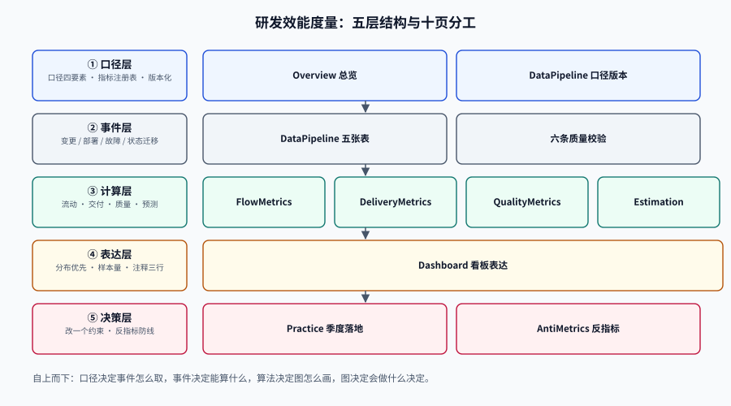

# 研发效能度量

研发效能度量（Engineering Metrics）要回答的不是「谁快谁慢」，而是：**这套交付系统里，价值在哪个环节排队；这个判断能不能被另一个人用同一份数据复算出来。**

前半句决定了它必须是**系统视角**——一个人的提交速度不等于一个需求的交付速度；后半句决定了它必须是**口径工程**——同一个「交付周期」，从「创建」算和从「开始做」算能差 5 倍，两个团队各自都「没算错」，却永远谈不到一起。

绝大多数团队的度量死于三种死法，且都死在「数字看起来很正常」的时候：把两个服务的中位数混着算、用四个数据点宣布「本季度改善 12%」、把度量结果贴到个人绩效上然后奇怪为什么数据开始变好而交付没有。本专题要给的是一套**先定口径、再算分布、最后才谈结论**的做法：每个数字都要能回答「分子是谁、分母是谁、样本多大、误差多少」。

## 与相邻专题的分工

| 专题 | 负责什么 | 与本专题的边界 |
| --- | --- | --- |
| 本专题 | **口径定义、指标计算、分布与误差、反指标识别、数据管道、看板表达** | —— |
| [研发流程](../../Tools/Collaboration/RdProcess/index.md) | DoR/DoD、四道门禁、迭代节奏、分支策略，末尾给了一张「四个指标」速查表 | 那边回答「**流程怎么定**」；本专题回答「**定完之后怎么算、算出来能不能比**」 |
| [协作与项目管理 · 概述](../../Tools/Collaboration/Overview/index.md) | 需求池、看板、站会、协作工具与周期时间的粗口径 | 那边是**协作方式**；本专题是协作方式在数据上的**投影**，以及投影的误差 |
| [项目交付 · 交付](../../Others/ProjectDelivery/Delivery/index.md) | 交付物清单、里程碑、上线节奏、验收组织 | 那边管「**交付什么**」；本专题管「**交付得好不好，凭什么这么说**」 |
| [项目交付 · 测试](../../Others/ProjectDelivery/Testing/index.md) | 测试分层、覆盖率、flaky 治理 | 覆盖率是**过程量**；本专题关心它作为**结果量**（逃逸缺陷）的对应关系 |
| [CI/CD · 流水线设计](../../Tools/CICD/PipelineDesign/index.md) | 阶段划分、并行与缓存、制品与门禁 | 那边是**流水线本身**；本专题把流水线的运行记录当成**事件源** |
| [观测驱动开发 · 指标先行](../../Tools/ObservabilityDriven/MetricsFirst/index.md) | 服务指标的口径、基数控制、埋点规范 | 那边度量**系统**（请求、延迟、错误）；本专题度量**生产系统的过程**（变更、部署、缺陷） |
| [变更管理与发布工程 · 分级](../../Ops/ChangeManagement/Classification/index.md) | 变更分级、风险评估、审批留痕 | 分级回答「这次变更该走几道门」；本专题回答「这些门让交付变成多长」 |
| [AI 编码助手 · 度量](../../AI/AICodingAssistant/Metrics/index.md) | AI 辅助编码的采纳率、生成占比、人机对比 | 那边度量**工具使用**；本专题只关心它对交付指标的影响是否可分辨（多半分辨不了） |
| [年度复盘](../../Others/AnnualReview/Overview/index.md) | 年度目标、复盘组织、结论表达 | 复盘是**一次会议**；本专题是这次会议桌上那些数字的**可信度** |
| [项目实战 · TeamBoard 交付效能](../../../project/Complete/TeamBoard/DeliveryMetrics/index.md) | 一个真实项目的度量表结构与 SQL | 本专题给方法，项目侧给**实例与读数** |

::: tip 一句话理解
效能度量的产出不是「一个数字」，而是**一个带分母、带样本量、带误差范围的判断**。
只有数字没有这三样东西的看板，本质上是一块装饰画：它让会议室里的人感觉在讨论事实。
:::

## 专题导航

- [总览：三个必答问题与五种失败模式](./Overview/index.md)：口径四要素、度量的三种用途、七个时间点、五步决策路径
- [流动指标：周期时间、在制品与流动效率](./FlowMetrics/index.md)：三个「周期」的区别、Little 定律、等待去哪了、WIP 上限怎么算
- [交付指标：DORA 五个指标的口径与分母](./DeliveryMetrics/index.md)：五指标定义、聚合方式、批次大小效应、为什么不能跨服务混算
- [估算与预测：速率、蒙特卡洛与承诺的概率](./Estimation/index.md)：故事点为什么不可比、速率虚增三条路、蒙特卡洛给区间、样本量与置信区间
- [质量指标：逃逸、返工与变更失败](./QualityMetrics/index.md)：逃逸缺陷的分母、缺陷密度陷阱、返工率与 CFR 的四种组合
- [反指标：古德哈特与度量博弈](./AntiMetrics/index.md)：五类反指标、三种博弈机制、三个可检测的指纹、个体化度量的后果
- [数据管道：事件、关联、去重与口径版本](./DataPipeline/index.md)：四张表、`merge_sha` 关联、去重三规则、时区与工作日、六条数据质量校验
- [看板表达：让图说真话](./Dashboard/index.md)：分位数不可加总、样本量必须上屏、口径注释三行、图上不该出现的四样东西
- [实战：给一个团队做一季度度量](./Practice/index.md)：四步落地、完整 DDL、六条校验、S1~S10 验收序列
- [常见问题与最佳实践](./FAQ/index.md)：十类症状分诊、十二问、上线自查十二项、术语表

## 按症状找页面

| 你遇到的现象 | 大概率先看 |
| --- | --- |
| 两个团队报的「交付周期」差 3 倍，谁也说服不了谁 | [总览](./Overview/index.md) 的「口径四要素」与 [流动指标](./FlowMetrics/index.md) 的「三个周期」 |
| 周期时间看上去没变，但大家都觉得很慢 | [流动指标](./FlowMetrics/index.md) 的「流动效率」与「等待去哪了」 |
| 部署频率上去了，故障也上去了 | [交付指标](./DeliveryMetrics/index.md) 的「吞吐与不稳定」与 [质量指标](./QualityMetrics/index.md) 的「四种组合」 |
| 老板要一个「研发效率」的综合分 | [反指标](./AntiMetrics/index.md) 的「综合分是博弈的入口」 |
| 承诺了 6 周交付，第 7 周还没发 | [估算与预测](./Estimation/index.md) 的「蒙特卡洛」与「承诺要带概率」 |
| 度量数字和工程师的感受相反 | [总览](./Overview/index.md) 的「五种失败模式」中的幸存者偏差 |
| 换个系统统计，同一个指标差一倍 | [数据管道](./DataPipeline/index.md) 的「去重三规则」与「关联键」 |
| 看板上平均 3 天，实际一半需求超过一周 | [看板表达](./Dashboard/index.md) 的「分位数不可加总」 |
| 度量一上绩效，数字立刻变好 | [反指标](./AntiMetrics/index.md) 的「三个指纹」 |

## 全专题的判据纪律

本专题十页共 **80 条判据**，每页 8 条，逐页独立前缀。判据只回答三件事：**约定是什么 / 定错了会怎样 / 怎么验证它没被破坏**。`index.md` 不设判据族。

| 页面 | 判据族 | 覆盖的约定 | 条数 |
| --- | --- | --- | --- |
| 总览 | `EMO-A` ~ `EMO-H` | 口径四要素齐全、用途不混、失败模式有对策 | 8 |
| 流动指标 | `EMF-A` ~ `EMF-H` | 三个周期不混用、等待被计量、WIP 有上限 | 8 |
| 交付指标 | `EMD-A` ~ `EMD-H` | 五指标口径固定、分母不错位、不跨主体混算 | 8 |
| 估算与预测 | `EME-A` ~ `EME-H` | 估点不跨团队比、预测给区间、承诺带概率 | 8 |
| 质量指标 | `EMQ-A` ~ `EMQ-H` | 逃逸有定义、分母可复算、速度与稳定性成对 | 8 |
| 反指标 | `EMA-A` ~ `EMA-H` | 不个体化、不排名、博弈可检测 | 8 |
| 数据管道 | `EMP-A` ~ `EMP-H` | 事件不可变、关联唯一、口径有版本 | 8 |
| 看板表达 | `EMV-A` ~ `EMV-H` | 分位数不聚合、样本量上屏、阈值不用红绿灯 | 8 |
| 实战 | `EMR-A` ~ `EMR-H` | 口径可复算、校验可执行、验收有序列 | 8 |
| 常见问题 | `EMX-A` ~ `EMX-H` | 分诊可执行、口径不混、自查可机器判 | 8 |

::: warning 为什么判据一律写成「可验证」而不是「最佳实践」
「度量要客观」这种话没法判对错——客观的定义随场景变。「同一个指标名在全库只有一个分母表达式，且 `metric_def` 表里 `ver` 单调递增、旧版本带 `retired_at`」就能判。
本专题每一页的「如何验证」都区分两类命令：**本机可执行**（`psql` / `python3` / `jq` / `grep`，脚本不入库）与**需要真实数据**（需要团队的历史事件流），后者一律写明前置条件，跑不了的标 `⏳` 并写原因，不把期望值抄进实测列。
:::

## 事实与口径速览（2026-10 核对）

| 事实 | 口径与出处 | 对本专题的意义 |
| --- | --- | --- |
| DORA 现在发布 **五个**软件交付指标，不再是「四个键」 | `dora.dev` 官方指南（2026-10 查阅）：change lead time / deployment frequency / failed deployment recovery time / change fail rate / **deployment rework rate** | 任何还写着「四指标」的看板都已经落后一个版本；本专题的[交付指标](./DeliveryMetrics/index.md)按五指标准展开 |
| 五指标分两组：**吞吐**（lead time / 部署频率 / 恢复时间）与**不稳定**（失败率 / 返工率） | 同上，官方原文 | 「快」与「稳」不是取舍关系（官方原话：top performers 五项都好），所以看板必须成对呈现 |
| DORA **2025 报告停用了 Elite/High/Medium/Low 四档**，改用**七个团队画像**（七个 profile） | DORA 2025《State of AI-assisted Software Development》，样本近 5,000 人 | 「我们是 Elite 吗」这个问题已经没有官方的答案口径；红绿灯打分是**自造**的，要自己负责 |
| DORA **2026 年 5 月**发布 AI 投资回报报告：J 曲线、500 人组织首年 ROI 约 **39%**、回本约 **8 个月**、变更失败率 **5% → 6%**、停机成本约 **34.4 万美元** | DORA《ROI of AI-assisted Software Development》(2026-05)，官方自述为「高不确定度估算，用于开启讨论」 | 它给的是「AI 让吞吐上升、同时让不稳定上升」的量化形状；引用时必须带「估算」二字 |
| 2025 报告的分布读数：按需部署 **16.2%**、变更前置时间 < 1 天 **15%**（< 1 小时 **9.4%**）、失败率 0~4% **16.7%**、恢复 < 1 小时 **21.3%**、返工率 0~2% **6.9%** | DORA 2025 报告 pp.20-21，经第三方汇总转述 | 用来判断「我们是不是真的很慢」时，只能当**参照系**，不能当目标线 |
| SPACE 框架（Satisfaction / Performance / Activity / Communication / Efficiency） | Forsgren 等，2021，ACM Queue | 「一个指标不够」的学术表述；本专题的[反指标](./AntiMetrics/index.md)按它组织替代方案 |
| Little 定律 `L = λW` | Little, J.D.C., 1961 | 在制品、吞吐与周期时间的**恒等式**，[流动指标](./FlowMetrics/index.md)用它反推 WIP 上限 |
| 约 **900 万次**变更：中位 **24 行**、中位 **1 名**评审 | Google 内部研究，经第三方引用 | 「小批量」不是口号：真实的高绩效系统里，变更是小的 |
| **37,440** 条用户故事 / **37** 个敏捷开源项目：故事点与记录工时强相关的项目只占 **7%** | 第三方学术汇总（经二手转述，未逐篇核对） | 故事点不能当工时、更不能跨团队比；引用时标「第三方」 |

::: danger 三条会静默失效的坑（本专题反复出现）
1. **口径漂移没有报错**：三月份把「周期时间」的起点从「创建」改成「进入进行中」，数字当场变好，没人改过任何流程。度量必须**带版本号**，看板上必须显示「口径 v3，自 2026-07-01 起」。
2. **分位数被当成可加总的数**：两个服务各报 P90，取平均写进汇报，得到 132.9 小时，而合并数据的 P90 是 103.2 小时——高 28.7%，且**没有任何一个服务是这个数**。
3. **度量一进绩效，数据就开始骗人**：把「部署频率」挂到个人考核，第二个月起没人再合并小改动，全是「一次部署带 30 个变更」；指标变好，交付没变。
:::

## 学习路径

1. 先读[总览](./Overview/index.md)，把「口径四要素」和「五种失败模式」记住——后面九页都在解其中某一条。
2. 再读[流动指标](./FlowMetrics/index.md)：它是最不容易被博弈的一层（周期时间是系统属性，不是个人属性）。
3. 然后[交付指标](./DeliveryMetrics/index.md) + [质量指标](./QualityMetrics/index.md)：这两页必须**成对读**，只读一半必然得出「快就是不稳」的错误结论。
4. 有预测需求（排期、承诺）的团队接着读[估算与预测](./Estimation/index.md)；被要求「给个综合分」的团队先读[反指标](./AntiMetrics/index.md)。
5. [数据管道](./DataPipeline/index.md) 与 [看板表达](./Dashboard/index.md) 是落地件，必须和[实战](./Practice/index.md) 一起走一遍。
6. 最后用[常见问题](./FAQ/index.md) 的自查表收口。

## 参考资料

- DORA，《DORA's software delivery performance metrics》官方指南：<https://dora.dev/guides/dora-metrics-four-keys/>（2026-10 查阅，五个指标与两组划分）
- DORA，《State of AI-assisted Software Development》(2025)：<https://dora.dev/research/>
- DORA，《ROI of AI-assisted Software Development》(2026-05) 与 ROI 计算器：<https://dora.dev/ai/roi/calculator>
- Forsgren, N., Storey, M.-A., Maddila, C., Zimmermann, T., Houck, B., Butler, J.，《The SPACE of Developer Productivity》，ACM Queue，2021。
- Little, J. D. C.，《A Proof for the Queuing Formula: L = λW》，Operations Research，1961。
- Forsgren, N., Humble, J., Kim, G.，《Accelerate》，2018（DORA 四指标的原始论述，读的时候注意它早于「五指标」）。
- Farley, D.，《Modern Software Engineering》，2021（「better software faster vs worse software slower」的出处，DORA 官方指南引用）。
- Goodhart, C.，《Problems of Monetary Management: The U.K. Experience》，1975（古德哈特定律的原始表述）。
