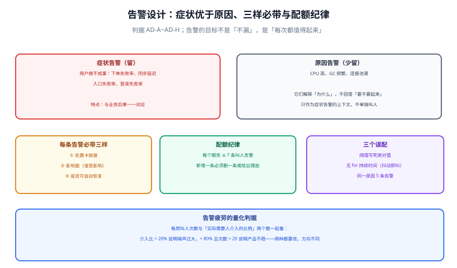

# 告警设计与配额

告警的目标不是「不漏」，是**每次响起来都值得有人起床**。这两句话听起来一致，实际相反：为了「不漏」，人会不断加规则；而每加一条，夜间被叫醒的信噪比就下降一点。当一条告警的平均处理价值低于「被吵醒的代价」时，值班机制本身开始失效——人会关闭通知、会拖延响应、会先问「这条是不是又误报」。

所以告警设计的第一原则是**配额**，不是覆盖。本页给出配额的量、症状优先的判据、每条告警必带的三样，以及把「告警疲劳」变成可算的数字。

## 判据族声明

本页判据族 `AD-A` ~ `AD-H`，共 8 条。定义表在第八节。



## 本页不讲什么

- 不讲 Prometheus 告警规则的 YAML 语法、`for` 与 `labels` 字段用法，归 [告警](/docs/Ops/Monitoring/Alerting/index.md)。
- 不讲通知渠道（钉钉 / 企业微信 / PagerDuty）的接入，归 [监控系统](/docs/Ops/Monitoring/Overview/index.md)。
- 不讲事故处理的分级升级与交接流程，归 [事故响应](/docs/Ops/IncidentResponse/index.md) 与项目侧的 [值班手册](/project/Complete/TeamBoard/ReleaseRunbook/index.md)。

本页只回答：**该不该叫人起来，以及凭什么。**

## 一、症状优于原因：一条判据分清楚

区分方法只有一句话：**这条告警触发时，用户有没有受到影响？**

| 类型 | 例子 | 用户是否受影响 | 该不该叫人 |
| --- | --- | --- | --- |
| 症状 | 下单失败率 5%（基线 0.2%） | 是，且明确 | **必须叫** |
| 症状 | 卡片同步延迟 P99 从 300 ms 到 9 s | 是（协作体感） | **必须叫** |
| 症状 | 登录成功数在高峰时段降到 0 | 是，全体 | **必须叫（P0）** |
| 原因 | CPU 使用率 92% | **不一定** | 不单独叫，作为上下文附在症状告警上 |
| 原因 | GC 老年代占用 85% | 不一定 | 同上 |
| 原因 | 连接池使用率 88% | 不一定 | 同上，除非伴随失败率上升 |

后三行不是「不重要」，而是**它们回答的是「为什么」，不是「要不要起来」**。半夜被叫起来的人需要的是「用户正在受什么影响」，而不是「某个资源指标偏高」。

::: tip 一个可以直接用的问句
「这条告警触发时，我要做的第一件事是什么？」

- 答得出具体动作（查某个看板 / 执行某个脚本 / 回滚某个发布）→ 是症状告警，留下。
- 答的是「先看看是怎么回事」→ 是原因告警，改造成上下文或直接删掉。

这句问句能筛掉一半以上的现有规则。
:::

## 二、每条告警必带三样

| 必带项 | 作用 | 缺失时的现场 |
| --- | --- | --- |
| 处置卡链接（runbook） | 让被叫起来的人在 30 秒内知道先做什么 | 花 20 分钟翻文档，期间故障继续 |
| 影响面（谁受影响、多大范围） | 决定升级级别 | 把「一个租户的报表慢」当成全站故障，或反之 |
| 是否可自愈 | 决定要不要立刻动手 | 手工重启了一个本来正在自愈的服务，反而扩大影响 |

第三条最少见，但很关键。可自愈的告警（如「副本被驱逐，正在重建」）应该**进看板不进电话**；不可自愈的（如「迁移失败，服务无法启动」）必须电话。

判据化：

```yaml
- alert: BoardSyncLagHigh
  expr: histogram_quantile(0.99, sum by (le) (rate(board_sync_lag_seconds_bucket[5m]))) > 5
  for: 5m
  labels:
    severity: P2
    runbook: RB-3                # ① 处置卡
    impact: "tenant-scoped"      # ② 影响面
    self_heal: "false"           # ③ 可否自愈
  annotations:
    summary: "卡片同步 P99 超过 5 秒（租户 {{ $labels.tenant }}）"
```

## 三、配额纪律：每个服务 ≤ 7 条

配额不是拍脑袋，它来自值班的现实约束：**一次夜间响应大约 20~40 分钟，一个人的一夜最多能承受 2~3 次打断而不影响次日工作**。按每周 7 天、每个服务 1 人轮值算，7 条是「每条都有机会被认真对待」的量级。

| 配额 | 数值 | 依据 |
| --- | --- | --- |
| 每服务「叫人」告警 | ≤ 7 条 | 一夜 2~3 次打断的上限 |
| 其中 P0/P1 | ≤ 2 条 | 高优先级告警必须稀缺，否则优先级失效 |
| 每条新增 | 必须删一条或写明理由 | 强制做取舍，避免只增不减 |

配套机制：**告警规则也要有 owner 与到期复核**，与 [功能开关](../FeatureFlag/index.md) 的到期日同理。一年没触发过的告警，要么阈值错了（该降），要么场景消失了（该删）。

## 四、三个误配

| 误配 | 现象 | 修法 |
| --- | --- | --- |
| 阈值写绝对值 | 低峰永不触发、高峰持续触发 | 改为相对基线或历史分位，见 [指标先行](../MetricsFirst/index.md) 第六节 |
| 没有 `for` 持续时间 | 一次抖动就叫，扩容瞬间也叫 | `for: 5m` 起步；瞬时尖峰用「1 分钟内 3 次」这类复合条件 |
| 同一原因的 5 条告警 | 数据库主库挂了 → 5 个服务的错误率各叫一次 | 用 `inhibit_rules` 依赖抑制：上游告警触发时抑制下游 |

第三条是夜间噪声的主要来源。一次数据库故障能让十几个服务同时报警，值班的人接到十几个电话，处理的是同一件事。抑制规则的价值不是「少接电话」，而是**让电话指向根因**。

```yaml
inhibit_rules:
  - source_matchers: [alertname="DatabaseDown"]
    target_matchers: [severity=~"P2|P3"]
    equal: [cluster]
```

## 五、把「告警疲劳」变成可算的数字

只看「每周告警条数」不够，因为它无法区分「20 条都需要处理」与「20 条里 19 条是噪声」。需要两个数一起看：

| 数字 | 取法 | 含义 |
| --- | --- | --- |
| 每周叫人次数 | 通知记录计数 | 打断成本 |
| 介入比 | 需要人实际动手的次数 / 叫人次数 | 信噪比 |

读法：

| 介入比 | 每周次数 | 判断 | 动作 |
| --- | --- | --- | --- |
| < 20% | 任意 | **噪声过大** | 删/降级告警，或改成自愈 |
| 20%~80% | ≤ 10 | 健康 | 维持，按季度复核 |
| 20%~80% | > 20 | 产品不稳 | 不是告警问题，是质量问题：走缺陷治理 |
| > 80% | 任意 | 告警确实在报告真实问题 | 若次数 > 20，说明系统不可用时间过长，需要架构级整改 |

四种组合指向四个完全不同的动作。这就是为什么**单看告警数量会得出错误结论**——同样是每周 25 条，介入比 10% 与 90% 是两种病。

## 六、与值班、升级、处置卡的接口

告警只是链条的第一环，后面三环必须存在：

| 环节 | 归属 | 关键约定 |
| --- | --- | --- |
| 什么时候叫（阈值、抑制、聚合） | **本页** | 配额 + 症状优先 |
| 叫谁、多久没响应升级 | [事故响应](/docs/Ops/IncidentResponse/index.md) | 分级 P0~P3 与升级时限 |
| 起来之后先做什么 | 项目侧 [值班手册](/project/Complete/TeamBoard/ReleaseRunbook/index.md) | 每张处置卡四字段 |
| 事后改什么 | [反馈闭环](../Loop/index.md) | 每次事故至少改一条告警或阈值 |

这里有一个容易断掉的连接：**告警里的 `runbook` 字段与实际处置卡必须一一对应**。二者脱节是最常见的「看起来都做了，实际没连上」——告警响了，点进去是 404；或者处置卡更新了，告警里的 ID 还是旧的。

判据只有一个：**告警规则里的每个 `runbook` 值，都能在仓库里找到一个文件**。这条可以静态检查（见验证第 ④ 条）。

## 七、一份可用的告警清单形状

```text
每个服务 5~7 条，按「用户受什么影响」排列：

P0（2 条以内）
  1. 核心写入全部失败（写接口 5xx 比例 > 50%，持续 2 分钟）
  2. 认证不可用（登录成功数 = 0，持续 3 分钟）

P1
  3. 核心读取失败率 > 5%（基线 0.2%，持续 5 分钟）
  4. 同步延迟 P99 > 5 s（持续 5 分钟）

P2
  5. 单个租户错误率 > 基线 5 倍（租户级隔离问题）
  6. 后台任务积压 > 10 分钟（不影响在线，但会延迟通知）
  7. 备份失败（每天检查一次，非实时）

不进电话、只看板：
  CPU / 内存 / GC / 连接池 / 磁盘水位 — 作为上下文附加在上面的告警里
```

第七条值得单独说：**备份失败几乎总是被配成实时告警**，于是每天凌晨 3 点响一次，连续响半年后所有人都学会了忽略它。正确做法是每天 9 点做一次检查、失败才叫人——因为备份失败不是「现在必须处理」的事，而是「今天必须处理」的事。

## 八、判据族定义

| 判据 | 规则 | 违反时的样子 | 验证方式 |
| --- | --- | --- | --- |
| `AD-A` | 每条叫人告警必须是症状（用户受影响），原因类只作上下文 | 半夜因 CPU 92% 被叫起来，用户其实没事 | 命令 1 |
| `AD-B` | 每条告警必须带 `runbook` / `impact` / `self_heal` 三项 | 起来后花 20 分钟找文档 | 命令 2 |
| `AD-C` | 每服务叫人告警 ≤ 7 条，其中 P0/P1 ≤ 2 条 | 优先级失去区分度 | 命令 3 |
| `AD-D` | 阈值不得用绝对值；用相对基线或历史分位 | 低峰永不触发、高峰持续触发 | 命令 4 |
| `AD-E` | 必须设 `for` 持续时间或复合条件，单点抖动不得叫人 | 扩容瞬间、一次 GC 就报警 | 命令 5 |
| `AD-F` | 同源故障必须有抑制规则，下游不得同时叫人 | 数据库故障引发十几个电话 | 命令 6 |
| `AD-G` | 每条 `runbook` 值必须对应仓库中存在的处置卡文件 | 点进去 404，或指向已废弃的卡 | 命令 7 |
| `AD-H` | 介入比 < 20% 或每周叫人 > 20 时必须改造，且新增告警需删旧或写理由 | 每周 25 条，介入 3 条，团队逐渐关通知 | 命令 8 |

## 如何验证

```shell
# ① AD-B：每条告警是否三项齐全
for f in deploy/prometheus/rules/*.yml; do
  yq -r '.groups[].rules[] | select(.labels.severity != "info")
         | select(.labels.runbook == null or .labels.impact == null or .labels.self_heal == null)
         | .alert' "$f"
done
```

**预期输出**：空。列出的每一条都缺必带项，值班时无法在 30 秒内判断该做什么。

```shell
# ② AD-C：按服务统计「叫人」告警数量
for f in deploy/prometheus/rules/*.yml; do
  yq -r '.groups[].rules[] | select(.labels.severity == "P0" or .labels.severity == "P1"
         or .labels.severity == "P2") | .labels.service' "$f"
done | sort | uniq -c | awk '$1 > 7 {print "OVER QUOTA:", $2, $1}'
```

**预期输出**：空。若出现 `OVER QUOTA: app 11`，说明这个服务有 11 条会叫人的规则，超出配额 4 条——按 `AD-H`，必须删掉 4 条或写明确理由。

```shell
# ③ AD-G：runbook 是否都指向存在的处置卡
grep -rhoE 'runbook: *"?[A-Za-z0-9-]+"?' deploy/prometheus/rules/*.yml \
  | sed -E 's/runbook: *"?//; s/"//' | sort -u | while read -r id; do
    find . -path ./node_modules -prune -o -name "${id}.md" -print | grep -q . \
      || echo "MISSING RUNBOOK: $id"
  done
```

**预期输出**：空。有输出即为「告警与处置卡脱节」——这是最容易发生的隐性断链。

```shell
# ④ AD-E：缺少 for 或复合条件的规则
for f in deploy/prometheus/rules/*.yml; do
  yq -r '.groups[].rules[] | select(.for == null) | .alert' "$f"
done
```

**预期输出**：空或仅少数条（如每日检查类）。若核心错误率规则也在其中，说明一次瞬时抖动就会叫人。

```shell
# ⑤ AD-F：是否配置了抑制规则
yq -r '.groups[] | select(.name | test("inhibit"; "i")) | .name' deploy/prometheus/rules/*.yml 2>/dev/null
grep -c "inhibit_rules" deploy/prometheus/alertmanager.yml 2>/dev/null
```

**预期输出**：抑制规则数量 > 0。若为 0，说明所有下游告警独立触发，一次基础设施故障会产生告警风暴。

```text
⑥ AD-A：症状性读法
   逐条问「触发时用户受什么影响」。
   答不出影响的，改为上下文标注或删除。

⑦ AD-H：介入比读法
   取最近 4 周通知记录，统计总数 N 与「实际动手处理」次数 M。
   介入比 = M / N。
     < 20% → 噪声过大，按 AD-H 改造
     > 80% 且 N/4 > 20 → 质量问题，走缺陷治理而非调告警
```

::: info 诚实标注
①~⑤ 为可在仓库内执行的静态检查，依赖 `deploy/prometheus/rules/*.yml` 与 `alertmanager.yml` 存在（项目侧告警规则截至本轮为设计片段，**尚未落盘**，故本节命令未在真实规则文件上跑过）。⑥⑦ 为读法，不产生命令输出。
:::

## 参考资料

- [Google SRE Book · Being On-Call](https://sre.google/sre-book/being-on-call/)——值班打断成本与「每条告警都值得响应」的原始论述
- [Google SRE Workbook · Alerting on SLOs](https://sre.google/workbook/alerting-on-slos/)——多窗口多燃烧率告警，比单阈值更能反映用户受影响程度
- [Prometheus · Alerting rules](https://prometheus.io/docs/prometheus/latest/configuration/alerting_rules/)——`for` 语义与模板变量
- [Alertmanager · Inhibition](https://prometheus.io/docs/alerting/latest/configuration/#inhibit_rule)——依赖抑制的正确写法，避免告警风暴
- 本站 [告警](/docs/Ops/Monitoring/Alerting/index.md) · [监控系统](/docs/Ops/Monitoring/Overview/index.md) · [事故响应](/docs/Ops/IncidentResponse/index.md) · [诊断](/docs/Ops/IncidentResponse/Diagnosis/index.md)
- 相邻：[灰度度量](./../GrayMetrics/index.md) · [反馈闭环](./../Loop/index.md) · 项目侧 [值班手册](/project/Complete/TeamBoard/ReleaseRunbook/index.md)
