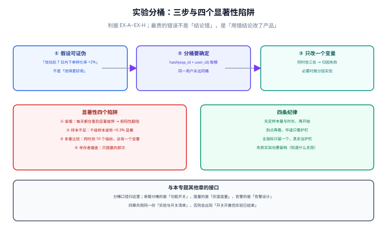

# 实验设计与分桶

实验和灰度的区别只有一句话：**灰度问「会不会坏」，实验问「有没有更好」**。前者的判据是护栏（错误、延迟、失败数），后者的判据是主指标的差异是否可信。两件事都需要对照组，但对样本量与统计的要求完全不同——灰度的 1,000 样本足以判断「有没有崩」，实验的 1,000 样本通常不足以判断「转化率提升了 0.3%」。

本页只讲实验里最容易出错的部分：假设怎么写才可证伪、分桶怎么保证确定性、以及四个会让结论彻底失效的统计陷阱。

## 判据族声明

本页判据族 `EX-A` ~ `EX-H`，共 8 条。定义表在第八节。



## 本页不讲什么

- 不讲分流网关与开关实现，归 [功能开关](../FeatureFlag/index.md) 与 [灰度度量](../GrayMetrics/index.md)。
- 不讲贝叶斯 / 频率学派的完整推导，本页只给**可操作的样本量估算与判读纪律**。
- 不讲推荐系统 / 排序类的离线评估，那是模型评测的范畴。

## 一、假设：必须可证伪，且带数值与期限

不合格的假设长这样：

| 写法 | 问题 |
| --- | --- |
| 「改得更好用」 | 不可测量，任何结果都能解释成「更好用」 |
| 「提升用户满意度」 | 满意度没有直接指标，只能用代理指标且需说明 |
| 「优化交互后转化会提升」 | 没说提升多少、多久、在谁身上 |

可证伪的写法有四要素：

```text
在 <人群> 中，把 <变量> 从 A 改为 B，
<主指标> 会在 <时长> 内从 <基线> 提升到 <目标>，
若未达到则判定假设不成立。
```

实例：

> 在**新注册租户**中，把卡片创建从「必须先建看板」改为「自动建默认看板」，**7 日内首卡创建率**会从 **41%** 提升到 **≥ 45%**；若 7 日后低于 43%，判定假设不成立。

这段写法之所以可用，是因为它把四个可能被事后解释的口子都封了：人群、变量、指标、期限与判定线。

## 二、分桶：确定性哈希，不是随机数

分桶实现错一次，整个实验作废。最常见的错误是用随机数：

```java
// 反例：每次请求重新随机
boolean inExperiment = ThreadLocalRandom.current().nextBoolean();
```

后果是**同一用户在不同请求里进出实验组**。表现是：实验组指标被对照组稀释，差异被抹平；用户看到界面来回切换；日志里同一 `user_id` 同时出现在两组。

正确的分桶是**确定性哈希**：

```text
bucket = hash(experiment_id + ":" + key) % 100
inExperiment = bucket < trafficPercent
```

四个要求：

| 要求 | 原因 | 违反的后果 |
| --- | --- | --- |
| 加入 `experiment_id` 参与哈希 | 不同实验的桶要互相独立 | 所有实验的分组完全重叠，无法做分层实验 |
| `key` 用稳定标识（用户 ID / 租户 ID），不用会话 | 会话会变 | 同一用户跨会话换组 |
| 哈希函数在客户端与服务端一致 | 否则两侧分组不同 | 前端显示 A、后端执行 B |
| 分桶结果可复现（同输入同输出） | 排障与审计需要 | 无法回答「这个用户为什么在实验组」 |

第二条尤其重要。用 `session_id` 分桶会导致「同一个用户上午在对照组、下午在实验组」，而实验的统计前提是**处理单元稳定**。用 `request_id` 更糟——那是把每个请求都当独立个体，等于没有分组。

::: tip 分桶键选谁：与灰度同一套判断
实验的最小一致单元也应与业务一致。协作类系统按租户分桶，个人产品按用户分桶。判断标准见 [灰度度量](../GrayMetrics/index.md) 第一节。

但实验多一个约束：**样本量**。按租户分桶时，样本量是「租户数」而不是「用户数」。50 个租户的实验，其统计功效远低于 50 万个用户——这时候只能做「大改动」的实验（预期提升 20% 以上），做不了 2% 的精细优化。
:::

## 三、只改一个变量：为什么「三处一起改」等于没做实验

如果一次实验同时改了按钮颜色、文案、默认值，那么无论结果好坏，你都**无法归因**。这是实验设计里最贵的一种浪费：花了流量、花了时间，得到一个不可用的结论。

两种可行做法：

| 做法 | 机制 | 适用 |
| --- | --- | --- |
| 单变量实验 | 一次只改一个，串行做 | 改动简单、流量充足 |
| 分层实验（orthogonal layering） | 不同实验用不同的哈希前缀，各自独立分流，可同时跑互不干扰 | 改动多、流量紧张 |

分层实验的关键是**层间正交**：用 `hash("layer3:" + key)` 与 `hash("layer5:" + key)` 分别分桶，两组桶不相关。若两个实验用了同一个前缀，它们的组会完全重叠，交叉效应无法分离。

## 四、四个显著性陷阱

### 4.1 偷看（peeking）

每天看一次结果，一旦显著就停。这会**系统性抬高假阳性率**：在真实无差异的情况下，多次检验中至少有一次显著的概率远高于 5%。看 10 次，假阳性率可以到 20% 以上。

| 做法 | 假阳性率 | 说明 |
| --- | --- | --- |
| 每天看、显著就停 | 可达 20%~30% | 最常见的错误 |
| 到预设样本量才看一次 | 5%（按 α=0.05） | 正确做法 |
| 中途看但用序贯检验校正 | 5% | 需要专门方法（alpha spending / group sequential） |

第三条是「既想中途看又不想膨胀」的唯一合法路径，但它要求事先声明检验次数与时间点。事后补校正不算。

### 4.2 样本不足

「1,000 个样本，转化率从 10.0% 到 10.3%，显著提升」——这句话在统计上基本不成立。用常用的样本量近似公式（双侧 α=0.05、功效 80%）：

```text
每组样本量 n ≈ 16 × p(1−p) / δ²

p = 0.10, δ = 0.003（0.3 个百分点）
n ≈ 16 × 0.10 × 0.90 / 0.000009 ≈ 160,000 每组
```

也就是说，想检出 0.3 个百分点的差异，每组需要约 **16 万**样本，而不是 1 千。把 δ 放大到 1 个百分点（δ=0.01）：

```text
n ≈ 16 × 0.10 × 0.90 / 0.0001 ≈ 14,400 每组
```

这个数字才是「1 万级流量能做多细的实验」的真实答案。

| 想检出的相对提升（基线 10%） | 每组所需样本（约） |
| --- | --- |
| 30%（10% → 13%） | 1,600 |
| 10%（10% → 11%） | 14,400 |
| 3%（10% → 10.3%） | 160,000 |
| 1%（10% → 10.1%） | 1,440,000 |

表格的用法不是精确计算，而是**在提实验需求时先做一次量级判断**：如果你的日流量是 2 万，就不要提「验证 3% 提升」的实验——它需要八天以上的全量流量，且期间不能有任何其他变更。

### 4.3 多重比较

同时看 10 个指标，取其中显著的那个作为结论。在真实无差异的情况下，10 次独立检验里至少一次显著的概率约 40%。

三种处置，按严格程度递增：

| 处置 | 做法 | 代价 |
| --- | --- | --- |
| 预设单主指标 | 只检验一个指标，其余只作护栏 | 需要事先选定，且选错就白做 |
| Bonferroni 校正 | α 除以检验次数（10 个指标 → α=0.005） | 功效下降，需要更多样本 |
| 分层检验（hierarchical） | 先检验主指标，通过后才检验次级 | 结论层级清晰，实现稍复杂 |

最实用的仍是第一种：**实验只允许一个主指标**。护栏指标不参与显著性判定，只看是否越线。

### 4.4 幸存者偏差与选择性报告

「本次实验提升 12%」——分母是做了几次实验？如果做了 8 次只报了成功的那次，读者会误判这个方法有效。这不是造假，是**只报赢的**这种习惯的必然结果。

处置很简单但需要纪律：**失败实验也留档**，记录假设、样本量、结果、为什么无效。半年后这些记录的价值往往超过成功的那几次——它们告诉你「哪些方向不用再试」。

## 五、四条纪律

```text
① 先定样本量与时长，再开始。开始后不许改判定标准。
② 到点再看；中途只看护栏，不看主指标。
③ 主指标只留一个，其余作护栏；护栏不参与显著性判定。
④ 失败实验也留档：假设、样本、结论、为什么无效。
```

第②条是四条里最难执行的，因为它与人的好奇心直接冲突。可行的工程手段是**把结果看板设为实验结束后自动解锁**，而不是靠自觉。

## 六、实验与开关、灰度的接口

| 环节 | 归属 | 关键约定 |
| --- | --- | --- |
| 开关定义、到期日、清理 | [功能开关](../FeatureFlag/index.md) | 实验型开关必须写结束日 |
| 分流比例、护栏、回滚 | [灰度度量](../GrayMetrics/index.md) | 实验的护栏与灰度共用同一套 |
| 分组是否有效、结论是否可信 | **本页** | 样本量、偷看、多重比较 |
| 指标口径 | [指标先行](../MetricsFirst/index.md) | 主指标的分母必须先定死 |

三种典型错位：开关已全量但实验还在跑（分组失效）、实验已结束但开关还开着（持续影响一部分用户）、灰度已回滚但实验结论已按"成功"归档（结论错误）。三者都源于**没有一份共用清单**（见 [功能开关](../FeatureFlag/index.md) 第七节）。

## 七、判据表前置：一个可用的实验记录结构

```yaml
experiment:
  id: exp_2026_11_default_board
  hypothesis: "新注册租户 7 日内首卡创建率从 41% 提升到 >= 45%"
  unit: tenant                     # 分桶单元
  traffic: 50                      # 实验组占比 %
  sample_target: 3600              # 每组目标样本
  primary_metric: tenant_first_card_rate_7d
  guardrails: [error_rate, p99_latency_ms, invite_accept_rate]
  start_at: 2026-11-03
  end_at: 2026-11-17               # 到点看，不提前
  decision_rule: ">= 45% 采纳；43%~45% 延长期；< 43% 放弃"
  flag: new_tenant_default_board   # 与开关清单同名
```

这份结构的价值在于**决策规则在开始前就写死**。没有 `decision_rule` 的实验，结果一定会被事后解释。

## 八、判据族定义

| 判据 | 规则 | 违反时的样子 | 验证方式 |
| --- | --- | --- | --- |
| `EX-A` | 假设四要素齐全（人群 / 变量 / 指标 / 时长与判定线） | 「改得更好用」这类不可证伪的假设 | 命令 1 |
| `EX-B` | 分桶用确定性哈希，输入含 `experiment_id` 与稳定标识 | 同一用户在不同请求里进出两组 | 命令 2 |
| `EX-C` | 分桶键跨端一致（客户端与服务端同函数同输入） | 前端显示 A、后端执行 B | 命令 3 |
| `EX-D` | 一次只改一个变量，或用正交分层 | 三处同改，结论不可归因 | 命令 4 |
| `EX-E` | 样本量按公式预先估算并写入实验单 | 「一千样本宣称 0.3% 显著」 | 命令 5 |
| `EX-F` | 只在预设时点看主指标，中途只看护栏 | 每天看、显著就停，假阳性翻倍 | 命令 6 |
| `EX-G` | 只允许一个主指标参与显著性判定 | 10 个指标里挑一个显著的当结论 | 命令 7 |
| `EX-H` | 失败实验必须留档（假设 / 样本 / 结论 / 原因） | 只报赢的那次，方法论被高估 | 命令 8 |

## 如何验证

```shell
# ① EX-E：样本量估算（不依赖外部库，量级判断用）
python3 - <<'PY'
def n_per_group(p, rel_lift):
    d = p * rel_lift
    return int(16 * p * (1 - p) / (d * d)) + 1

for lift in (0.30, 0.10, 0.03, 0.01):
    print(f"基线 10%，想检出相对提升 {lift*100:>4.0f}% → 每组约 {n_per_group(0.10, lift):>9,} 样本")
PY
```

**预期输出**：

```text
基线 10%，想检出相对提升   30% → 每组约     1,601 样本
基线 10%，想检出相对提升   10% → 每组约    14,401 样本
基线 10%，想检出相对提升    3% → 每组约   160,001 样本
基线 10%，想检出相对提升    1% → 每组约 1,440,001 样本
```

这四个数量级直接决定了「哪些实验在本系统的流量下根本做不了」。

```shell
# ② EX-B：分桶是否用了随机数或易变标识
grep -rn "nextBoolean\|Math.random\|new Random" src/main/java --include=*.java | grep -i "experiment\|flag\|bucket"
grep -rn "bucketOf\|bucketKey" src/main/java --include=*.java | grep -iE "sessionId|requestId"
```

**预期输出**：两条都应为空。第一条命中即为「每次请求重新随机」；第二条命中即为「分桶单元不稳定」。

```shell
# ③ EX-C：分桶函数是否两端各写一份
grep -rn "hash(.*experiment" web/src src/main/java 2>/dev/null | wc -l
```

**预期输出**：`1`。若为 2，说明两端各实现了一份哈希——只要任一侧改过（比如换了哈希算法），分组就会立刻错位。正确做法是服务端下发分组结果，前端不再自行计算。

```shell
# ④ EX-D：分层实验是否用了不同前缀
grep -rhoE "layer[0-9]+|exp_[a-z0-9_]+" config/experiments.yaml | sort | uniq -c | sort -rn | head
```

**预期输出**：每个实验一行，前缀互不相同。若两个实验共用同一前缀，它们的组会完全重叠，交叉效应无法分离。

```text
⑤ EX-A：假设读法
   打开实验单，检查能否回答四个问题：人群是谁、改了什么、看哪个指标、多久与多少算成。
   任一答不上即不成立。

⑥ EX-F：偷看读法
   查看实验数据的访问记录：主指标在 `end_at` 之前被查询的次数。
   > 2 次且未做序贯校正即不成立。

⑦ EX-G：多重比较读法
   数实验单里被标为「显著」的指标个数。> 1 即不成立（除非声明了校正方法）。

⑧ EX-H：留档读法
   统计近半年实验单总数与「结论为无效」的条数。
   无效条数为 0 是可疑信号——它多半意味着失败实验没被记录。
```

::: info 诚实标注
① 为本页实跑的小脚本（纯公式估算，不依赖外部数据），输出即上文四行。②③④ 为仓库内静态检查，依赖实验配置与分桶函数落盘（项目侧本轮尚无 `experiments.yaml`，**未跑**）。⑤~⑧ 为读法，不产生命令输出。
:::

## 与『评测工程』专题的分工（第 171 天补充）

| 你想知道 | 去哪 |
| --- | --- |
| 在线 A/B 怎么分桶、怎么判显著性 | [实验驱动](index.md)（本页） |
| 离线评测的配对检验怎么算 | [区间、检验与样本量](../../../AI/EvalEngineering/Statistics/index.md) |
| 离线结论怎么进发布门禁 | [回归门禁](../../../AI/EvalEngineering/RegressionGate/index.md) |
| 离线与在线结论不一致时信哪个 | [常见问题](../../../AI/EvalEngineering/FAQ/index.md) |

::: danger 本页特有的一个坑：离线评测不能套用在线 A/B 的独立性假设
在线 A/B 里两组用户相互独立，用两样本比例检验是对的。离线评测是**同一批样本跑两版**，样本之间高度相关（难题在两版上都难），此时用两样本检验会低估方差、把不显著的差异判成显著。正确做法是改用**配对检验**（McNemar 精确检验），并且只统计「一版过一版不过」的不一致对。本页第四节列的四个显著性陷阱，加上这一条就是五个。
:::

## 与《推荐系统工程》的分工（第 202 天补充）

本页讲的是实验**平台**：分流、埋点、看板、指标计算。推荐的实验还多一层麻烦——**指标之间天然冲突**，而且离线指标与线上指标的关系不稳定。这部分放在[评估与实验](../../../Backend/RecommenderSystems/Evaluation/index.md)，这里只补三条平台侧必须支持的判定：

| 平台能力 | 为什么推荐场景必须有 | 阈值建议 |
| --- | --- | --- |
| SRM 检查 | 推荐的分流键常带用户维度，容易偏斜 | `p < 0.001` 自动挂起 |
| 序贯检验 / 固定期限二选一 | 「每天看，显著就停」会把误报从 5% 抬到 18% | 平台侧禁止无期限实验 |
| 护栏指标同屏 | CTR 涨、时长跌是推荐最常见的假胜利 | 延迟/覆盖/负反馈三项必选 |

一个平台设计的细节：推荐实验的分组要进**缓存键**。少了这一项，B 组用户会命中 A 组的推荐结果，SRM 看起来正常、指标却是两组混合——这是本库反复出现的「配了但没接」的一种。

## 参考资料

- [Kohavi, Tang & Xu · Trustworthy Online Controlled Experiments](https://experimentguide.com/)——偷看、样本量、多重比较的系统论述，本章的主要依据
- [Microsoft EXP · Peeking problem](https://www.exp-platform.com/Documents/2014%20practical%20guide%20to%20controlled%20experiments.pdf)——序贯检验与假阳性膨胀的量化
- [Evan Miller · How not to run an A/B test](https://www.evanmiller.org/how-not-to-run-an-ab-test.html)——「显著就停」的经典反驳
- [OpenFeature · Evaluation context](https://openfeature.dev/docs/reference/concepts/evaluation-context)——分流键与评估上下文的一致性要求
- 本站 [CI/CD · 发布与回滚](/docs/Tools/CICD/DeployRollback/index.md) · [流水线设计](/docs/Tools/CICD/PipelineDesign/index.md)
- 相邻：[功能开关](./../FeatureFlag/index.md) · [灰度度量](./../GrayMetrics/index.md) · [指标先行](./../MetricsFirst/index.md)
