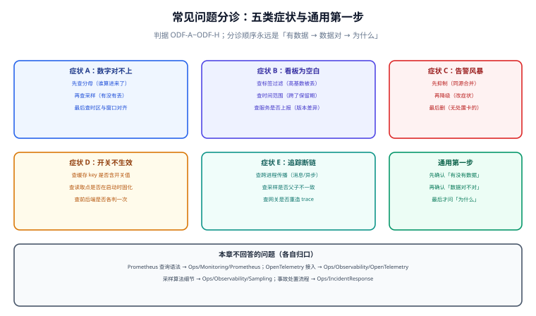

# 常见问题与分诊

本页按**症状**组织，不按章节组织。出问题时人是带着症状来的：「这个数不对」「看板是空的」「一晚上响了十四次」——他不知道自己缺的是口径、埋点还是告警设计。

所以这里的结构是：**症状 → 三类最常见原因 → 排查顺序 → 结论**。每一类都给出「先查什么」，因为观测问题里最常见的浪费是**从错误的一端开始查**：先去改埋点，实际是分母错了。

## 判据族声明

本页判据族 `ODF-A` ~ `ODF-H`，共 8 条。定义表在第十节。



## 本页不讲什么

- 不讲 PromQL / Loki / Jaeger 的查询语法，归 [Prometheus](/docs/Ops/Monitoring/Prometheus/index.md) 与 [可观测性](/docs/Ops/Observability/Overview/index.md)。
- 不讲告警规则文件怎么写，归 [告警](/docs/Ops/Monitoring/Alerting/index.md)。
- 不讲事故处理的分级与升级，归 [事故响应](/docs/Ops/IncidentResponse/index.md)。

## 通用第一步：先分三段

任何观测问题都先判断落在哪一段，判断错了会绕很远：

```text
① 有数据吗？      → 没有：断供（采集、上报、权限、保留期）
② 数据对吗？      → 不对：口径（分母、采样、时区、聚合）
③ 为什么不对？    → 前面都对，才轮到查业务原因
```

大多数「数据不对」的争论都卡在①和②之间：一方在查业务，另一方在查采集，双方都有理，因为他们查的是不同段。

## 症状 A：数字对不上

两个数不一样，先不要问「哪个对」，先问**它们的分母是否相同**。

| 原因 | 特征 | 查法 |
| --- | --- | --- |
| 分母不同 | 一个含 4xx、一个不含；一个按请求、一个按用户 | 分别打印分子分母 |
| 时区与窗口错位 | 差值与「跨天」的量级相当 | 核对时间窗口是否为同一时区、是否左闭右开 |
| 采样差异 | 差值与采样率大致成比例 | 查两侧采样配置 |
| 去重口径不同 | 一个按事件、一个按幂等键 | 查是否有 `distinct` / 去重 |
| 数据源不同 | 一个来自服务端、一个来自客户端埋点 | **这是 [埋点规范](../Instrumentation/index.md) 的「一处一义」问题** |

排查顺序：**分母 → 窗口 → 采样 → 去重 → 数据源**。按这个顺序，八成问题在前两步就结束。

::: warning 一个不该做的动作
不要为了「让两个数一致」去改其中一个的口径。这会让两个数都失去意义，且下次对不上时你无法判断是口径改了还是真的出了问题。
:::

## 症状 B：看板是空的

空白有四种完全不同的原因，处理方式相反：

| 原因 | 特征 | 处理 |
| --- | --- | --- |
| 高基数维度被丢弃 | 标签值太多，采集端直接丢弃该指标 | 去掉高基数标签（见 [埋点规范](../Instrumentation/index.md) 第四节） |
| 时间范围超出保留期 | 查 90 天前的数据，而保留期是 15 天 | 缩短范围或调整保留策略 |
| 服务没上报（版本差异） | 新版本没带采集配置 | 对比不同版本的上报量 |
| 查询本身写错 | 标签值拼写、正则不匹配 | 先查 `count by (label)` 看标签实际取值 |

第三条在灰度期特别常见：新版本 Pod 起来了，但镜像里缺采集配置或环境变量少了导出地址。此时旧版本有数据、新版本完全没有，看板的查询按 `sum()` 聚合时会被拉低但不会归零——比完全空白更难发现。

## 症状 C：告警风暴

一次故障产生几十条告警，值班的人处理的是同一件事。三种处置按顺序做：

| 顺序 | 动作 | 说明 |
| --- | --- | --- |
| 1 | **抑制**（inhibit） | 上游告警触发时抑制下游，见 [告警设计](../AlertDesign/index.md) 第四节 |
| 2 | **聚合**（group） | 同 `alertname` + 同 `cluster` 合并成一条通知 |
| 3 | **删除** | 无处置卡、无影响面的规则直接删 |

顺序不能颠倒：先删可能删掉本来有用的，先抑制能立刻止血。没有抑制规则的系统，一次数据库抖动能叫醒十几个人。

## 症状 D：开关不生效

改了开关但行为没变。四种原因，按排查成本排序：

| 原因 | 验证方法 | 修法 |
| --- | --- | --- |
| 开关值进了缓存 key 但没订阅失效 | 关掉开关后清缓存，若立即生效则为此因 | 开关值不进 key，或订阅切换事件（见 [功能开关](../FeatureFlag/index.md) 4.2） |
| 读取点在启动时固化 | 重启服务后生效 | 改为每请求读快照 |
| 前后端各判一次 | 前端显示变了、后端仍拒绝 | 后端为准，前端只作展示 |
| 分流键取错导致目标用户不在范围内 | 打印分桶结果 | 检查分桶键与目标条件 |

第三种的表现是「改了前端没效果」，很容易被误判成「前端缓存」。区分方法：直接 `curl` 接口看后端行为——如果后端也变了，说明是纯展示问题；如果后端没变，说明开关评估在后端没生效。

## 症状 E：追踪断链

一次请求的 trace 在某个环节断掉，后续 span 变成了新的 trace。三类原因：

| 断点 | 原因 | 特征 |
| --- | --- | --- |
| 跨进程 | 消息队列 / HTTP 客户端没注入传播头 | 消费端的 trace 只有一个 span |
| 异步线程 | 线程池没传递上下文 | 异步任务里的 trace 是新的 |
| 网关 | 网关重造了 `traceparent` | 网关前后是两个独立 trace |

第一类最常见于消息消费。判据是**消费端的 span 是否为 root span**：是 root 说明没收到上游上下文。

## 症状 F：指标账单暴涨

成本突然翻倍，通常不是流量翻倍。

| 原因 | 机制 | 验证 |
| --- | --- | --- |
| 新增高基数标签 | 序列数乘以新标签的取值数 | 查序列数排行（`topk`） |
| 版本标签在灰度期并存 | `app_version` 取值数临时增长数倍 | 灰度结束后是否回落 |
| 指标名写错导致重复上报 | 同一个指标两个名字，各自一份序列 | 查相似名 |
| 拉取间隔变密 | 15 s → 5 s，序列数不变但样本数 ×3 | 查采集配置 |

第一条是绝大多数。一个 `board_id` 标签可以让序列数从一万涨到一亿，而流量没有任何变化（见 [埋点规范](../Instrumentation/index.md) 第四节的乘法算例）。

## 症状 G：灰度「很顺利」，但什么都没报警

这是最危险的一种顺利。先查一件事：**对照组有没有流量**。

| 现象 | 原因 | 说明 |
| --- | --- | --- |
| 相对指标全部 `NaN` | 对照组为空 | 分流键写错，100% 落入实验组 |
| 分流比例与预期差很远 | 取模键分布不均 | 用了一个取值很少的字段取模 |
| 两组指标完全一致 | 开关没真正生效，两组跑同一套代码 | 查代码里是否真读了开关 |

第一种最隐蔽：所有告警因为无数据而不触发，表现为「平静」。所以放量前的第一个动作是**验证两组都有流量**，见 [灰度度量](../GrayMetrics/index.md) 的 `GM-H`。

## 症状 H：实验结论不可信

看到「显著提升」先问三个问题：

| 问题 | 若答案为「否」 | 后果 |
| --- | --- | --- |
| 样本量是事先算的吗？ | 事后补算通常会被结果污染 | 样本不足却宣称显著 |
| 中途看过几次主指标？ | 偷看导致假阳性膨胀 | 结论可能是噪声 |
| 主指标只有一个吗？ | 多重比较 | 10 个指标里挑一个必然有显著的 |

三个问题里任意一个答案为「否」，结论就应当被标为「待复核」而不是「已采纳」。详见 [实验设计](../Experiments/index.md) 第四节。

## 十二问速查

| 问 | 归到哪一页 |
| --- | --- |
| 1. 这个指标的分子分母分别是什么？ | [指标先行](../MetricsFirst/index.md) |
| 2. 为什么延迟要用 P99 而不是均值？ | [指标先行](../MetricsFirst/index.md) |
| 3. 多实例的 P99 能求平均吗？ | [指标先行](../MetricsFirst/index.md) |
| 4. 埋点该放前端还是后端？ | [埋点规范](../Instrumentation/index.md) |
| 5. 为什么加了一个标签，账单翻倍？ | [埋点规范](../Instrumentation/index.md) |
| 6. 开关该设多久的到期日？ | [功能开关](../FeatureFlag/index.md) |
| 7. 关掉开关为什么还生效？ | [功能开关](../FeatureFlag/index.md) |
| 8. 灰度要看哪几个数？ | [灰度度量](../GrayMetrics/index.md) |
| 9. 什么时候可以全量？ | [灰度度量](../GrayMetrics/index.md) |
| 10. 一千个样本能验证 0.3% 的提升吗？ | [实验设计](../Experiments/index.md) |
| 11. 半夜该不该被叫起来？ | [告警设计](../AlertDesign/index.md) |
| 12. 一块看板没人看，该不该删？ | [反馈闭环](../Loop/index.md) |

## 判据族定义

| 判据 | 规则 | 违反时的样子 | 验证方式 |
| --- | --- | --- | --- |
| `ODF-A` | 数据对不上时先比分母，禁止为对齐而改口径 | 两个数越改越不可信 | 命令 1 |
| `ODF-B` | 看板空白必须按「基数 / 保留期 / 断供 / 查询」四段排查 | 直接改查询，浪费数小时 | 命令 2 |
| `ODF-C` | 告警风暴必须先抑制再聚合最后删除 | 先删导致漏掉真实告警 | 命令 3 |
| `ODF-D` | 开关不生效必须区分「缓存 / 固化 / 前后端 / 分流」四因 | 统一归因成「缓存问题」而修不好 | 命令 4 |
| `ODF-E` | 追踪断链先查消费端 span 是否为 root | 在业务代码里找 bug | 命令 5 |
| `ODF-F` | 成本异常先查高基数标签与序列数排行 | 去优化流量，无效 | 命令 6 |
| `ODF-G` | 灰度「无异常」必须先验证对照组非空 | 平静地全量，事故延后爆发 | 命令 7 |
| `ODF-H` | 实验结论必须能回答样本量 / 偷看 / 多重比较三问 | 用噪声结论改产品 | 命令 8 |

## 如何验证

```shell
# ① ODF-A：同一天的同一指标，两处读数是否用同一分母
grep -rn "NUMERATOR\|DENOMINATOR" src/main/java --include=*.java | wc -l
```

**预期输出**：`2`（分子与分母各一处定义）。若为 0，说明口径没有集中定义，各处各写一套，对不上是必然。

```shell
# ② ODF-F：序列数排行，找出高基数指标
curl -sG "$PROM/api/v1/query" \
  --data-urlencode 'query=topk(10, count by (__name__) ({__name__=~".+"}))' \
  | jq -r '.data.result[] | "\(.metric.__name__)\t\(.value[1])"'
```

**预期输出**：十行「指标名 + 序列数」。任意一行的序列数超过 10,000，即为 `ODF-F` 的嫌疑对象，回到 [埋点规范](../Instrumentation/index.md) 的阈值表降维。

```shell
# ③ ODF-G：灰度放量后两组是否都有流量
curl -sG "$PROM/api/v1/query" \
  --data-urlencode 'query=sum by (flag_group) (rate(http_requests_total[5m]))' \
  | jq -r '.data.result | length'
```

**预期输出**：`2`。若为 `1`，说明一组没有流量，所有相对指标失效——此时「灰度很顺利」这句话不成立。

```shell
# ④ ODF-C：是否存在抑制规则与聚合配置
grep -c "inhibit_rules" deploy/prometheus/alertmanager.yml 2>/dev/null
grep -c "group_by" deploy/prometheus/alertmanager.yml 2>/dev/null
```

**预期输出**：两个数都 > 0。均为 0 时，一次基础设施故障会产生全量告警风暴。

```text
⑤ ODF-B：空白排查四段读法
   ① 基数：查标签取值数是否超阈值
   ② 保留期：确认查询范围是否超出
   ③ 断供：对比新老版本的上报量
   ④ 查询：`count by (label)` 看实际取值
   按 ①②③④ 顺序，不要跳步。

⑥ ODF-D：开关四因读法
   清缓存后是否生效 → 是则为缓存因；否则重启后是否生效 → 是则为固化因；
   否则 curl 后端看行为 → 后端也未变为前后端因或分流因。

⑦ ODF-E：断链读法
   在消费端打印 span 的 parent 是否存在。为 root 即为传播头缺失。

⑧ ODF-H：结论复核读法
   对每个「显著」结论，检查实验单里是否有 sample_target / decision_rule /
   单一主指标。三项缺一即标为「待复核」。
```

::: info 诚实标注
①③④ 为可在仓库内或对监控后端执行的检查（③ 的查询形状与 [灰度度量](../GrayMetrics/index.md) 同源，本页**未连接真实实例**取数）；② 依赖 Prometheus 可达。⑤~⑧ 为读法，不产生命令输出。本页所有「原因 → 排查」结构来自实践归纳，**不是任何单一产品的官方文档**。
:::

## 参考资料

- [Prometheus · FAQ](https://prometheus.io/docs/introduction/faq/)——序列数、保留期、聚合行为的常见误解
- [Prometheus · Querying basics](https://prometheus.io/docs/prometheus/latest/querying/basics/)——时间窗口与左闭右开语义，很多「数对不上」源于此
- [OpenTelemetry · Context propagation](https://opentelemetry.io/docs/concepts/context-propagation/)——跨进程与异步链路的上下文传递，断链排查的依据
- [OpenFeature · Flag evaluation](https://openfeature.dev/docs/reference/concepts/evaluation-context)——评估上下文与缓存语义，开关不生效的根因
- 本站 [告警](/docs/Ops/Monitoring/Alerting/index.md) · [Prometheus](/docs/Ops/Monitoring/Prometheus/index.md) · [可观测性](/docs/Ops/Observability/Overview/index.md) · [诊断](/docs/Ops/IncidentResponse/Diagnosis/index.md)
- 全专题：[总览](./../Overview/index.md) · [指标先行](./../MetricsFirst/index.md) · [埋点规范](./../Instrumentation/index.md) · [功能开关](./../FeatureFlag/index.md) · [灰度度量](./../GrayMetrics/index.md) · [实验设计](./../Experiments/index.md) · [告警设计](./../AlertDesign/index.md) · [反馈闭环](./../Loop/index.md)
