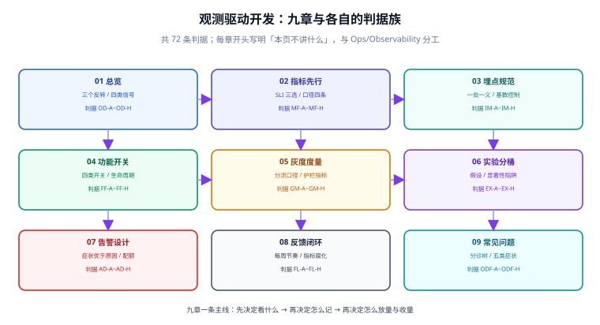

# 观测驱动开发

观测驱动开发回答的是一个**在写第一行代码之前就该回答的问题**：这个功能上线之后，怎么知道它是好的？

大多数团队的答案要到出事那天才成形。上线时没人定义「好」，只有一句「别报错」；出事时的第一反应是打开日志翻，翻到一半发现没有租户维度、没有版本信息、请求 ID 断在网关。事后补埋点的成本不是在写代码，而是在**重建当时的上下文**——而上下文是不可重建的。

本专题讲的是**把这件事挪到事前**：先定指标口径，再定埋点，再用开关放量，再用护栏收量，最后让每周的读数反过来改代码。九页各管一环，但共用一条主线：**每一环都必须在出事之前就被写成一个可执行、可判定的东西**——口径写进代码常量、埋点写进字段清单、开关写进配置与到期日、护栏写进自动回滚条件、告警写进处置卡。

::: tip 一句话理解
观测驱动开发的价值不在「监控更全了」，而在**「上线决策有据可依」**——放多少量、收不收、回不回滚，都由事先写好的数值条件回答，而不是由会议室里的感觉回答。所以本专题每页最后都会落到同一个问题上：**这条判据被违反时，什么会自动变红？** 答不上来的埋点和看板，只是数据垃圾。
:::

## 与相邻专题的分工

「监控」「可观测性」「观测驱动开发」三个词经常混用，边界必须写死：

| 专题 | 讲什么 | 与本专题的关系 |
| --- | --- | --- |
| 本专题 | **决策视角**：定什么指标、怎么埋、怎么放量收量、怎么让读数改代码 | —— |
| [可观测性](/docs/Ops/Observability/Overview/index.md) | 三支柱（指标 / 日志 / 追踪）的**技术实现**：后端选型、Collector、采样、Profiles、成本 | 那边回答「**信号怎么采集与存储**」，本专题回答「**该采什么、采来怎么用**」；本专题不重复 SDK 安装与后端拓扑 |
| [监控系统](/docs/Ops/Monitoring/Overview/index.md) | Prometheus / Grafana / 日志监控的**平台搭建与查询** | 那边是**管子**，本专题是**管子里流什么水**；PromQL 语法归那边，指标口径归本专题 |
| [告警](/docs/Ops/Monitoring/Alerting/index.md) | 告警规则的**配置语法与通知渠道** | 那边讲「怎么配一条规则」，本专题的 [告警设计](./AlertDesign/index.md) 讲「**该不该叫人起来**」——配额、症状优先、处置卡绑定 |
| [OpenTelemetry](/docs/Ops/Observability/OpenTelemetry/index.md) | SDK、语义约定、跨进程传播的**落地细节** | 语义约定的**取值**归那边；本专题的 [埋点规范](./Instrumentation/index.md) 只讲「**该不该加这个维度**」 |
| [采样](/docs/Ops/Observability/Sampling/index.md) | 头部/尾部采样的**算法与参数** | 算法归那边；本专题只给一条业务侧的取舍原则：先保错、再保慢、最后按比例采成功 |
| [CI/CD](/docs/Tools/CICD/index.md) | 流水线阶段、制品、发布策略 | 那边是**发布动作**，本专题是**发布前后的判据**：开关、灰度、护栏、自动回滚 |
| [事故响应](/docs/Ops/IncidentResponse/index.md) | 值班、升级、复盘流程 | 那边是**人在事故中的动作序列**，本专题负责让它**不必被触发**；触发之后读的也是本专题定义的指标 |
| [容量与成本治理](/docs/Ops/CapacityCost/index.md) | 水位线、弹性、单位成本 | 观测指标是它的**输入**；本专题不涉及容量模型，只负责把「水位」变成可采的指标 |
| [完整项目交付](/docs/Others/ProjectDelivery/index.md) | 上线验收的标准动作清单 | 本专题的 [反馈闭环](./Loop/index.md) 是验收之后的那一半：**上线不是终点，第一次读数才是** |
| [在线协作任务看板 · 请求作用域与观测信号](/project/Complete/TeamBoard/SignalScope/index.md) | 上述原则在一个真实项目里的落地：作用域、MDC、四类业务信号、开关快照 | 那边是**施工**，本专题是**方法论**；判据族不同（`SG-` vs `OD-`），互不覆盖 |

## 专题地图

| 页面 | 内容 | 适合谁读 |
| --- | --- | --- |
| [总览：三个反转与四类信号](./Overview/index.md) | 顺序、问题、主人三个反转；四类信号能答与不能答；四个交付物 | 所有人，先读 |
| [指标先行与口径](./MetricsFirst/index.md) | SLI 三选、四种可用性口径、为什么必看 P99、四个必写项 | 写业务代码的人，**重点读** |
| [埋点规范与基数控制](./Instrumentation/index.md) | 三处埋点、一处一义、命名三段式、基数爆炸的量化、四个必带字段 | 前后端开发 |
| [功能开关工程](./FeatureFlag/index.md) | 四类开关、五态生命周期、开关债、三处最容易出事的写法 | 要灰度发布的人，**重点读** |
| [灰度度量与自动回滚](./GrayMetrics/index.md) | 分流口径、实验/对照、护栏指标、四条自动回滚条件 | 发布负责人 |
| [实验设计与分桶](./Experiments/index.md) | 可证伪假设、确定性分桶、四个显著性陷阱、四条纪律 | 产品与数据 |
| [告警设计与配额](./AlertDesign/index.md) | 症状优于原因、每条告警必带三样、配额纪律、误配三例 | 值班与运维 |
| [反馈闭环与指标腐化](./Loop/index.md) | 一周六步、指标腐化四征兆、每月三件事 | 团队负责人 |
| [常见问题与分诊](./FAQ/index.md) | 五类症状的分诊树、十二问、自查清单 | 所有人 |

## 四条底层判断（先记住这四句）

九页内容可以压缩成四句话。如果只读一段，读这段：

| 判断 | 含义 | 违反它的典型后果 |
| --- | --- | --- |
| **先定分母** | 任何比率型指标，分母是谁必须先写死 | 「可用性 99.9%」在事故复盘时被两个团队算出两个数，结论直接对立 |
| **一处一义** | 同一件事只在一层记一次 | 前端记「提交成功 1200」，后端记「订单创建 1180」，差 20 条没人能解释 |
| **仪表盘不是资产，是负债** | 没人看的看板有维护成本、误导成本 | 三年后 47 块看板，事故时没人知道该看哪块 |
| **放量条件必须是数值** | 「观察一会儿没问题就全量」不是条件 | 夜里全量、凌晨出事——观察窗口没覆盖业务高峰 |

## 成熟度五档

观测驱动最容易「上到一半」：埋点有了、看板有了、告警也有了，但**没有任何一次决策是由它们做出来的**。按下面五档对照：

| 档位 | 特征 | 只补一件事 |
| --- | --- | --- |
| L0 | 只有错误日志，出事靠 `grep` 和用户投诉 | 先给**一个**核心链路加一条成功数指标——一条就够，用来证明这条路走得通 |
| L1 | 有指标、有看板，但只在事故时打开 | 给每个看板写一句「**谁在什么情况下看它**」；写不出来的下线 |
| L2 | 指标进了值班，告警有人接，但阈值全是绝对值 | 把阈值改成**相对对照组或历史分位**，见 [灰度度量](./GrayMetrics/index.md) |
| L3 | 有开关、有灰度、有护栏，回滚有数值条件 | 补**开关债**清理机制：每条开关有到期日，见 [功能开关](./FeatureFlag/index.md) |
| L4 | 读数每周回流到代码与阈值，指标腐化有固定清理动作 | 做一次「**删掉一半看板**」的推演，验证删掉的那些确实没人在用 |

## 事实与口径速览（2026-10）

本专题讲方法，但方法落在具体的工具上，几个容易过期的口径先对齐：

| 项 | 当前事实（2026-10） | 对判断的影响 |
| --- | --- | --- |
| OpenTelemetry 语义约定（HTTP / 数据库 / 消息） | 已稳定（`http.*`、`db.*`、`messaging.*`），且被主流后端原生接收 | 自定义维度前先查约定：**能复用就别自造**，否则跨服务聚合失效 |
| 指标类型命名 | `Counter` 只增、`Histogram` 出分位、`Gauge` 可升可降 | 「活跃用户数」用 Gauge 会在重启时归零，「请求数」用 Gauge 同理——**类型选错，口径永远错** |
| 分位数聚合 | 分位数**不可再聚合**：不能把两个实例的 P99 取平均 | 多实例场景必须在上游用直方图聚桶后再算，见 [指标先行](./MetricsFirst/index.md) |
| 功能开关的评估位置 | 主流实现支持服务端评估与客户端流式下发（本地缓存 + 变更推送） | 「每次请求查配置中心」是最常见的性能事故来源 |
| 卡片/看板的保留期 | 多数托管方案的原始指标保留 13~15 个月，高基数指标按量计费 | 高基数维度不是「以后再说」的问题，是**当月账单**问题 |

::: info 版本组织说明
本专题**不按大版本建目录**。它讲的是方法（口径、埋点、开关、灰度、告警、闭环），方法的有效期远长于工具版本；工具侧的具体版本事实写在「事实与口径速览」与各页的脚注里，并标注核对日期。需要按版本分目录的是**框架与语言**类主题，范例见 [Spring5](/docs/Backend/Java/Frame/Spring/Spring5/index.md) / [Spring6](/docs/Backend/Java/Frame/Spring/Spring6/index.md)，**旧版本一律保留、标注状态、不覆盖**。
:::

## 学习路径

1. **先读 [总览](./Overview/index.md)**：三个反转决定后面八页的读法。跳过它最容易犯的错是把观测当成「上线后的补充工作」。
2. **写业务代码的人必读 [指标先行](./MetricsFirst/index.md)**：口径错了，后面所有下游（看板、告警、灰度、实验）全错，且错得很难发现——因为数字一直「有」。
3. **要动手埋点，读 [埋点规范](./Instrumentation/index.md)**：它把「基数爆炸」量化成可执行的阈值（标签取值 < 100）。
4. **要灰度发布，连着读 [功能开关](./FeatureFlag/index.md) 与 [灰度度量](./GrayMetrics/index.md)**：前者管「怎么放」，后者管「什么时候收」。两页共用一份开关清单。
5. **做产品实验，读 [实验设计](./Experiments/index.md)**：它只讲最容易出错的部分——偷看、样本不足、多重比较。
6. **值班的人读 [告警设计](./AlertDesign/index.md)**：配额纪律那一条能直接把告警量砍掉一半。
7. **负责人读 [反馈闭环](./Loop/index.md)**：没有「删」这一步的闭环，一年后必然变成没人看的看板墙。
8. **收尾看 [常见问题](./FAQ/index.md)** 的分诊树：它按症状组织，出问题时从症状进入，不从章节进入。

## 与项目侧的接口

本专题的方法论在第 158 天落到了一个真实项目上：[在线协作任务看板 · 请求作用域与观测信号](/project/Complete/TeamBoard/SignalScope/index.md)。那一页做的事是**把方法变成代码**：作用域对象、MDC、四类业务信号、开关快照、五个自伤写法。两边的分工是：

- **本专题**：该定义哪些指标、口径怎么写、开关怎么管、护栏怎么定、告警怎么配。
- **项目侧那页**：这些定义落在哪个类、哪个过滤器、哪个字段上，以及在这套技术栈里踩到的具体坑。

两侧判据族不同（`OD-` / `MF-` / `IM-` / `FF-` / `GM-` / `EX-` / `AD-` / `FL-` / `ODF-` 对 `SG-`），可以同时引用而不会混淆。

## 参考资料

- [OpenTelemetry · Semantic Conventions](https://opentelemetry.io/docs/specs/semconv/)——HTTP / 数据库 / 消息的字段命名约定，自造维度前必查
- [Google SRE Book · Service Level Objectives](https://sre.google/sre-book/service-level-objectives/)——SLI / SLO / 错误预算的口径来源，「先定分母」的原始论述
- [Prometheus · Histograms and summaries](https://prometheus.io/docs/practices/histograms/)——为什么分位数不可再聚合，多实例聚合的正确做法
- [OpenFeature · Specification](https://openfeature.dev/specification/)——功能开关的评估语义与供应商无关的接口约定
- [Martin Fowler · Feature Toggles (aka Feature Flags)](https://martinfowler.com/articles/feature-toggles.html)——四类开关（release / experiment / ops / permission）的经典划分
- [Kohavi et al. · Trustworthy Online Controlled Experiments](https://experimentguide.com/)——实验的样本量、偷看问题与多重比较
- 本站 [可观测性](/docs/Ops/Observability/Overview/index.md) · [监控系统](/docs/Ops/Monitoring/Overview/index.md) · [告警](/docs/Ops/Monitoring/Alerting/index.md) · [采样](/docs/Ops/Observability/Sampling/index.md)
